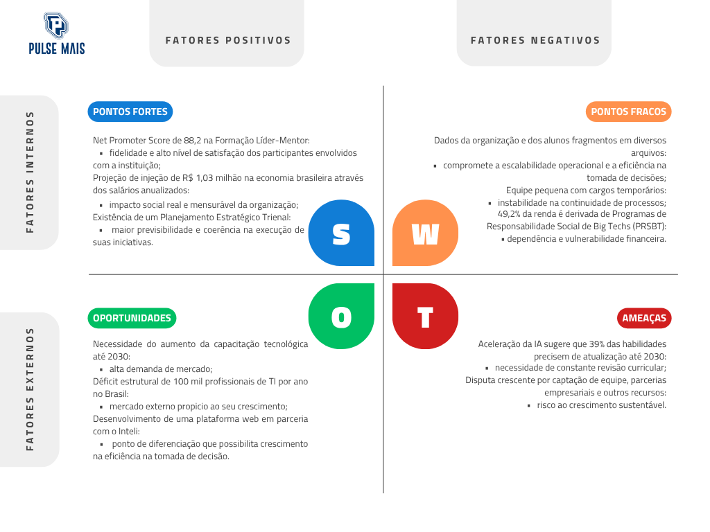
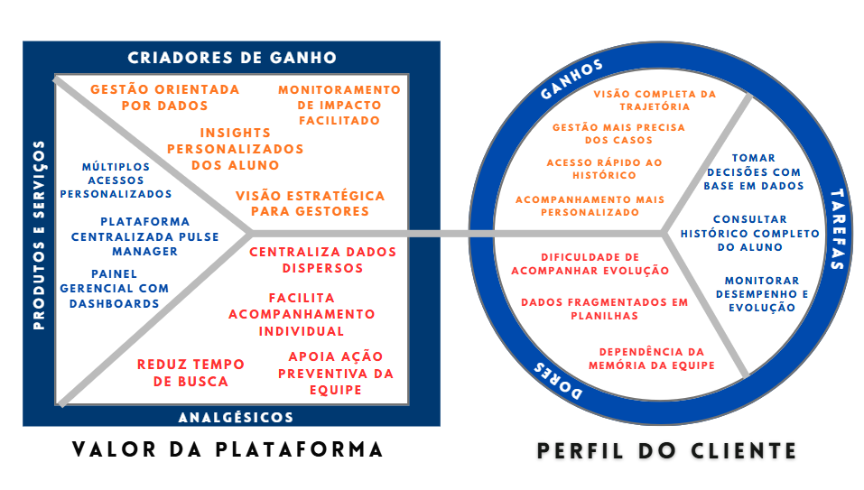
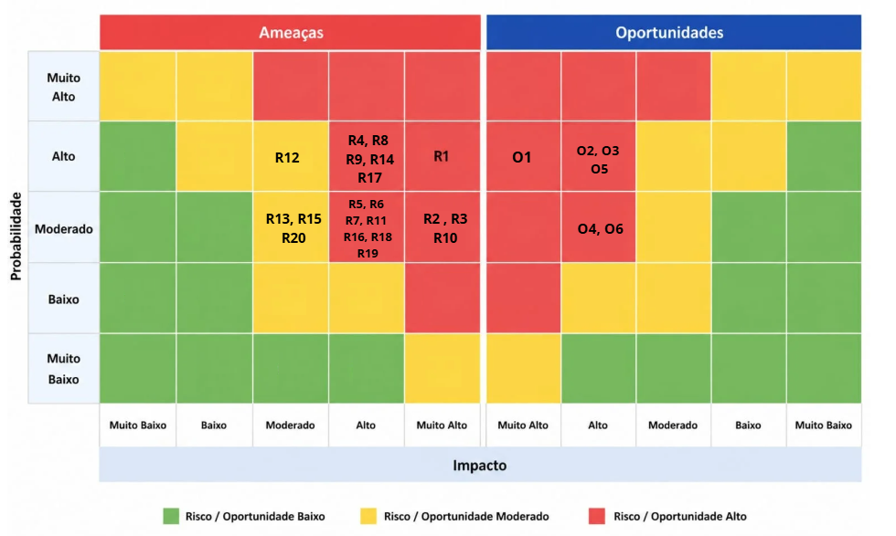
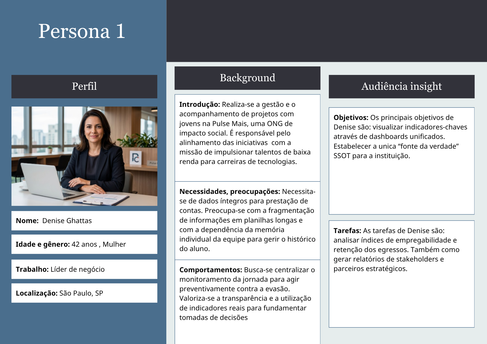
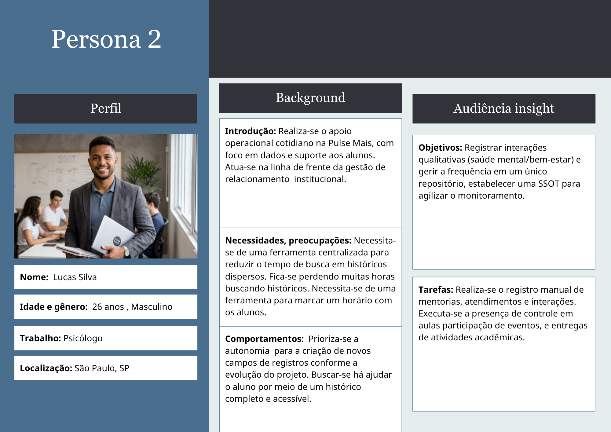
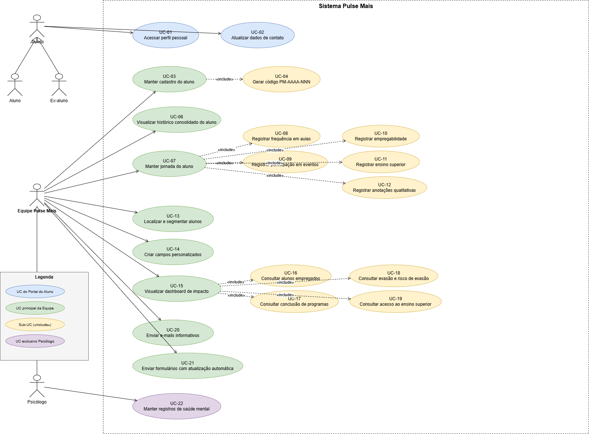
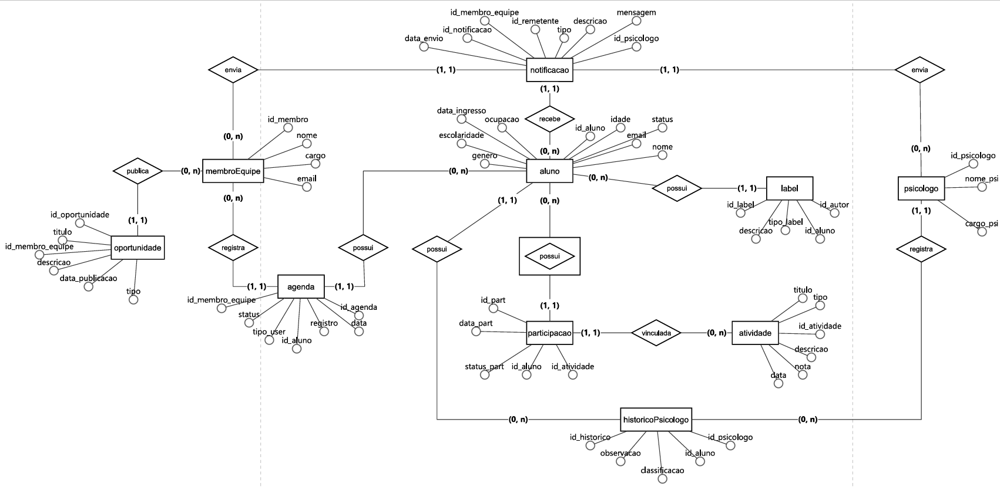

# WAD - Web Application Document - Módulo 2 - Inteli

**_Os trechos em itálico servem apenas como guia para o preenchimento da seção. Por esse motivo, não devem fazer parte da documentação final_**

## Nome do Grupo

#### Nomes dos integrantes do grupo

## Sumário

[1. Introdução](#c1)

[2. Visão Geral da Aplicação Web](#c2)

[3. Projeto Técnico da Aplicação Web](#c3)

[4. Desenvolvimento da Aplicação Web](#c4)

[5. Testes da Aplicação Web](#c5)

[6. Estudo de Mercado e Plano de Marketing](#c6)

[7. Conclusões e trabalhos futuros](#c7)

[8. Referências](#c8)

[Anexos](#c9)

 

# 1. Introdução (sprints 1 a 5)

A Pulse Mais é uma organização sem fins lucrativos voltada à capacitação profissional de jovens que desejam seguir na área de tecnologia. Ao analisar mais profundamente o contexto da organização é identificada uma problemática central em relação à organização operacional: a descentralização dos dados institucionais, divididos em múltiplos arquivos em diferentes formatos, de planilhas à relatórios, e sistemas externos. Essa fragmentação de informações compromete diretamente a eficiência na tomada de decisões da equipe, dificulta o acompanhamento individual dos jovens atingidos e reduz a oportunidade da instituição de explicitar o impacto de forma estruturada em apresentações ao público e parceiros.

A partir desta problemática, o grupo propõe o desenvolvimento de uma plataforma web voltada à organização e gestão dos dados institucionais e dos alunos que possibilita a centralização das informações em um ambiente e o monitoramento dos indicadores empresariais, contribuindo para maior eficiência nos processos desenvolvidos pela equipe.

# 2. Visão Geral da Aplicação Web (sprint 1)

## 2.1. Escopo do Projeto (sprints 1 e 4)

### 2.1.1. Modelo de 5 Forças de Porter (sprint 1)

**Ameaça de novos entrantes - Ameaça Baixa**

A entrada no segmento de ONGs voltadas à capacitação no mercado tecnológico se torna de difícil execução devido aos desafios burocráticos, além da captação de mentores e entidades doadoras. Para além disso, há uma expansão de instituições voltadas ao aprendizado e tecnologia no Brasil, de acordo com a Edtech Report 2024 da Distrito, indo de 197 para 619 entre 2013 e 2024. Apesar disso, a popularização da IA Generativa facilitou a construção de novas ferramentas voltadas ao ensino e capacitação tecnológica de jovens, permitindo a construção rápida de novas ferramentas e menos infraestrutura física; explicitando que, apesar das barreiras, há pontos que tornam a ameaça moderada.

**Ameaça de produtos substitutos - Ameaça Alta**

É identificada uma alta ameaça de produtos substitutos devido ao crescimento da disponibilidade de conteúdos onlines, como cursos gratuitos e vídeos em plataformas como Youtube, além da existência de programas governamentais, como o Pronatec. Para além disso, há também a substituição através de outras organizações que oferecem serviços semelhantes, classificando a ameaça como alta.

**Poder de barganha dos fornecedores - Poder Alto**

Os fornecedores deste segmento são definidos como os mentores e equipe voluntários e empresas parceiras doadoras, que podem exercer grande poder sobre as operações. Para além da existência de dificuldades relacionadas à captação e mantenimento de colaboradores, a equipe também influencia na credibilidade institucional e sua substituição é de alto custo de tempo, ocasionando um alto poder de barganha da parte dos fornecedores.

**Poder de barganha dos clientes - Poder Baixo-Médio**

Os clientes são classificados como os jovens atingidos, que possuem, em muitos casos, acesso limitado a alternativas de capacitação acadêmica em tecnologia. Além disso, há a classificação de 88,2 no NPS (Net Promoter Score) da Formação Líder-Mentor, que indica alta satisfação e baixo poder de negociação individual.

**Rivalidade entre concorrentes - Rivalidade Alta**

No segmento de aprendizado voltado à tecnologia, há uma maior disputa por visibilidade entre outras, financiamento de empresas e captação de talentos. Como exemplo estão instituições como o Códigos do Amanhã, que oferece serviços em nichos semelhantes, além de competir por doadores e ter perfis semelhantes de beneficiários, ocasionando a classificação de alta rivalidade.

### 2.1.2. Análise SWOT da Instituição Parceira (sprint 1)

Figura 1: Análise SWOT. 
 
Fonte: Autoria própria (2026).  

Cada um dos fatores associados à instituição revelam diferentes efeitos na sua participação de mercado. As pontos fortes explicitam a fidelidade dos clientes e fornecedores e o planejamento coerente com os impactos sociais da instituição; já os pontos fracos, a falta de eficiência e a instabilidade na continuidade de processos, além da vulnerabilidade por decisões externas. Há também as oportunidades mapeadas como um cenário de crescimento no mercado e a diferenciação de outros produtos; além das ameaças mostra a necessidade de estratégias para manter a relevância competitiva e consolidar alianças estratégicas.

### 2.1.3. Solução (sprints 1 a 5)

#### 1. Problema a ser resolvido
Verificou-se que a Pulse Mais opera com dados de alunos fragmentados em planilhas e registros dispersos, dificultando a visualização da jornada do jovem. Esse cenário compromete o acompanhamento histórico, a análise de indicadores, a personalização do suporte e a agilidade da tomada de decisão institucional.

#### 2. Dados disponíveis
Foram identificados como insumos o uma planilha de jovens do framework, relatórios CSV da plataforma atual e dados institucionais sobre programas, trilhas, mentoria, empregabilidade, ensino superior e rede de talentos. Também foram considerados critérios de público, jornada do jovem e indicadores estratégicos da organização.

#### 3. Solução proposta
Foi proposta uma aplicação web com WebAPI e banco de dados estruturado para centralizar o histórico acadêmico, institucional e profissional de alunos e ex-alunos. A solução atuará como Single Source of Truth da Pulse Mais, oferecendo visão consolidada para gestores e portal de consulta, atualização e oportunidades para alunos.

#### 4. Forma de utilização da solução
Gestores utilizarão dashboards, filtros e páginas individuais para consultar históricos, acompanhar indicadores e registrar feedbacks. Alunos e ex-alunos acessarão um portal para visualizar dados, atualizar perfis e consultar oportunidades. A solução será desenvolvida com HTML, CSS e JavaScript no front-end, Node.js no back-end e SQLite no banco de dados.

#### 5. Benefícios esperados
Espera-se reduzir a fragmentação de dados e centralizar a jornada dos jovens em uma única plataforma. A solução deverá ampliar a agilidade operacional, melhorar o acompanhamento estratégico, apoiar decisões baseadas em dados e fortalecer a autonomia dos alunos no acesso ao histórico e oportunidades.

#### 6. Critério de sucesso e como será avaliado
O sucesso será avaliado pela centralização dos dados, clareza da visualização histórica, utilidade dos dashboards e efetividade dos fluxos para gestores e alunos. Também serão considerados a aderência ao fluxo operacional da Pulse Mais, a qualidade das funcionalidades entregues e a validação contínua com o parceiro ao longo das sprints.

### 2.1.4. Canvas de Proposta de Valor

Figura 2: Canvas de Proposta de Valor da Pulse Manager

 

Fonte: Autoria própria (2026), com base no Value Proposition Canvas de Strategyzer.  

O Canvas de Proposta de valor da Pulse Mais foi estruturado com base em dois segmentos prioritários da solução: **gestores da instituição** e **alunos/ex-alunos da rede**. Essa definição foi adotada porque a proposta de valor da plataforma depende, ao mesmo tempo, da capacidade institucional de acompanhar a jornada completa dos jovens e da capacidade dos próprios alunos de acessarem seu histórico, manterem seus perfis atualizados e se conectarem a oportunidades. Dessa forma, o canvas foi organizado para evidenciar, de um lado, as tarefas, dores e ganhos desses públicos e, de outro, os elementos da solução que aliviam essas dores e potencializam a geração de valor.

### Perfil do cliente - Gestores da Pulse Mais

#### Tarefas do cliente
Os gestores precisam acompanhar a jornada completa dos jovens desde a entrada na organização até os desdobramentos em formação, mentoria, empregabilidade, ensino superior e rede de talentos. Também precisam localizar rapidamente históricos individuais, monitorar indicadores institucionais, identificar riscos de evasão, segmentar perfis para oportunidades específicas, registrar feedbacks de performance e tomar decisões baseadas em dados consolidados. Essas necessidades são coerentes com o escopo macro, o dashboard, a página do aluno, os filtros avançados e o módulo de registro de jornada previstos no TAPI.

#### Dores
Atualmente, a gestão enfrenta dispersão de informações em planilhas isoladas, dificuldade de reconstrução da trajetória do aluno, baixa rastreabilidade histórica, dependência de memória individual da equipe e esforço manual para consolidação de indicadores. Há também limitação para personalizar o atendimento com base em dados completos e para agir preventivamente diante de sinais de evasão, queda de engajamento ou necessidade de suporte direcionado.

#### Ganhos
Os gestores desejam uma visão única e confiável de cada aluno, dashboards claros, rapidez de consulta, histórico completo em uma só interface, filtros inteligentes, apoio à tomada de decisão e maior precisão na estratégia de acompanhamento e empregabilidade. Desejam ainda reduzir o retrabalho operacional e transformar dados dispersos em inteligência acionável.

### Mapa de valor - Gestores da Pulse Mais

#### Produtos & Serviços
A solução entrega base centralizada de dados, dashboard institucional, página individual do aluno, módulo de registro da jornada, histórico consolidado, filtros avançados, campos estruturados para indicadores de impacto e funcionalidade para inserção de feedbacks e anotações de performance. O modelo institucional também prevê prontuário digital e visão segmentada por perfil de acesso.

#### Aliviadores
A plataforma reduz a fragmentação de informações ao concentrar dados pessoais, acadêmicos, institucionais e profissionais em uma única base. Diminui a dependência de conhecimento informal da equipe ao registrar a trajetória completa do jovem. Reduz o tempo gasto na busca por históricos e melhora o acompanhamento preventivo por meio de visualização integrada e atualização contínua dos dados. Também reduz a dificuldade de monitorar impacto ao substituir consolidações manuais por consultas estruturadas.

#### Criadores de Ganho
A solução cria valor ao transformar dados operacionais em visão estratégica. Os dashboards e históricos completos permitem atendimento mais consultivo, identificação de padrões, acompanhamento longitudinal e maior capacidade de personalização do suporte. Os registros de performance e os insights individualizados ampliam a qualidade da gestão e tornam a tomada de decisão mais rápida, precisa e fundamentada.

## 2.1.5. Matriz de Riscos do Projeto

A Matriz de Riscos do projeto foi elaborada com o objetivo de identificar, classificar e tratar os principais eventos capazes de comprometer a entrega e o valor da aplicação web proposta para a Pulse Mais. Considerando que a solução deverá centralizar dados atualmente dispersos, sustentar o acompanhamento da jornada dos jovens, viabilizar consultas históricas, apoiar dashboards gerenciais e permitir segmentações estratégicas, tornou-se necessário antecipar riscos de natureza técnica, operacional, analítica e institucional.

Figura 4: Matriz de Riscos da Pulse Manager

 

<em>Fonte: Elaborado pela equipe (2026).</em>

A análise foi organizada de modo a preservar coerência com o nível de detalhamento adotado nas demais seções do WAD, contemplando não apenas a identificação dos riscos, mas também sua classificação, criticidade e respectivas estratégias de prevenção, mitigação e contingência.

### Critérios adotados

#### Probabilidade
- **Muito baixa**: ocorrência improvável dentro do contexto do projeto  
- **Baixa**: possibilidade existente, porém pouco recorrente  
- **Moderada**: ocorrência plausível ao longo do desenvolvimento  
- **Alta**: risco provável, com sinais concretos de incidência  
- **Muito alta**: ocorrência fortemente esperada na ausência de controle  

#### Impacto
- **Muito baixo**: afeta elementos periféricos, sem comprometer o objetivo principal  
- **Baixo**: gera retrabalho localizado, com baixo efeito sobre a entrega  
- **Moderado**: compromete parcialmente uma funcionalidade relevante  
- **Alto**: afeta de forma significativa o valor do produto ou sua operação  
- **Muito alto**: compromete diretamente a utilidade, aderência ou viabilidade da solução  

### Tabela síntese de riscos

| ID | Risco | Categoria | Probabilidade | Impacto |
|---|---|---|---|---|
| R1 | Inconsistência na consolidação dos dados legados | Dados | Alta | Muito alto |
| R2 | Modelagem insuficiente para representar toda a jornada do jovem | Negócio / Dados | Moderada | Muito alto |
| R3 | Falta de aderência da solução às necessidades reais da Pulse Mais | Negócio | Moderada | Muito alto |
| R4 | Sobrecarga de escopo para o tempo disponível do módulo | Gestão | Alta | Alto |
| R5 | Dashboard com indicadores pouco úteis para a tomada de decisão | Produto | Moderada | Alto |
| R6 | Dificuldade de visualização do histórico completo do aluno | Usabilidade / Produto | Moderada | Alto |
| R7 | Filtros e segmentações não atenderem às buscas operacionais | Produto / Negócio | Moderada | Alto |
| R8 | Baixa qualidade ou incompletude dos dados alimentados no sistema | Dados / Operação | Alta | Alto |
| R9 | Dependência excessiva de conhecimento informal da equipe | Operação | Alta | Alto |
| R10 | Tratamento inadequado de dados sensíveis ou restritos | Segurança / Conformidade | Moderada | Muito alto |
| R11 | Interpretação equivocada das restrições de autenticação e permissão | Arquitetura / Segurança | Moderada | Alto |
| R12 | Complexidade excessiva na migração inicial de planilhas | Dados / Técnica | Alta | Moderado |
| R13 | Portal do aluno gerar pouco valor percebido | Produto | Moderada | Moderado |
| R14 | Falhas de comunicação entre front-end, back-end e banco | Técnica | Alta | Alto |
| R15 | Desempenho insuficiente em consultas históricas e filtros | Técnica / Produto | Moderada | Moderado |
| R16 | Interface pouco intuitiva para a equipe gestora | Usabilidade | Moderada | Alto |
| R17 | Atualização futura dificultada pela falta de flexibilidade estrutural | Arquitetura | Alta | Alto |
| R18 | Subestimação da complexidade dos feedbacks e registros qualitativos | Negócio / Produto | Moderada | Alto |
| R19 | Falta de rastreabilidade entre requisitos, dados e funcionalidades | Gestão / Engenharia | Moderada | Alto |
| R20 | Adoção limitada da plataforma pela equipe no curto prazo | Operação / Mudança | Moderada | Moderado |

### Detalhamento dos riscos

#### R1 - Inconsistência na consolidação dos dados legados
**Categoria:** Dados  
**Descrição:** Os dados atualmente encontram-se distribuídos em planilhas distintas e registros descentralizados, o que pode provocar duplicidade, lacunas e divergências de preenchimento durante a consolidação da base.  
**Probabilidade:** Alta  
**Impacto:** Muito alto  
**Prevenção / Mitigação:** Definir modelo canônico, padronizar campos e validar amostras antes da carga principal.  
**Plano de contingência / Resposta:** Priorizar cargas parciais, registrar inconsistências e executar saneamento manual dos dados críticos.

#### R2 - Modelagem insuficiente para representar toda a jornada do jovem
**Categoria:** Negócio / Dados  
**Descrição:** Há risco de que a estrutura de dados não represente adequadamente dimensões como formação, mentoria, empregabilidade, ensino superior e histórico longitudinal.  
**Probabilidade:** Moderada  
**Impacto:** Muito alto  
**Prevenção / Mitigação:** Revisar entidades e relações com base no TAPI e validar a modelagem ao longo das sprints.  
**Plano de contingência / Resposta:** Repriorizar a modelagem para os fluxos centrais e manter campos complementares para evolução futura.

#### R3 - Falta de aderência da solução às necessidades reais da Pulse Mais
**Categoria:** Negócio  
**Descrição:** A solução pode apresentar consistência técnica sem, necessariamente, refletir o fluxo operacional e decisório da equipe.  
**Probabilidade:** Moderada  
**Impacto:** Muito alto  
**Prevenção / Mitigação:** Validar backlog, protótipos e fluxos em ciclos frequentes com os pontos focais da instituição.  
**Plano de contingência / Resposta:** Readequar funcionalidades críticas e registrar itens não absorvidos para iterações posteriores.

#### R4 - Sobrecarga de escopo para o tempo disponível do módulo
**Categoria:** Gestão  
**Descrição:** O volume de funcionalidades previstas pode ultrapassar a capacidade de entrega no prazo acadêmico.  
**Probabilidade:** Alta  
**Impacto:** Alto  
**Prevenção / Mitigação:** Definir o MVP logo nas primeiras sprints e limitar o escopo ao núcleo funcional.  
**Plano de contingência / Resposta:** Postergar itens secundários e concentrar esforço nos fluxos prioritários.

#### R5 - Dashboard com indicadores pouco úteis para a tomada de decisão
**Categoria:** Produto  
**Descrição:** Existe o risco de construir dashboards tecnicamente corretos, porém pouco úteis para responder às necessidades concretas da gestão.  
**Probabilidade:** Moderada  
**Impacto:** Alto  
**Prevenção / Mitigação:** Definir previamente quais perguntas o dashboard precisa responder e validar os indicadores com o parceiro.  
**Plano de contingência / Resposta:** Reestruturar os painéis com foco em métricas acionáveis.

#### R6 - Dificuldade de visualização do histórico completo do aluno
**Categoria:** Usabilidade / Produto  
**Descrição:** A página individual do aluno pode se tornar extensa ou pouco legível, dificultando a leitura da trajetória.  
**Probabilidade:** Moderada  
**Impacto:** Alto  
**Prevenção / Mitigação:** Organizar informações por blocos de jornada e aplicar hierarquia visual clara.  
**Plano de contingência / Resposta:** Simplificar a visualização e priorizar resumos por categoria.

#### R7 - Filtros e segmentações não atenderem às buscas operacionais
**Categoria:** Produto / Negócio  
**Descrição:** Os filtros podem não refletir os critérios de busca efetivamente utilizados pela equipe.  
**Probabilidade:** Moderada  
**Impacto:** Alto  
**Prevenção / Mitigação:** Mapear previamente os critérios de segmentação mais recorrentes.  
**Plano de contingência / Resposta:** Repriorizar filtros críticos e postergar segmentações complementares.

#### R8 - Baixa qualidade ou incompletude dos dados alimentados no sistema
**Categoria:** Dados / Operação  
**Descrição:** Mesmo centralizados, os dados podem permanecer incompletos, desatualizados ou inconsistentes, reduzindo o valor analítico da solução.  
**Probabilidade:** Alta  
**Impacto:** Alto  
**Prevenção / Mitigação:** Definir campos obrigatórios, padrões mínimos de preenchimento e validações nas entradas.  
**Plano de contingência / Resposta:** Sinalizar registros incompletos e priorizar saneamento dos campos críticos.

#### R9 - Dependência excessiva de conhecimento informal da equipe
**Categoria:** Operação  
**Descrição:** Parte da lógica institucional pode permanecer implícita, dificultando sua tradução em regras de sistema.  
**Probabilidade:** Alta  
**Impacto:** Alto  
**Prevenção / Mitigação:** Formalizar regras de negócio, critérios de preenchimento e fluxos operacionais.  
**Plano de contingência / Resposta:** Conduzir refinamentos com o parceiro para explicitar regras tácitas.

#### R10 - Tratamento inadequado de dados sensíveis ou restritos
**Categoria:** Segurança / Conformidade  
**Descrição:** O sistema lida com informações pessoais e registros potencialmente sensíveis, exigindo cuidado quanto à exposição e uso.  
**Probabilidade:** Moderada  
**Impacto:** Muito alto  
**Prevenção / Mitigação:** Restringir dados sensíveis, limitar visibilidade por perfil e evitar exposição em ambientes públicos.  
**Plano de contingência / Resposta:** Remover imediatamente dados indevidos e substituí-los por registros fictícios ou mascarados.

#### R11 - Interpretação equivocada das restrições de autenticação e permissão
**Categoria:** Arquitetura / Segurança  
**Descrição:** A simplificação do controle de acesso pode gerar inconsistências entre perfis e permissões.  
**Probabilidade:** Moderada  
**Impacto:** Alto  
**Prevenção / Mitigação:** Definir previamente regras mínimas de autenticação e acesso por perfil.  
**Plano de contingência / Resposta:** Reduzir perfis ativos no MVP e restringir acessos ao mínimo necessário.

#### R12 - Complexidade excessiva na migração inicial de planilhas
**Categoria:** Dados / Técnica  
**Descrição:** A importação inicial pode consumir mais esforço do que o previsto em razão da heterogeneidade dos arquivos.  
**Probabilidade:** Alta  
**Impacto:** Moderado  
**Prevenção / Mitigação:** Trabalhar com recortes de importação e validação progressiva.  
**Plano de contingência / Resposta:** Suspender automações complexas e priorizar cargas essenciais.

#### R13 - Portal do aluno gerar pouco valor percebido
**Categoria:** Produto  
**Descrição:** O portal pode não demonstrar valor suficiente ao estudante se entregar pouca utilidade prática.  
**Probabilidade:** Moderada  
**Impacto:** Moderado  
**Prevenção / Mitigação:** Priorizar histórico, perfil e oportunidades como núcleo do portal.  
**Plano de contingência / Resposta:** Simplificar o fluxo e concentrar a entrega em funcionalidades de valor direto.

#### R14 - Falhas de comunicação entre front-end, back-end e banco
**Categoria:** Técnica  
**Descrição:** Divergências entre interface, API e persistência podem comprometer cadastros, consultas e atualizações.  
**Probabilidade:** Alta  
**Impacto:** Alto  
**Prevenção / Mitigação:** Definir contratos de dados e realizar testes integrados continuamente.  
**Plano de contingência / Resposta:** Corrigir endpoints críticos e estabilizar primeiro o fluxo principal.

#### R15 - Desempenho insuficiente em consultas históricas e filtros
**Categoria:** Técnica / Produto  
**Descrição:** Consultas extensas podem comprometer a fluidez de uso, especialmente em dashboards e históricos.  
**Probabilidade:** Moderada  
**Impacto:** Moderado  
**Prevenção / Mitigação:** Otimizar consultas, modelagem e carregamento de dados.  
**Plano de contingência / Resposta:** Paginar resultados e limitar consultas amplas no MVP.

#### R16 - Interface pouco intuitiva para a equipe gestora
**Categoria:** Usabilidade  
**Descrição:** Uma interface pouco clara pode reduzir a adoção e aumentar o retrabalho operacional.  
**Probabilidade:** Moderada  
**Impacto:** Alto  
**Prevenção / Mitigação:** Validar fluxos com usuários internos e aplicar princípios de usabilidade.  
**Plano de contingência / Resposta:** Redesenhar as telas críticas com foco em clareza funcional.

#### R17 - Atualização futura dificultada pela falta de flexibilidade estrutural
**Categoria:** Arquitetura  
**Descrição:** Uma estrutura rígida pode dificultar futuras expansões e ajustes da plataforma.  
**Probabilidade:** Alta  
**Impacto:** Alto  
**Prevenção / Mitigação:** Modelar com foco em extensibilidade e documentar a estrutura de dados.  
**Plano de contingência / Resposta:** Registrar limitações e prever pontos de expansão para versões futuras.

#### R18 - Subestimação da complexidade dos feedbacks e registros qualitativos
**Categoria:** Negócio / Produto  
**Descrição:** Os registros qualitativos podem demandar maior refinamento estrutural e semântico do que o inicialmente previsto.  
**Probabilidade:** Moderada  
**Impacto:** Alto  
**Prevenção / Mitigação:** Definir tipos, categorias e objetivos dos registros antes da implementação.  
**Plano de contingência / Resposta:** Simplificar o modelo de registro no MVP e documentar expansão futura.

#### R19 - Falta de rastreabilidade entre requisitos, dados e funcionalidades
**Categoria:** Gestão / Engenharia  
**Descrição:** A ausência de vínculo claro entre requisitos, entidades e entregas pode comprometer a consistência do projeto.  
**Probabilidade:** Moderada  
**Impacto:** Alto  
**Prevenção / Mitigação:** Manter rastreabilidade entre problema, requisito, dado e funcionalidade.  
**Plano de contingência / Resposta:** Revisar WAD e backlog antes de cada entrega.

#### R20 - Adoção limitada da plataforma pela equipe no curto prazo
**Categoria:** Operação / Mudança  
**Descrição:** A transição de planilhas para uma plataforma estruturada exige adaptação operacional e mudança de hábito.  
**Probabilidade:** Moderada  
**Impacto:** Moderado  
**Prevenção / Mitigação:** Construir fluxos simples e aderentes à rotina da equipe.  
**Plano de contingência / Resposta:** Concentrar adoção inicial em fluxos críticos e expandir gradualmente.

### Classificação sintética por criticidade

#### Riscos críticos
- R1 - Inconsistência na consolidação dos dados legados  
- R2 - Modelagem insuficiente para representar toda a jornada do jovem  
- R3 - Falta de aderência da solução às necessidades reais da Pulse Mais  
- R4 - Sobrecarga de escopo para o tempo disponível do módulo  
- R10 - Tratamento inadequado de dados sensíveis ou restritos  

#### Riscos relevantes
- R5 - Dashboard com indicadores pouco úteis para a tomada de decisão  
- R6 - Dificuldade de visualização do histórico completo do aluno  
- R7 - Filtros e segmentações não atenderem às buscas operacionais  
- R8 - Baixa qualidade ou incompletude dos dados alimentados no sistema  
- R9 - Dependência excessiva de conhecimento informal da equipe  
- R11 - Interpretação equivocada das restrições de autenticação e permissão  
- R14 - Falhas de comunicação entre front-end, back-end e banco  
- R16 - Interface pouco intuitiva para a equipe gestora  
- R17 - Atualização futura dificultada pela falta de flexibilidade estrutural  
- R18 - Subestimação da complexidade dos feedbacks e registros qualitativos  
- R19 - Falta de rastreabilidade entre requisitos, dados e funcionalidades  

#### Riscos moderados
- R12 - Complexidade excessiva na migração inicial de planilhas  
- R13 - Portal do aluno gerar pouco valor percebido  
- R15 - Desempenho insuficiente em consultas históricas e filtros  
- R20 - Adoção limitada da plataforma pela equipe no curto prazo  

### Oportunidades associadas ao projeto

Além dos riscos, identificaram-se oportunidades relevantes que podem ampliar o valor da solução caso sejam exploradas de forma consistente.

| ID | Oportunidade | Probabilidade | Impacto |
|---|---|---|---|
| O1 | Consolidação da SSOT institucional | Alta | Muito alto |
| O2 | Melhoria da tomada de decisão baseada em dados | Alta | Alto |
| O3 | Personalização do atendimento ao jovem | Alta | Alto |
| O4 | Fortalecimento da empregabilidade e da rede de talentos | Moderada | Alto |
| O5 | Redução de carga operacional da equipe | Alta | Alto |
| O6 | Base para evolução futura da plataforma | Moderada | Alto |

#### O1 - Consolidação da SSOT institucional
**Descrição:** A plataforma pode se consolidar como principal fonte de verdade institucional para histórico, acompanhamento e decisão.  
**Plano de aproveitamento:** Priorizar consistência da base, clareza estrutural e confiabilidade dos dados desde o MVP.

#### O2 - Melhoria da tomada de decisão baseada em dados
**Descrição:** A centralização dos registros pode qualificar decisões e reduzir dependência de interpretações intuitivas.  
**Plano de aproveitamento:** Estruturar dashboards orientados a perguntas concretas da gestão.

#### O3 - Personalização do atendimento ao jovem
**Descrição:** O histórico consolidado permite acompanhamento mais individualizado, consultivo e preventivo.  
**Plano de aproveitamento:** Estruturar páginas individuais com leitura longitudinal e registros relevantes.

#### O4 - Fortalecimento da empregabilidade e da rede de talentos
**Descrição:** Filtros e segmentações podem qualificar o vínculo entre jovens e oportunidades.  
**Plano de aproveitamento:** Priorizar campos e filtros relacionados à empregabilidade e trajetória.

#### O5 - Redução de carga operacional da equipe
**Descrição:** A redução da dependência de planilhas pode liberar tempo para acompanhamento mais estratégico.  
**Plano de aproveitamento:** Priorizar usabilidade, busca rápida e acesso direto ao histórico.

#### O6 - Base para evolução futura da plataforma
**Descrição:** A solução pode servir como base para novos módulos e futuras expansões.  
**Plano de aproveitamento:** Documentar arquitetura, limitações e pontos de expansão desde a primeira versão.

### Síntese analítica

A análise evidencia que os principais pontos de atenção do projeto concentram-se em quatro frentes: consolidação dos dados legados, aderência da modelagem à jornada real dos jovens, controle de escopo frente ao prazo acadêmico e tratamento adequado de informações sensíveis. Esses elementos são decisivos porque sustentam diretamente a utilidade, a confiabilidade e o valor institucional da solução.

Diante disso, conclui-se que a condução mais adequada consiste em priorizar um MVP aderente ao TAPI, concentrado na centralização dos perfis, no registro da jornada, na visualização consolidada do histórico, no dashboard gerencial e no portal básico do aluno. A partir dessa base, a solução tende a reduzir retrabalho operacional, ampliar capacidade analítica e sustentar evoluções futuras com maior consistência.

## 2.2. Personas (sprint 1)

Personas: A persona é definida como uma descrição realista e detalhada do usuário ideal, sendo elaborada com base nos objetivos estratégicos do produto e sustentada por dados reais sobre o comportamento, necessidades e motivações do público-alvo. Nesse caso usamos Proto-Personas (Quando não sustentamos com dados reais.).

Figura 5: Persona 01. 
     

Fonte: Autoria própria (2026).  

Figura 6: Persona 02. 
     
Fonte: Autoria própria (2026).  

Figura 7: Persona 03. 
     
Fonte: Autoria própria (2026).

## 2.3. User Stories (sprints 1 a 5)

User Stories: As User Stories são definidas como descrições de uma funcionalidade, sob a perspectiva do usuário final. Por meio desta técnica, o foco do desenvolvimento é direcionado às necessidades reais dos usuários, em vez das percepções internas da equipe.

Identificação | US01
--- | ---
Persona | Denise Ghattas
User Story | como uma gestora eu busco ter uma visão geral do perfil do aluno de forma prática para avaliá-lo da melhor maneira  
Critério de aceite 1 | CR1:   Dado que a gestora acessa o dashboard, quando ela clica no perfil do aluno, então é exibido os dados do histórico do aluno. 
Critério de aceite 2 | CR2: dado que a gestora acesse a plataforma, quando ela abrir a aba “alunos”, então devem ser exibidos resumos sobre todos os alunos atingidos.
Critérios INVEST | INDEPENDENTE: Pode ser desenvolvida sem depender de outras histórias , utilizando dados pré-existentes no banco.    NEGOCIÁVEL:  O formato de exibição dos dados  no dashboard pode ser ajustado com o parceiro Pulse Mais.    VALIOSA: Resolve a dor real da fragmentação de dados  e da dificuldade em visualizar a jornada do jovem.    ESTIMÁVEL: A equipe técnica consegue estimar  o esforço de criação de uma interface de consulta conectada ao SQLite.    PEQUENA: A implementação de uma tela de consulta básica cabe dentro de uma sprint de desenvolvimento.    TESTÁVEL: Tem como saber que está pronta verificando se os dados do banco aparecem corretamente ao clicar no perfil.

Identificação | US02
--- | ---
Persona | Denise Ghattas
User Story | como uma gestora eu busco uma plataforma que unifique os dados para não perder informação relevante. 
Critério de aceite 1 | CR1: dado que a gestora acesse a plataforma, quando ela abrir a aba de insights, então devem ser exibidos indicadores sobre a performance dos jovens
Critério de aceite 2 | CR2: dado que a gestora acesse a plataforma, quando ela acessar a aba “funcionários”, então devem ser exibidos dados quantitativos sobre os funcionários. 
Critérios INVEST | INDEPENDENTE: A plataforma de unificação pode ser estruturada como o núcleo central do sistema  sem depender de módulos externos de comunicação.    NEGOCIÁVEL: Os indicadores de performance e os dados quantitativos exibidos nas abas de "insights" e "funcionários" podem ser refinados conforme a necessidade estratégica da Denise.    VALIOSA: Resolve o problema da fragmentação de dados em múltiplas planilhas centralizando o prontuário em uma única interface e com a organização do time.    ESTIMÁVEL:  O esforço para consolidar os dados acadêmicos e de jornada em um banco de dados SQLite é mensurável pela equipe de desenvolvimento.    PEQUENA: A criação das abas principais para exibição de indicadores e dados quantitativos está delimitada ao escopo do MVP, sendo coerente  para uma sprint.    TESTÁVEL: É possível validar a conclusão da tarefa ao verificar se os indicadores de performance que são exibidos corretamente na aba de insights ao acessar a plataforma.

Identificação | US03
--- | ---
Persona | Denise Ghattas
User Story | como gestora eu busco filtrar os alunos para aumentar a agilidade de busca de dados de um aluno e agilidade de trabalho. 
Critério de aceite 1 | CR1: Dado que o usuário abre a plataforma, quando ele busca os dados dos alunos, então os dados aparecem integrados em um único sistema. 
Critério de aceite 2 | CR2: Dado que a gestora quer filtrar os alunos por dados específicos (como nota ou faltas), quando ela cria os filtros, então a plataforma organiza os alunos baseado nos filtros selecionados.
Critérios INVEST | INDEPENDENTE: A funcionalidade de unificação dos dados pode ser desenvolvida sem depender diretamente de outras stories    NEGOCIÁVEL:  Os detalhes da integração (quais dados, formato, ferramentas usadas, interface de acesso e filtros) podem ser ajustados conforme as necessidades da equipe.    VALIOSA:  Gera valor claro para a gestora, pois reduz o tempo de busca e aumenta a eficiência na análise dos dados dos alunos.    ESTIMÁVEL:  É possível estimar o esforço com base nas fontes de dados existentes, quantidade de sistemas a integrar e complexidade da estrutura.    PEQUENA: Pode ser dividida em partes menores, como: integração de um sistema por vez ou  criação de um banco central.

Identificação | US04
--- | ---
Persona | Denise Ghattas
User Story | Como gestora, eu quero ter acesso a todos os dados dos alunos, funcionários e ex alunos ,para que eu não dependa mais da minha memória para acessar dados específicos de cada aluno, ex aluno e funcionário.
Critério de aceite 1 | CR1:   Dado que o usuário busca acessar um dado de um aluno, ex aluno ou funcionário, quando ele clica nessa pessoa específica, então o sistema abre uma página com todos os dados dessa pessoa (como nota, presença, função, empregabilidade)
Critério de aceite 2 | CR2: Dado que a gestora quer achar uma pessoa específica, quando ele busca um dado dessa pessoa (como nome e CPF), então o sistema mostra todos os dados dessa pessoa. 

Identificação | US05
--- | ---
Persona | Lucas Silva 
User Story | Como um psicólogo, eu quero mandar notificações para os alunos, para que eu consiga entrar em contato com o aluno para ajudar ele conforme suas necessidades. 
Critério de aceite 1 | CR1: Dado que o psicólogo abre a plataforma, quando ele percebe que um aluno está tendo dificuldades, e clica no perfil do aluno, o sistema envia uma notificação para o aluno mostrando que o psicólogo quer entrar em contato com ele.
Critério de aceite 2 | CR2: Dado que o psicólogo recebe uma notificação de um aluno, quando ele clica no perfil do aluno, o sistema envia uma notificação para o aluno marcando uma conversa entre o aluno e o psicólogo.
Critérios INVEST | INDEPENDENTE: A história deve ser entregue sem depender de outras funcionalidades complexas de comunicação, focando apenas no envio da notificação.    NEGOCIÁVEL:  A história abre espaço para para discussões sobre como a notificação será entregue e o que deve ser mostrado na mensagem automática.    VALIOSA:  Permite a proatividade do psicólogo do suporte ao aluno, garantindo intervenções necessárias através da plataforma.    ESTIMÁVEL: Com os critérios de aceite definidos a equipe consegue avaliar o esforço técnico para implementar o gatilho de ação.    PEQUENA: A história é focada em uma única ação e um gatilho específico, assim evitando a inclusão de sistemas complexos de chat ou agendamento completo nesta fase.    TESTÁVEL: A história é testável verificando se o aluno recebeu a notificação correspondente na interface dele.

Identificação | US06
--- | ---
Persona | Lucas Silva
User Story | Como um psicólogo, eu quero receber notificações dos alunos quando eles tiverem dificuldades, quando o desempenho deles diminuir e quando esse aluno atingir uma porcentagem de faltas alta, para que eu consiga dar o apoio e suporte necessário para esse aluno.
Critério de aceite 1 | CR1: Dado que o psicólogo está com a plataforma aberta, quando ele clicar em notificações, o sistema vai abrir uma sidebar com as notificações que os alunos enviaram para ele.
Critério de aceite 2 | CR2: Dado que o desempenho de um aluno cai ou quando a porcentagem de faltas desse aluno estiver alta, quando o psicólogo abre a plataforma, o sistema envia uma notificação para o psicólogo informando ele das questões desses alunos com dificuldades.

Identificação | US07
--- | ---
Persona | Lucas Silva 
User Story | Como um psicólogo, eu quero visualizar o histórico de notas dos alunos e a porcentagem de faltas dos alunos, para que eu consiga visualizar de forma mais específica o histórico do aluno para conseguir dar o suporte necessário.
Critério de aceite 1 | CR1:  Dado que o psicólogo percebe que um aluno está com dificuldades, quando ele clica no perfil do aluno, o sistema mostra o histórico do aluno.
Critério de aceite 2 | CR2: Dado que o psicólogo acessa a plataforma, quando ele entra na aba de alunos, o sistema mostra todos os alunos com dificuldades (alta porcentagem de faltas ou queda no desempenho) 

Identificação | US08
--- | ---
Persona | André Souza 
User Story | Como um aluno da Pulse Mais, eu quero ter acesso aos meus resultados de maneira simples e com um histórico de notas, para que eu consiga me organizar melhor e ver em quais matérias eu estou tendo mais dificuldades 
Critério de aceite 1 | CR1: Dado que o aluno deseja ver seus resultados, quando ele abre a plataforma e clica em notas, o sistema exibe uma média de todas as notas, e um histórico em ordem cronológica das notas do aluno.
Critério de aceite 2 | CR2: Dado que o aluno quer ver o seu desempenho em uma matéria específica, quando ele clica em notas e seleciona uma matéria específica, o sistema exibe uma média  e um histórico de notas daquela matéria.
Critérios INVEST | INDEPENDENTE:  A história pode ser desenvolvida e entregue sem depender de outras funcionalidades de visualização de perfil ou módulos de secretaria, focando na consulta ao banco de dados.    NEGOCIÁVEL:   Os detalhes da interface e o formato do histórico podem ser discutidos com o time de design e desenvolvimento durante a Sprint.    VALIOSA:  Fornece transparência ao aluno sobre seu desempenho acadêmico, permitindo que ele identifique lacunas de aprendizado e melhore sua organização pessoal.    ESTIMÁVEL:  O esforço técnico é observável, pois envolve a criação de uma consulta para cálculo de média e uma listagem cronológica.    PEQUENA:  A funcionalidade é limitada à visualização de dados existentes, sendo simples o suficiente para ser implementada em poucos dias.    TESTÁVEL:  É possível fazer o teste através de testes automatizados ou manuais, conferindo se a média exibida e a ordem das notas no histórico correspondem aos dados reais do banco.

Identificação | US09
--- | ---
Persona | André Souza 
User Story | Como um aluno da Pulse Mais, eu quero receber notificações dos eventos da Pulse Mais, e ter acesso as minhas faltas, para que eu consiga me organizar melhor e ver de maneira simples o que eu perdi.
Critério de aceite 1 | CR1: Dado que o aluno deseja ver os próximos eventos da Pulse Mais, quando ele acessa a aba calendário, o sistema mostra para o aluno um calendário com todos os eventos da Pulse Mais.
Critério de aceite 2 | CR2: Dado que o aluno tem um evento da Pulse Mais nos próximos dias, quando ele abre a plataforma, o sistema envia uma notificação informando o aluno que o evento irá ocorrer nos próximos dias.
Critérios INVEST | INDEPENDENTE: A funcionalidade de visualização de calendário e notificações podem ser desenvolvidas separadamente do sistema de notas, utilizando apenas a base de dados de cronograma da Pulse Mais.    NEGOCIÁVEL:    Os canais de notificação e o visual do calendário podem ser discutidos e ajustados conforme o feedback dos alunos.    VALIOSA:  Ajuda o aluno a não perder eventos importantes e a manter o controle sobre suas faltas, aumentando o engajamento com as atividades da ONG.    ESTIMÁVEL:  Como os eventos e as faltas já constam no banco de dados, o esforço para exibir essas informações em uma interface de calendário e configurar alertas automáticos é compreendido pela equipe.    PEQUENA:   A história foca em uma interface de visualização e um gatilho (sino) de lembrete simples, sendo possível de completar dentro de uma única sprint.    TESTÁVEL:  É possível testar criando um evento fictício no banco e verificando se o calendário o exibe corretamente e se o sistema dispara a notificação no tempo previsto.

Identificação | US10
--- | ---
Persona | André Souza 
User Story | Como aluno da Pulse Mais, eu quero entrar em contato com os psicólogos quando estiver com dificuldades, para que eu consiga receber ajuda de um profissional.
Critério de aceite 1 | CR1: Dado que o aluno está tendo dificuldades, quando ele clica em ajuda, o sistema envia uma notificação para um dos psicólogos da Pulse Mais. 
Critério de aceite 2 | CR2: Dado que o aluno entrou em contacto com o psicólogo, quando ele clicar em marcar conversa, o sistema exibe uma agenda do psicólogo, possibilitando o aluno a marcar uma conversa com um profissional.

# 3. Projeto da Aplicação Web (sprints 1 a 5)

## 3.1. Requisitos do Sistema (sprints 1 a 5)

Esta seção formaliza o que o sistema deve fazer, sob quais regras de negócio deve operar e com quais atributos de qualidade deve atender. O conteúdo aqui apresentado é um documento vivo: a cada sprint, do levantamento inicial à entrega final, os requisitos serão revisados, adicionados, refinados ou reclassificados conforme as conversas com o parceiro Pulse Mais avançam e o entendimento técnico da solução amadurece. Mudanças de prioridade, status e escopo são esperadas e documentadas nesta própria seção ao longo do projeto.

A seção está dividida em três blocos complementares: os Requisitos Funcionais (RF), que descrevem o que o sistema deve fazer do ponto de vista do usuário; as Regras de Negócio (RN), que formalizam as políticas e restrições impostas pela Pulse Mais que moldam a lógica do software; e os Requisitos Não Funcionais (RNF), que definem os atributos de qualidade que o sistema deve apresentar, organizados pelos eixos da norma ISO/IEC 25010.

Cada requisito recebe um identificador único e estável (RF001, RN001, RNF001…) que é preservado mesmo quando o requisito é alterado ou refinado. Essa numeração é a base da rastreabilidade entre o levantamento inicial, o backlog do produto, os artefatos de design (casos de uso, modelagem do banco de dados, telas), os commits do repositório e os casos de teste. Alterações relevantes são registradas pelo versionamento do próprio WAD, mantendo o histórico auditável ao longo das cinco sprints do projeto.

### 3.1.1. Requisitos Funcionais (sprint 1, refinar até sprint 5)

Os requisitos funcionais a seguir foram extraídos do Termo de Abertura do Projeto Inteli (TAPI) da Pulse Mais e refinados a partir das conversas iniciais com os pontos focais do parceiro. A priorização (Alta, Média, Baixa) reflete o entendimento de que o núcleo da solução é a gestão centralizada da jornada do aluno pela equipe interna da Pulse Mais, sendo que funcionalidades voltadas ao aluno final ou a integrações e automações periféricas aparecem como prioridade secundária.

| ID | Descrição | Prioridade | Status |
|----|-----------|------------|--------|
| RF001 | O sistema deve permitir o cadastro de alunos e ex-alunos com dados pessoais, acadêmicos, de jornada na Pulse Mais, empregabilidade e engajamento. | Alta | Planejado |
| RF002 | O sistema deve permitir a edição e atualização dos dados cadastrais de um aluno pela equipe Pulse Mais. | Alta | Planejado |
| RF003 | O sistema deve permitir a consulta e listagem dos alunos cadastrados. | Alta | Planejado |
| RF004 | O sistema deve consolidar e apresentar o histórico completo de cada aluno (dados gerais, programas, eventos, empregabilidade e renda) de forma integrada. | Alta | Planejado |
| RF005 | O sistema deve permitir o registro de frequência dos alunos em aulas. | Alta | Planejado |
| RF006 | O sistema deve permitir o registro de participação dos alunos em eventos promovidos pela Pulse Mais. | Alta | Planejado |
| RF007 | O sistema deve permitir o registro de indicadores de empregabilidade do aluno (conquista e retenção de emprego). | Alta | Planejado |
| RF008 | O sistema deve permitir o registro de informações sobre o acesso e permanência do aluno no ensino superior. | Alta | Planejado |
| RF009 | O sistema deve permitir o registro de anotações qualitativas e quantitativas sobre a evolução de cada jovem (mentorias, atendimentos e observações gerais). | Alta | Planejado |
| RF010 | O sistema deve permitir o registro de observações sobre saúde mental e bem-estar do aluno, com acesso restrito ao psicólogo da instituição. | Alta | Planejado |
| RF011 | O sistema deve restringir o acesso às funcionalidades de acordo com o perfil do usuário (ex.: equipe Pulse, psicólogo, aluno). | Alta | Planejado |
| RF012 | O sistema deve permitir a localização e segmentação de alunos com base em múltiplos critérios combinados (ex.: identificação de perfis para oportunidades específicas ou de multiplicadores na rede). | Alta | Planejado |
| RF013 | O sistema deve permitir que a equipe Pulse Mais crie novos campos personalizados no cadastro do aluno, com autonomia. | Alta | Planejado |
| RF014 | O sistema deve apresentar um dashboard consolidando os principais indicadores de impacto da Pulse Mais. | Alta | Planejado |
| RF015 | O sistema deve calcular e apresentar o total de alunos empregados em um período selecionado. | Alta | Planejado |
| RF016 | O sistema deve calcular e apresentar o total de alunos que concluíram um programa em um período selecionado. | Alta | Planejado |
| RF017 | O sistema deve calcular e apresentar indicadores de evasão e risco de evasão por programa ou turma. | Alta | Planejado |
| RF018 | O sistema deve calcular e apresentar indicadores de acesso ao ensino superior dentro da rede de alunos. | Alta | Planejado |
| RF019 | O sistema deve disponibilizar um portal restrito no qual o próprio aluno possa visualizar seus dados cadastrais. | Média | Planejado |
| RF020 | O sistema deve permitir que o aluno atualize informações do seu perfil pelo portal do aluno. | Média | Planejado |
| RF021 | O sistema deve permitir o envio de e-mails informativos e convites para eventos. | Média | Planejado |
| RF022 | O sistema deve permitir o envio de formulários cujas respostas atualizem ou adicionem automaticamente as informações dos alunos. | Baixa | Planejado |

### 3.1.2. Regras de Negócio (sprint 1, refinar até sprint 5)

As regras de negócio formalizam as políticas, condições e restrições que a Pulse Mais impõe ao funcionamento do sistema e que orientam a lógica de implementação dos requisitos funcionais. Diferentemente dos RFs, que descrevem comportamentos do sistema, as RNs descrevem decisões da organização que esses comportamentos devem respeitar. Cada RN está associada a um ou mais RFs, garantindo a rastreabilidade entre política institucional e funcionalidade implementada.

A primeira versão a seguir consolida as regras já levantadas com o parceiro durante o coffee break inicial e a leitura do TAPI. Itens marcados como *A definir* dependem de aprofundamento em conversas futuras com a Pulse Mais e serão refinados nas próximas sprints.

| ID | Descrição | RF Associado |
|----|-----------|--------------|
| RN001 | Todo aluno cadastrado deve receber um código identificador interno único, imutável e gerado automaticamente pelo sistema no momento do cadastro. O código segue o formato `PM-AAAA-NNN`, em que `PM` é prefixo fixo da Pulse Mais, `AAAA` é o ano em que o aluno foi cadastrado (4 dígitos) e `NNN` é um número sequencial daquele ano (3 dígitos, com reinício a cada novo ano). Exemplos: `PM-2024-001` representa o primeiro aluno cadastrado em 2024, `PM-2024-002` o segundo, e `PM-2025-001` o primeiro de 2025. Esse código é usado como chave estável de identificação do aluno em todo o sistema, substituindo o uso de e-mail ou nome (que são instáveis) para fins de cruzamento de dados. O código nunca é reutilizado, mesmo após inativação do aluno, e é mantido caso o aluno retorne para um novo programa. | RF001 |
| RN002 | O cadastro de um aluno só pode ser efetivado se forem informados, no mínimo, nome completo e e-mail. O CPF é opcional, mas seu preenchimento deve ser incentivado pela interface; quando ausente, o sistema pode solicitar uma justificativa textual. | RF001 |
| RN003 | Quando um aluno se vincula a um novo programa após já ter sido cadastrado anteriormente, o sistema deve recuperar o cadastro existente (mesmo `PM-AAAA-NNN`) e adicionar o novo vínculo ao histórico, sem criar duplicidade de cadastro. | RF001, RF002 |
| RN004 | Um aluno pode estar vinculado a múltiplos programas ao longo do tempo. Todo histórico de programas anteriores deve ser preservado e visível no cadastro do aluno, mesmo após o término. | RF004 |
| RN005 | O status "ex-aluno" é atribuído automaticamente ao término do programa em que o aluno está vinculado. Caso o ex-aluno se vincule a um novo programa, o status retorna a "aluno ativo" e seu progresso volta a ser computado, mantendo o histórico anterior. | RF001, RF002 |
| RN006 | O aluno possui uma categoria que reflete seu estágio na jornada Pulse Mais (ex.: conectado, capacitado, empregado, ex-aluno). A nomenclatura final, os critérios de transição entre categorias e suas regras de cálculo serão definidos em conjunto com o parceiro. *(A definir)* | RF001, RF014 |
| RN007 | O risco de evasão de um aluno deve ser calculado por uma fórmula composta que combina variáveis como frequência em aulas, notas, participação em eventos e engajamento geral, gerando um score que classifica o aluno em níveis de risco (ex.: baixo, médio, alto). A definição da fórmula, dos limiares de classificação e do peso de cada variável será refinada ao longo das sprints conforme a base de dados amadurece. *(A definir)* | RF017 |
| RN008 | Para fins do dashboard, considera-se "aluno empregado" aquele que possui registro de trabalho, formal ou informal. A interface deve incentivar o registro do tipo de vínculo, priorizando o trabalho formalizado, mas sem excluir vínculos informais da contabilização. | RF007, RF015 |
| RN009 | Os indicadores do dashboard apresentam, por padrão, dados referentes ao módulo e à turma em andamento no momento da consulta. Critérios adicionais (período, programa, turma específica) podem ser aplicados pelo usuário. | RF014, RF015, RF016, RF017, RF018 |
| RN010 | A exclusão definitiva de um aluno do sistema não é permitida. Quando a equipe Pulse Mais encerra o vínculo com um aluno, o registro é marcado como inativo, preservando todos os dados históricos para fins de análise de impacto e continuidade de coleta longitudinal. | RF001, RF002 |
| RN011 | Toda a equipe interna da Pulse Mais (gestão, administrativo, relacionamento institucional, operações, coordenação de mentores e psicólogos) tem permissão para editar dados cadastrais gerais dos alunos, eliminando a dependência atual de uma única pessoa para alterações como troca de e-mail. | RF002, RF011 |
| RN012 | Registros relacionados à saúde mental e bem-estar do aluno só podem ser criados, editados ou visualizados por usuários com perfil de psicólogo. Demais perfis da equipe Pulse Mais não devem ter acesso a esse tipo de informação, em qualquer tela ou consulta do sistema. | RF010, RF011 |
| RN013 | Pelo portal do aluno, o próprio jovem pode atualizar apenas informações de contato comuns (ex.: telefone e e-mail). Dados como vínculo a programas, situação de empregabilidade, notas, frequência e observações da equipe não podem ser editados pelo aluno. | RF019, RF020 |
| RN014 | Atualizações realizadas pelo próprio aluno via portal devem ser identificáveis no sistema (ex.: data e origem da alteração), permitindo que a equipe Pulse distinga dados informados pelo aluno de dados inseridos pela equipe. | RF020 |
| RN015 | A criação de novos campos personalizados no cadastro do aluno é permitida apenas a usuários com perfil de gestão ou psicólogo, configurando-se como uma autonomia exclusiva da equipe interna da Pulse Mais. | RF013, RF011 |
| RN016 | Mentores voluntários não são usuários do sistema na versão atual da plataforma. Suas atividades, quando relevantes para o histórico do aluno, são registradas pela equipe interna da Pulse Mais. | RF009, RF011 |
| RN017 | Em conformidade com a Lei Geral de Proteção de Dados (LGPD) e com o termo de uso de dados assinado pelos alunos, dados pessoais e relatos qualitativos sensíveis não podem ser expostos a perfis sem autorização específica, nem incluídos em exportações, logs públicos ou commits do repositório de código. | RF001, RF010, RF011 |

### 3.1.3. Requisitos Não Funcionais — 8 Eixos ISO/IEC 25010 (sprints 1 a 5)

Os requisitos não funcionais descrevem características de qualidade que o sistema deve apresentar, complementando os requisitos funcionais ao definir não o que o sistema faz, mas como ele se comporta. Esta seção é estruturada conforme os oito eixos de qualidade definidos pela norma ISO/IEC 25010, modelo internacionalmente reconhecido para avaliação da qualidade de produtos de software.

A tabela abaixo apresenta a primeira versão dos RNFs do projeto (sprint 1), com critérios e métricas iniciais que serão refinados ao longo das próximas sprints. O contexto considerado é o de um MVP acadêmico desenvolvido em parceria com a Pulse Mais, executado em ambiente de homologação e não destinado a produção crítica antes de auditoria de segurança, conforme explicitado pelo TAPI. As métricas, portanto, refletem expectativas razoáveis para esse contexto e devem evoluir do conceitual (sprint 1) ao técnico mensurável (sprint 5).

A coluna "Requisito" descreve o atributo de qualidade esperado em linguagem de negócio. A coluna "Métrica / Critério" define como esse atributo é medido ou verificado de forma objetiva. A coluna "Como atendido" indica as decisões técnicas e práticas que sustentam o atendimento ao requisito.

| Eixo | Requisito | Métrica / Critério | Como atendido |
|------|-----------|--------------------|----|
| USAB: Usabilidade | A interface da equipe e do portal do aluno deve ser responsiva, funcionando adequadamente em dispositivos mobile, tablet e desktop, dado que parte da equipe Pulse Mais utiliza desktop e a maior parte dos jovens (idade média 22 anos) acessa preferencialmente pelo celular. | Layout funcional e legível em viewports de 320px a 1920px de largura, sem rolagem horizontal indesejada, com elementos interativos com área de toque mínima de 44×44 px. | CSS responsivo com media queries; testes manuais nos breakpoints de mobile, tablet e desktop. |
| USAB: Usabilidade | A interface deve adotar boas práticas de acessibilidade inspiradas na WCAG 2.1 nível AA, com foco em contraste de cores e suporte a daltonismo. | Contraste mínimo de 4.5:1 para textos e 3:1 para elementos gráficos; informações de status nunca transmitidas exclusivamente por cor; pontuação mínima de 90 na categoria Accessibility do Google Lighthouse nas principais telas. | Paleta validada por ferramenta de contraste (ex.: WebAIM Contrast Checker); ícones e rótulos textuais associados a indicadores coloridos; auditoria via Lighthouse executada nas revisões de sprint. |
| USAB: Usabilidade | A interface deve apresentar curva de aprendizado curta para usuários da equipe Pulse Mais. | Um novo usuário da equipe deve conseguir realizar o cadastro completo de um aluno em até 5 minutos sem treinamento formal, apoiado apenas pelos rótulos e dicas da própria interface. | Padrões visuais consistentes em todas as telas; rótulos claros em português; mensagens de erro orientadas à ação corretiva. |
| CONF: Confiabilidade | O sistema deve utilizar identificador interno estável para cada aluno, independente de e-mail, CPF ou nome, resolvendo a dor atual de quebra de cruzamento de dados quando o aluno troca de e-mail. | Todo aluno cadastrado recebe um código no formato `PM-AAAA-NNN`, único, imutável e gerado automaticamente; relacionamentos internos do sistema não dependem de e-mail ou nome. | Chave primária artificial na tabela de alunos; campo `codigo_pulse` único; constraints de integridade referencial no SQLite. |
| CONF: Confiabilidade | O sistema deve preservar a integridade dos dados em caso de falha durante uma operação de escrita, evitando registros parciais ou inconsistentes. | Operações que envolvem múltiplas tabelas devem ser atômicas: ou completam por inteiro ou são desfeitas integralmente. | Uso de transações do SQLite com `BEGIN`/`COMMIT`/`ROLLBACK` via biblioteca do Node.js; testes manuais simulando falha durante escrita. |
| DES: Desempenho | A listagem de alunos com critérios aplicados deve responder rapidamente, mesmo com o crescimento da base prevista (aprox. 600 alunos hoje, projeção de até 2000 ao longo dos próximos anos). | Tempo de resposta p95 < 2 segundos para listagem com até 2000 registros; p95 < 3 segundos para o dashboard agregado com os quatro indicadores principais. | Índices nas colunas mais consultadas (ano, programa, categoria); queries SQL otimizadas; medição via testes de carga simples na sprint 5. |
| DES: Desempenho | A consulta ao histórico consolidado de um aluno deve carregar em tempo aceitável para uso diário pela equipe. | Tempo de resposta p95 < 1.5 segundos para abertura do histórico completo de um aluno; pontuação mínima de 80 na categoria Performance do Google Lighthouse nas principais telas. | Consultas pré-otimizadas; agregações feitas no servidor; payload JSON enxuto entre back-end e front-end; auditoria via Lighthouse executada nas revisões de sprint. |
| SUP: Suportabilidade | O código-fonte deve seguir um padrão arquitetural claro, com separação de responsabilidades entre apresentação, lógica de aplicação e persistência. | Cada camada do sistema deve ter responsabilidade única e bem delimitada; nenhuma lógica de acesso a dados deve estar misturada com a camada de apresentação. | Adoção do padrão MVC com diretórios `views/`, `controllers/` e `models/`; revisões de pull request validando a separação; consultas SQL restritas à camada de Model. |
| SUP: Suportabilidade | O sistema deve ser facilmente analisável, permitindo que um novo desenvolvedor ou docente entenda e contribua com o código. | Um novo colaborador deve conseguir realizar o setup local em até 10 minutos a partir da documentação; trechos de lógica não trivial devem estar comentados; nomenclatura consistente. | README com passo a passo de instalação; revisão por pares; aderência ao guia de estilo do módulo. |
| SEG: Segurança | O acesso às funcionalidades sensíveis deve ser controlado por níveis de permissão simples, sem autenticação formal (login/senha), conforme restrição do TAPI. As observações de saúde mental devem ser visíveis apenas para usuários com perfil de psicólogo. | Usuários sem o perfil adequado não devem conseguir acessar dados de saúde mental por nenhum caminho do sistema, incluindo tentativas de acesso direto. | Middleware de verificação de perfil no Express; rotas protegidas por papel; testes de bloqueio em cada perfil. |
| SEG: Segurança | Dados pessoais e relatos qualitativos sensíveis dos jovens, em conformidade com a LGPD e com o "Conteúdo Restrito" definido no TAPI, não devem ser expostos publicamente nem incluídos em commits do repositório público. | Nenhum dado pessoal real presente no repositório; uso obrigatório de massa de dados fictícia para desenvolvimento e demonstração. | Banco real e dumps incluídos no `.gitignore`; arquivo de seeds com dados fictícios; revisão manual de segredos antes de cada commit. |
| CAP: Capacidade | O sistema deve suportar a carga prevista de uso pela equipe Pulse Mais e o volume estimado de alunos cadastrados. | Suporte a, no mínimo, 15 usuários simultâneos da equipe (margem confortável sobre os 7 colaboradores internos atuais); base de dados projetada para crescer até 2000 alunos cadastrados sem degradação perceptível. | Banco SQLite com índices nas colunas críticas; arquitetura preparada para migração futura a outro SGBD caso o volume cresça além do previsto. |
| CAP: Capacidade | O portal do aluno deve suportar acessos eventuais distribuídos ao longo do dia, sem necessidade de alta concorrência. | Suporte a, no mínimo, 30 acessos simultâneos no portal do aluno sem degradação superior a 20% no tempo de resposta. | Arquitetura stateless do back-end Node.js; consultas leves na rota pública do aluno. |
| REST: Restrições de Design | Stack tecnológica obrigatória definida pelo Inteli e pelo TAPI: front-end em HTML, CSS e JavaScript; back-end em Node.js; banco de dados SQLite. | O front-end deve ser construído sem o uso de frameworks SPA (Single Page Application), como React, Vue, Angular ou similares; o back-end deve permanecer em Node.js e a persistência em SQLite. | Verificação no `package.json` e na estrutura do projeto durante revisões de sprint; validação arquitetural com docente orientador. |
| REST: Restrições de Design | Não haverá sistema de autenticação tradicional (login/senha), nem integração em tempo real com APIs externas (ex.: WhatsApp, Google), conforme TAPI. | Ausência de fluxos de cadastro de senha, recuperação de senha, OAuth ou tokens externos; ausência de chamadas a Web APIs externas em runtime. | Definido na arquitetura inicial; validado em revisão arquitetural com docente orientador. |
| REST: Restrições de Design | A comunicação entre aluno e equipe (mentor, psicólogo) deve ocorrer fora da plataforma; o sistema apenas registra histórico de interações, não implementa chat em tempo real. | Nenhum componente de chat ou comunicação em tempo real implementado; comunicação representada apenas por registros estruturados (mensagens, formulários, anotações). | Decisão arquitetural documentada; escopo do MVP alinhado com o parceiro. |
| ORG: Organizacionais | O projeto deve aderir ao processo Scrum adotado pelo Inteli, com entregas incrementais a cada sprint e este documento (WAD) atualizado ao final de cada uma delas. | Cinco sprints planejadas; histórico de alterações do WAD versionado; backlog mantido em ferramenta visível ao parceiro e ao corpo docente. | Repositório no GitHub; reuniões de revisão a cada sprint com o parceiro; commits de atualização do WAD. |
| ORG: Organizacionais | O repositório do projeto deve ser público (conforme prática do Inteli), respeitando a lista de "Conteúdo Restrito" do TAPI: não devem ser commitados nomes, e-mails ou outros dados pessoais reais dos jovens, nem relatos qualitativos individuais de bem-estar. | Nenhum dado pessoal real presente no repositório; apenas massa fictícia e exemplos genéricos em documentação. | Arquivo de exclusões do versionamento configurado; checklist de revisão antes de cada push relevante; uso de seeds com dados fictícios. |
| ORG: Organizacionais | A interface, mensagens, rótulos e documentação principal devem ser produzidas em português brasileiro, idioma da equipe Pulse Mais e dos alunos. | 100% das telas, mensagens de erro e textos visíveis ao usuário em pt-BR. | Validação visual nas revisões de sprint. |

A próxima evolução desta seção (sprints 2 a 5) deve incluir o refinamento das métricas a partir de medições reais, a inclusão de novos RNFs descobertos durante o desenvolvimento e a transição dos status dos requisitos de "Planejado" para "Implementado" conforme a entrega avança.

### 3.1.4. Matriz RF → RN → Endpoint (sprints 3 a 5)

*Matriz de cobertura mostrando quais RN e endpoints implementam cada RF.*

| RF    | RN associadas | Endpoint    | Método |
|-------|---------------|-------------|--------|
| RF001 | RN01, RN02    | `/usuarios` | POST   |

## 3.2. Arquitetura (sprints 1 a 5)

### 3.2.1. Diagrama de Arquitetura (sprints 3 e 4)

*Posicione aqui o diagrama de arquitetura da solução, indicando as camadas principais (Controller, Service, Repository, Model) e suas responsabilidades. Atualize sempre que necessário.*

### 3.2.2. Diagrama de Casos de Uso (sprint 1)

Figura 8: Diagrama Casos de Uso. 
 
Fonte: Autoria própria (2026).  

### 3.2.3. Diagrama de Classes do Domínio (sprint 2)

*Diagrama UML de classes com entidades, atributos, relacionamentos e responsabilidades. Diferencie **associação**, **agregação** (losango vazio), **composição** (losango cheio) e **herança** (triângulo vazio). Multiplicidade explícita em toda associação.*

### 3.2.4. Diagrama de Sequência UML (sprint 3)

*Ao menos um fluxo prioritário, mostrando a interação entre as camadas Controller → Service → Repository → Banco. Linhas de vida verticais, ativação correta, mensagens síncronas e assíncronas diferenciadas, retornos tracejados.*

### 3.2.5. Diagrama de Atividades ou Estados (sprint 3)

*Ao menos um fluxo relevante em UML ou BPMN. Use a notação da ferramenta escolhida de forma consistente (sem misturar convenções).*

### 3.2.6. Diagrama de Implantação (sprints 4 e 5)

*Diagrama UML de deployment mostrando nós físicos, artefatos e canais de comunicação. Representa a visão Engineering + Technology do RM-ODP.*

### 3.2.7. Padrões de Projeto Aplicados (sprints 3 a 5)

*Documente os design patterns utilizados (Repository, Strategy, Factory, DTO etc.) e quais princípios SOLID se aplicam. Justifique a adoção de cada padrão com base em uma necessidade real do projeto.*

## 3.3. Wireframes (sprint 2)

*Posicione aqui as imagens do wireframe construído para sua solução e, opcionalmente, o link para acesso (mantenha o link sempre público para visualização)*

## 3.4. Guia de estilos (sprint 3)

*Descreva aqui orientações gerais para o leitor sobre como utilizar os componentes do guia de estilos de sua solução*

### 3.4.1 Cores

*Apresente aqui a paleta de cores, com seus códigos de aplicação e suas respectivas funções*

### 3.4.2 Tipografia

*Apresente aqui a tipografia da solução, com famílias de fontes e suas respectivas funções*

### 3.4.3 Iconografia e imagens 

*(esta subseção é opcional, caso não existam ícones e imagens, apague esta subseção)*

*posicione aqui imagens e textos contendo exemplos padronizados de ícones e imagens, com seus respectivos atributos de aplicação, utilizadas na solução*

## 3.5 Protótipo de alta fidelidade (sprint 3)

*posicione aqui algumas imagens demonstrativas de seu protótipo de alta fidelidade e o link para acesso ao protótipo completo (mantenha o link sempre público para visualização)*

## 3.6. Modelagem do banco de dados (sprints 2 e 4)

### 3.6.1. Modelo Entidade-Relacionamento (ER) (sprint 2)

Um diagrama de Modelo Entidade-Relacionamento (MER) é uma representação visual da estrutura lógica de um banco de dados que descreve como os dados de um sistema estão organizados e se relacionam entre si. Ele é composto por três elementos fundamentais: Entidades, que representam os objetos ou conceitos do mundo real sobre os quais se deseja armazenar informações, como usuários, produtos ou pedidos; Atributos, que são as características ou propriedades que descrevem cada entidade, como nome, data de nascimento ou preço; e Relacionamentos, que expressam as associações existentes entre as entidades, podendo ser do tipo um-para-um, um-para-muitos ou muitos-para-muitos. Esse tipo de diagrama é amplamente utilizado na fase de modelagem de dados de um projeto, pois permite visualizar de forma clara e estruturada como as informações se conectam, facilitando o planejamento do banco de dados, a comunicação entre a equipe de desenvolvimento e a posterior implementação das tabelas e relações em um sistema gerenciador de banco de dados. 

A partir destes conceitos e utilizando como base o TAPI e outros materiais disponibilizados pelos pelo parceiro, foram mapeadas as entidades que serão a base para o desenvolvimento de novas funcionalidades do projeto, além de seus atributos, importantes para o funcionamento adequado das funcionalidades. Essas entidades e atributos estão explicitados na seguinte imagem:

Figura 9: Modelo conceitual Entidade-Relacionamento utilizando Chen. 
 
Fonte: Autoria própria (2026).  

Dentro do modelo conceitual, estão explicitadas as relações entre as entidades, sendo estas:

##### `Membro da Equipe`

- Publica zero ou várias `oportunidades` (0, n), onde cada uma pode ser enviada por apenas um membro da equipe (1, 1);
- Registra zero ou várias `agendas` (0, n), onde cada uma pode ser registrada por apenas um membro da equipe (1, 1);
- Envia zero ou várias `notificações` (0, n), onde cada uma pode ser enviada por apenas um remetente, este que pode ser membro da equipe ou psicólogo (1, 1).

##### `Aluno`

- Acessa zero ou várias `agendas` (0, n), onde cada agenda é acessada por um aluno (1, 1);
- Possui uma ou várias `labels` atribuídas (1, n), onde cada uma pode ser atribuída à zero ou vários alunos (0, n);
- Recebe zero ou várias `notificações` (0, n), que podem ser recebidas por um ou vários alunos (1, n);
- Possui zero ou várias `participações` (0, n), onde cada uma pertence à apenas um aluno (1, 1) e está vinculada a zero ou várias `atividades` (0, n);
- Possui zero ou vários `registros` psicológicos (0, n), onde cada um pertence à apenas um aluno (1, 1).

##### `Psicólogo`

- Registra zero ou vários `registros` psicológicos (0, n), os quais podem ser registrados por apenas um psicólogo (1, 1);
- Gerencia zero ou várias `labels` (0, n), onde cada uma pode ser gerenciada por apenas um psicólogo (1, 1);
- Envia zero ou várias `notificações` (0, n), onde cada uma pode ser enviada por apenas um remetente, este que pode ser membro da equipe ou psicólogo (1, 1).

Além disso, as entidades aplicadas foram elaboradas a partir da análise das Regras de Negócio anteriormente desenvolvidas, foram definidas as seguintes relações: 

| Entidade principal | Relacionamento com | RNs associadas | Justificativa |
|-------------|------------|---------------|-------------|
| Membro da Equipe | Publicação de oportunidades | RN008, RN011 | Pois a interface incentiva o registro de vínculos de trabalho (formal/informal) e a publicação de oportunidades é ação exclusiva da equipe interna |
| Membro da Equipe | Registro na agenda | RN011 | Pois toda a equipe interna tem permissão para registrar e editar dados no sistema, eliminando dependência de uma única pessoa |
| Membro da Equipe | Envio de notificações | RN011, RN016 | Pois a equipe interna tem autonomia no quesito registros no sistema, além de ter que comunicar os alunos sobre atividades de mentores voluntários (não-usuários), já que estes não tem liberdade de alterações no sistema |
| Aluno | Acesso de agenda | RN013 | Pois o aluno não tem permissão de alterar todos os dados do sistema, apenas dados essenciais, outros dados podem apenas ser acessados para verificação |
| Aluno | Atribuição de labels | RN015 | Pois as labels podem ser criadas apenas por psicológos/membros da equipe, assim, o aluno só se relaciona com ela no momento da atribuição |
| Aluno | Recebimento de notificações | RN013, RN014 | Pois o aluno não tem permissão de alterar todos os dados do sistema, apenas dados essenciais, outros dados podem apenas ser acessados para verificação. Além disso, as notifações são um meio de enviar formulários para que os alunos atualizem seus dados |
| Aluno | Participações dos alunos | RN004, RN009, RN007 | Pois o histórico de programas anteriores deve ser preservado para verificações futuros, algo permitido através do registro de participações. Além deste registro servir como base para criação de alguns indicadores em dashboards e cálculos de variavéis |
| Aluno | Registros psicológicos | RN012, RN010 | Pois registros voltados à saúde mental só podem ser criados e editados por psicológos, sua ligação com o aluno se relaciona com a existência desta entidade no registro estudantil visto pela equipe especificada. Além disso, estes dados podem ser preservados para análises futuras dos profissionais |
| Psicólogo | Registros psicológicos | RN012, RN010 | Pois os registros relacionados à saúde mental são criados e editados pela equipe de psicólogos, além da necessidade de preservação dos dados para outras análises |
| Psicólogo | Gerenciamento de labels | RN015 | Pois a criação de labels é de autonomia exclusiva da equipe interna de psicólogos  |
| Psicólogo | Envio de notificações | RN011 | Pois a equipe interna tem autonomia no quesito registros no sistema, assim, precisa utilizar notificações para a coleta de informações |

### 3.6.2. Diagrama Entidade-Relacionamento (DER) (sprint 2)

*Posicione aqui o DER com cardinalidades explícitas em ambos os lados de cada relação e identificação de PK/FK. O DER deve ser coerente com o diagrama de classes (3.2.3).*

### 3.6.3. Modelo Relacional e Modelo Físico (sprints 2 e 4)

*Posicione aqui os diagramas de modelos relacionais do banco de dados, apresentando todos os esquemas de tabelas e suas relações. Inclua as migrations DDL numeradas e reproduzíveis (`CREATE TABLE`, `CREATE INDEX`, constraints `NOT NULL`, `UNIQUE`, `FOREIGN KEY`, `CHECK`). Utilize texto para complementar suas explicações quando necessário.*

### 3.6.4. Consultas SQL e lógica proposicional (sprint 2)

*posicione aqui uma lista de consultas SQL compostas, realizadas pelo back-end da aplicação web, com sua respectiva lógica proposicional, descrita conforme template abaixo. Lembre-se que para usar LaTeX em markdown, basta você colocar as expressões entre $ ou $$*

*Template de SQL + lógica proposicional*
#1 | ---
--- | ---
**Expressão SQL** | SELECT * FROM suppliers WHERE (state = 'California' AND supplier_id <> 900) OR (supplier_id = 100); 
**Proposições lógicas** | $A$: O estado é 'California' (state = 'California')   $B$: O ID do fornecedor não é 900 (supplier_id ≠ 900)   $C$: O ID do fornecedor é 100 (supplier_id = 100)
**Expressão lógica proposicional** | $(A \land B) \lor C$
**Tabela Verdade** | <table> <thead> <tr> <th>$A$</th> <th>$B$</th> <th>$C$</th> <th>$(A \land B)$</th> <th>$(A \land B) \lor C$</th> </tr> </thead> <tbody> <tr> <td>F</td> <td>F</td> <td>F</td> <td>F</td> <td>F</td> </tr> <tr> <td>F</td> <td>F</td> <td>V</td> <td>F</td> <td>V</td> </tr> <tr> <td>F</td> <td>V</td> <td>F</td> <td>F</td> <td>F</td> </tr> <tr> <td>F</td> <td>V</td> <td>V</td> <td>F</td> <td>V</td> </tr> <tr> <td>V</td> <td>F</td> <td>F</td> <td>F</td> <td>F</td> </tr> <tr> <td>V</td> <td>F</td> <td>V</td> <td>F</td> <td>V</td> </tr> <tr> <td>V</td> <td>V</td> <td>F</td> <td>V</td> <td>V</td> </tr> <tr> <td>V</td> <td>V</td> <td>V</td> <td>V</td> <td>V</td> </tr> </tbody> </table>

*Dica: edite a tabela verdade fora do markdown, para ter melhor controle*

## 3.7. WebAPI e endpoints (sprints 3 e 4)

*Utilize um link para outra página de documentação contendo a descrição completa de cada endpoint. Ou descreva aqui cada endpoint criado para seu sistema.* 

*Cada endpoint deve conter endereço, método (GET, POST, PUT, PATCH, DELETE), header, body, formatos de response e os status codes possíveis (200, 201, 204, 400, 401, 403, 404, 409, 422, 500).*

## 3.8. Autenticação, Autorização e Resiliência (sprint 5)

### 3.8.1. Autenticação

*Descreva o fluxo de autenticação implementado: persistência de senha com hash bcrypt/argon2 (parâmetros de custo explícitos e justificados), validação de credenciais e criação de sessão. Senhas em texto plano no banco não são aceitas.*

### 3.8.2. Controle de sessão

*Descreva o controle de sessão baseado em `session id` persistido em tabela própria, com expiração. Se optar por JWT, justifique a escolha explicando os trade-offs (stateless, não revogável, payload exposto).*

### 3.8.3. Autorização

*Descreva as regras de autorização por rota e por operação, baseadas no perfil do usuário autenticado. A verificação deve ocorrer no backend — o frontend nunca é fonte de verdade para autorização.*

### 3.8.4. Estratégias de Resiliência

*Descreva as estratégias aplicadas no tratamento de falhas de rede: timeout, retry com backoff exponencial, circuit breaker e idempotência em operações críticas (`PUT`, `DELETE`, operações de pagamento etc.).*

## 3.9. Matriz de Rastreabilidade (RTM) (sprints 3 a 5)

*A RTM consolida a rastreabilidade completa do sistema. Um elo quebrado invalida toda a cadeia — mantenha-a atualizada a cada sprint. A partir da sprint 3 não deve haver lacunas nos fluxos centrais.*

| Persona | RF    | RN   | Endpoint    | Tela     | Teste | Evidência        |
|---------|-------|------|-------------|----------|-------|------------------|
| ...     | RF001 | RN01 | `/usuarios` | Cadastro | CT02  | print, log, relatório de cobertura |

# 4. Desenvolvimento da Aplicação Web

## 4.1. Primeira versão da aplicação web (sprint 3)

*Descreva e ilustre aqui o desenvolvimento da primeira versão do sistema web. Utilize prints de tela para ilustrar. Indique obrigatoriamente: (a) o que foi implementado, (b) o que não foi concluído, (c) dificuldades técnicas enfrentadas e próximos passos.*

## 4.2. Segunda versão da aplicação web (sprint 4)

*Descreva e ilustre aqui o desenvolvimento da segunda versão do sistema web, com foco no que foi consolidado entre a primeira versão funcional e o sistema operacional integrado. Utilize prints de tela para ilustrar. Indique obrigatoriamente: (a) o que foi implementado, (b) o que não foi concluído, (c) dificuldades técnicas enfrentadas e próximos passos.*

## 4.3. Versão final da aplicação web (sprint 5)

*Descreva e ilustre aqui o desenvolvimento da versão final do sistema web, com foco em refatorações, correções finais e na camada de autenticação/autorização entregue. Utilize prints de tela para ilustrar. Indique obrigatoriamente: (a) o que foi refinado ou adicionado desde a sprint 4, (b) pendências remanescentes, (c) dificuldades técnicas enfrentadas.*

# 5. Testes

## 5.1. Relatório de testes de integração de endpoints automatizados (sprint 4)

*Liste e descreva os testes automatizados dos endpoints criados e planejados para sua solução, implementados com **Jest**. Cubra as duas abordagens:*

- ***White-box*** *— testes unitários de Service que exercitam ramos internos, exceções e regras de negócio (conhecimento da implementação).*
- ***Black-box*** *— testes de integração dos endpoints via Jest + Supertest, verificando apenas o contrato HTTP (status, body, efeito observável), sem depender da implementação interna.*

*Posicione aqui também o relatório de cobertura de testes Jest se houver (através de link ou transcrito para estrutura markdown).*

## 5.2. Testes de usabilidade (sprint 5)

### 5.2.1. Relatório de testes de guerrilha

*Posicione aqui as tabelas com enunciados de tarefas, etapas e resultados de testes de usabilidade. Ou utilize um link para seu relatório de testes (mantenha o link sempre público para visualização).*

### 5.2.2. Relatório de testes SUS (System Usability Scale)

*Posicione aqui o relatório dos testes SUS realizados.*

# 6. Estudo de Mercado e Plano de Marketing (sprint 4)

## 6.1 Resumo Executivo

*Preencher com até 300 palavras, sem necessidade de fonte*

*Apresente de forma clara e objetiva os principais destaques do projeto: oportunidades de mercado, diferenciais competitivos da aplicação web e os objetivos estratégicos pretendidos.*

## 6.2 Análise de Mercado

*a) Visão Geral do Setor (até 250 palavras)*
*Contextualize o setor no qual a aplicação está inserida, considerando aspectos econômicos, tecnológicos e regulatórios. Utilize fontes confiáveis.*

*b) Tamanho e Crescimento do Mercado (até 250 palavras)*
*Apresente dados quantitativos sobre o tamanho atual e projeções de crescimento do mercado. Utilize fontes confiáveis.*

*c) Tendências de Mercado (até 300 palavras)*
*Identifique e analise tendências relevantes (tecnológicas, comportamentais e mercadológicas) que influenciam o setor. Utilize fontes confiáveis.*

## 6.3 Análise da Concorrência

*a) Principais Concorrentes (até 250 palavras)*
*Liste os concorrentes diretos e indiretos, destacando suas principais características e posicionamento no mercado.*

*b) Vantagens Competitivas da Aplicação Web (até 250 palavras)*
*Descreva os diferenciais da sua aplicação em relação aos concorrentes, sem necessidade de citação de fontes.*

## 6.4 Público-Alvo

*a) Segmentação de Mercado (até 250 palavras)*
*Descreva os principais segmentos de mercado a serem atendidos pela aplicação. Utilize bases de dados e fontes confiáveis.*

*b) Perfil do Público-Alvo (até 250 palavras)*
*Caracterize o público-alvo com dados demográficos, psicográficos e comportamentais, incluindo necessidades específicas. Utilize fontes obrigatórias.*

## 6.5 Posicionamento

*a) Proposta de Valor Única (até 250 palavras)*
*Defina de maneira clara o que torna a sua aplicação única e valiosa para o mercado.*

*b) Estratégia de Diferenciação (até 250 palavras)*
*Explique como sua aplicação se destacará da concorrência, evidenciando a lógica por trás do posicionamento.*

## 6.6 Estratégia de Marketing 

*a) Produto/Serviço (até 200 palavras)*
*Descreva as funcionalidades, benefícios e diferenciais da aplicação*

*b) Preço (até 200 palavras)*
*Explique o modelo de precificação adotado e justifique com base nas análises anteriores.*

*c) Praça (Distribuição) (até 200 palavras)*
*Apresente os canais digitais utilizados para distribuir e entregar a aplicação ao público.*

*d) Promoção (até 200 palavras)*
*Descreva as estratégias digitais planejadas, como SEO, redes sociais, marketing de conteúdo e campanhas pagas.*

# 7. Conclusões e trabalhos futuros (sprint 5)

*Escreva de que formas a solução da aplicação web atingiu os objetivos descritos na seção 2 deste documento. Indique pontos fortes e pontos a melhorar de maneira geral.*

*Relacione os pontos de melhorias evidenciados nos testes com planos de ações para serem implementadas. O grupo não precisa implementá-las, pode deixar registrado aqui o plano para ações futuras*

*Relacione também quaisquer outras ideias que o grupo tenha para melhorias futuras*

# 8. Referências (sprints 1 a 5)

_Incluir as principais referências de seu projeto, para que seu parceiro possa consultar caso ele se interessar em aprofundar. Um exemplo de referência de livro e de site:_ 

LUCK, Heloisa. Liderança em gestão escolar. 4. ed. Petrópolis: Vozes, 2010.  
SOBRENOME, Nome. Título do livro: subtítulo do livro. Edição. Cidade de publicação: Nome da editora, Ano de publicação.  

INTELI. Adalove. Disponível em: https://adalove.inteli.edu.br/feed. Acesso em: 1 out. 2023  
SOBRENOME, Nome. Título do site. Disponível em: link do site. Acesso em: Dia Mês Ano

# Anexos

*Inclua aqui quaisquer complementos para seu projeto, como diagramas, imagens, tabelas etc. Organize em sub-tópicos utilizando headings menores (use ## ou ### para isso)*

