

# WAD - Web Application Document - Módulo 2 - Inteli

**_Os trechos em itálico servem apenas como guia para o preenchimento da seção. Por esse motivo, não devem fazer parte da documentação final_**

## Nome do Grupo

#### Nomes dos integrantes do grupo

## Sumário

[1. Introdução](#c1)

[2. Visão Geral da Aplicação Web](#c2)

[3. Projeto Técnico da Aplicação Web](#c3)

[4. Desenvolvimento da Aplicação Web](#c4)

[5. Testes da Aplicação Web](#c5)

[6. Estudo de Mercado e Plano de Marketing](#c6)

[7. Conclusões e trabalhos futuros](#c7)

[8. Referências](#c8)

[Link para fluxo de telas: https://www.canva.com/design/DAHJebfiO4A/NqxvsvUgwcbkv3LeEEnRwA/edit](#c9)

<br>

# <a name="c1"></a>1. Introdução (sprints 1 a 5)

<div align="justify">
A Pulse Mais é uma organização sem fins lucrativos voltada à capacitação profissional de jovens que desejam seguir na área de tecnologia. Ao analisar mais profundamente o contexto da organização é identificada uma problemática central em relação à organização operacional: a descentralização dos dados institucionais, divididos em múltiplos arquivos em diferentes formatos, de planilhas à relatórios, e sistemas externos. Essa fragmentação de informações compromete diretamente a eficiência na tomada de decisões da equipe, dificulta o acompanhamento individual dos jovens atingidos e reduz a oportunidade da instituição de explicitar o impacto de forma estruturada em apresentações ao público e parceiros.

A partir desta problemática, o grupo propõe o desenvolvimento de uma plataforma web voltada à organização e gestão dos dados institucionais e dos alunos que possibilita a centralização das informações em um ambiente e o monitoramento dos indicadores empresariais, contribuindo para maior eficiência nos processos desenvolvidos pela equipe.

</div>

# <a name="c2"></a>2. Visão Geral da Aplicação Web (sprint 1)

## 2.1. Escopo do Projeto (sprints 1 e 4)

### 2.1.1. Modelo de 5 Forças de Porter (sprint 1)

<div align="justify">

**Ameaça de novos entrantes - Ameaça Baixa**

A entrada no segmento de ONGs voltadas à capacitação no mercado tecnológico se torna de difícil execução devido aos desafios burocráticos, além da captação de mentores e entidades doadoras. Para além disso, há uma expansão de instituições voltadas ao aprendizado e tecnologia no Brasil, de acordo com a Edtech Report 2024 da Distrito, indo de 197 para 619 entre 2013 e 2024. Apesar disso, a popularização da IA Generativa facilitou a construção de novas ferramentas voltadas ao ensino e capacitação tecnológica de jovens, permitindo a construção rápida de novas ferramentas e menos infraestrutura física; explicitando que, apesar das barreiras, há pontos que tornam a ameaça moderada.

**Ameaça de produtos substitutos - Ameaça Alta**

É identificada uma alta ameaça de produtos substitutos devido ao crescimento da disponibilidade de conteúdos onlines, como cursos gratuitos e vídeos em plataformas como Youtube, além da existência de programas governamentais, como o Pronatec. Para além disso, há também a substituição através de outras organizações que oferecem serviços semelhantes, classificando a ameaça como alta.

**Poder de barganha dos fornecedores - Poder Alto**

Os fornecedores deste segmento são definidos como os mentores e equipe voluntários e empresas parceiras doadoras, que podem exercer grande poder sobre as operações. Para além da existência de dificuldades relacionadas à captação e mantenimento de colaboradores, a equipe também influencia na credibilidade institucional e sua substituição é de alto custo de tempo, ocasionando um alto poder de barganha da parte dos fornecedores.

**Poder de barganha dos clientes - Poder Baixo-Médio**

Os clientes são classificados como os jovens atingidos, que possuem, em muitos casos, acesso limitado a alternativas de capacitação acadêmica em tecnologia. Além disso, há a classificação de 88,2 no NPS (Net Promoter Score) da Formação Líder-Mentor, que indica alta satisfação e baixo poder de negociação individual.

**Rivalidade entre concorrentes - Rivalidade Alta**

No segmento de aprendizado voltado à tecnologia, há uma maior disputa por visibilidade entre outras, financiamento de empresas e captação de talentos. Como exemplo estão instituições como o Códigos do Amanhã, que oferece serviços em nichos semelhantes, além de competir por doadores e ter perfis semelhantes de beneficiários, ocasionando a classificação de alta rivalidade.

</div>

### 2.1.2. Análise SWOT da Instituição Parceira (sprint 1)

<div align="center">
<sup>Figura 1: Análise SWOT.</sup><br>
<br>
<sub>Fonte: Autoria própria (2026). </sub><br>
</div>

<div align="justify">

Cada um dos fatores associados à instituição revelam diferentes efeitos na sua participação de mercado. As pontos fortes explicitam a fidelidade dos clientes e fornecedores e o planejamento coerente com os impactos sociais da instituição; já os pontos fracos, a falta de eficiência e a instabilidade na continuidade de processos, além da vulnerabilidade por decisões externas. Há também as oportunidades mapeadas como um cenário de crescimento no mercado e a diferenciação de outros produtos; além das ameaças mostra a necessidade de estratégias para manter a relevância competitiva e consolidar alianças estratégicas.

</div>

### 2.1.3. Solução (sprints 1 a 5)

#### 1. Problema a ser resolvido

<div align="justify">

Verificou-se que a Pulse Mais opera com dados de alunos fragmentados em planilhas e registros dispersos, dificultando a visualização da jornada do jovem. Esse cenário compromete o acompanhamento histórico, a análise de indicadores, a personalização do suporte e a agilidade da tomada de decisão institucional.

</div>

#### 2. Dados disponíveis

<div align="justify">

Foram identificados como insumos o uma planilha de jovens do framework, relatórios CSV da plataforma atual e dados institucionais sobre programas, trilhas, mentoria, empregabilidade, ensino superior e rede de talentos. Também foram considerados critérios de público, jornada do jovem e indicadores estratégicos da organização.

</div>

#### 3. Solução proposta

<div align="justify">

Foi proposta uma aplicação web com WebAPI e banco de dados estruturado para centralizar o histórico acadêmico, institucional e profissional de alunos e ex-alunos. A solução atuará como Single Source of Truth da Pulse Mais, oferecendo visão consolidada para gestores e portal de consulta, atualização e oportunidades para alunos.

</div>

#### 4. Forma de utilização da solução

<div align="justify">

Gestores utilizarão dashboards, filtros e páginas individuais para consultar históricos, acompanhar indicadores e registrar feedbacks. Alunos e ex-alunos acessarão um portal para visualizar dados, atualizar perfis e consultar oportunidades. A solução será desenvolvida com HTML, CSS e JavaScript no front-end, Node.js no back-end e PostgreSQL no banco de dados.

</div>

#### 5. Benefícios esperados

<div align="justify">

Espera-se reduzir a fragmentação de dados e centralizar a jornada dos jovens em uma única plataforma. A solução deverá ampliar a agilidade operacional, melhorar o acompanhamento estratégico, apoiar decisões baseadas em dados e fortalecer a autonomia dos alunos no acesso ao histórico e oportunidades.

</div>

#### 6. Critério de sucesso e como será avaliado

<div align="justify">

O sucesso será avaliado pela centralização dos dados, clareza da visualização histórica, utilidade dos dashboards e efetividade dos fluxos para gestores e alunos. Também serão considerados a aderência ao fluxo operacional da Pulse Mais, a qualidade das funcionalidades entregues e a validação contínua com o parceiro ao longo das sprints.

</div>

### 2.1.4. Canvas de Proposta de Valor

<div align="center">
<sup>Figura 2: Canvas de Proposta de Valor da Pulse Manager.</sup><br>
<br>
<sub>Fonte: Elaborado pela equipe (2026), com base no Value Proposition Canvas de Strategyzer.</sub><br>
</div>


<div align="justify">

O Canvas de Proposta de valor da Pulse Mais foi estruturado com base em dois segmentos prioritários da solução: **gestores da instituição** e **alunos/ex-alunos da rede**. Essa definição foi adotada porque a proposta de valor da plataforma depende, ao mesmo tempo, da capacidade institucional de acompanhar a jornada completa dos jovens e da capacidade dos próprios alunos de acessarem seu histórico, manterem seus perfis atualizados e se conectarem a oportunidades. Dessa forma, o canvas foi organizado para evidenciar, de um lado, as tarefas, dores e ganhos desses públicos e, de outro, os elementos da solução que aliviam essas dores e potencializam a geração de valor.

</div>

### Perfil do cliente - Gestores da Pulse Mais

#### Tarefas do cliente

<div align="justify">

Os gestores precisam acompanhar a jornada completa dos jovens desde a entrada na organização até os desdobramentos em formação, mentoria, empregabilidade, ensino superior e rede de talentos. Também precisam localizar rapidamente históricos individuais, monitorar indicadores institucionais, identificar riscos de evasão, segmentar perfis para oportunidades específicas, registrar feedbacks de performance e tomar decisões baseadas em dados consolidados. Essas necessidades são coerentes com o escopo macro, o dashboard, a página do aluno, os filtros avançados e o módulo de registro de jornada previstos no TAPI.

</div>

#### Dores

<div align="justify">

Atualmente, a gestão enfrenta dispersão de informações em planilhas isoladas, dificuldade de reconstrução da trajetória do aluno, baixa rastreabilidade histórica, dependência de memória individual da equipe e esforço manual para consolidação de indicadores. Há também limitação para personalizar o atendimento com base em dados completos e para agir preventivamente diante de sinais de evasão, queda de engajamento ou necessidade de suporte direcionado.

</div>

#### Ganhos

<div align="justify">

Os gestores desejam uma visão única e confiável de cada aluno, dashboards claros, rapidez de consulta, histórico completo em uma só interface, filtros inteligentes, apoio à tomada de decisão e maior precisão na estratégia de acompanhamento e empregabilidade. Desejam ainda reduzir o retrabalho operacional e transformar dados dispersos em inteligência acionável.

</div>

### Mapa de valor - Gestores da Pulse Mais

#### Produtos & Serviços

<div align="justify">

A solução entrega base centralizada de dados, dashboard institucional, página individual do aluno, módulo de registro da jornada, histórico consolidado, filtros avançados, campos estruturados para indicadores de impacto e funcionalidade para inserção de feedbacks e anotações de performance. O modelo institucional também prevê prontuário digital e visão segmentada por perfil de acesso.

</div>

#### Aliviadores

<div align="justify">

A plataforma reduz a fragmentação de informações ao concentrar dados pessoais, acadêmicos, institucionais e profissionais em uma única base. Diminui a dependência de conhecimento informal da equipe ao registrar a trajetória completa do jovem. Reduz o tempo gasto na busca por históricos e melhora o acompanhamento preventivo por meio de visualização integrada e atualização contínua dos dados. Também reduz a dificuldade de monitorar impacto ao substituir consolidações manuais por consultas estruturadas.

</div>

#### Criadores de Ganho

<div align="justify">

A solução cria valor ao transformar dados operacionais em visão estratégica. Os dashboards e históricos completos permitem atendimento mais consultivo, identificação de padrões, acompanhamento longitudinal e maior capacidade de personalização do suporte. Os registros de performance e os insights individualizados ampliam a qualidade da gestão e tornam a tomada de decisão mais rápida, precisa e fundamentada.

</div>

## 2.1.5. Matriz de Riscos do Projeto

<div align="justify">

A Matriz de Riscos do projeto foi elaborada com o objetivo de identificar, classificar e tratar os principais eventos capazes de comprometer a entrega e o valor da aplicação web proposta para a Pulse Mais. Considerando que a solução deverá centralizar dados atualmente dispersos, sustentar o acompanhamento da jornada dos jovens, viabilizar consultas históricas, apoiar dashboards gerenciais e permitir segmentações estratégicas, tornou-se necessário antecipar riscos de natureza técnica, operacional, analítica e institucional.

</div>

<div align="center">
<sup>Figura 3: Matriz de Riscos da Pulse Manager.</sup><br>
<br>
<sub>Fonte: Autoria Própria (2026).</sub><br>
</div>

<div align="justify">

A análise foi organizada de modo a preservar coerência com o nível de detalhamento adotado nas demais seções do WAD, contemplando não apenas a identificação dos riscos, mas também sua classificação, criticidade e respectivas estratégias de prevenção, mitigação e contingência.

</div>

### Critérios adotados

#### Probabilidade

- **Muito baixa**: ocorrência improvável dentro do contexto do projeto
- **Baixa**: possibilidade existente, porém pouco recorrente
- **Moderada**: ocorrência plausível ao longo do desenvolvimento
- **Alta**: risco provável, com sinais concretos de incidência
- **Muito alta**: ocorrência fortemente esperada na ausência de controle

#### Impacto

- **Muito baixo**: afeta elementos periféricos, sem comprometer o objetivo principal
- **Baixo**: gera retrabalho localizado, com baixo efeito sobre a entrega
- **Moderado**: compromete parcialmente uma funcionalidade relevante
- **Alto**: afeta de forma significativa o valor do produto ou sua operação
- **Muito alto**: compromete diretamente a utilidade, aderência ou viabilidade da solução

### Tabela síntese de riscos

| ID  | Risco                                                                 | Categoria                | Probabilidade | Impacto    |
| --- | --------------------------------------------------------------------- | ------------------------ | ------------- | ---------- |
| R1  | Inconsistência na consolidação dos dados legados                      | Dados                    | Alta          | Muito alto |
| R2  | Modelagem insuficiente para representar toda a jornada do jovem       | Negócio / Dados          | Moderada      | Muito alto |
| R3  | Falta de aderência da solução às necessidades reais da Pulse Mais     | Negócio                  | Moderada      | Muito alto |
| R4  | Sobrecarga de escopo para o tempo disponível do módulo                | Gestão                   | Alta          | Alto       |
| R5  | Dashboard com indicadores pouco úteis para a tomada de decisão        | Produto                  | Moderada      | Alto       |
| R6  | Dificuldade de visualização do histórico completo do aluno            | Usabilidade / Produto    | Moderada      | Alto       |
| R7  | Filtros e segmentações não atenderem às buscas operacionais           | Produto / Negócio        | Moderada      | Alto       |
| R8  | Baixa qualidade ou incompletude dos dados alimentados no sistema      | Dados / Operação         | Alta          | Alto       |
| R9  | Dependência excessiva de conhecimento informal da equipe              | Operação                 | Alta          | Alto       |
| R10 | Tratamento inadequado de dados sensíveis ou restritos                 | Segurança / Conformidade | Moderada      | Muito alto |
| R11 | Interpretação equivocada das restrições de autenticação e permissão   | Arquitetura / Segurança  | Moderada      | Alto       |
| R12 | Complexidade excessiva na migração inicial de planilhas               | Dados / Técnica          | Alta          | Moderado   |
| R13 | Portal do aluno gerar pouco valor percebido                           | Produto                  | Moderada      | Moderado   |
| R14 | Falhas de comunicação entre front-end, back-end e banco               | Técnica                  | Alta          | Alto       |
| R15 | Desempenho insuficiente em consultas históricas e filtros             | Técnica / Produto        | Moderada      | Moderado   |
| R16 | Interface pouco intuitiva para a equipe gestora                       | Usabilidade              | Moderada      | Alto       |
| R17 | Atualização futura dificultada pela falta de flexibilidade estrutural | Arquitetura              | Alta          | Alto       |
| R18 | Subestimação da complexidade dos feedbacks e registros qualitativos   | Negócio / Produto        | Moderada      | Alto       |
| R19 | Falta de rastreabilidade entre requisitos, dados e funcionalidades    | Gestão / Engenharia      | Moderada      | Alto       |
| R20 | Adoção limitada da plataforma pela equipe no curto prazo              | Operação / Mudança       | Moderada      | Moderado   |

### Detalhamento dos riscos

#### R1 - Inconsistência na consolidação dos dados legados

**Categoria:** Dados
**Descrição:** Os dados atualmente encontram-se distribuídos em planilhas distintas e registros descentralizados, o que pode provocar duplicidade, lacunas e divergências de preenchimento durante a consolidação da base.
**Probabilidade:** Alta
**Impacto:** Muito alto
**Prevenção / Mitigação:** Definir modelo canônico, padronizar campos e validar amostras antes da carga principal.
**Plano de contingência / Resposta:** Priorizar cargas parciais, registrar inconsistências e executar saneamento manual dos dados críticos.

#### R2 - Modelagem insuficiente para representar toda a jornada do jovem

**Categoria:** Negócio / Dados
**Descrição:** Há risco de que a estrutura de dados não represente adequadamente dimensões como formação, mentoria, empregabilidade, ensino superior e histórico longitudinal.
**Probabilidade:** Moderada
**Impacto:** Muito alto
**Prevenção / Mitigação:** Revisar entidades e relações com base no TAPI e validar a modelagem ao longo das sprints.
**Plano de contingência / Resposta:** Repriorizar a modelagem para os fluxos centrais e manter campos complementares para evolução futura.

#### R3 - Falta de aderência da solução às necessidades reais da Pulse Mais

**Categoria:** Negócio
**Descrição:** A solução pode apresentar consistência técnica sem, necessariamente, refletir o fluxo operacional e decisório da equipe.
**Probabilidade:** Moderada
**Impacto:** Muito alto
**Prevenção / Mitigação:** Validar backlog, protótipos e fluxos em ciclos frequentes com os pontos focais da instituição.
**Plano de contingência / Resposta:** Readequar funcionalidades críticas e registrar itens não absorvidos para iterações posteriores.

#### R4 - Sobrecarga de escopo para o tempo disponível do módulo

**Categoria:** Gestão
**Descrição:** O volume de funcionalidades previstas pode ultrapassar a capacidade de entrega no prazo acadêmico.
**Probabilidade:** Alta
**Impacto:** Alto
**Prevenção / Mitigação:** Definir o MVP logo nas primeiras sprints e limitar o escopo ao núcleo funcional.
**Plano de contingência / Resposta:** Postergar itens secundários e concentrar esforço nos fluxos prioritários.

#### R5 - Dashboard com indicadores pouco úteis para a tomada de decisão

**Categoria:** Produto
**Descrição:** Existe o risco de construir dashboards tecnicamente corretos, porém pouco úteis para responder às necessidades concretas da gestão.
**Probabilidade:** Moderada
**Impacto:** Alto
**Prevenção / Mitigação:** Definir previamente quais perguntas o dashboard precisa responder e validar os indicadores com o parceiro.
**Plano de contingência / Resposta:** Reestruturar os painéis com foco em métricas acionáveis.

#### R6 - Dificuldade de visualização do histórico completo do aluno

**Categoria:** Usabilidade / Produto
**Descrição:** A página individual do aluno pode se tornar extensa ou pouco legível, dificultando a leitura da trajetória.
**Probabilidade:** Moderada
**Impacto:** Alto
**Prevenção / Mitigação:** Organizar informações por blocos de jornada e aplicar hierarquia visual clara.
**Plano de contingência / Resposta:** Simplificar a visualização e priorizar resumos por categoria.

#### R7 - Filtros e segmentações não atenderem às buscas operacionais

**Categoria:** Produto / Negócio
**Descrição:** Os filtros podem não refletir os critérios de busca efetivamente utilizados pela equipe.
**Probabilidade:** Moderada
**Impacto:** Alto
**Prevenção / Mitigação:** Mapear previamente os critérios de segmentação mais recorrentes.
**Plano de contingência / Resposta:** Repriorizar filtros críticos e postergar segmentações complementares.

#### R8 - Baixa qualidade ou incompletude dos dados alimentados no sistema

**Categoria:** Dados / Operação
**Descrição:** Mesmo centralizados, os dados podem permanecer incompletos, desatualizados ou inconsistentes, reduzindo o valor analítico da solução.
**Probabilidade:** Alta
**Impacto:** Alto
**Prevenção / Mitigação:** Definir campos obrigatórios, padrões mínimos de preenchimento e validações nas entradas.
**Plano de contingência / Resposta:** Sinalizar registros incompletos e priorizar saneamento dos campos críticos.

#### R9 - Dependência excessiva de conhecimento informal da equipe

**Categoria:** Operação
**Descrição:** Parte da lógica institucional pode permanecer implícita, dificultando sua tradução em regras de sistema.
**Probabilidade:** Alta
**Impacto:** Alto
**Prevenção / Mitigação:** Formalizar regras de negócio, critérios de preenchimento e fluxos operacionais.
**Plano de contingência / Resposta:** Conduzir refinamentos com o parceiro para explicitar regras tácitas.

#### R10 - Tratamento inadequado de dados sensíveis ou restritos

**Categoria:** Segurança / Conformidade
**Descrição:** O sistema lida com informações pessoais e registros potencialmente sensíveis, exigindo cuidado quanto à exposição e uso.
**Probabilidade:** Moderada
**Impacto:** Muito alto
**Prevenção / Mitigação:** Restringir dados sensíveis, limitar visibilidade por perfil e evitar exposição em ambientes públicos.
**Plano de contingência / Resposta:** Remover imediatamente dados indevidos e substituí-los por registros fictícios ou mascarados.

#### R11 - Interpretação equivocada das restrições de autenticação e permissão

**Categoria:** Arquitetura / Segurança
**Descrição:** A simplificação do controle de acesso pode gerar inconsistências entre perfis e permissões.
**Probabilidade:** Moderada
**Impacto:** Alto
**Prevenção / Mitigação:** Definir previamente regras mínimas de autenticação e acesso por perfil.
**Plano de contingência / Resposta:** Reduzir perfis ativos no MVP e restringir acessos ao mínimo necessário.

#### R12 - Complexidade excessiva na migração inicial de planilhas

**Categoria:** Dados / Técnica
**Descrição:** A importação inicial pode consumir mais esforço do que o previsto em razão da heterogeneidade dos arquivos.
**Probabilidade:** Alta
**Impacto:** Moderado
**Prevenção / Mitigação:** Trabalhar com recortes de importação e validação progressiva.
**Plano de contingência / Resposta:** Suspender automações complexas e priorizar cargas essenciais.

#### R13 - Portal do aluno gerar pouco valor percebido

**Categoria:** Produto
**Descrição:** O portal pode não demonstrar valor suficiente ao estudante se entregar pouca utilidade prática.
**Probabilidade:** Moderada
**Impacto:** Moderado
**Prevenção / Mitigação:** Priorizar histórico, perfil e oportunidades como núcleo do portal.
**Plano de contingência / Resposta:** Simplificar o fluxo e concentrar a entrega em funcionalidades de valor direto.

#### R14 - Falhas de comunicação entre front-end, back-end e banco

**Categoria:** Técnica
**Descrição:** Divergências entre interface, API e persistência podem comprometer cadastros, consultas e atualizações.
**Probabilidade:** Alta
**Impacto:** Alto
**Prevenção / Mitigação:** Definir contratos de dados e realizar testes integrados continuamente.
**Plano de contingência / Resposta:** Corrigir endpoints críticos e estabilizar primeiro o fluxo principal.

#### R15 - Desempenho insuficiente em consultas históricas e filtros

**Categoria:** Técnica / Produto
**Descrição:** Consultas extensas podem comprometer a fluidez de uso, especialmente em dashboards e históricos.
**Probabilidade:** Moderada
**Impacto:** Moderado
**Prevenção / Mitigação:** Otimizar consultas, modelagem e carregamento de dados.
**Plano de contingência / Resposta:** Paginar resultados e limitar consultas amplas no MVP.

#### R16 - Interface pouco intuitiva para a equipe gestora

**Categoria:** Usabilidade
**Descrição:** Uma interface pouco clara pode reduzir a adoção e aumentar o retrabalho operacional.
**Probabilidade:** Moderada
**Impacto:** Alto
**Prevenção / Mitigação:** Validar fluxos com usuários internos e aplicar princípios de usabilidade.
**Plano de contingência / Resposta:** Redesenhar as telas críticas com foco em clareza funcional.

#### R17 - Atualização futura dificultada pela falta de flexibilidade estrutural

**Categoria:** Arquitetura
**Descrição:** Uma estrutura rígida pode dificultar futuras expansões e ajustes da plataforma.
**Probabilidade:** Alta
**Impacto:** Alto
**Prevenção / Mitigação:** Modelar com foco em extensibilidade e documentar a estrutura de dados.
**Plano de contingência / Resposta:** Registrar limitações e prever pontos de expansão para versões futuras.

#### R18 - Subestimação da complexidade dos feedbacks e registros qualitativos

**Categoria:** Negócio / Produto
**Descrição:** Os registros qualitativos podem demandar maior refinamento estrutural e semântico do que o inicialmente previsto.
**Probabilidade:** Moderada
**Impacto:** Alto
**Prevenção / Mitigação:** Definir tipos, categorias e objetivos dos registros antes da implementação.
**Plano de contingência / Resposta:** Simplificar o modelo de registro no MVP e documentar expansão futura.

#### R19 - Falta de rastreabilidade entre requisitos, dados e funcionalidades

**Categoria:** Gestão / Engenharia
**Descrição:** A ausência de vínculo claro entre requisitos, entidades e entregas pode comprometer a consistência do projeto.
**Probabilidade:** Moderada
**Impacto:** Alto
**Prevenção / Mitigação:** Manter rastreabilidade entre problema, requisito, dado e funcionalidade.
**Plano de contingência / Resposta:** Revisar WAD e backlog antes de cada entrega.

#### R20 - Adoção limitada da plataforma pela equipe no curto prazo

**Categoria:** Operação / Mudança
**Descrição:** A transição de planilhas para uma plataforma estruturada exige adaptação operacional e mudança de hábito.
**Probabilidade:** Moderada
**Impacto:** Moderado
**Prevenção / Mitigação:** Construir fluxos simples e aderentes à rotina da equipe.
**Plano de contingência / Resposta:** Concentrar adoção inicial em fluxos críticos e expandir gradualmente.

### Classificação sintética por criticidade

#### Riscos críticos

- R1 - Inconsistência na consolidação dos dados legados
- R2 - Modelagem insuficiente para representar toda a jornada do jovem
- R3 - Falta de aderência da solução às necessidades reais da Pulse Mais
- R4 - Sobrecarga de escopo para o tempo disponível do módulo
- R10 - Tratamento inadequado de dados sensíveis ou restritos

#### Riscos relevantes

- R5 - Dashboard com indicadores pouco úteis para a tomada de decisão
- R6 - Dificuldade de visualização do histórico completo do aluno
- R7 - Filtros e segmentações não atenderem às buscas operacionais
- R8 - Baixa qualidade ou incompletude dos dados alimentados no sistema
- R9 - Dependência excessiva de conhecimento informal da equipe
- R11 - Interpretação equivocada das restrições de autenticação e permissão
- R14 - Falhas de comunicação entre front-end, back-end e banco
- R16 - Interface pouco intuitiva para a equipe gestora
- R17 - Atualização futura dificultada pela falta de flexibilidade estrutural
- R18 - Subestimação da complexidade dos feedbacks e registros qualitativos
- R19 - Falta de rastreabilidade entre requisitos, dados e funcionalidades

#### Riscos moderados

- R12 - Complexidade excessiva na migração inicial de planilhas
- R13 - Portal do aluno gerar pouco valor percebido
- R15 - Desempenho insuficiente em consultas históricas e filtros
- R20 - Adoção limitada da plataforma pela equipe no curto prazo

### Oportunidades associadas ao projeto

<div align="justify">

Além dos riscos, identificaram-se oportunidades relevantes que podem ampliar o valor da solução caso sejam exploradas de forma consistente.

</div>

| ID  | Oportunidade                                            | Probabilidade | Impacto    |
| --- | ------------------------------------------------------- | ------------- | ---------- |
| O1  | Consolidação da SSOT institucional                      | Alta          | Muito alto |
| O2  | Melhoria da tomada de decisão baseada em dados          | Alta          | Alto       |
| O3  | Personalização do atendimento ao jovem                  | Alta          | Alto       |
| O4  | Fortalecimento da empregabilidade e da rede de talentos | Moderada      | Alto       |
| O5  | Redução de carga operacional da equipe                  | Alta          | Alto       |
| O6  | Base para evolução futura da plataforma                 | Moderada      | Alto       |

#### O1 - Consolidação da SSOT institucional

**Descrição:** A plataforma pode se consolidar como principal fonte de verdade institucional para histórico, acompanhamento e decisão.
**Plano de aproveitamento:** Priorizar consistência da base, clareza estrutural e confiabilidade dos dados desde o MVP.

#### O2 - Melhoria da tomada de decisão baseada em dados

**Descrição:** A centralização dos registros pode qualificar decisões e reduzir dependência de interpretações intuitivas.
**Plano de aproveitamento:** Estruturar dashboards orientados a perguntas concretas da gestão.

#### O3 - Personalização do atendimento ao jovem

**Descrição:** O histórico consolidado permite acompanhamento mais individualizado, consultivo e preventivo.
**Plano de aproveitamento:** Estruturar páginas individuais com leitura longitudinal e registros relevantes.

#### O4 - Fortalecimento da empregabilidade e da rede de talentos

**Descrição:** Filtros e segmentações podem qualificar o vínculo entre jovens e oportunidades.
**Plano de aproveitamento:** Priorizar campos e filtros relacionados à empregabilidade e trajetória.

#### O5 - Redução de carga operacional da equipe

**Descrição:** A redução da dependência de planilhas pode liberar tempo para acompanhamento mais estratégico.
**Plano de aproveitamento:** Priorizar usabilidade, busca rápida e acesso direto ao histórico.

#### O6 - Base para evolução futura da plataforma

**Descrição:** A solução pode servir como base para novos módulos e futuras expansões.
**Plano de aproveitamento:** Documentar arquitetura, limitações e pontos de expansão desde a primeira versão.

### Síntese analítica

<div align="justify">

A análise evidencia que os principais pontos de atenção do projeto concentram-se em quatro frentes: consolidação dos dados legados, aderência da modelagem à jornada real dos jovens, controle de escopo frente ao prazo acadêmico e tratamento adequado de informações sensíveis. Esses elementos são decisivos porque sustentam diretamente a utilidade, a confiabilidade e o valor institucional da solução.

Diante disso, conclui-se que a condução mais adequada consiste em priorizar um MVP aderente ao TAPI, concentrado na centralização dos perfis, no registro da jornada, na visualização consolidada do histórico, no dashboard gerencial e no portal básico do aluno. A partir dessa base, a solução tende a reduzir retrabalho operacional, ampliar capacidade analítica e sustentar evoluções futuras com maior consistência.

</div>

## 2.2. Personas (sprint 1)

<div align="justify">

Personas: A persona é definida como uma descrição realista e detalhada do usuário ideal, sendo elaborada com base nos objetivos estratégicos do produto e sustentada por dados reais sobre o comportamento, necessidades e motivações do público-alvo. Nesse caso usamos Proto-Personas (Quando não sustentamos com dados reais.).

</div>


<div align="center">
<sup>Figura 4: Persona 01.</sup><br>
    <br>

<sub>Fonte: Autoria própria (2026). </sub><br>

<sup>Figura 5: Persona 02.</sup><br>
    <br>
<sub>Fonte: Autoria própria (2026). </sub><br>

<sup>Figura 6: Persona 03.</sup><br>
    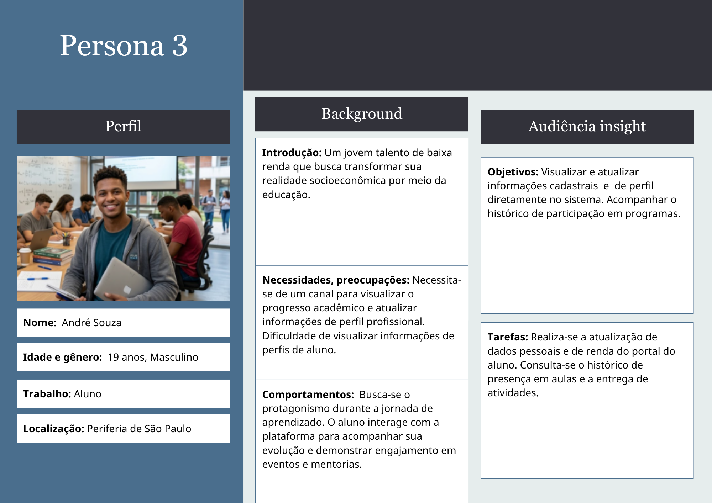<br>
<sub>Fonte: Autoria própria (2026).</sub>
</div>

## 2.3. User Stories (sprints 1 a 5)

<div align="justify">

User Stories: As User Stories são definidas como descrições de uma funcionalidade, sob a perspectiva do usuário final. Por meio desta técnica, o foco do desenvolvimento é direcionado às necessidades reais dos usuários, em vez das percepções internas da equipe.

</div>

| Identificação        | US01                                                                                                                                                                                                                                                                                                                                                                                                                                                                                                                                                                                                                                                                                                                       |
| -------------------- | -------------------------------------------------------------------------------------------------------------------------------------------------------------------------------------------------------------------------------------------------------------------------------------------------------------------------------------------------------------------------------------------------------------------------------------------------------------------------------------------------------------------------------------------------------------------------------------------------------------------------------------------------------------------------------------------------------------------------- |
| Persona              | Denise Ghattas                                                                                                                                                                                                                                                                                                                                                                                                                                                                                                                                                                                                                                                                                                             |
| User Story           | como uma gestora eu busco ter uma visão geral do perfil do aluno de forma prática para avaliá-lo da melhor maneira                                                                                                                                                                                                                                                                                                                                                                                                                                                                                                                                                                                                         |
| Critério de aceite 1 | CR1: Dado que a gestora acessa o dashboard, quando ela clica no perfil do aluno, então é exibido os dados do histórico do aluno.                                                                                                                                                                                                                                                                                                                                                                                                                                                                                                                                                                                           |
| Critério de aceite 2 | CR2: dado que a gestora acesse a plataforma, quando ela abrir a aba “alunos”, então devem ser exibidos resumos sobre todos os alunos atingidos.                                                                                                                                                                                                                                                                                                                                                                                                                                                                                                                                                                            |
| Critérios INVEST     | INDEPENDENTE: Pode ser desenvolvida sem depender de outras histórias , utilizando dados pré-existentes no banco. <br><br> NEGOCIÁVEL: O formato de exibição dos dados no dashboard pode ser ajustado com o parceiro Pulse Mais. <br><br> VALIOSA: Resolve a dor real da fragmentação de dados e da dificuldade em visualizar a jornada do jovem. <br><br> ESTIMÁVEL: A equipe técnica consegue estimar o esforço de criação de uma interface de consulta conectada ao PostgreSQL. <br><br> PEQUENA: A implementação de uma tela de consulta básica cabe dentro de uma sprint de desenvolvimento. <br><br> TESTÁVEL: Tem como saber que está pronta verificando se os dados do banco aparecem corretamente ao clicar no perfil. |

| Identificação        | US02                                                                                                                                                                                                                                                                                                                                                                                                                                                                                                                                                                                                                                                                                                                                                                                                                                                                                                                                                                                                                                |
| -------------------- | ----------------------------------------------------------------------------------------------------------------------------------------------------------------------------------------------------------------------------------------------------------------------------------------------------------------------------------------------------------------------------------------------------------------------------------------------------------------------------------------------------------------------------------------------------------------------------------------------------------------------------------------------------------------------------------------------------------------------------------------------------------------------------------------------------------------------------------------------------------------------------------------------------------------------------------------------------------------------------------------------------------------------------------- |
| Persona              | Denise Ghattas                                                                                                                                                                                                                                                                                                                                                                                                                                                                                                                                                                                                                                                                                                                                                                                                                                                                                                                                                                                                                      |
| User Story           | como uma gestora eu busco uma plataforma que unifique os dados para não perder informação relevante.                                                                                                                                                                                                                                                                                                                                                                                                                                                                                                                                                                                                                                                                                                                                                                                                                                                                                                                                |
| Critério de aceite 1 | CR1: dado que a gestora acesse a plataforma, quando ela abrir a aba de insights, então devem ser exibidos indicadores sobre a performance dos jovens                                                                                                                                                                                                                                                                                                                                                                                                                                                                                                                                                                                                                                                                                                                                                                                                                                                                                |
| Critério de aceite 2 | CR2: dado que a gestora acesse a plataforma, quando ela acessar a aba “funcionários”, então devem ser exibidos dados quantitativos sobre os funcionários.                                                                                                                                                                                                                                                                                                                                                                                                                                                                                                                                                                                                                                                                                                                                                                                                                                                                           |
| Critérios INVEST     | INDEPENDENTE: A plataforma de unificação pode ser estruturada como o núcleo central do sistema sem depender de módulos externos de comunicação. <br><br> NEGOCIÁVEL: Os indicadores de performance e os dados quantitativos exibidos nas abas de "insights" e "funcionários" podem ser refinados conforme a necessidade estratégica da Denise. <br><br> VALIOSA: Resolve o problema da fragmentação de dados em múltiplas planilhas centralizando o prontuário em uma única interface e com a organização do time. <br><br> ESTIMÁVEL: O esforço para consolidar os dados acadêmicos e de jornada em um banco de dados PostgreSQL é mensurável pela equipe de desenvolvimento. <br><br> PEQUENA: A criação das abas principais para exibição de indicadores e dados quantitativos está delimitada ao escopo do MVP, sendo coerente para uma sprint. <br><br> TESTÁVEL: É possível validar a conclusão da tarefa ao verificar se os indicadores de performance que são exibidos corretamente na aba de insights ao acessar a plataforma. |

| Identificação        | US03                                                                                                                                                                                                                                                                                                                                                                                                                                                                                                                                                                                                                                                                                                                                   |
| -------------------- | -------------------------------------------------------------------------------------------------------------------------------------------------------------------------------------------------------------------------------------------------------------------------------------------------------------------------------------------------------------------------------------------------------------------------------------------------------------------------------------------------------------------------------------------------------------------------------------------------------------------------------------------------------------------------------------------------------------------------------------- |
| Persona              | Denise Ghattas                                                                                                                                                                                                                                                                                                                                                                                                                                                                                                                                                                                                                                                                                                                         |
| User Story           | como gestora eu busco filtrar os alunos para aumentar a agilidade de busca de dados de um aluno e agilidade de trabalho.                                                                                                                                                                                                                                                                                                                                                                                                                                                                                                                                                                                                               |
| Critério de aceite 1 | CR1: Dado que o usuário abre a plataforma, quando ele busca os dados dos alunos, então os dados aparecem integrados em um único sistema.                                                                                                                                                                                                                                                                                                                                                                                                                                                                                                                                                                                               |
| Critério de aceite 2 | CR2: Dado que a gestora quer filtrar os alunos por dados específicos (como nota ou faltas), quando ela cria os filtros, então a plataforma organiza os alunos baseado nos filtros selecionados.                                                                                                                                                                                                                                                                                                                                                                                                                                                                                                                                        |
| Critérios INVEST     | INDEPENDENTE: A funcionalidade de unificação dos dados pode ser desenvolvida sem depender diretamente de outras stories <br><br> NEGOCIÁVEL: Os detalhes da integração (quais dados, formato, ferramentas usadas, interface de acesso e filtros) podem ser ajustados conforme as necessidades da equipe. <br><br> VALIOSA: Gera valor claro para a gestora, pois reduz o tempo de busca e aumenta a eficiência na análise dos dados dos alunos. <br><br> ESTIMÁVEL: É possível estimar o esforço com base nas fontes de dados existentes, quantidade de sistemas a integrar e complexidade da estrutura. <br><br> PEQUENA: Pode ser dividida em partes menores, como: integração de um sistema por vez ou criação de um banco central. |

| Identificação        | US04                                                                                                                                                                                                                                         |
| -------------------- | -------------------------------------------------------------------------------------------------------------------------------------------------------------------------------------------------------------------------------------------- |
| Persona              | Denise Ghattas                                                                                                                                                                                                                               |
| User Story           | Como gestora, eu quero ter acesso a todos os dados dos alunos, funcionários e ex alunos ,para que eu não dependa mais da minha memória para acessar dados específicos de cada aluno, ex aluno e funcionário.                                 |
| Critério de aceite 1 | CR1: Dado que o usuário busca acessar um dado de um aluno, ex aluno ou funcionário, quando ele clica nessa pessoa específica, então o sistema abre uma página com todos os dados dessa pessoa (como nota, presença, função, empregabilidade) |
| Critério de aceite 2 | CR2: Dado que a gestora quer achar uma pessoa específica, quando ele busca um dado dessa pessoa (como nome e CPF), então o sistema mostra todos os dados dessa pessoa.                                                                       |

| Identificação        | US05                                                                                                                                                                                                                                                                                                                                                                                                                                                                                                                                                                                                                                                                                                                                                                                                                                                                                              |
| -------------------- | ------------------------------------------------------------------------------------------------------------------------------------------------------------------------------------------------------------------------------------------------------------------------------------------------------------------------------------------------------------------------------------------------------------------------------------------------------------------------------------------------------------------------------------------------------------------------------------------------------------------------------------------------------------------------------------------------------------------------------------------------------------------------------------------------------------------------------------------------------------------------------------------------- |
| Persona              | Lucas Silva                                                                                                                                                                                                                                                                                                                                                                                                                                                                                                                                                                                                                                                                                                                                                                                                                                                                                       |
| User Story           | Como um psicólogo, eu quero mandar notificações para os alunos, para que eu consiga entrar em contato com o aluno para ajudar ele conforme suas necessidades.                                                                                                                                                                                                                                                                                                                                                                                                                                                                                                                                                                                                                                                                                                                                     |
| Critério de aceite 1 | CR1: Dado que o psicólogo abre a plataforma, quando ele percebe que um aluno está tendo dificuldades, e clica no perfil do aluno, o sistema envia uma notificação para o aluno mostrando que o psicólogo quer entrar em contato com ele.                                                                                                                                                                                                                                                                                                                                                                                                                                                                                                                                                                                                                                                          |
| Critério de aceite 2 | CR2: Dado que o psicólogo recebe uma notificação de um aluno, quando ele clica no perfil do aluno, o sistema envia uma notificação para o aluno marcando uma conversa entre o aluno e o psicólogo.                                                                                                                                                                                                                                                                                                                                                                                                                                                                                                                                                                                                                                                                                                |
| Critérios INVEST     | INDEPENDENTE: A história deve ser entregue sem depender de outras funcionalidades complexas de comunicação, focando apenas no envio da notificação. <br><br> NEGOCIÁVEL: A história abre espaço para para discussões sobre como a notificação será entregue e o que deve ser mostrado na mensagem automática. <br><br> VALIOSA: Permite a proatividade do psicólogo do suporte ao aluno, garantindo intervenções necessárias através da plataforma. <br><br> ESTIMÁVEL: Com os critérios de aceite definidos a equipe consegue avaliar o esforço técnico para implementar o gatilho de ação. <br><br> PEQUENA: A história é focada em uma única ação e um gatilho específico, assim evitando a inclusão de sistemas complexos de chat ou agendamento completo nesta fase. <br><br> TESTÁVEL: A história é testável verificando se o aluno recebeu a notificação correspondente na interface dele. |

| Identificação        | US06                                                                                                                                                                                                                                                               |
| -------------------- | ------------------------------------------------------------------------------------------------------------------------------------------------------------------------------------------------------------------------------------------------------------------ |
| Persona              | Lucas Silva                                                                                                                                                                                                                                                        |
| User Story           | Como um psicólogo, eu quero receber notificações dos alunos quando eles tiverem dificuldades, quando o desempenho deles diminuir e quando esse aluno atingir uma porcentagem de faltas alta, para que eu consiga dar o apoio e suporte necessário para esse aluno. |
| Critério de aceite 1 | CR1: Dado que o psicólogo está com a plataforma aberta, quando ele clicar em notificações, o sistema vai abrir uma sidebar com as notificações que os alunos enviaram para ele.                                                                                    |
| Critério de aceite 2 | CR2: Dado que o desempenho de um aluno cai ou quando a porcentagem de faltas desse aluno estiver alta, quando o psicólogo abre a plataforma, o sistema envia uma notificação para o psicólogo informando ele das questões desses alunos com dificuldades.          |

| Identificação        | US07                                                                                                                                                                                                                               |
| -------------------- | ---------------------------------------------------------------------------------------------------------------------------------------------------------------------------------------------------------------------------------- |
| Persona              | Lucas Silva                                                                                                                                                                                                                        |
| User Story           | Como um psicólogo, eu quero visualizar o histórico de notas dos alunos e a porcentagem de faltas dos alunos, para que eu consiga visualizar de forma mais específica o histórico do aluno para conseguir dar o suporte necessário. |
| Critério de aceite 1 | CR1: Dado que o psicólogo percebe que um aluno está com dificuldades, quando ele clica no perfil do aluno, o sistema mostra o histórico do aluno.                                                                                  |
| Critério de aceite 2 | CR2: Dado que o psicólogo acessa a plataforma, quando ele entra na aba de alunos, o sistema mostra todos os alunos com dificuldades (alta porcentagem de faltas ou queda no desempenho)                                            |

| Identificação        | US08                                                                                                                                                                                                                                                                                                                                                                                                                                                                                                                                                                                                                                                                                                                                                                                                                                                                                                                                                                                                                     |
| -------------------- | ------------------------------------------------------------------------------------------------------------------------------------------------------------------------------------------------------------------------------------------------------------------------------------------------------------------------------------------------------------------------------------------------------------------------------------------------------------------------------------------------------------------------------------------------------------------------------------------------------------------------------------------------------------------------------------------------------------------------------------------------------------------------------------------------------------------------------------------------------------------------------------------------------------------------------------------------------------------------------------------------------------------------ |
| Persona              | André Souza                                                                                                                                                                                                                                                                                                                                                                                                                                                                                                                                                                                                                                                                                                                                                                                                                                                                                                                                                                                                              |
| User Story           | Como um aluno da Pulse Mais, eu quero ter acesso aos meus resultados de maneira simples e com um histórico de notas, para que eu consiga me organizar melhor e ver em quais matérias eu estou tendo mais dificuldades                                                                                                                                                                                                                                                                                                                                                                                                                                                                                                                                                                                                                                                                                                                                                                                                    |
| Critério de aceite 1 | CR1: Dado que o aluno deseja ver seus resultados, quando ele abre a plataforma e clica em notas, o sistema exibe uma média de todas as notas, e um histórico em ordem cronológica das notas do aluno.                                                                                                                                                                                                                                                                                                                                                                                                                                                                                                                                                                                                                                                                                                                                                                                                                    |
| Critério de aceite 2 | CR2: Dado que o aluno quer ver o seu desempenho em uma matéria específica, quando ele clica em notas e seleciona uma matéria específica, o sistema exibe uma média e um histórico de notas daquela matéria.                                                                                                                                                                                                                                                                                                                                                                                                                                                                                                                                                                                                                                                                                                                                                                                                              |
| Critérios INVEST     | INDEPENDENTE: A história pode ser desenvolvida e entregue sem depender de outras funcionalidades de visualização de perfil ou módulos de secretaria, focando na consulta ao banco de dados. <br><br> NEGOCIÁVEL: Os detalhes da interface e o formato do histórico podem ser discutidos com o time de design e desenvolvimento durante a Sprint. <br><br> VALIOSA: Fornece transparência ao aluno sobre seu desempenho acadêmico, permitindo que ele identifique lacunas de aprendizado e melhore sua organização pessoal. <br><br> ESTIMÁVEL: O esforço técnico é observável, pois envolve a criação de uma consulta para cálculo de média e uma listagem cronológica. <br><br> PEQUENA: A funcionalidade é limitada à visualização de dados existentes, sendo simples o suficiente para ser implementada em poucos dias. <br><br> TESTÁVEL: É possível fazer o teste através de testes automatizados ou manuais, conferindo se a média exibida e a ordem das notas no histórico correspondem aos dados reais do banco. |

| Identificação        | US09                                                                                                                                                                                                                                                                                                                                                                                                                                                                                                                                                                                                                                                                                                                                                                                                                                                                                                                                                                                                                                                                                 |
| -------------------- | ------------------------------------------------------------------------------------------------------------------------------------------------------------------------------------------------------------------------------------------------------------------------------------------------------------------------------------------------------------------------------------------------------------------------------------------------------------------------------------------------------------------------------------------------------------------------------------------------------------------------------------------------------------------------------------------------------------------------------------------------------------------------------------------------------------------------------------------------------------------------------------------------------------------------------------------------------------------------------------------------------------------------------------------------------------------------------------ |
| Persona              | André Souza                                                                                                                                                                                                                                                                                                                                                                                                                                                                                                                                                                                                                                                                                                                                                                                                                                                                                                                                                                                                                                                                          |
| User Story           | Como um aluno da Pulse Mais, eu quero receber notificações dos eventos da Pulse Mais, e ter acesso as minhas faltas, para que eu consiga me organizar melhor e ver de maneira simples o que eu perdi.                                                                                                                                                                                                                                                                                                                                                                                                                                                                                                                                                                                                                                                                                                                                                                                                                                                                                |
| Critério de aceite 1 | CR1: Dado que o aluno deseja ver os próximos eventos da Pulse Mais, quando ele acessa a aba calendário, o sistema mostra para o aluno um calendário com todos os eventos da Pulse Mais.                                                                                                                                                                                                                                                                                                                                                                                                                                                                                                                                                                                                                                                                                                                                                                                                                                                                                              |
| Critério de aceite 2 | CR2: Dado que o aluno tem um evento da Pulse Mais nos próximos dias, quando ele abre a plataforma, o sistema envia uma notificação informando o aluno que o evento irá ocorrer nos próximos dias.                                                                                                                                                                                                                                                                                                                                                                                                                                                                                                                                                                                                                                                                                                                                                                                                                                                                                    |
| Critérios INVEST     | INDEPENDENTE: A funcionalidade de visualização de calendário e notificações podem ser desenvolvidas separadamente do sistema de notas, utilizando apenas a base de dados de cronograma da Pulse Mais. <br><br> NEGOCIÁVEL: Os canais de notificação e o visual do calendário podem ser discutidos e ajustados conforme o feedback dos alunos. <br><br> VALIOSA: Ajuda o aluno a não perder eventos importantes e a manter o controle sobre suas faltas, aumentando o engajamento com as atividades da ONG. <br><br> ESTIMÁVEL: Como os eventos e as faltas já constam no banco de dados, o esforço para exibir essas informações em uma interface de calendário e configurar alertas automáticos é compreendido pela equipe. <br><br> PEQUENA: A história foca em uma interface de visualização e um gatilho (sino) de lembrete simples, sendo possível de completar dentro de uma única sprint. <br><br> TESTÁVEL: É possível testar criando um evento fictício no banco e verificando se o calendário o exibe corretamente e se o sistema dispara a notificação no tempo previsto. |

| Identificação        | US10                                                                                                                                                                                                       |
| -------------------- | ---------------------------------------------------------------------------------------------------------------------------------------------------------------------------------------------------------- |
| Persona              | André Souza                                                                                                                                                                                                |
| User Story           | Como aluno da Pulse Mais, eu quero entrar em contato com os psicólogos quando estiver com dificuldades, para que eu consiga receber ajuda de um profissional.                                              |
| Critério de aceite 1 | CR1: Dado que o aluno está tendo dificuldades, quando ele clica em ajuda, o sistema envia uma notificação para um dos psicólogos da Pulse Mais.                                                            |
| Critério de aceite 2 | CR2: Dado que o aluno entrou em contacto com o psicólogo, quando ele clicar em marcar conversa, o sistema exibe uma agenda do psicólogo, possibilitando o aluno a marcar uma conversa com um profissional. |

# <a name="c3"></a>3. Projeto da Aplicação Web (sprints 1 a 5)

## 3.1. Requisitos do Sistema (sprints 1 a 5)

<div align="justify">

Esta seção formaliza o que o sistema deve fazer, sob quais regras de negócio deve operar e com quais atributos de qualidade deve atender. O conteúdo aqui apresentado é um documento vivo: a cada sprint, do levantamento inicial à entrega final, os requisitos serão revisados, adicionados, refinados ou reclassificados conforme as conversas com o parceiro Pulse Mais avançam e o entendimento técnico da solução amadurece. Mudanças de prioridade, status e escopo são esperadas e documentadas nesta própria seção ao longo do projeto.

A seção está dividida em três blocos complementares: os Requisitos Funcionais (RF), que descrevem o que o sistema deve fazer do ponto de vista do usuário; as Regras de Negócio (RN), que formalizam as políticas e restrições impostas pela Pulse Mais que moldam a lógica do software; e os Requisitos Não Funcionais (RNF), que definem os atributos de qualidade que o sistema deve apresentar, organizados pelos eixos da norma ISO/IEC 25010.

Cada requisito recebe um identificador único e estável (RF001, RN001, RNF001…) que é preservado mesmo quando o requisito é alterado ou refinado. Essa numeração é a base da rastreabilidade entre o levantamento inicial, o backlog do produto, os artefatos de design (casos de uso, modelagem do banco de dados, telas), os commits do repositório e os casos de teste. Alterações relevantes são registradas pelo versionamento do próprio WAD, mantendo o histórico auditável ao longo das cinco sprints do projeto.

</div>

### 3.1.1. Requisitos Funcionais (sprint 1, refinar até sprint 5)

<div align="justify">

Os requisitos funcionais a seguir foram extraídos do Termo de Abertura do Projeto Inteli (TAPI) da Pulse Mais e refinados a partir das conversas iniciais com os pontos focais do parceiro. A priorização (Alta, Média, Baixa) reflete o entendimento de que o núcleo da solução é a gestão centralizada da jornada do aluno pela equipe interna da Pulse Mais, sendo que funcionalidades voltadas ao aluno final ou a integrações e automações periféricas aparecem como prioridade secundária.

</div>

| ID    | Descrição                                                                                                                                                                                             | Prioridade | Status    |
| ----- | ----------------------------------------------------------------------------------------------------------------------------------------------------------------------------------------------------- | ---------- | --------- |
| RF001 | O sistema deve permitir o cadastro de alunos e ex-alunos com dados pessoais, acadêmicos, de jornada na Pulse Mais, empregabilidade e engajamento.                                                     | Alta       | Parcial   |
| RF002 | O sistema deve permitir a edição e atualização dos dados cadastrais de um aluno pela equipe Pulse Mais.                                                                                               | Alta       | Planejado |
| RF003 | O sistema deve permitir a consulta e listagem dos alunos cadastrados.                                                                                                                                 | Alta       | Implementado |
| RF004 | O sistema deve consolidar e apresentar o histórico completo de cada aluno (dados gerais, programas, eventos, empregabilidade e renda) de forma integrada.                                             | Alta       | Parcial   |
| RF005 | O sistema deve permitir o registro de frequência dos alunos em aulas.                                                                                                                                 | Alta       | Planejado |
| RF006 | O sistema deve permitir o registro de participação dos alunos em eventos promovidos pela Pulse Mais.                                                                                                  | Alta       | Planejado |
| RF007 | O sistema deve permitir cadastrar e atualizar informações sobre a empregabilidade do aluno.                                                                                                           | Alta       | Parcial   |
| RF008 | O sistema deve permitir atualizar informações sobre o acesso do aluno no ensino superior.                                                                                                             | Alta       | Parcial   |
| RF009 | O sistema deve permitir o registro de observações sobre saúde mental e bem-estar do aluno, com acesso restrito ao psicólogo da instituição que atende o aluno específico.                             | Alta       | Parcial   |
| RF010 | O sistema deve restringir o acesso às funcionalidades de acordo com o perfil do usuário (ex.: equipe Pulse, psicólogo, aluno).                                                                        | Alta       | Parcial   |
| RF011 | O sistema deve permitir a localização e segmentação de alunos com base em múltiplos critérios combinados (ex.: identificação de perfis para oportunidades específicas ou de multiplicadores na rede). | Média      | Parcial   |
| RF012 | O sistema deve apresentar um dashboard consolidando os principais indicadores de impacto da Pulse Mais.                                                                                               | Alta       | Parcial   |
| RF013 | O sistema deve calcular e apresentar o total de alunos empregados em um período selecionado.                                                                                                          | Baixa      | Parcial   |
| RF014 | O sistema deve calcular e apresentar o total de alunos que concluíram um programa em um período selecionado.                                                                                          | Média      | Planejado |
| RF015 | O sistema deve calcular e apresentar indicadores de evasão e risco por programa ou turma.                                                                                                   | Média      | Parcial   |
| RF016 | O sistema deve calcular e apresentar indicadores de acesso ao ensino superior dentro da rede de alunos.                                                                                               | Média      | Parcial   |
| RF017 | O sistema deve disponibilizar um portal restrito ao aluno no qual o próprio aluno possa visualizar seus dados cadastrais.                                                                             | Alta       | Parcial   |
| RF018 | O sistema deve permitir que o aluno atualize informações do seu perfil como ex: (E-mail, telefone, cpf) pelo portal do aluno.                                                                                                          | Alta       | Planejado |
| RF019 | O sistema deve permitir o envio de notificações informativas e convites para eventos.                                                                                                                 | Baixa      | Parcial   |
| RF020 | O sistema deve permitir que somente gestores visualizem a agenda.                                                                                                                                    | Média      | Planejado |
| RF021 | O sistema deve permitir que o gestor modifique os itens presentes na agenda.                                                                                                                          | Alta       | Planejado |
| RF022 | O sistema deve permitir ao psicólogo acessar o desempenho acadêmico dos alunos que monitora.                                                                                                          | Alta       | Planejado |

### 3.1.2. Regras de Negócio
 
As regras de negócio formalizam as políticas, condições e restrições que a Pulse Mais impõe ao funcionamento do sistema e que orientam a lógica de implementação dos requisitos funcionais. Diferentemente dos RFs, que descrevem comportamentos do sistema, as RNs descrevem decisões da organização que esses comportamentos devem respeitar. Cada RN está associada a um ou mais RFs, garantindo a rastreabilidade entre política institucional e funcionalidade implementada.
 
| RN | Descricao | Evidencia no sistema |
| --- | --- | --- |
| RN001 | Ao cadastrar aluno, o sistema deve gerar automaticamente `codigo_pm` no formato `PM-AAAA-NNN`, com sequencial anual. | `codigo-pm.integration.test.ts`, `alunos.integration.test.ts` |
| RN002 | Nao pode existir mais de um aluno com o mesmo e-mail. | `AlunoService`, `alunos.integration.test.ts` |
| RN008 | Para indicadores de empregabilidade, ocupacoes/vinculos considerados empregados devem entrar no calculo de alunos empregados. | `dashboard.integration.test.ts` |
| RN009 | Consultas de dashboard com periodo devem validar datas e impedir `dataFim` anterior a `dataInicio`. | `DashboardService`, `dashboard.integration.test.ts` |
| RN010 | Inativar aluno deve alterar status para `inativo`, sem remover o registro do banco. | `AlunoService`, `alunos.integration.test.ts` |
| RN019 | Apenas usuarios com perfil `gestor` podem criar, atualizar ou cancelar itens da agenda. | `AgendaService`, `agenda.integration.test.ts` |
| RN-PORTAL-01 | O id do aluno em rotas de portal deve ser inteiro positivo. | `PortalAlunoService`, `portal-aluno.integration.test.ts` |
| RN-PORTAL-02 | Perfil inexistente no portal deve retornar erro de recurso nao encontrado. | `PortalAlunoService`, `portal-aluno.integration.test.ts` |
| RN-PORTAL-03 | Atualizacao de contato deve aceitar somente e-mail valido quando e-mail for informado. | `PortalAlunoService`, `portal-aluno.integration.test.ts` |
| RN-PORTAL-04 | Atualizacao de contato deve informar ao menos e-mail ou telefone. | `PortalAlunoService`, `portal-aluno.integration.test.ts` |
| RN-PORTAL-05 | Aluno autenticado so pode visualizar as proprias notificacoes. | `PortalAlunoService`, `portal-aluno-notificacoes.integration.test.ts` |
| RN-PORTAL-06 | Listagem de oportunidades do portal deve retornar oportunidades disponiveis sem exigir aluno especifico. | `PortalAlunoService`, `portal-aluno-notificacoes.integration.test.ts` |
| RN-ALUNO-03 | Idade do aluno deve estar entre 0 e 120 quando informada. | `AlunoService`, `alunos.integration.test.ts` |
| RN-ALUNO-04 | Consulta por id deve validar `idAluno` como inteiro positivo. | `AlunoController`, `alunos.integration.test.ts` |
| RN-ALUNO-05 | Consulta de aluno inexistente deve retornar erro de recurso nao encontrado. | `AlunoService`, `alunos.integration.test.ts` |
| RN-ALUNO-06 | Atualizacao de aluno deve validar valores de risco de evasao. | `AlunoService`, `alunos.integration.test.ts` |
| RN-ALUNO-07 | Atualizacao de aluno inexistente deve retornar erro de recurso nao encontrado. | `AlunoService`, `alunos.integration.test.ts` |
| RN-JORNADA-01 | Jornada consolidada deve validar `idAluno` como inteiro positivo. | `JornadaService`, `jornada.integration.test.ts` |
| RN-JORNADA-02 | Jornada de aluno inexistente deve retornar erro de recurso nao encontrado. | `JornadaService`, `jornada.integration.test.ts` |
| RN-JORNADA-03 | Frequencia so pode ser registrada para atividade do tipo `aula`. | `JornadaService`, `jornada.integration.test.ts` |
| RN-JORNADA-04 | Nota de frequencia deve estar entre 0 e 10 quando informada. | `JornadaService`, `jornada.integration.test.ts` |
| RN-JORNADA-05 | Atividade informada para frequencia deve existir. | `JornadaService`, `jornada.integration.test.ts` |
| RN-JORNADA-06 | Participacao so pode ser registrada para atividade do tipo `evento`. | `JornadaService`, `jornada.integration.test.ts` |
| RN-JORNADA-07 | Nao pode haver participacao duplicada para o mesmo aluno na mesma atividade. | `JornadaService`, `jornada.integration.test.ts` |
| RN-JORNADA-08 | Atividade informada para participacao deve existir. | `JornadaService`, `jornada.integration.test.ts` |
| RN-JORNADA-09 | Empregabilidade deve validar ocupacao com tamanho minimo e renda mensal nao negativa. | `JornadaService`, `jornada.integration.test.ts` |
| RN-JORNADA-10 | Ensino superior deve validar escolaridade com tamanho minimo. | `JornadaService`, `jornada.integration.test.ts` |
| RN-JORNADA-11 | Data de ingresso no ensino superior deve estar no formato `YYYY-MM-DD` quando informada. | `JornadaService`, `jornada.integration.test.ts` |
| RN-JORNADA-12 | Anotacao qualitativa deve validar titulo, descricao e autor com tamanho minimo. | `JornadaService`, `jornada.integration.test.ts` |
| RN-JORNADA-13 | Data de registro da anotacao deve estar no formato `YYYY-MM-DD` quando informada. | `JornadaService`, `jornada.integration.test.ts` |
| RN-SEG-01 | Segmentacao deve receber ao menos um criterio de busca/filtro. | `SegmentacaoService`, `segmentacao.integration.test.ts` |
| RN-SEG-02 | Limite de segmentacao deve ser inteiro positivo e nao pode ultrapassar 100 registros. | `SegmentacaoService`, `segmentacao.integration.test.ts` |
| RN-SEG-03 | Segmentacao deve validar status, risco de evasao e busca com minimo de 3 caracteres. | `SegmentacaoService`, `segmentacao.integration.test.ts` |
| RN-DASH-01 | Filtros de periodo do dashboard devem usar formato `YYYY-MM-DD`. | `DashboardService`, `dashboard.integration.test.ts` |
| RN-DASH-02 | Filtro `categoria` deve ter pelo menos 3 caracteres quando informado. | `DashboardService`, `dashboard.integration.test.ts` |
| RN-DASH-03 | Filtro `programa` deve ter pelo menos 3 caracteres quando informado. | `DashboardService`, `dashboard.integration.test.ts` |
| RN-COM-01 | Notificacao deve ser criada apenas para aluno destinatario existente. | `NotificacaoService`, `notificacoes.integration.test.ts` |
| RN-COM-02 | Tipo de notificacao e tipo de remetente devem pertencer aos valores aceitos. | `NotificacaoService`, `notificacoes.integration.test.ts` |
| RN-COM-03 | Somente perfil `psicologo` pode enviar notificacao com `tipoRemetente=psicologo`. | `NotificacaoService`, `notificacao-psicologo.integration.test.ts` |
| RN-COM-04 | Tipo de oportunidade deve pertencer aos valores aceitos. | `NotificacaoService`, `notificacoes.integration.test.ts` |
| RN-COM-05 | Prazo de inscricao de oportunidade deve estar no formato `YYYY-MM-DD` quando informado. | `NotificacaoService`, `notificacoes.integration.test.ts` |
| RN-AGENDA-01 | Filtros de data da agenda devem usar `YYYY-MM-DD` e `dataFim` nao pode ser anterior a `dataInicio`. | `AgendaService`, `agenda.integration.test.ts` |
| RN-AGENDA-02 | Agenda deve aceitar somente `tipoUser` igual a `aluno` ou `membro_equipe`. | `AgendaService`, `agenda.integration.test.ts` |
| RN-AGENDA-03 | Atualizar ou cancelar item inexistente deve retornar erro de recurso nao encontrado. | `AgendaService`, `agenda.integration.test.ts` |
| RN-SAUDE-01 | Registros de saude mental sao restritos ao perfil `psicologo`. | `SaudeMentalService`, `saude-mental.integration.test.ts` |
| RN-SAUDE-02 | Historico psicologico deve ser criado somente para aluno existente. | `SaudeMentalService`, `saude-mental.integration.test.ts` |
| RN-SAUDE-03 | Historico psicologico deve validar titulo e observacao obrigatorios. | `SaudeMentalService`, `saude-mental.integration.test.ts` |
| RN-SAUDE-04 | Label psicologica deve ser criada somente para aluno existente. | `SaudeMentalService`, `saude-mental.integration.test.ts` |
| RN-SAUDE-05 | Tipo de label deve pertencer aos valores aceitos. | `SaudeMentalService`, `saude-mental.integration.test.ts` |
| RN-PSI-01 | Apenas usuario com permissao de psicologo pode acessar desempenho academico de aluno nessa rota. | `permissionMiddleware`, `desempenho-psicologo.integration.test.ts` |
| RN-PSI-02 | Psicologo so pode acessar desempenho de aluno com vinculo registrado. | `DesempenhoService`, `desempenho-psicologo.integration.test.ts` |
| RN-INFRA-01 | Healthchecks devem retornar status de disponibilidade sem expor dados sensiveis. | `routes/index.ts` |

### 3.1.3. Requisitos Não Funcionais — 8 Eixos ISO/IEC 25010 (sprints 1 a 5)

<div align="justify">

Os requisitos não funcionais descrevem características de qualidade que o sistema deve apresentar, complementando os requisitos funcionais ao definir não o que o sistema faz, mas como ele se comporta. Esta seção é estruturada conforme os oito eixos de qualidade definidos pela norma ISO/IEC 25010, modelo internacionalmente reconhecido para avaliação da qualidade de produtos de software.
 
A tabela abaixo apresenta os RNFs do projeto, com critérios e métricas definidos para o contexto de um MVP acadêmico desenvolvido em parceria com a Pulse Mais, executado em ambiente de homologação e não destinado a produção crítica antes de auditoria de segurança, conforme explicitado pelo TAPI. As métricas refletem expectativas razoáveis para esse contexto.
 
A coluna "Requisito" descreve o atributo de qualidade esperado em linguagem de negócio. A coluna "Métrica / Critério" define como esse atributo é medido ou verificado de forma objetiva. A coluna "Como atendido" indica as decisões técnicas e práticas que sustentam o atendimento ao requisito.
 
| Eixo | Requisito | Métrica / Critério | Como atendido |
|------|-----------|--------------------|----|
| USAB: Usabilidade | A interface da equipe e do portal do aluno deve ser responsiva, funcionando adequadamente  em desktop, dado que parte da equipe Pulse Mais utiliza desktop e estão com programas de doação para os seus alunos.| Layout funcional e legível em viewports de 1920px a 1080px | CSS responsivo com interface adequeada e telas desktop; responsividade feita a partir do HTML também; testes manuais nos breakpoints de desktop |
| USAB: Usabilidade | A interface deve adotar boas práticas de acessibilidade inspiradas na WCAG 2.1 nível AA, com foco em contraste de cores e suporte a daltonismo. | Contraste mínimo de 4.5:1 para textos e 3:1 para elementos gráficos; informações de status nunca transmitidas exclusivamente por cor; pontuação mínima de 90 na categoria Accessibility do Google Lighthouse nas principais telas. | Paleta validada por ferramenta de contraste (ex.: WebAIM Contrast Checker); ícones e rótulos textuais associados a indicadores coloridos; auditoria via Lighthouse executada nas revisões de sprint. |
| USAB: Usabilidade | A interface deve apresentar curva de aprendizado curta para usuários da equipe Pulse Mais. | Um novo usuário da equipe deve conseguir realizar o cadastro completo de um aluno em até 5 minutos sem treinamento formal, apoiado apenas pelos rótulos e dicas da própria interface. | Padrões visuais consistentes em todas as telas; rótulos claros em português; mensagens de erro orientadas à ação corretiva. |
| CONF: Confiabilidade | O sistema deve utilizar identificador interno estável para cada aluno, independente de e-mail, CPF ou nome, resolvendo a dor atual de quebra de cruzamento de dados quando o aluno troca de e-mail. | Todo aluno cadastrado recebe um `id_aluno` único, imutável e gerado automaticamente; relacionamentos internos do sistema não dependem de e-mail ou nome. | Chave primária artificial `id_aluno` na tabela de alunos e constraints de integridade referencial no Banco de Dados. |
| CONF: Confiabilidade | O sistema deve preservar a integridade dos dados em caso de falha durante uma operação de escrita, evitando registros parciais ou inconsistentes. | Operações que envolvem múltiplas tabelas devem ser atômicas: ou completam por inteiro ou são desfeitas integralmente. | Uso de transações do PostgreSQL com `BEGIN`/`COMMIT`/`ROLLBACK` via biblioteca do Node.js; testes manuais simulando falha durante escrita. |
| DES: Desempenho | A listagem de alunos com critérios aplicados deve responder rapidamente, mesmo com o crescimento da base prevista (aprox. 600 alunos hoje, projeção de até 2000 ao longo dos próximos anos). | Tempo de resposta p95 < 2 segundos para listagem com até 2000 registros; p95 < 3 segundos para o dashboard agregado com os quatro indicadores principais. | Índices nas colunas mais consultadas (ano, programa, categoria); queries SQL otimizadas. |
| DES: Desempenho | A consulta ao histórico consolidado de um aluno deve carregar em tempo aceitável para uso diário pela equipe. | Tempo de resposta p95 < 1.5 segundos para abertura do histórico completo de um aluno; pontuação mínima de 80 na categoria Performance do Google Lighthouse nas principais telas. | Consultas pré-otimizadas; agregações feitas no servidor; payload JSON enxuto entre back-end e front-end; auditoria via Lighthouse executada nas revisões de sprint. |
| SUP: Suportabilidade | O código-fonte deve seguir um padrão arquitetural claro, com separação de responsabilidades entre apresentação, lógica de aplicação e persistência. | Cada camada do sistema deve ter responsabilidade única e bem delimitada; nenhuma lógica de acesso a dados deve estar misturada com a camada de apresentação. | Adoção do padrão MVC com diretórios `controllers/`, `service/` e `repository/`; revisões de pull request validando a separação; consultas SQL restritas à camada de Model. |
| SUP: Suportabilidade | O sistema deve ser facilmente analisável, permitindo que um novo desenvolvedor ou docente entenda e contribua com o código. | Um novo colaborador deve conseguir realizar o setup local em até 10 minutos a partir da documentação; trechos de lógica não trivial devem estar comentados; nomenclatura consistente. | README com passo a passo de instalação; revisão por pares; aderência ao guia de estilo do módulo. |
| SEG: Segurança | O acesso às funcionalidades sensíveis deve ser controlado por níveis de permissão simples, sem autenticação formal (login/senha), conforme restrição do TAPI. As observações de saúde mental devem ser visíveis apenas para usuários com perfil de psicólogo. | Usuários sem o perfil adequado não devem conseguir acessar dados de saúde mental por nenhum caminho do sistema, incluindo tentativas de acesso direto. | Middleware de verificação de perfil no Express; rotas protegidas por papel; testes de bloqueio em cada perfil. |
| SEG: Segurança | Dados pessoais e relatos qualitativos sensíveis dos jovens, em conformidade com a LGPD e com o "Conteúdo Restrito" definido no TAPI, não devem ser expostos publicamente nem incluídos em commits do repositório público. | Nenhum dado pessoal real presente no repositório; uso obrigatório de massa de dados fictícia para desenvolvimento e demonstração. | Banco real e dumps incluídos no `.gitignore`; arquivo de seeds com dados fictícios; revisão manual de segredos antes de cada commit. |
| CAP: Capacidade | O sistema deve suportar a carga prevista de uso pela equipe Pulse Mais e o volume estimado de alunos cadastrados. | Suporte a, no mínimo, 15 usuários simultâneos da equipe (margem confortável sobre os 7 colaboradores internos atuais); base de dados projetada para crescer até 2000 alunos cadastrados sem degradação perceptível. | Banco PostgreSQL com índices nas colunas críticas para facilitar operação e escalabilidade. |
| CAP: Capacidade | O portal do aluno deve suportar acessos eventuais distribuídos ao longo do dia, sem necessidade de alta concorrência. | Suporte a, no mínimo, 30 acessos simultâneos no portal do aluno sem degradação superior a 20% no tempo de resposta. | Arquitetura stateless do back-end Node.js; consultas leves na rota pública do aluno. |
| REST: Restrições de Design | Stack tecnológica obrigatória definida pelo Inteli e pelo TAPI: front-end em HTML, CSS,JavaScript e TypeScript; back-end em Node.js; banco de dados PostgreSQL. | O front-end deve ser construído sem o uso de frameworks SPA (Single Page Application), como React, Vue, Angular ou similares; o back-end deve permanecer em Node.js e a persistência em PostgreSQL. | Verificação no `package.json` e na estrutura do projeto durante revisões de sprint; validação arquitetural com docente orientador. |
| REST: Restrições de Design | Não haverá sistema de autenticação tradicional (login/senha), nem integração em tempo real com APIs externas (ex.: WhatsApp, Google), conforme TAPI. | Ausência de fluxos de cadastro de senha, recuperação de senha, OAuth ou tokens externos; ausência de chamadas a Web APIs externas em runtime. | Estrutura simples de if e else validando credenciais registradas no sistema. |
| REST: Restrições de Design | A comunicação entre aluno e equipe (mentor, psicólogo) deve ocorrer fora da plataforma; o sistema apenas registra histórico de interações, não implementa chat em tempo real. | Nenhum componente de chat ou comunicação em tempo real implementado; comunicação representada apenas por registros estruturados (mensagens, formulários, anotações). | Decisão arquitetural documentada; escopo do MVP alinhado com o parceiro. |
| ORG: Organizacionais | O projeto deve aderir ao processo Scrum adotado pelo Inteli, com entregas incrementais a cada sprint e este documento (WAD) atualizado ao final de cada uma delas. | Cinco sprints planejadas; histórico de alterações do WAD versionado; backlog mantido em ferramenta visível ao parceiro e ao corpo docente. | Repositório no GitHub; reuniões de revisão a cada sprint com o parceiro; commits de atualização do WAD. |
| ORG: Organizacionais | O repositório do projeto deve ser público (conforme prática do Inteli), respeitando a lista de "Conteúdo Restrito" do TAPI: não devem ser commitados nomes, e-mails ou outros dados pessoais reais dos jovens, nem relatos qualitativos individuais de bem-estar. | Nenhum dado pessoal real presente no repositório; apenas massa fictícia e exemplos genéricos em documentação. | Arquivo de exclusões do versionamento configurado; checklist de revisão antes de cada push relevante; uso de seeds com dados fictícios. |
| ORG: Organizacionais | A interface, mensagens, rótulos e documentação principal devem ser produzidas em português brasileiro, idioma da equipe Pulse Mais e dos alunos. | 100% das telas, mensagens de erro e textos visíveis ao usuário em pt-BR. | Validação visual nas revisões de sprint. |
 
Os requisitos não funcionais aqui definidos traduzem as escolhas de qualidade feitas para o sistema de gestão de jovens da Pulse Mais. O projeto atende a uma necessidade real de centralização e rastreabilidade de dados de acompanhamento socioeducativo, com foco na experiência da equipe interna e na privacidade dos jovens atendidos. As decisões técnicas, como stack Node.js com PostgreSQL, arquitetura MVC, controle de acesso por perfil e ausência de autenticação tradicional, foram tomadas em alinhamento com as restrições definidas pelo TAPI e validadas com o parceiro. Os critérios estabelecidos nesta seção orientam o desenvolvimento e servem como referência para a verificação da qualidade do produto entregue.
</div>

### 3.1.4. Matriz RF → RN → Endpoint (sprints 3 a 5)

_Matriz de cobertura mostrando quais RN e endpoints implementam cada RF._

| Metodo | Endpoint | RF | Entrada principal | Retorno esperado | Status principais |
| --- | --- | --- | --- | --- | --- |
| GET | `/api/health` | RF028 | N/A | Status da API | 200 |
| GET | `/api/health/supabase` | RF028 | N/A | Status de conexao com banco/configuracao Supabase | 200, 503 |
| GET | `/api/portal/alunos/:idAluno` | RF001 | `idAluno` path param | Perfil do aluno | 200, 400, 404 |
| PATCH | `/api/portal/alunos/:idAluno/contato` | RF002 | `email`, `telefone` | Contato atualizado | 200, 400, 404 |
| GET | `/api/portal/alunos/:idAluno/notificacoes` | RF003 | `idAluno`, headers de autenticacao | Notificacoes do aluno | 200, 400, 403, 404 |
| GET | `/api/portal/oportunidades` | RF003 | N/A | Lista de oportunidades | 200 |
| POST | `/api/alunos` | RF004 | Dados cadastrais do aluno | Aluno cadastrado | 201, 400, 409 |
| GET | `/api/alunos` | RF005 | Filtros opcionais | Lista de alunos | 200 |
| GET | `/api/alunos/:idAluno` | RF005 | `idAluno` path param | Dados do aluno | 200, 400, 404 |
| PATCH | `/api/alunos/:idAluno` | RF006 | Campos parciais do aluno | Aluno atualizado | 200, 400, 404 |
| DELETE | `/api/alunos/:idAluno` | RF007 | `idAluno` path param | Aluno inativado | 200, 404 |
| GET | `/api/jornada/alunos/:idAluno` | RF008 | `idAluno` path param | Jornada consolidada | 200, 400, 404 |
| POST | `/api/frequencias` | RF009 | `idAluno`, `idAtividade`, `statusPart`, `nota`, `dataPart` | Frequencia registrada | 200, 400, 404, 422 |
| POST | `/api/participacoes` | RF010 | `idAluno`, `idAtividade`, `statusPart`, `nota`, `dataPart` | Participacao registrada | 200, 400, 404, 409, 422 |
| PATCH | `/api/empregabilidade/:idAluno` | RF011 | `ocupacao`, `tipoVinculoEmpregaticio`, `rendaMensal` | Empregabilidade atualizada | 200, 400, 404 |
| PATCH | `/api/ensino-superior/:idAluno` | RF012 | `escolaridade`, instituicao/curso/status/data | Ensino superior atualizado | 200, 400, 404 |
| POST | `/api/anotacoes-qualitativas` | RF013 | `idAluno`, `titulo`, `descricao`, `autor`, `dataRegistro` | Anotacao registrada | 200, 400, 404 |
| GET | `/api/alunos/segmentacao` | RF014 | Query params de filtros | Alunos segmentados | 200, 400, 422 |
| GET | `/api/impacto/resumo` | RF015 | `programa`, `categoria`, `dataInicio`, `dataFim` | Resumo de impacto | 200, 400, 422 |
| GET | `/api/jornada/resumo` | RF016 | `programa`, `categoria`, `dataInicio`, `dataFim` | Resumo da jornada | 200, 400, 422 |
| GET | `/api/impacto/conclusao-programas` | RF017 | Filtros de dashboard | Indicador de conclusao | 200, 400, 422 |
| GET | `/api/impacto/alunos-empregados` | RF018 | Filtros de dashboard | Indicador de empregados | 200, 400, 422 |
| GET | `/api/impacto/acesso-ensino-superior` | RF019 | Filtros de dashboard | Indicador de ensino superior | 200, 400, 422 |
| GET | `/api/jornada/evasao-risco` | RF020 | Filtros de dashboard | Indicador de evasao/risco | 200, 400, 422 |
| GET | `/api/comunicacao` | RF021 | `idAluno` opcional | Lista de notificacoes | 200 |
| POST | `/api/comunicacao` | RF021 | Dados da notificacao | Notificacao criada | 200, 400, 403, 404 |
| GET | `/api/comunicacao/oportunidades` | RF022 | N/A | Lista de oportunidades | 200 |
| POST | `/api/comunicacao/oportunidades` | RF022 | Dados da oportunidade | Oportunidade criada | 200, 400 |
| GET | `/api/agenda` | RF023 | `idAluno`, `idMembro`, `dataInicio`, `dataFim` | Itens de agenda | 200, 400, 422 |
| POST | `/api/agenda` | RF024 | Dados do item de agenda | Item criado | 200, 400, 422 |
| PATCH | `/api/agenda/:idAgenda` | RF024 | Campos parciais do item | Item atualizado | 200, 400, 404, 422 |
| DELETE | `/api/agenda/:idAgenda` | RF024 | `idAgenda` path param | Item cancelado | 200, 404, 422 |
| GET | `/api/prontuarios` | RF025 | `idAluno`, `idPsi`, perfil | Lista de prontuarios | 200, 422 |
| POST | `/api/prontuarios` | RF025 | `idAluno`, `idPsi`, `titulo`, `observacao`, perfil | Prontuario criado | 200, 400, 404, 422 |
| GET | `/api/labels` | RF026 | `idAluno`, `idPsi`, perfil | Lista de labels | 200, 422 |
| POST | `/api/labels` | RF026 | `idAluno`, `idPsi`, `descricao`, `tipoLabel`, perfil | Label criada | 200, 400, 404, 422 |
| GET | `/api/psicologo/alunos/:idAluno/desempenho` | RF027 | `idAluno`, headers de autenticacao/permissao | Desempenho do aluno | 200, 400, 403, 404 |

## 3.2. Arquitetura (sprints 1 a 5)

### 3.2.1. Diagrama de Arquitetura (sprints 3 e 4)


<div align="center">
<sup>Figura 7: Diagrama de Arquitetura.</sup><br>
    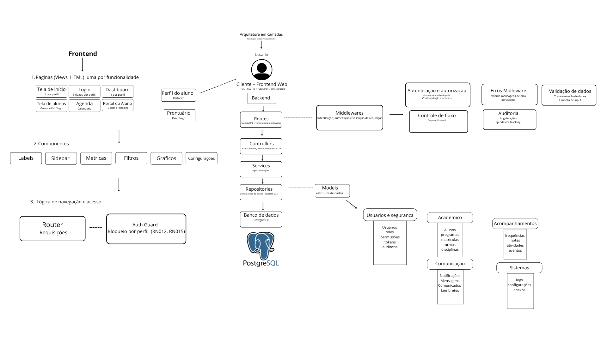<br>
    <sub>Fonte: Autoria própria (2026).</sub>
</div>

<div align="justify">
A Arquitetura em Camadas organiza o sistema em níveis hierárquicos com responsabilidades definidas, onde cada camada se comunica apenas com a camada adjacente. O padrão adotado é o Controller-Service-Repository, que separa o tratamento de requisições HTTP, as regras de negócio e o acesso ao banco de dados em camadas distintas.
</div>


**Visão Geral das Camadas**

A requisição HTTP percorre o sistema sempre no mesmo sentido descendente, e a resposta retorna no sentido inverso. Cada camada conhece apenas a camada imediatamente inferior, garantindo o princípio da dependência unidirecional:

- **Cliente (Frontend Web):** aplicação em HTML + CSS + TypeScript que consome a API por meio da camada de serviços do próprio frontend (`frontend/js/services/api.ts`).
- **Camada de Rotas (Routes):** mapeia URLs e verbos HTTP para os Controllers e aplica os middlewares de autenticação, permissão e validação de payload.
- **Camada de Controllers:** recebe a requisição HTTP, extrai os parâmetros, delega a operação ao Service apropriado e formata a resposta (status code + JSON). Não contém regra de negócio.
- **Camada de Services:** concentra toda a regra de negócio — validações de domínio, orquestração entre repositórios, cálculos, integrações externas e regras transacionais.
- **Camada de Repositories:** único ponto de acesso ao banco de dados. Encapsula as queries SQL e isola o Service da tecnologia de persistência.
- **Banco de Dados:** PostgreSQL, acessado via pool de conexões.

Em paralelo, atuam três camadas transversais (cross-cutting): Middlewares (autenticação, permissão, validação de payload e tratamento centralizado de erros), Models (contratos e tipos do domínio em TypeScript) e Integrations (adapters para e-mail, auditoria e notificações).

**Estrutura de Diretórios do Backend**

A organização física do código em `backend/src/` reflete fielmente a divisão lógica das camadas, contendo as pastas `config/`, `routes/`, `controllers/`, `services/`, `repositories/`, `models/`, `middlewares/`, `integrations/`, `database/` e `utils/`, além dos arquivos `app.ts` (bootstrap do Express) e `server.ts` (inicialização do servidor HTTP).

**Responsabilidade Detalhada de Cada Camada**

**1. Camada de Apresentação — Routes + Controllers**

A pasta `routes/` é o ponto de entrada de qualquer requisição. Cada arquivo (`alunoRoutes.ts`, `agendaRoutes.ts`, `dashboardRoutes.ts`, `authRoutes.ts`, `frequenciaRoutes.ts`, `saudeMentalRoutes.ts`, `empregabilidadeRoutes.ts`, `ensinoSuperiorRoutes.ts`, `jornadaRoutes.ts`, `notificacaoRoutes.ts`, `participacaoRoutes.ts`, `portalAlunoRoutes.ts`, `segmentacaoRoutes.ts`, `importacaoRoutes.ts`, entre outros) declara o verbo HTTP, o caminho da URL, os middlewares aplicáveis e o handler do Controller correspondente. O arquivo `routes/index.ts` agrega e expõe todas as rotas ao `app.ts`.

Os Controllers (`controllers/`) são responsáveis exclusivamente por receber o objeto Request do Express e extrair parâmetros (`req.params`, `req.query`, `req.body`, `req.user`), invocar o Service apropriado repassando dados já tipados, capturar o retorno do Service e devolver a resposta HTTP com o status code correto (200, 201, 204, 400, 404, etc.), e encaminhar erros ao `errorMiddleware`. Controllers não contêm regra de negócio nem fazem acesso direto ao banco de dados. Essa disciplina é o que permite trocar o framework HTTP no futuro sem reescrever o domínio.

**2. Camada de Negócio — Services**

A camada `services/` é o coração da aplicação. Cada service (`alunoService.ts`, `jornadaService.ts`, `frequenciaService.ts`, `saudeMentalService.ts`, `empregabilidadeService.ts`, `ensinoSuperiorService.ts`, `dashboardService.ts`, `agendaService.ts`, `notificacaoService.ts`, `riscoEvasaoService.ts`, `segmentacaoService.ts`, `participacaoService.ts`, `portalAlunoService.ts`, `importacaoService.ts`, `authService.ts`, `codigoPmService.ts`, `anotacaoQualitativaService.ts`, entre outros) concentra as regras de negócio específicas do domínio (como o cálculo de risco de evasão em `riscoEvasaoService`), a orquestração entre múltiplos repositórios quando uma operação envolve mais de uma entidade, as validações de domínio, o disparo de integrações externas (envio de e-mail, registro de auditoria, notificações) e a aplicação de políticas de permissão dependentes de contexto de negócio.

O Service é a única camada autorizada a chamar `repositories` e `integrations`. Ele desconhece HTTP e desconhece SQL — recebe dados puros e devolve dados puros.

**3. Camada de Persistência — Repositories**

A camada `repositories/` (com arquivos como `alunoRepository.ts`, `agendaRepository.ts`, `dashboardRepository.ts`, `frequenciaRepository.ts`, `saudeMentalRepository.ts`, `empregabilidadeRepository.ts`, `ensinoSuperiorRepository.ts`, `jornadaRepository.ts`, `notificacaoRepository.ts`, `participacaoRepository.ts`, `programaRepository.ts`, `usuarioRepository.ts`, `atividadeRepository.ts`, `auditoriaRepository.ts`, `labelRepository.ts`, entre outros) é o único ponto de contato com o PostgreSQL. Cada repository encapsula as instruções SQL (queries parametrizadas via biblioteca `pg`), recebe o pool de conexões definido em `database/pool.ts`, implementa operações de CRUD e consultas específicas e devolve ao Service objetos já mapeados para os tipos definidos em `models/`.

A consequência prática dessa camada é que uma eventual migração do PostgreSQL para outro SGBD, ou a adoção de um ORM, afetaria apenas os repositories — Services, Controllers e Routes permaneceriam intocados.

**4. Camada de Modelos — Models**

A pasta `models/` define os contratos de tipos do domínio em TypeScript: interfaces e tipos das entidades manipuladas pelo sistema (Aluno, Programa, Frequência, Participação, Usuário, Vínculo, Agenda, Auditoria, Empregabilidade, Ensino Superior, Saúde Mental, Notificação, Label, entre outros). São consumidos por todas as camadas para garantir tipagem estática end-to-end.

**5. Camadas Transversais**

A pasta `middlewares/` contém o `authMiddleware` (valida o JWT), o `permissionMiddleware` (verifica perfil e RBAC), o `validationMiddleware` (valida o schema do payload antes da requisição chegar ao Controller) e o `errorMiddleware` (captura erros lançados em qualquer camada e converte em resposta HTTP padronizada).

A pasta `integrations/` contém os adapters para sistemas externos — `emailProvider`, `notificationProvider`, `auditoriaIntegration` e `dashboardAuditoriaIntegration` — isolando dependências externas para que mudanças de provedor não afetem o domínio.

As pastas `config/` (variáveis de ambiente, conexão com o banco, política de CORS e matriz de permissões), `database/` (pool de conexões, execução de migrações e seed) e `utils/` (helpers puros e sem estado — date, errors, pagination, response, validators) completam a infraestrutura de suporte.

**Camada de Cliente — Frontend**

O frontend (`frontend/`) é uma aplicação web em HTML + CSS + TypeScript organizada por páginas (`frontend/pages/*.html`), scripts por página (`frontend/js/pages/*.ts`), componentes reutilizáveis (`frontend/js/components/`: sidebar, table, filters) e uma camada de serviços de API própria (`frontend/js/services/api.ts` e `auth.ts`) que centraliza todas as chamadas HTTP ao backend. Essa separação espelha, no cliente, o mesmo princípio aplicado no servidor: a UI não conhece detalhes de transporte, e sim invoca métodos do `api.ts`.

**Fluxo de uma Requisição (exemplo: cadastrar frequência de um aluno)**

O usuário, no navegador, dispara um `POST /frequencia` a partir de `frontend/js/pages/...` via `frontend/js/services/api.ts`. O Express recebe a requisição e a direciona pelo `routes/frequenciaRoutes.ts`, que aplica `authMiddleware`, `permissionMiddleware` e `validationMiddleware`. Em seguida, o `frequenciaController` extrai o payload validado e chama o método correspondente do `frequenciaService`. O `frequenciaService` aplica as regras de negócio — como verificar se o aluno está ativo no programa e calcular o impacto no risco de evasão via `riscoEvasaoService` — e invoca o `frequenciaRepository` e, se necessário, o `auditoriaIntegration`. O `frequenciaRepository` executa o SQL parametrizado contra o PostgreSQL e devolve o registro persistido. O retorno sobe a pilha — Service → Controller — e o Controller responde com `201 Created` e o JSON da frequência criada. Qualquer erro lançado em qualquer ponto é capturado pelo `errorMiddleware`, que padroniza a resposta de erro.

### 3.2.2. Diagrama de Casos de Uso (sprint 1)

<div align="center">
<sup>Figura 8: Diagrama de Casos de Uso.</sup><br>
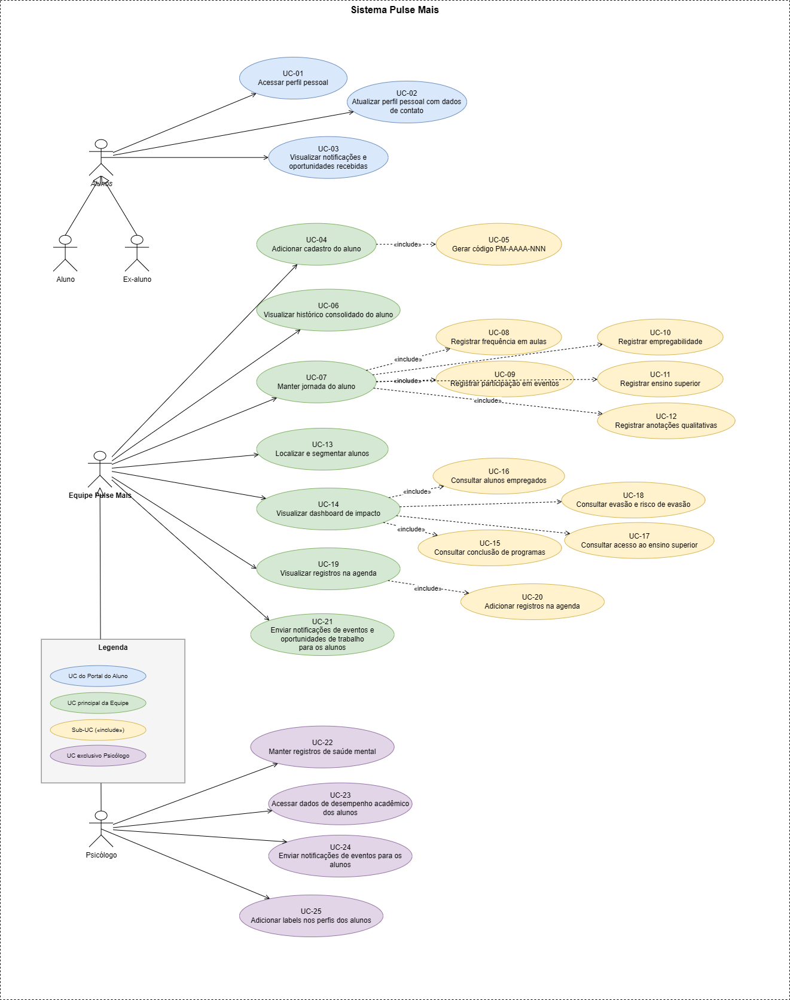<br>
<sub>Fonte: Autoria própria (2026). </sub><br>
</div>

### 3.2.3. Diagrama de Classes do Domínio (sprint 2)

<div align="justify">

O Diagrama de Classes de Domínio do sistema Pulse Mais estabelece a estrutura conceitual e lógica das entidades de negócio, definindo a organização dos dados e as regras de associação que regem o ecossistema da ONG. O modelo foi projetado para assegurar a integridade da informação e a rastreabilidade das interações entre os alunos e a equipe multidisciplinar, focando na unificação de dados provenientes de múltiplos contextos operacionais.

</div>

<div align="center">
<sup>Figura 9: Diagrama de Classes de Domínio.</sup><br>
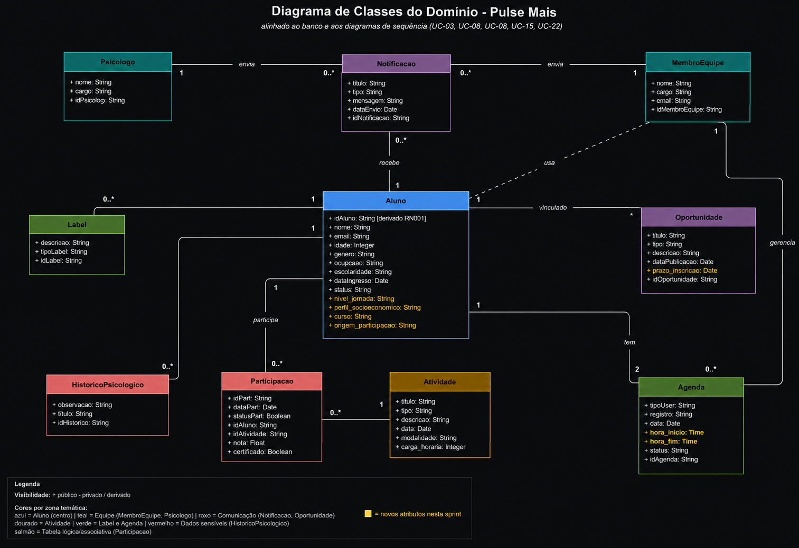<br>
<sub>Fonte: Autoria própria (2026). </sub><br>
</div>

<div align="justify">

A entidade Aluno atua como o núcleo do domínio, consolidando atributos biográficos, acadêmicos e profissionais que servem como o ponto de unificação para os demais módulos. O acesso a esses dados é estruturado através de uma relação de Dependência com a classe Membro da Equipe, o que formaliza a capacidade de consulta e monitoramento administrativo sem estabelecer um vínculo de posse estrutural. Paralelamente, a classe Psicólogo detém a responsabilidade técnica sobre os registros sensíveis, conectando-se diretamente ao aluno para o acompanhamento clínico e evolutivo.

A gestão de eventos e a comunicação interna são operacionalizadas pelas classes Agenda, Notificação e Oportunidade. A Agenda funciona como uma entidade de intersecção que coordena a temporalidade das interações entre a equipe e os alunos. Já as Notificações garantem a rastreabilidade da comunicação assíncrona, enquanto a classe Oportunidade mapeia os vínculos externos, como processos seletivos e cursos, permitindo o acompanhamento da progressão de carreira dos assistidos.

No que tange aos registros de impacto e classificação, a classe Atividade armazena as instâncias de participação e engajamento em programas internos. A organização desses dados é refinada pela classe Label, que fornece uma taxonomia para categorização e filtragem eficiente. O tratamento de dados sensíveis é garantido pela Composição entre Aluno e Histórico Psicológico, uma relação que impõe integridade referencial forte; tecnicamente, o ciclo de vida do histórico é indissociável da entidade mestre, garantindo que o armazenamento e a exclusão de dados sensíveis ocorram em conformidade com as diretrizes de privacidade e governança de dados.

</div>

#### 3.2.3.1 Diagrama de Classes Arquitetural

<div align="center">
<sup>Figura 10: Diagrama de Classes Arquitetural.</sup><br>
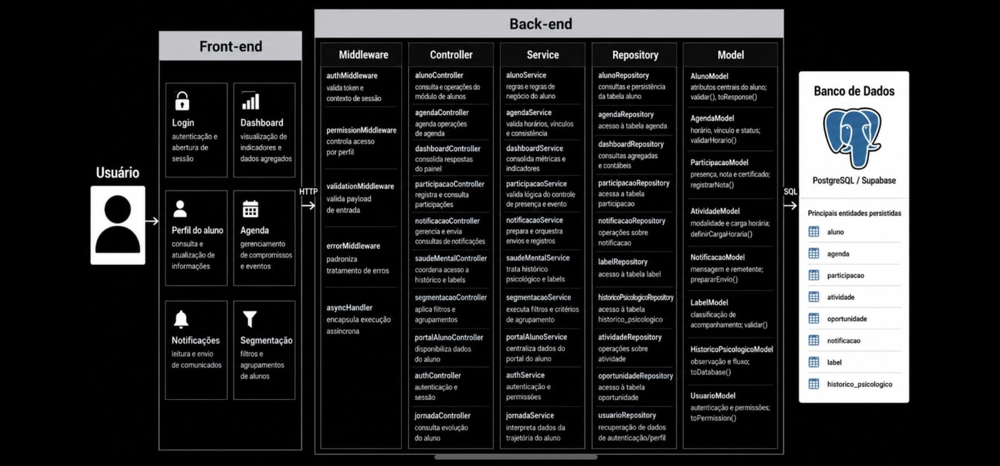<br>
<sub>Fonte: Autoria própria (2026). </sub><br>
</div>

<div>
O diagrama de classes arquitetural representa a organização lógica da aplicação, evidenciando a separação entre as camadas de front-end, back-end e banco de dados. A arquitetura foi estruturada de forma modular, buscando separar responsabilidades, facilitar a manutenção do sistema e permitir maior escalabilidade conforme novas funcionalidades forem adicionadas.

No front-end, o usuário interage com os principais módulos da plataforma, como Login, Dashboard, Perfil do Aluno, Agenda, Notificações e Segmentação. Essa camada é responsável pela interface visual e pela comunicação com o back-end por meio de requisições HTTP. Cada funcionalidade do front-end representa uma área de interação do usuário com o sistema, permitindo autenticação, consulta de informações, visualização de indicadores, gerenciamento de compromissos, recebimento de comunicados e aplicação de filtros ou agrupamentos de alunos.

O back-end concentra a regra de negócio da aplicação e está organizado em cinco camadas principais: Middleware, Controller, Service, Repository e Model. Essa divisão segue uma lógica comum em aplicações web modernas, na qual cada camada possui uma responsabilidade específica dentro do fluxo de processamento das requisições.

A camada de Middleware atua antes da execução das rotas principais, sendo responsável por tarefas transversais do sistema. Nela estão concentradas funções como validação de autenticação e sessão, controle de permissões por perfil, validação dos dados de entrada, padronização de erros e encapsulamento de execuções assíncronas. Dessa forma, os middlewares ajudam a garantir segurança, consistência e tratamento adequado das requisições antes que elas cheguem às regras de negócio.

A camada de Controller recebe as requisições vindas do front-end e direciona cada operação para o serviço correspondente. Os controllers organizam os pontos de entrada da API, como operações relacionadas a alunos, agenda, dashboard, participações, notificações, saúde mental, segmentação, portal do aluno, autenticação e jornada do aluno. Sua função principal é intermediar a comunicação entre a interface e a lógica de negócio, sem concentrar regras complexas.

A camada de Service concentra as regras de negócio da aplicação. É nela que são realizadas validações, consolidações de informações e operações específicas de cada domínio do sistema. Por exemplo, o alunoService trata regras relacionadas ao cadastro e informações dos alunos; o agendaService valida horários, vínculos e consistência de eventos; o dashboardService consolida métricas e indicadores; e o segmentacaoService aplica critérios de filtros e agrupamentos. Essa camada garante que as decisões do sistema fiquem centralizadas e não sejam misturadas com a lógica de interface ou persistência.

A camada de Repository é responsável pela comunicação com o banco de dados. Ela abstrai as operações de consulta, criação, atualização e recuperação de dados, acessando entidades como aluno, agenda, participação, notificação, atividade, oportunidade, label e histórico psicológico. Essa separação evita que as regras de negócio acessem diretamente o banco, tornando o sistema mais organizado e facilitando futuras alterações na forma de persistência.

A camada de Model representa as principais entidades do domínio da aplicação. Cada model define a estrutura e os comportamentos associados a uma entidade do sistema, como AlunoModel, AgendaModel, ParticipacaoModel, AtividadeModel, NotificacaoModel, LabelModel, HistoricoPsicologicoModel e UsuarioModel. Esses modelos refletem os objetos centrais manipulados pela aplicação e ajudam a manter a coerência dos dados ao longo do sistema.

Por fim, a aplicação utiliza um banco de dados PostgreSQL/Supabase, acessado pelo back-end por meio de comandos SQL. As principais entidades persistidas são: aluno, agenda, participacao, atividade, oportunidade, notificacao, label e historico_psicologico. Essas tabelas armazenam os dados essenciais para o funcionamento da plataforma, servindo como base para as consultas, indicadores, registros de acompanhamento e demais funcionalidades do sistema.

De forma geral, o diagrama evidencia uma arquitetura em camadas, na qual o usuário interage com o front-end, que se comunica com o back-end via HTTP. O back-end processa a requisição passando por middlewares, controllers, services e repositories, até acessar o banco de dados. Essa estrutura favorece a organização do código, a separação de responsabilidades, a reutilização de componentes e a evolução da aplicação de maneira mais segura e controlada.

</div>

### 3.2.4. Diagrama de Sequência UML

<div align="justify">

Esta seção apresenta cinco diagramas de sequência UML que descrevem como os principais fluxos do sistema Pulse Mais se desenrolam no tempo. Cada diagrama segue a mesma arquitetura em camadas (Tela, Controller, Service, Repository e Banco) e usa a notação UML padrão: linhas contínuas para mensagens síncronas, tracejadas para retornos, barras de ativação sobre as lifelines e fragmentos `alt` para fluxos alternativos. Os fluxos diagramados são UC-03 (Manter cadastro do aluno), UC-06 (Visualizar histórico consolidado do aluno), UC-08 (Registrar participação em atividade), UC-15 (Visualizar dashboard de impacto) e UC-22 (Manter registros de saúde mental), escolhidos por exercitarem todas as camadas e cobrirem os requisitos funcionais e regras de negócio mais críticos do MVP.

</div>

#### 3.2.4.1. UC-04 - Adicionar cadastro do aluno

<div align="center">
<sup>Figura 11: Diagrama de sequência do caso de uso Adicionar cadastro do aluno.</sup><br>
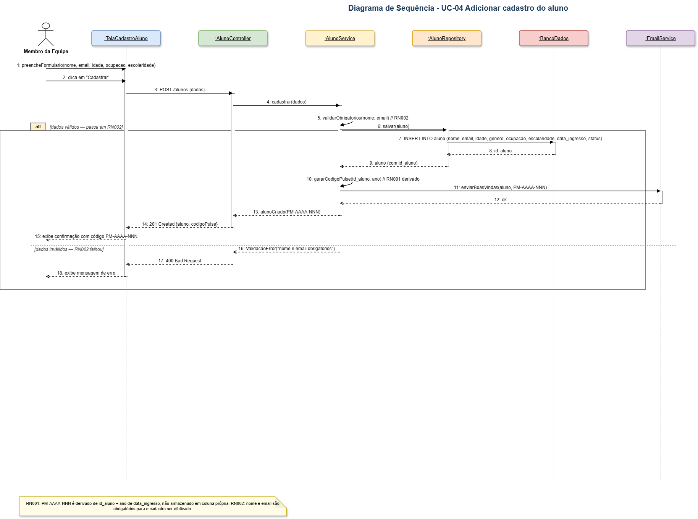<br>
<sub>Fonte: Autoria própria (2026). </sub><br>
</div>

<div align="justify">

O fluxo começa quando o membro da equipe preenche o formulário de cadastro na `:TelaCadastroAluno` e submete os dados ao `:AlunoController`, que os repassa ao `:AlunoService`. O service realiza a validação dos campos obrigatórios (RN002), e em caso de sucesso aciona o `:AlunoRepository` para persistir o registro no banco. Após o INSERT, o service deriva o código identificador no formato `PM-AAAA-NNN` a partir do `id_aluno` e do ano de ingresso — operação detalhada como caso de uso próprio (UC-04, incluído via `«include»`), cobrindo a RN001 — e dispara a mensagem de boas-vindas pelo `:EmailService`. A confirmação retorna pelas camadas até a tela, exibindo o código gerado ao usuário. Caso a validação inicial falhe, o fluxo segue pelo ramo alternativo do fragmento `alt`, devolvendo um erro 400 sem chegar ao banco. Esse diagrama atende ao RF001 e cobre as RN001 e RN002.

</div>

#### 3.2.4.2. UC-06 — Visualizar histórico consolidado do aluno

<div align="center">
<sup>Figura 12: Diagrama de sequência do caso de uso Visualizar histórico consolidado do aluno.</sup><br>
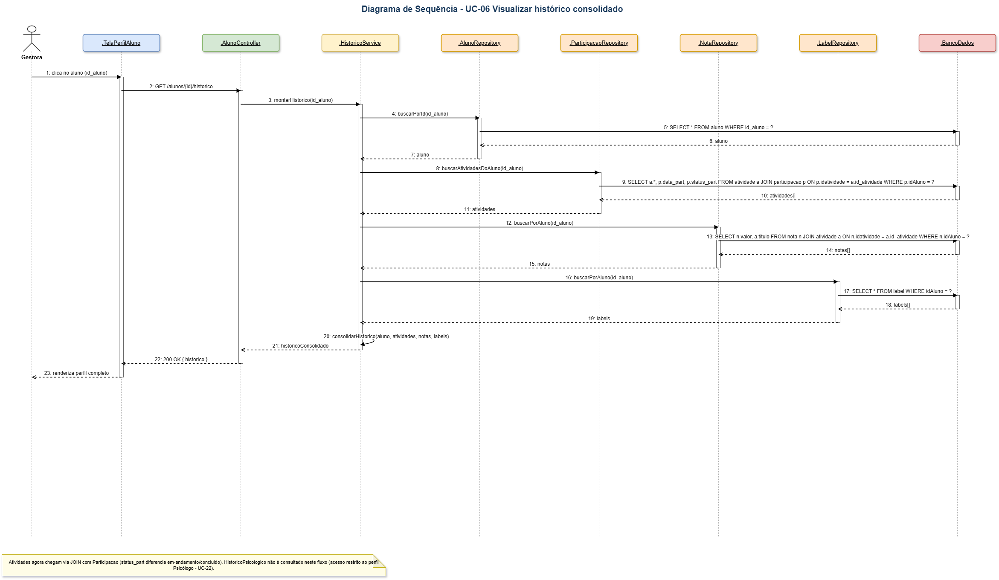<br>
<sub>Fonte: Autoria própria (2026). </sub><br>
</div>

<div align="justify">

A gestora seleciona um aluno na lista e a `:TelaPerfilAluno` chama o `:AlunoController` via `GET /api/alunos/:id`. O controller consulta os dados do aluno e devolve, quando disponível, as informações de histórico associadas ao perfil. A tela então renderiza o perfil consolidado. Vale notar que `HistoricoPsicologico` não aparece neste fluxo: o acesso a esse tipo de informação é restrito ao perfil Psicólogo (RN012), e o fluxo correspondente está detalhado em 3.2.4.5. Esse diagrama atende ao RF004, ainda de forma parcial no MVP atual.

</div>

#### 3.2.4.3. UC-07 — Manter jornada do aluno

<div align="center">
<sup>Figura 13: Diagrama de sequência do caso de uso Manter jornada do aluno.</sup><br>
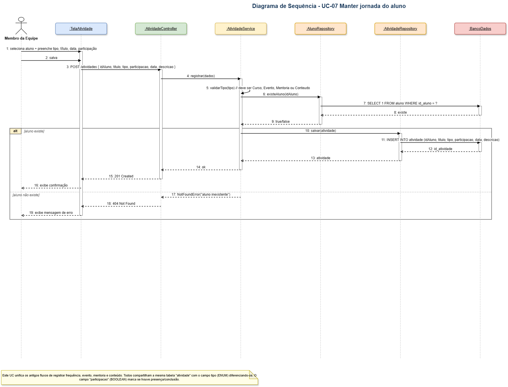<br>
<sub>Fonte: Autoria própria (2026). </sub><br>
</div>

<div align="justify">

O membro da equipe seleciona um aluno e uma atividade existente do catálogo, e define o status da participação. A `:TelaParticipacao` envia `POST /participacoes` ao `:ParticipacaoController`, que delega ao `:ParticipacaoService`. O service executa duas validações em sequência: existência do aluno (`:AlunoRepository`) e existência da atividade (`:AtividadeRepository`). Quando ambas retornam verdadeiro, o ramo principal do fragmento `alt` é seguido: o `:ParticipacaoRepository` emite o `INSERT` na tabela `participacao`, registrando `id_aluno`, `id_atividade`, `data_part`, `status_part` e, quando aplicável, `nota`, e a confirmação retorna pelas camadas até a tela. Quando qualquer das validações falha, o ramo alternativo devolve 404 sem chegar à escrita, preservando a integridade referencial. Diferente de um simples registro de frequência, este fluxo cria uma entrada completa de participação — com data, status e nota próprios — que sustenta tanto a consulta de histórico (UC-06) quanto o cálculo de indicadores (UC-15). Esse diagrama atende aos RF005 e RF006, mas o endpoint específico de participação ainda não está implementado no backend atual.

</div>

#### 3.2.4.4. UC-14 — Visualizar dashboard de impacto

<div align="center">
<sup>Figura 14: Diagrama de sequência do caso de uso Visualizar dashboard de impacto.</sup><br>
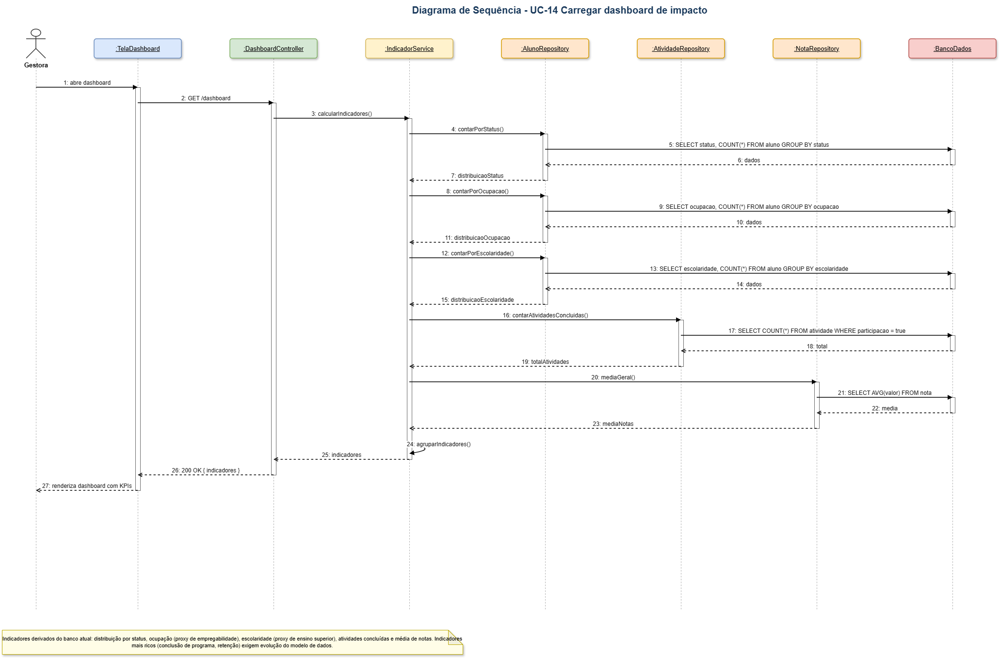<br>
<sub>Fonte: Autoria própria (2026). </sub><br>
</div>

<div align="justify">

A gestora abre o dashboard e a `:TelaDashboard` chama endpoints de resumo, como `/api/impacto/resumo` e `/api/jornada/resumo`, para apresentar os principais indicadores institucionais. A ocupação serve como proxy para empregabilidade e a escolaridade como proxy para acesso ao ensino superior, uma vez que o banco atual do MVP não modela explicitamente vínculos empregatícios ou matrículas em instituições de ensino superior — essas dimensões mais ricas estão previstas para iterações futuras. Esse fluxo atende parcialmente aos RF012, RF013, RF015 e RF016; o RF014 permanece planejado por depender de cálculo específico de conclusão de programa por período.

</div>

#### 3.2.4.5. UC-22 — Manter registros de saúde mental

<div align="center">
<sup>Figura 15: Diagrama de sequência do caso de uso Manter registros de saúde mental.</sup><br>
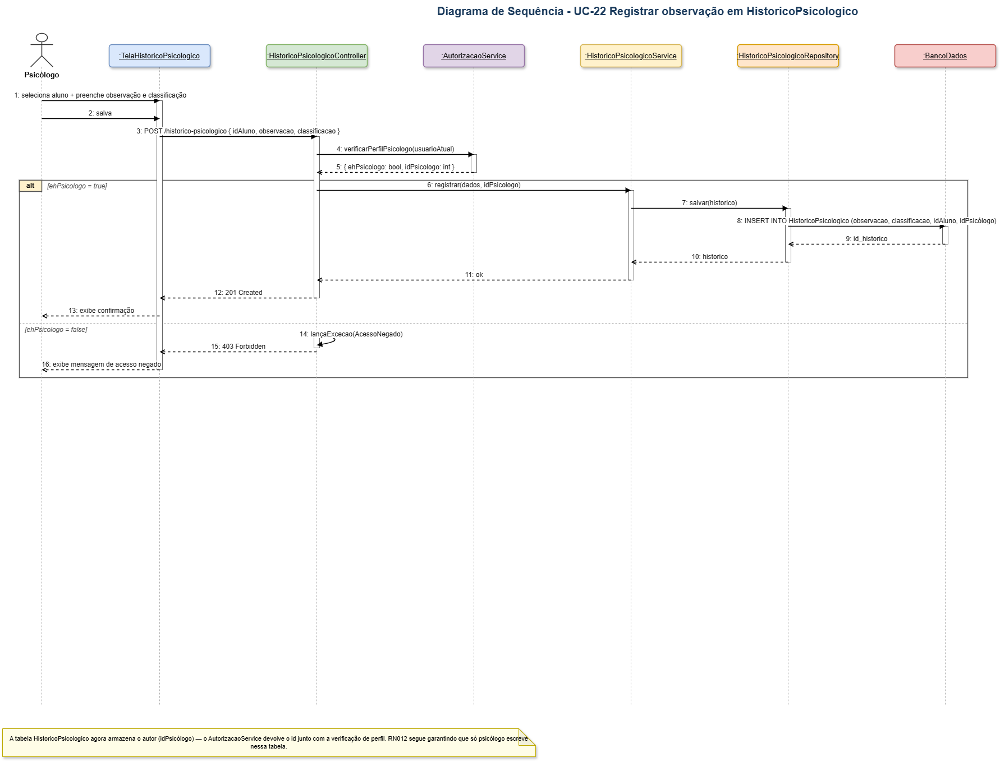<br>
<sub>Fonte: Autoria própria (2026). </sub><br>
</div>

<div align="justify">

O psicólogo seleciona um aluno e visualiza registros de acompanhamento no módulo de prontuário, atualmente exposto no backend por `GET /api/prontuarios`. A regra de restrição de acesso ao conteúdo sensível permanece associada à RN012 e ao RF010, embora a criação de registros psicológicos por `POST` ainda não esteja implementada no backend atual. Esse fluxo atende parcialmente ao RF009 e ao RF010 e cobre a RN012.

</div>

### 3.2.5. Diagrama de Atividades ou Estados (sprint 3)

_Ao menos um fluxo relevante em UML ou BPMN. Use a notação da ferramenta escolhida de forma consistente (sem misturar convenções)._

### 3.2.6. Diagrama de Implantação (sprints 4 e 5)

_Diagrama UML de deployment mostrando nós físicos, artefatos e canais de comunicação. Representa a visão Engineering + Technology do RM-ODP._

### 3.2.7. Padrões de Projeto Aplicados (sprints 3 a 5)

<div align="justify">

Um padrão de projeto é uma solução já testada e documentada para resolver um problema recorrente em projetos distintos. A adoção de padrões proporciona benefícios como aumento de produtividade, redução de complexidade, facilidade de manutenção e reaproveitamento de código. O backend do sistema Pulse Mais foi desenvolvido em TypeScript com Express, TypeORM e PostgreSQL via Supabase, e aplica os padrões descritos a seguir, cada um adotado com base em uma necessidade real do projeto.

</div>

#### MVC (Model-View-Controller)

<div align="justify">

O padrão MVC separa o projeto em três camadas independentes: Model, View e Controller. Essa separação reduz o acoplamento entre as classes e aumenta a coesão, fazendo com que cada parte do sistema tenha um único propósito bem definido. No Pulse Mais, a camada Model reúne as entidades do domínio como Aluno, Participacao e HistoricoPsicologico. A camada Controller atua como intermediária entre as requisições HTTP e a camada de negócio, sem conter lógica de processamento. As Routes mapeiam os endpoints aos controllers correspondentes. Esse padrão foi adotado para que os módulos de alunos, jornada, dashboard e saúde mental possam ser desenvolvidos e evoluídos de forma independente ao longo das cinco sprints.

</div>

#### DAO (Data Access Object) via TypeORM e Pool Nativo

<div align="justify">

O padrão DAO separa as classes de acesso a banco de dados das classes responsáveis pelas regras de negócio. No Pulse Mais, isso é feito por dois mecanismos paralelos: o arquivo connection.ts usa o TypeORM com mapeamento objeto-relacional via decorators para operações estruturadas, e o pool.ts usa o driver pg nativo com Pool de conexões para queries SQL diretas. Ambos se conectam ao PostgreSQL hospedado no Supabase. O controle de acesso por perfil fica centralizado em permissions.ts, onde se define que apenas o psicólogo acessa registros de saúde mental e apenas o gestor pode modificar a agenda, por exemplo.

</div>

#### Service Layer

<div align="justify">

A camada de Services concentra todas as regras de negócio da aplicação. Os controllers recebem a requisição e delegam integralmente o processamento para o service correspondente, instanciado via injeção no construtor. Regras críticas como a geração do código PM-AAAA-NNN, a validação de risco de evasão e o controle de acesso aos prontuários ficam centralizadas nos services, podendo ser testadas de forma isolada sem depender da camada HTTP.

</div>

#### Middleware Chain

<div align="justify">

O encadeamento de middlewares intercepta as requisições antes que cheguem aos controllers, centralizando responsabilidades transversais. O authMiddleware extrai os dados do usuário dos headers HTTP. O permissionMiddleware controla o acesso por perfil. O errorMiddleware centraliza o tratamento de exceções, respondendo com o status HTTP correto para cada tipo de erro. Esse padrão evita que lógica de verificação de perfil fique duplicada dentro de cada controller.

</div>

#### Error Object Hierarchy

<div align="justify">

Uma hierarquia de classes de erro foi implementada em errors.ts, com AppError como classe base e subclasses especializadas: PayloadValidationError para erros de validação de entrada com HTTP 400, BusinessRuleError para violações de regra de negócio com HTTP 422, NotFoundError para recursos não encontrados com HTTP 404 e ConflictError para conflitos de dados com HTTP 409. Todos os controllers seguem o mesmo contrato de tratamento, garantindo respostas semânticas e consistentes em toda a API.

</div>

#### Utility Module

<div align="justify">

Funções utilitárias reutilizáveis foram isoladas em módulos dedicados dentro de src/utils: validators.ts para validação e sanitização de parâmetros, errors.ts para a hierarquia de erros, response.ts para o envelope padronizado de respostas e date.ts para validação e formatação de datas ISO. Essa separação garante que a mesma lógica seja reutilizada de forma consistente em todos os controllers sem duplicação de código.

</div>

## 3.3. Wireframes (sprint 2)

<div align="justify">
Wireframes são esboços simples de telas, como sites e aplicativos. O objetivo é validar ideias, por isso eles não contêm informações detalhadas como cores, imagens e tipografia final. Desta forma, wireframes conseguem demonstrar de forma direta a estrutura das telas e o fluxo de navegação do sistema, focando apenas no que é essencial.
</div>

<div align="justify">

Caso queira acessar os wireframes completos, acesse o link: https://www.canva.com/design/DAHJebfiO4A/NqxvsvUgwcbkv3LeEEnRwA/edit

</div>


<div align="center">
<sup>Figura 16: Fluxo de telas do perfil Aluno.</sup><br>
    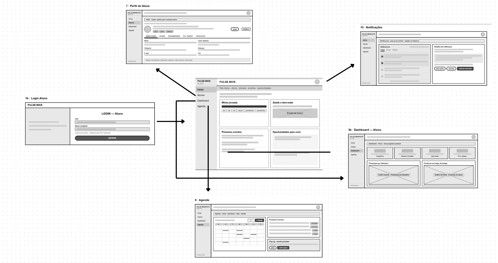<br>
    <sub>Fonte: Autoria própria (2026).</sub>
</div>

<div align="justify">
Neste fluxo, o aluno faz login com CPF e nome, acessa a tela inicial com jornada, eventos e oportunidades, e navega para Perfil, Dashboard (progresso/presenças), Agenda (calendário) ou Notificações.
</div>


<div align="center">
<sup>Figura 17: Fluxo de telas do perfil Gestor.</sup><br>
    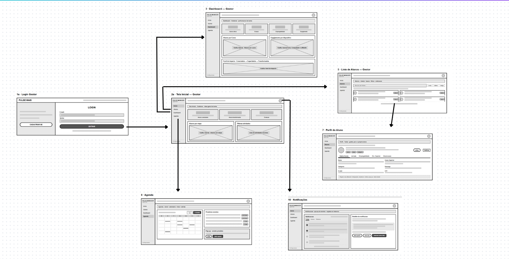<br>
    <sub>Fonte: Autoria própria (2026).</sub>
</div>

<div align="justify">
O gestor faz login com e-mail e senha, acessa a tela inicial com visão geral da turma (alunos conectafos, transformados e evolução), e navega para Dashboard (performance/gráficos), Lista de Alunos (com filtros e acesso ao perfil individual), Agenda ou Notificações.
</div>


<div align="center">
<sup>Figura 18: Fluxo de telas do perfil Psicólogo.</sup><br>
    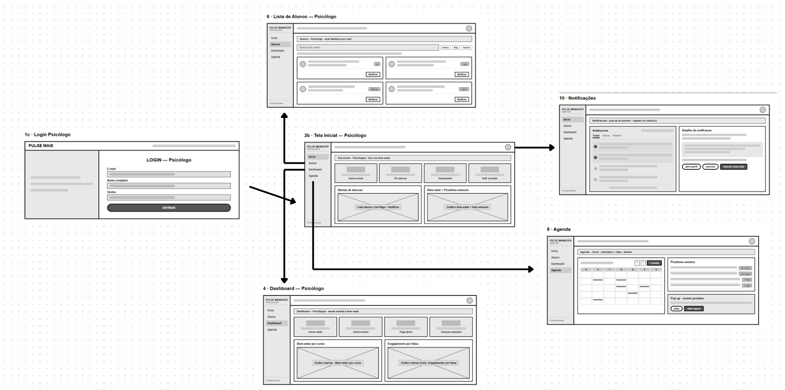<br>
    <sub>Fonte: Autoria própria (2026).</sub>
</div>

<div align="justify">
O psicólogo faz login com e-mail, nome e senha, acessa a tela inicial com foco em bem-estar (alunos acompanhados, em atenção, sessões e alertas com flags), e navega para lista de Alunos (com ação de notificar por card), Dashboard (saúde mental/bem-estar por curso e faixa) Agenda ou Notificações.
</div>


<div align="center">
<sup>Figura 19: Wireframe da tela de login do Gestor.</sup><br>
    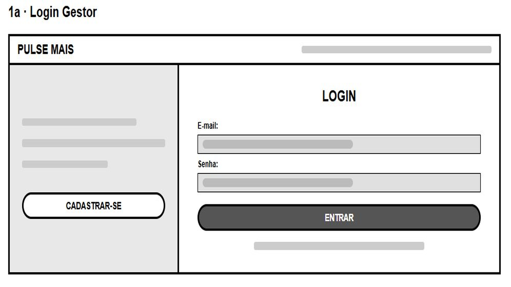<br>
    <sub>Fonte: Autoria própria (2026).</sub>
</div>

<div align="justify">
Tela de login do sistema  dividida em dois painéis. O painel esquerdo (cinza) exibe conteúdo informativo com textos placeholder e um botão "CADASTRAR-SE". O painel direito contém o formulário de login com campos de E-mail e Senha. Um botão escuro "ENTRAR" centralizado realiza o acesso. Abaixo do botão há um link placeholder, provavelmente para recuperação de senha.
</div>

<div align="center">
<sup>Figura 20: Wireframe da tela de login do Aluno.</sup><br>
    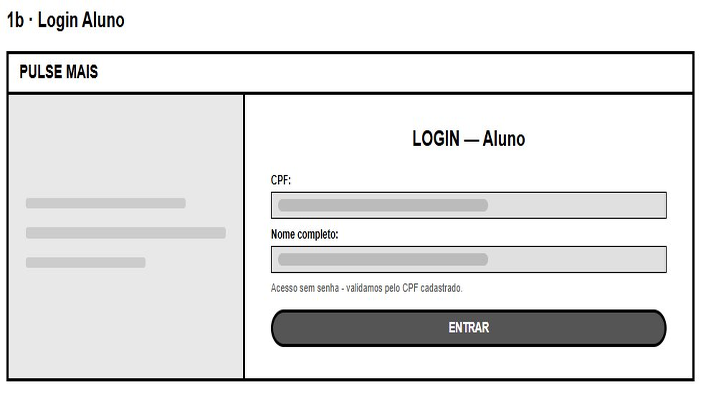<br>
    <sub>Fonte: Autoria própria (2026).</sub>
</div>

<div align="justify">
Tela de login para Alunos do PULSE MAIS com layout dividido em dois painéis. O painel esquerdo exibe conteúdo informativo da plataforma. O painel direito contém campos de CPF e Nome completo para autenticação. O acesso é feito sem senha, validado apenas pelo CPF cadastrado. Um botão "ENTRAR" escuro centralizado confirma o login.
</div>

<div align="center">
<sup>Figura 21: Wireframe da tela de login do Psicólogo.</sup><br>
    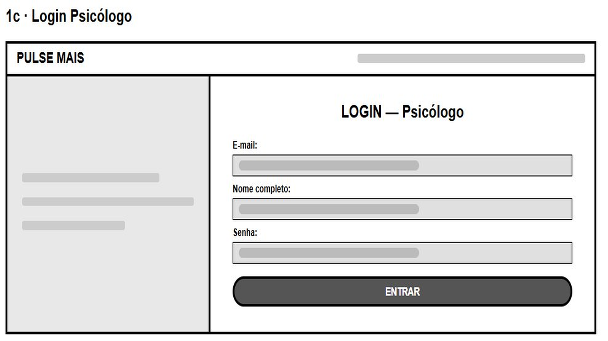<br>
    <sub>Fonte: Autoria própria (2026).</sub>
</div>

<div align="justify">
Tela de login exclusiva para psicólogos da plataforma Pulse Mais. Dividida em dois painéis: esquerdo com imagem/texto ilustrativo, direito com formulário. O formulário possui três campos (e-mail, nome completo e senha) e um botão "Entrar".
</div>

<div align="center">
<sup>Figura 22: Wireframe da tela inicial do Gestor.</sup><br>
    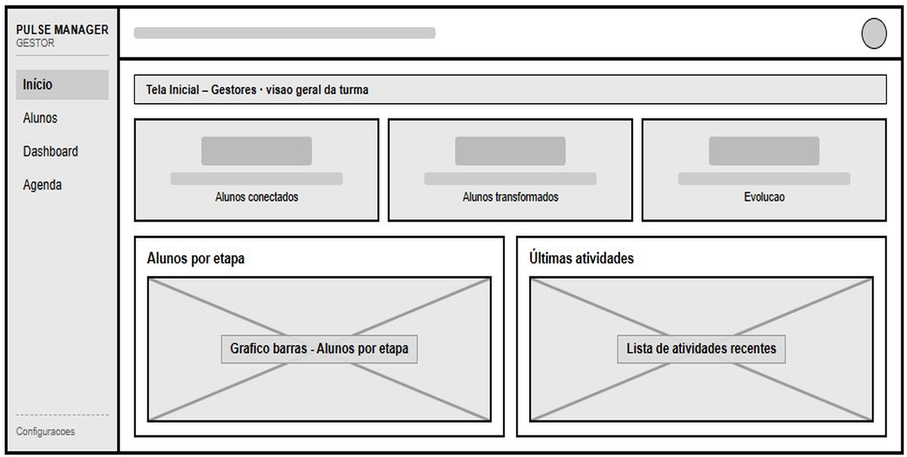<br>
    <sub>Fonte: Autoria própria (2026).</sub>
</div>

<div align="justify">
Tela inicial do gestor no Pulse Manager, com menu lateral contendo Início, Alunos, Dashboard e Agenda. No topo, três cards de métricas: alunos conectados, alunos transformados e evolução. Na parte inferior, dois painéis: um gráfico de barras com distribuição de alunos por etapa e uma lista de atividades recentes. Layout de dashboard simples, focado em visão geral da turma.
</div>

<div align="center">
<sup>Figura 23: Wireframe da tela inicial do Psicólogo.</sup><br>
    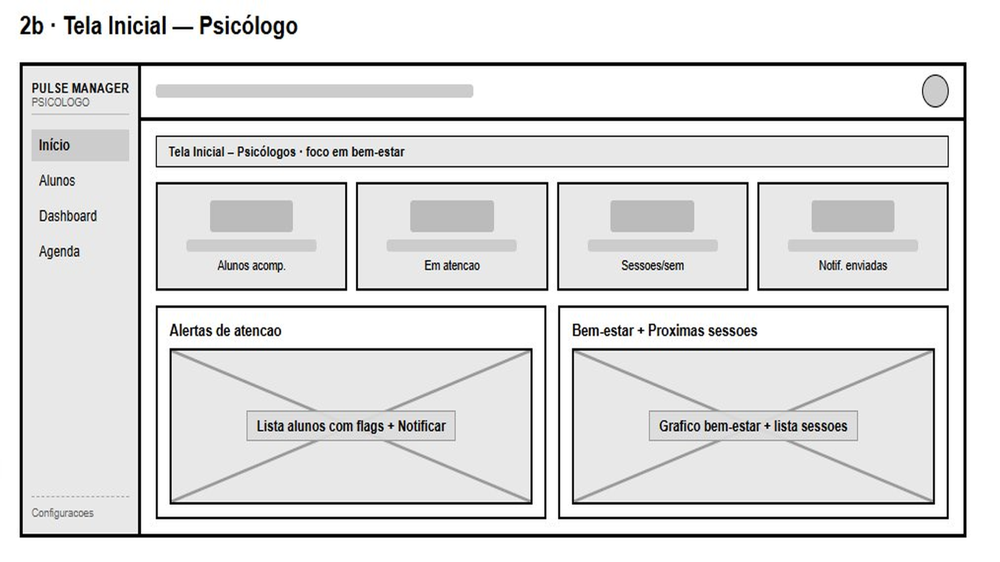<br>
    <sub>Fonte: Autoria própria (2026).</sub>
</div>

<div align="justify">
Tela inicial do psicólogo no Pulse Manager, com menu lateral contendo Início, Alunos, Dashboard e Agenda. No topo, quatro cards de métricas: alunos acompanhados, em atenção, sessões por semana e notificações enviadas. Na parte inferior, dois painéis: alertas de atenção com lista de alunos sinalizados e opção de notificar, e um painel de bem-estar com gráfico e lista das próximas sessões. Foco em monitoramento clínico e agenda do psicólogo.
</div>

<div align="center">
<sup>Figura 24: Wireframe do Dashboard do Gestor.</sup><br>
    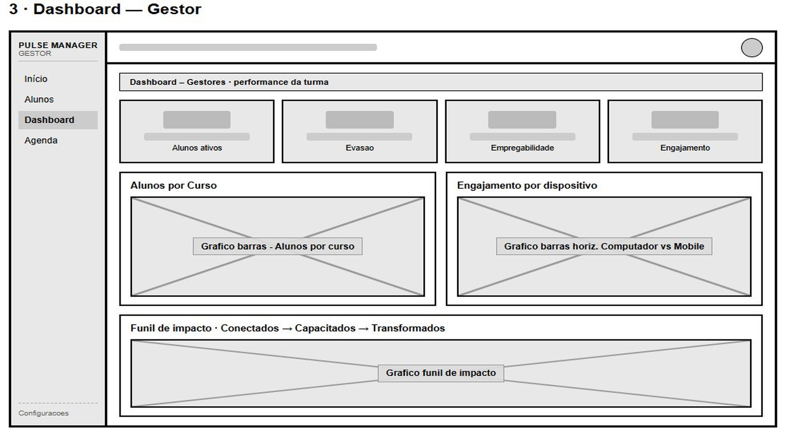<br>
    <sub>Fonte: Autoria própria (2026).</sub>
</div>

<div align="justify">
Dashboard de performance da turma para o gestor no Pulse Manager. No topo, quatro cards de métricas: alunos ativos, evasão, empregabilidade e engajamento. Na faixa do meio, dois gráficos de barras: distribuição de alunos por curso e engajamento. Na parte inferior, um gráfico de funil de impacto mostrando a jornada dos alunos: conectados, capacitados,transformados.
</div>

<div align="center">
<sup>Figura 25: Wireframe do Dashboard do Aluno.</sup><br>
    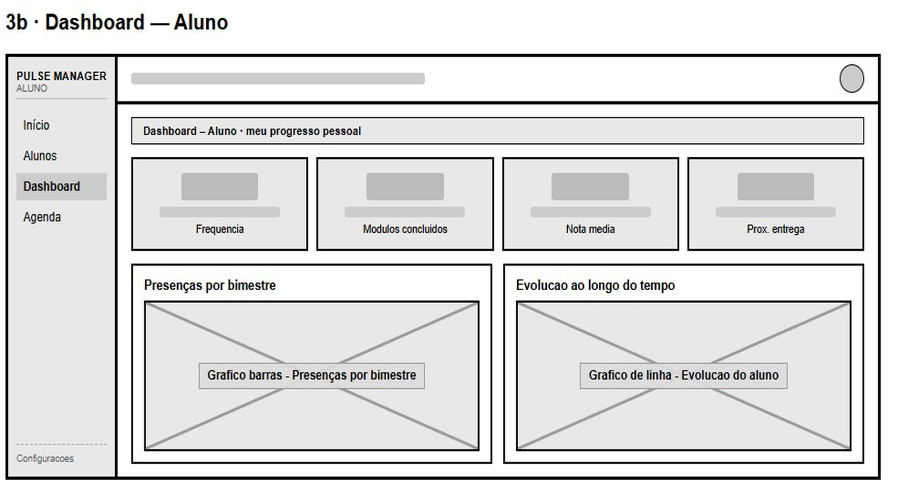<br>
    <sub>Fonte: Autoria própria (2026).</sub>
</div>

<div align="justify">
Dashboard de progresso pessoal do aluno no Pulse Manager. No topo, quatro cards de métricas: frequência, módulos concluídos, nota média e próxima entrega. Na parte inferior, dois gráficos: barras com presenças por bimestre e linha com a evolução do aluno ao longo do tempo. Foco em automonitoramento e acompanhamento acadêmico individual.
</div>

<div align="center">
<sup>Figura 26: Wireframe do Dashboard do Psicólogo.</sup><br>
    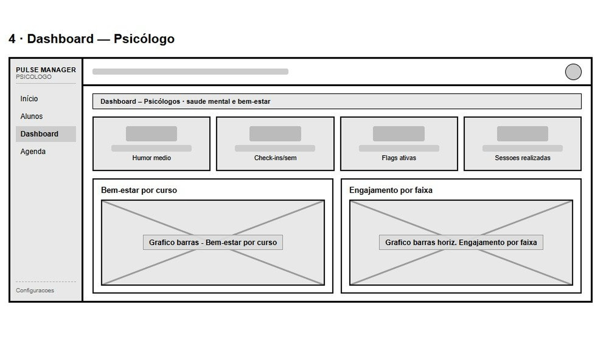<br>
    <sub>Fonte: Autoria própria (2026).</sub>
</div>

<div align="justify">
A tela de Dashboard do Psicólogo apresenta uma barra de navegação lateral com as seções Início, Alunos, Dashboard e Agenda, além de Configurações fixadas na parte inferior. No topo da área principal, quatro cartões exibem indicadores-chave de saúde mental: Humor Médio, Check-ins por semana, Flags Ativas e Sessões Realizadas. Na metade inferior, dois gráficos de barras complementam a análise: "Bem-estar por curso" e "Engajamento por faixa etária", permitindo comparações visuais entre grupos. O cabeçalho global mantém o campo de busca e o ícone de perfil do usuário, seguindo o padrão de layout das demais telas da plataforma.
</div>

<div align="center">
<sup>Figura 27: Wireframe da lista de alunos do Psicólogo.</sup><br>
    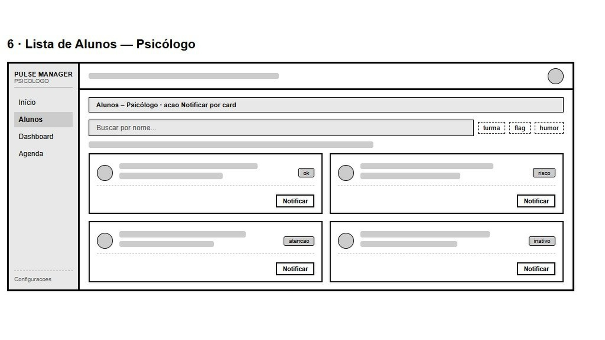<br>
    <sub>Fonte: Autoria própria (2026).</sub>
</div>

<div align="justify">
Tela de listagem de alunos do psicólogo no sistema Pulse Manager, exibindo cards em grade com foto, nome, turma e status de cada aluno (ok, risco, atenção, inativo). Há uma barra de busca por nome com filtros por turma, flag e humor para facilitar a localização de alunos específicos. Cada card possui um botão "Notificar" que permite ao psicólogo acionar uma notificação diretamente a partir da listagem.
</div>

<div align="center">
<sup>Figura 28: Wireframe do perfil do aluno na visão do Gestor.</sup><br>
    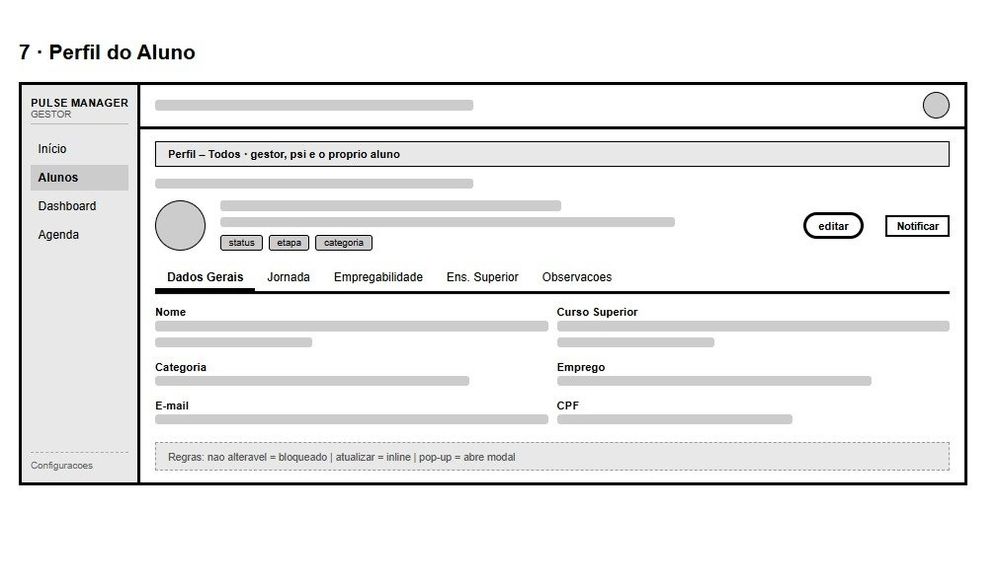<br>
    <sub>Fonte: Autoria própria (2026).</sub>
</div>

<div align="justify">
A tela exibe o perfil de um aluno com navegação lateral (Início, Alunos, Dashboard, Agenda) e abas de conteúdo (Dados Gerais, Jornada, Empregabilidade, Ens. Superior, Observações). No topo do perfil há foto, status, etapa, categoria e botões de "editar" e "Notificar", com campos como Nome, E-mail, CPF, Curso Superior e Emprego na aba ativa. O acesso é compartilhado entre gestor, psicólogo e o próprio aluno.
</div>

<div align="center">
<sup>Figura 29: Wireframe da tela inicial do Aluno.</sup><br>
    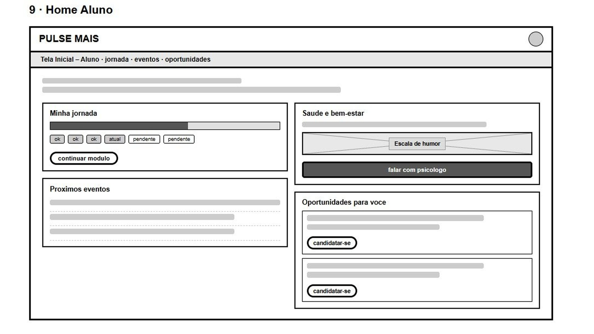<br>
    <sub>Fonte: Autoria própria (2026).</sub>
</div>

<div align="justify">
Tela inicial do aluno está dividida em quatro seções: jornada de aprendizado com barra de progresso e módulos, próximos eventos, saúde e bem-estar com escala de humor e acesso a psicólogo, e oportunidades com botões de candidatura. O layout usa dois painéis lado a lado para organizar o conteúdo. A navegação superior destaca as áreas principais: jornada, eventos e oportunidades.
</div>

<div align="center">
<sup>Figura 30: Wireframe da tela de Agenda.</sup><br>
    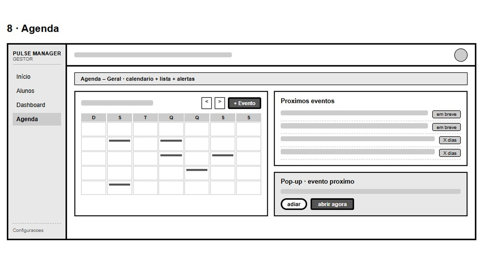<br>
    <sub>Fonte: Autoria própria (2026).</sub>
</div>

<div align="justify">
Wireframe da tela agenda com calendário mensal navegável e botão "+ Evento" à esquerda, e dois painéis à direita: lista de próximos eventos com indicadores de tempo e um pop-up de alerta com opções "adiar" ou "abrir agora". Elementos de conteúdo são representados por retângulos cinzas em layout de duas colunas.
</div>

<div align="center">
<sup>Figura 31: Wireframe da tela de Notificações do Gestor.</sup><br>
    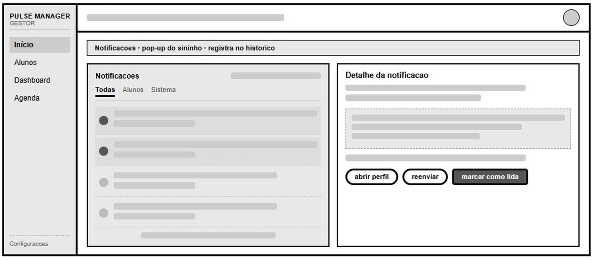<br>
    <sub>Fonte: Autoria própria (2026).</sub>
</div>

<div align="justify">
Wireframe da tela notificações com uma lista à esquerda filtrada por abas (Todas, Alunos, Sistema), onde círculos indicam notificações não lidas, e um painel de detalhe à direita exibindo o conteúdo da notificação selecionada. As ações disponíveis no detalhe são abrir perfil, reenviar e marcar como lida.
</div>

<div align="center">
<sup>Figura 32: Wireframe da lista de alunos do Gestor.</sup><br>
    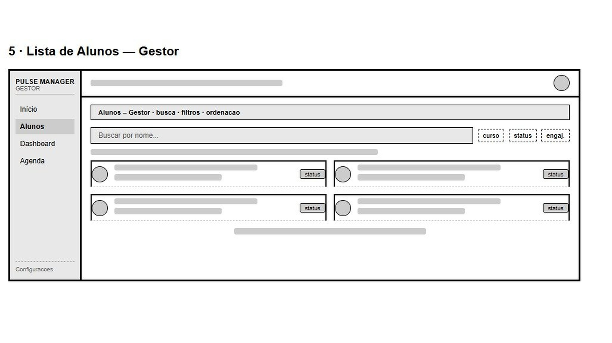<br>
    <sub>Fonte: Autoria própria (2026).</sub>
</div>

<div align="justify">
Wireframe de uma tela de gerenciamento de alunos com sidebar de navegação (Início, Alunos, Dashboard, Agenda), área principal com busca e filtros, e cards de alunos em grade 2x2 com avatar e status.
</div>

## 3.4. Guia de estilos (sprint 3)

<div align="justify">

O Pulse Manager adota um sistema de design próprio, derivado do Manual de Identidade Visual da Pulse Mais e ajustado para uma plataforma digital de gestão acolhedora, técnica e acessível. O princípio editorial que orienta o sistema é a combinação de acolhimento e seriedade técnica com esperança, posicionando os jovens atendidos como protagonistas - nunca como beneficiários passivos. A partir desse princípio, cada decisão visual é tomada com função semântica clara, sem escolhas estéticas aleatórias.

Esta seção do WAD apresenta os fundamentos da identidade visual da plataforma - as três cores institucionais, as duas famílias tipográficas e o sistema de iconografia. O detalhamento técnico completo (escalas tonais 50->900, neutros, cores de status, escala tipográfica Display->Micro, sistema de espaçamento em 4 px, cantos e sombras, estados de componentes, tom de voz e diretrizes de acessibilidade) está consolidado no documento Guia de Estilos – Pulse Manager, disponível em PDF no Drive do projeto:

🔗 [Guia de Estilos – Pulse Manager (PDF completo)](https://drive.google.com/file/d/1G8H7yAJ79vnQEwDpKnYnalWm99SWktlA/view?usp=drive_link)

</div>

### 3.4.1 Cores

<div align="justify">

A identidade cromática do Pulse Manager é herdada do Manual de Identidade Visual da Pulse Mais e composta por três cores institucionais - Azul, Verde e Amarelo - cada uma com função semântica clara no sistema. Toda decisão de aplicação cromática na plataforma parte dessa base: as cores nunca são escolhas estéticas aleatórias, mas tokens semânticos que comunicam ação, estado ou hierarquia.

</div>

<div align="center">
<sup>Figura 33: Azul Pulse - cor principal.</sup><br>
<br>
<sub>Fonte: Adaptado do Guia de Estilos – Pulse Manager v1.1 (2026).</sub><br>
</div>

<div align="justify">

**Azul Pulse (`#003870`)** - cor principal da plataforma. Sustenta a identidade institucional e é aplicada em headers, sidebars, links primários, navegação ativa, botões de ação institucional e texto sobre fundo claro quando é necessário destaque. É a cor que carrega a autoridade e a seriedade técnica do sistema.

</div>

<div align="center">
<sup>Figura 34: Verde Pulse - cor secundária.</sup><br>
<br>
<sub>Fonte: Adaptado do Guia de Estilos – Pulse Manager v1.1 (2026).</sub><br>
</div>

<div align="justify">

**Verde Pulse (`#338458`)** - cor secundária, associada a sucesso e ações afirmativas. Aplicada em confirmações (matricular, aprovar), trilhas concluídas, indicadores positivos e ícones de seleção. Reforça o eixo de esperança do princípio editorial do sistema.

</div>

<div align="center">
<sup>Figura 35: Amarelo Pulse - cor de destaque.</sup><br>
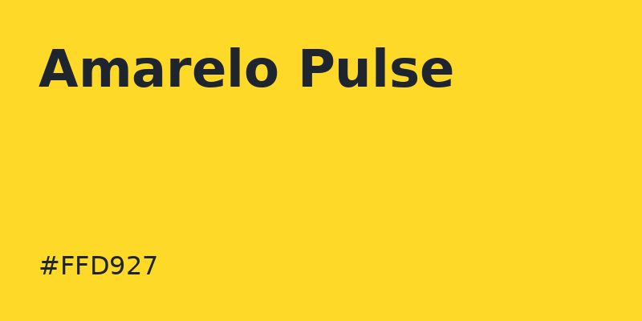<br>
<sub>Fonte: Adaptado do Guia de Estilos – Pulse Manager v1.1 (2026).</sub><br>
</div>

<div align="justify">

**Amarelo Pulse (`#FFD927`)** - cor de destaque pontual. Aplicada em tagline, badges, CTAs secundários, decorativos e sinalizações de atenção. Nunca é usada como cor principal de fundo, justamente para preservar seu papel de destaque dentro do sistema.

</div>

<div align="justify">

A escolha de manter apenas três cores institucionais como núcleo da paleta acompanha o princípio editorial do Pulse Manager: acolhimento e seriedade técnica com esperança. Cada cor carrega um papel específico e exclusivo (identidade, sucesso, destaque), o que garante leitura semântica imediata pela equipe gestora, pelos psicólogos e pelos alunos que utilizam a plataforma.

Para além das três cores institucionais, o sistema de design completo conta com escalas tonais 50→900 para cada cor (utilizadas em estados de hover, fundos suaves, bordas e camadas), uma escala neutra azulada para textos, bordas e estados desabilitados, e um conjunto dedicado de cores de status para comunicar o nível de acompanhamento dos alunos nos dashboards (Em dia, Atenção, Em risco, Urgente). O detalhamento dessas escalas, com tokens semânticos e códigos hexadecimais completos, está consolidado no Guia de Estilos – Pulse Manager v1.1 (PDF), referenciado na abertura desta seção.

</div>

### 3.4.2 Tipografia

<div align="justify">

O Pulse Manager adota duas famílias tipográficas com papéis distintos e complementares. A escolha de cada família não é estética - cada uma ocupa um espaço semântico específico na plataforma, garantindo hierarquia visual clara e leitura confortável em desktop e mobile.

**Poppins** é a família principal de corpo da plataforma. Desenvolvida pela Google Fonts, é uma sans-serif humanista que combina legibilidade técnica com acolhimento visual - características diretamente alinhadas ao princípio editorial do Pulse Manager. É aplicada em toda a UI da plataforma: textos de corpo, títulos de seção (H1 a H4), labels, botões, formulários, navegação e microcopy. Os pesos utilizados são Light (300), Regular (400), Medium (500), SemiBold (600), Bold (700) e ExtraBold (800), cobrindo desde microcopy raro até números de dashboard. Disponível gratuitamente em [fonts.google.com/specimen/Poppins](https://fonts.google.com/specimen/Poppins).

**Anton** é o display único da plataforma, utilizado exclusivamente no wordmark "Pulse Manager" e em headlines institucionais de alto impacto visual - grandes números de dashboard, KPIs hero e títulos de destaque. Por ser uma fonte de exibição com peso único (Regular 400), nunca é aplicada em corpo de texto, botões, labels ou parágrafos. Disponível gratuitamente em [fonts.google.com/specimen/Anton](https://fonts.google.com/specimen/Anton). Vale registrar que a fonte original do wordmark no Manual de Identidade Visual da Pulse Mais é a Druk Condensed (comercial, paga); Anton é a substituição open source adotada para a plataforma digital.

A decisão de manter apenas duas famílias segue a diretriz de coerência e acessibilidade do sistema: menos famílias significam menos variação visual, menor carga cognitiva para o usuário e maior consistência entre as telas desenvolvidas por diferentes membros do time. A escala tipográfica completa - com tamanhos em px, line-heights, pesos e contextos de uso de Display até Micro - está consolidada no Guia de Estilos – Pulse Manager v1.1 (PDF), referenciado na abertura desta seção.

</div>

### 3.4.3 Iconografia e imagens

<div align="justify">

O Pulse Manager adota a biblioteca **Lucide** como sistema de iconografia da plataforma. Lucide é uma biblioteca open source de ícones no estilo outline, com cobertura ampla de contextos funcionais e padrão visual consistente. A escolha se justifica por três razões principais: é gratuita e de código aberto, possui stroke único padronizado que garante coerência visual em toda a plataforma, e cobre com precisão semântica os contextos funcionais do Pulse Manager - gestão de alunos, frequência, histórico, notificações, empregabilidade, agenda e acompanhamento psicológico.

</div>

<div align="center">
<sup>Figura 36: Grid de ícones representativos da plataforma - Lucide, outline, stroke 2px.</sup><br>
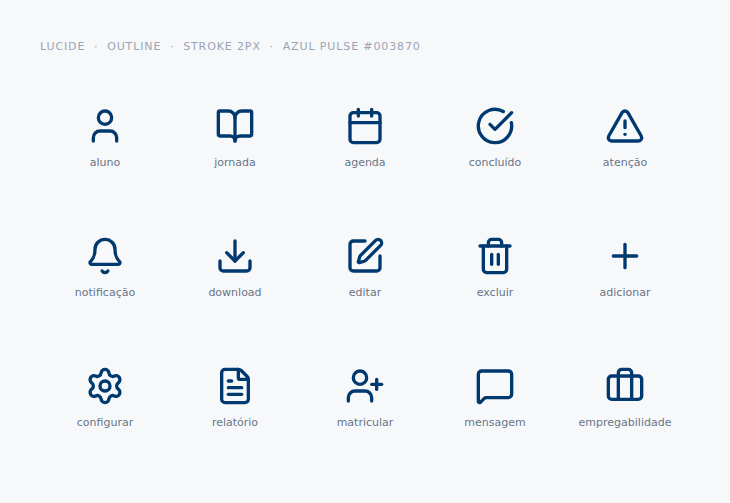<br>
<sub>Fonte: Gerado a partir da biblioteca Lucide (open source). Guia de Estilos – Pulse Manager v1.1 (2026).</sub><br>
</div>

<div align="justify">

Todos os ícones da plataforma seguem o estilo **outline com stroke fixo de 2px**, aplicados na cor Azul Pulse (`#003870`) como padrão, herdando o valor de `currentColor` do contexto em que estão inseridos. Nunca se mistura ícones fill com ícones outline na mesma tela - a consistência de estilo é regra sem exceção. Os tamanhos padrão de aplicação são 16px para badges e empty states, 20px para corpo de texto e navegação, 24px para ações e botões, e 32px ou mais para destaques visuais.

Todo ícone na plataforma é sempre acompanhado de label textual ou atributo `aria-label`, nunca utilizado isolado como único portador de informação - diretriz diretamente ligada à conformidade com WCAG 2.1 AA adotada pelo sistema de design.

Em casos onde a Lucide não oferecer o ícone necessário, as bibliotecas **Phosphor** ou **Tabler** são as substituições aceitas, desde que mantido o estilo outline 2px e que não haja mistura de bibliotecas diferentes na mesma tela. O catálogo completo, com grid visual expandido, regras de cor, tamanhos por contexto e diretrizes detalhadas de acessibilidade, está consolidado no Guia de Estilos – Pulse Manager v1.1 (PDF), referenciado na abertura desta seção.

</div>

## 3.5 Protótipo de alta fidelidade (sprint 3)

### Tela de Login


<div align="center">
<sup>Figura 37: Tela de Login Geral.</sup><br>
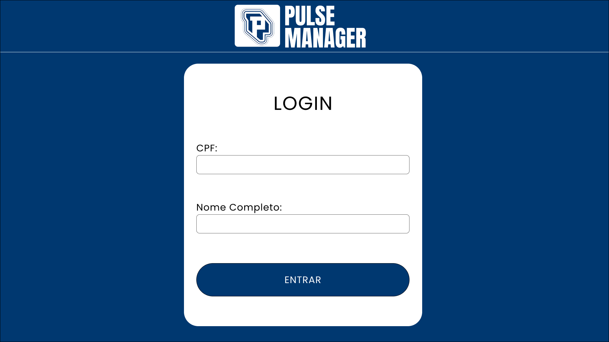<br>
<sub>Fonte: Autoria própria (2026).</sub><br>
</div>

<div align="justify">
A tela de login é a página inicial da plataforma para todos os perfis de usuário. Ela conta com um fundo azul institucional, o logo do Pulse Manager centralizado no topo e um card branco com os campos de autenticação — CPF e Nome Completo para alunos, e e-mail e senha para gestores e psicólogos — e o botão "Entrar", que redireciona cada usuário para sua tela inicial correspondente.
Esta tela está associada às User Stories US05, US07, US08 e US09, de acordo com o critério de aceite número 1 de cada uma. Isso porque o acesso unificado e padronizado garante tanto a simplicidade para o aluno quanto o controle de acesso necessário para gestores e psicólogos visualizarem e interagirem com os dados da plataforma.
</div>

### Tela Inicial do Gestor

<div align="center">
<sup>Figura 38: Tela Inicial do Gestor.</sup><br>
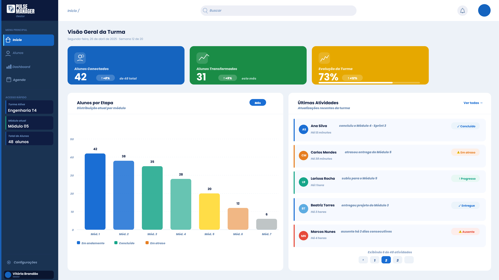<br>
<sub>Fonte: Autoria própria (2026).</sub><br>
</div>

<div align="justify">
O protótipo apresenta a tela inicial do painel do gestor na plataforma, projetada para consolidar indicadores de desempenho e o fluxo de atividades de uma turma específica em uma interface centralizada e de fácil leitura. Na lateral esquerda, há um menu de navegação persistente integrado a um bloco de contexto que exibe informações estáticas sobre o grupo monitorado, enquanto o cabeçalho superior traz ferramentas globais como barra de busca, notificações e perfil do usuário. O corpo principal da página destaca-se por três cartões de métricas no topo que resumem o engajamento e a evolução dos usuários por meio de dados percentuais e barras de progresso visuais. Abaixo, a interface se divide em duas áreas centrais de monitoramento: um gráfico de colunas interativo para mapear a distribuição dos usuários ao longo das diferentes etapas cronológicas do programa, contando com filtros temporais e legendas de status, e um feed dinâmico de últimas atividades ao lado, que lista logs cronológicos com avatares, descrições de ações, marcadores de tempo e tags coloridas de categorização, complementado por um sistema de paginação no rodapé.
</div>

### Lista de Alunos apresentada ao Gestor

<div align="center">
<sup>Figura 39: Lista de Alunos do Gestor.</sup><br>
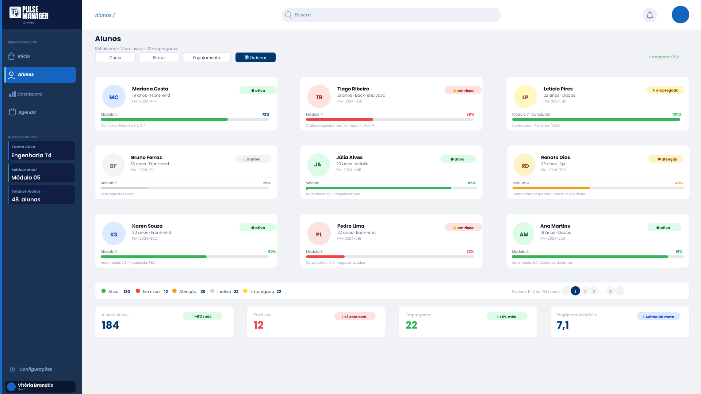<br>
<sub>Fonte: Autoria própria (2026).</sub><br>
</div>

<div align="justify">
A tela de lista de alunos é onde o gestor visualiza e gerencia todos os estudantes da plataforma. Nela estão disponíveis filtros por curso, status e engajamento. Os alunos são exibidos em cards com avatar, nome, curso, badge de status e barra de progresso do módulo atual. No rodapé, uma legenda resume os totais por status com paginação, e quatro cards exibem os principais indicadores da turma.

Esta tela está associada às User Stories US01, US03 e US04, de acordo com os critérios de aceite de cada uma. Isso porque a tela centraliza os dados de todos os alunos em um único lugar e permite à gestora buscar, filtrar e acessar perfis individuais com agilidade.
</div>

### Perfil do Aluno apresentado ao Gestor

<div align="center">
<sup>Figura 40: Perfil do Aluno do Gestor.</sup><br>
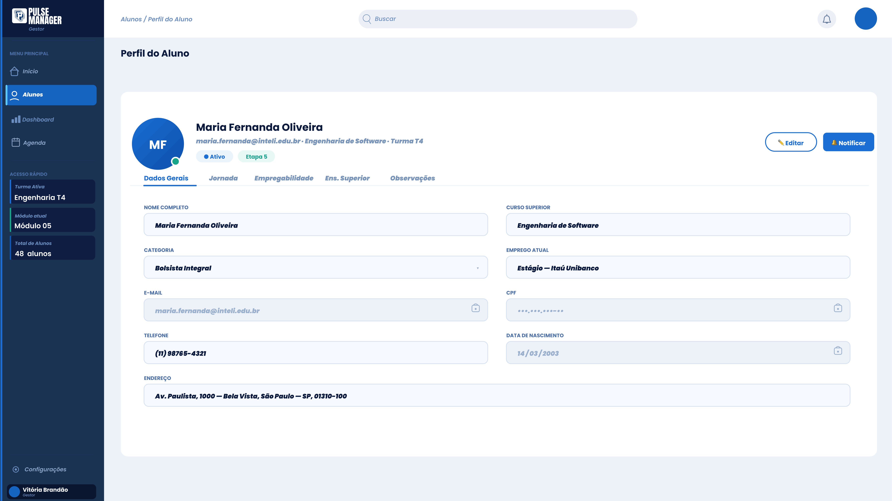<br>
<sub>Fonte: Autoria própria (2026).</sub><br>
</div>

<div align="justify">
O protótipo apresenta a tela de perfil individual do aluno na visão do gestor, estruturada para centralizar o gerenciamento de dados cadastrais e o acompanhamento do estudante por meio de uma interface organizada em abas. Mantendo a navegação lateral fixa para acesso às páginas do sistema e ao contexto da turma, além do cabeçalho global com busca e notificações, o núcleo da tela destaca um cartão principal com as informações básicas do aluno, incluindo avatar com indicador de status online, nome, e-mail institucional, curso e turma, acompanhados por tags de situação cadastral e botões de ação rápida para edição de dados e envio de notificações. Logo abaixo, um menu de navegação por abas horizontais permite alternar entre diferentes categorias de acompanhamento, como dados gerais, jornada, empregabilidade, ensino superior e observações, onde a aba ativa revela um formulário com campos de leitura e escrita dispostos em colunas que agrupam informações como nome completo, curso, categoria de bolsa, emprego atual, telefone e endereço, além de campos de dados sensíveis, como e-mail, CPF e data de nascimento, que contam com um ícone de cadeado indicando restrição de segurança ou campos bloqueados para edição direta.
</div>

### Dashboard apresentado ao Gestor

<div align="center">
<sup>Figura 41: Dashboard do Gestor.</sup><br>
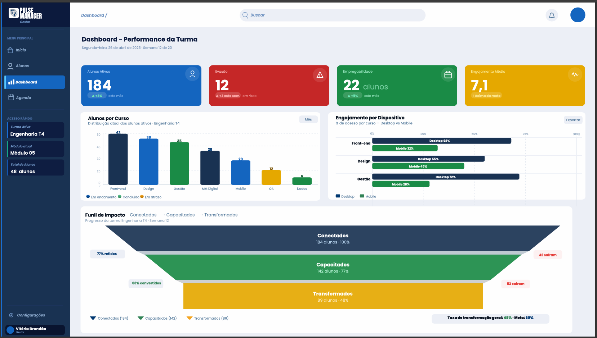<br>
<sub>Fonte: Autoria própria (2026).</sub><br>
</div>

<div align="justify">
O protótipo apresenta o painel principal do gestor na plataforma Pulse Manager, projetado para consolidar indicadores de desempenho e o acompanhamento de uma turma específica em uma interface centralizada e de leitura imediata. Na lateral esquerda, há um menu de navegação persistente com acesso às seções Início, Alunos, Dashboard e Agenda, integrado a um bloco de contexto que exibe informações estáticas sobre o grupo monitorado, como turma ativa, módulo atual e total de alunos. O cabeçalho superior traz ferramentas globais como barra de busca, notificações e perfil do usuário.
O corpo principal da página destaca-se por quatro cartões de métricas no topo que resumem os principais indicadores da turma: alunos ativos, evasão, empregabilidade e engajamento médio, cada um com variação percentual em relação ao período anterior e codificação de cor por criticidade. Abaixo, a interface se divide em duas áreas de análise: um gráfico de colunas agrupadas que mapeia a distribuição dos alunos por curso com legendas de status (em andamento, concluído, em atraso), e um gráfico de barras horizontais segmentado que cruza o engajamento por tipo de dispositivo, desktop versus mobile, por área de conhecimento. Encerrando a tela, um funil de impacto em camadas ilustra a progressão da turma pelos estágios Conectados, Capacitados e Transformados, com percentuais de retenção, conversão e evasão destacados lateralmente.
</div>


### Tela de Agenda do Gestor

<div align="center">
<sup>Figura 42: Tela de Agenda do Gestor.</sup><br>
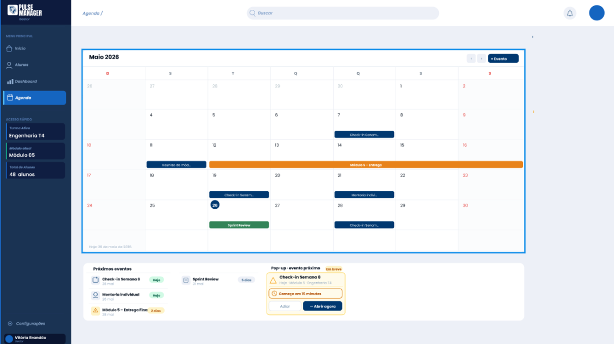<br>
<sub>Fonte: Autoria própria (2026).</sub><br>
</div>

<div align="justify">
A tela de agenda do gestor é onde a equipe Pulse Mais tem uma visão do calendário operacional da turma. Nela estão dispostos a visualização mensal com todos os compromissos categorizados por cor, check-ins semanais, reuniões de módulo, entregas, mentorias individuais e sprint reviews, a lista de próximos eventos com sua proximidade temporal e um pop-up de alerta para eventos iminentes, permitindo abrir ou adiar a atividade diretamente. A navegação lateral permite que o gestor transite entre o Início, Alunos, Dashboard e a Agenda, com acessos rápidos à turma ativa, ao módulo corrente e ao total de alunos vinculados, além do botão "+ Evento" para criação de novos compromissos.

Esta tela está associada às User Stories US01, US02 e US04, de acordo com os critérios de aceite de cada uma.
</div>

### Tela Inicial do Aluno

<div align="center">
<sup>Figura 43: Tela Inicial do Aluno.</sup><br>
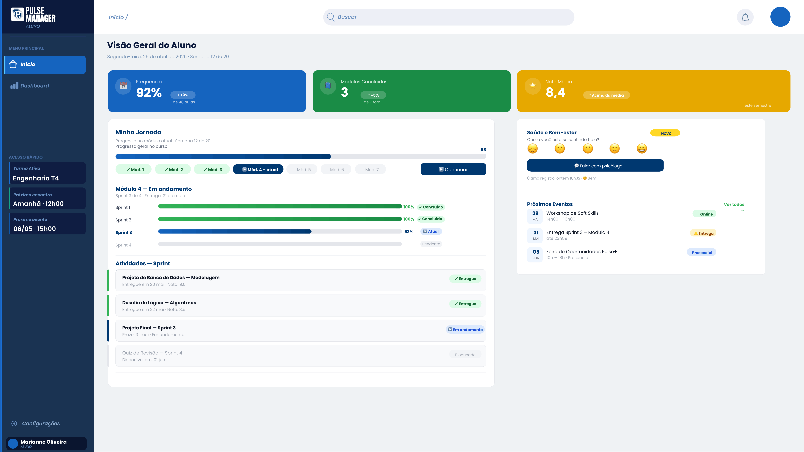<br>
<sub>Fonte: Autoria própria (2026).</sub><br>
</div>

<div align="justify">
A tela inicial do aluno é onde o estudante tem uma visão geral da sua jornada na plataforma. Nela estão dispostos seus principais indicadores de desempenho, o progresso nos módulos do curso, os próximos eventos da Pulse Mais e um acesso rápido ao suporte de saúde mental. A navegação lateral permite que o aluno transite entre as demais seções da plataforma.
Esta tela está associada às User Stories US08, US09 e US10, de acordo com os critérios de aceite de cada uma. Isso porque a tela centraliza o acesso aos resultados pessoais do aluno, exibe os eventos e faltas de forma clara e disponibiliza o contato direto com o psicólogo, tornando a navegação intuitiva e completa para o estudante.
</div>

### Tela de Perfil apresentada para o Aluno

<div align="center">
<sup>Figura 44: Perfil do Aluno.</sup><br>
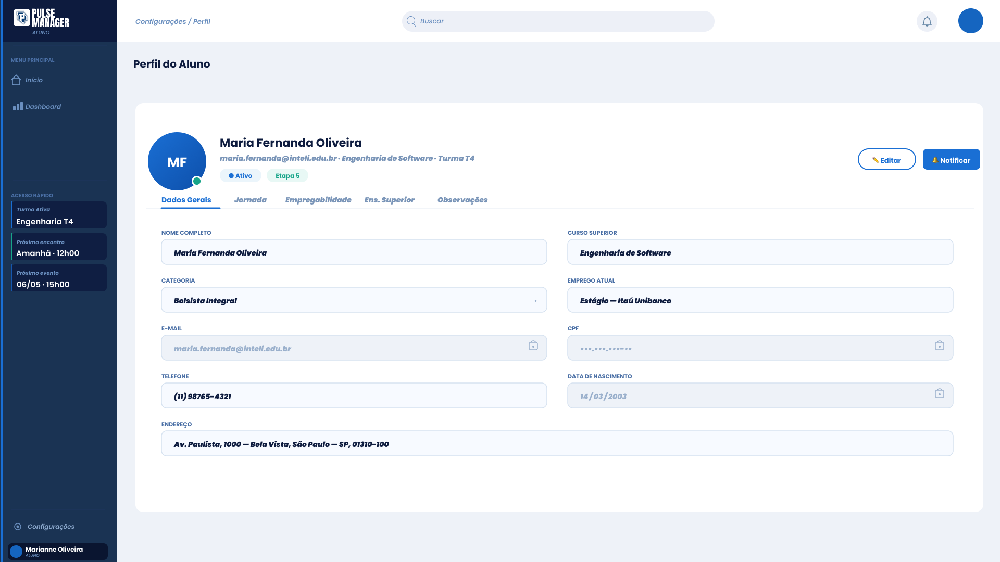<br>
<sub>Fonte: Autoria própria (2026).</sub><br>
</div>

<div align="justify">
A tela de perfil do aluno exibe todas as informações cadastrais do estudante em um único lugar. No topo, um card com avatar, nome, e-mail, curso e turma identifica o aluno, acompanhado de badges de status e etapa atual. Abaixo, abas organizam os dados em categorias — Dados Gerais, Jornada, Empregabilidade, Ensino Superior e Observações. Na aba inicial, os campos exibem nome completo, categoria, e-mail, telefone, endereço, curso superior, emprego atual, CPF e data de nascimento. Botões de editar e notificar ficam disponíveis no canto superior direito.

Esta tela está associada às User Stories US01, US04 e US05, de acordo com os critérios de aceite de cada uma. Isso porque a tela centraliza todos os dados do aluno em um único lugar, permitindo à gestora e ao psicólogo acessar o perfil completo do estudante com agilidade e tomar as ações necessárias diretamente pela plataforma.
</div>

### Dashboard apresentado ao Aluno

<div align="center">
<sup>Figura 45: Dashboard do Aluno.</sup><br>
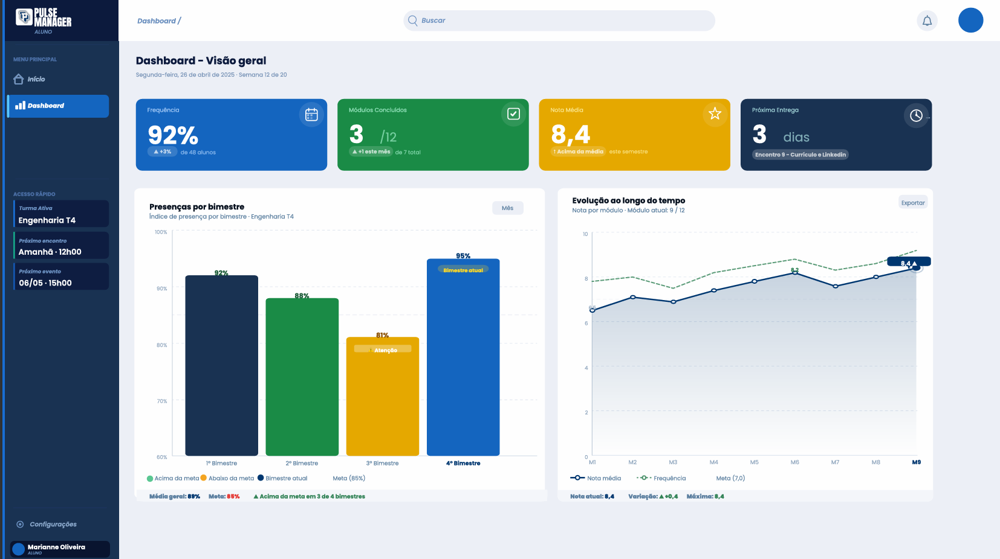<br>
<sub>Fonte: Autoria própria (2026).</sub><br>
</div>

<div align = "justify">
O protótipo apresenta o painel individual do aluno na plataforma, concebido para oferecer uma visão personalizada do próprio progresso acadêmico ao longo do programa. A estrutura de navegação lateral mantém a consistência visual do sistema, exibindo além do menu principal um bloco de acesso rápido com informações contextuais sobre a turma ativa, o próximo encontro e o próximo evento agendado. O cabeçalho repete o padrão global com busca, notificações e perfil.
Os quatro cartões de métricas no topo sintetizam os dados mais relevantes para o acompanhamento pessoal: frequência acumulada, módulos concluídos, nota média e prazo da próxima entrega — este último com identificação direta da atividade pendente. A seção central divide-se em dois painéis analíticos: à esquerda, um gráfico de colunas exibe o índice de presença por bimestre com marcações visuais de atenção e referência à meta estabelecida, acompanhado de um resumo textual com média geral e comparativo em relação ao objetivo; à direita, um gráfico de linhas com área sombreada mostra a evolução da nota média e da frequência módulo a módulo ao longo do semestre, permitindo ao aluno identificar tendências de melhora ou queda no próprio desempenho.
</div>

### Tela Inicial do Aluno

<div align="center">
<sup>Figura 46: Tela Inicial do Psicólogo.</sup><br>
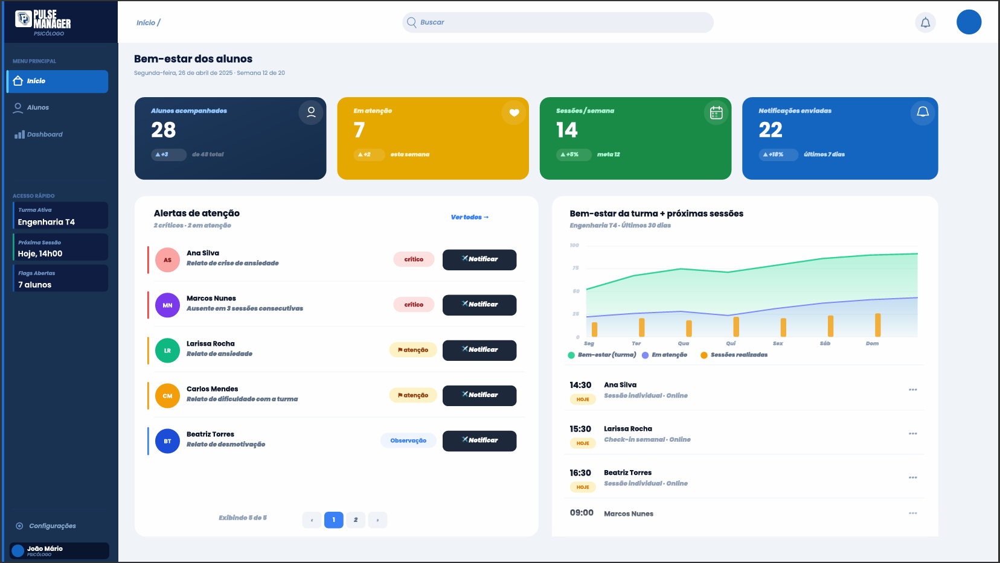<br>
<sub>Fonte: Autoria própria (2026).</sub><br>
</div>

<div align ="justify">
O protótipo apresenta o painel de acompanhamento socioemocional da plataforma, voltado exclusivamente para o profissional de psicologia responsável pela turma. A barra lateral mantém a identidade visual do sistema e exibe um bloco de acesso rápido com dados operacionais críticos: turma ativa, horário da próxima sessão e quantidade de flags abertas que demandam atenção imediata. O cabeçalho global repete os elementos padrão de busca e notificações.
Os quatro cartões de métricas superiores apresentam os indicadores centrais do trabalho clínico: alunos acompanhados, casos em atenção, sessões realizadas na semana e notificações enviadas, todos com variação recente em destaque. O corpo da tela divide-se em dois blocos complementares: à esquerda, uma lista paginada de alertas de atenção classifica os alunos por nível de criticidade — crítico, atenção ou observação — com nome, motivo do alerta e um botão de ação direta para notificação, permitindo ao psicólogo agir sem sair da tela; à direita, um gráfico de área sobreposta acompanha a evolução semanal do bem-estar geral da turma, dos casos em atenção e das sessões realizadas, seguido por uma agenda cronológica do dia com horário, nome do aluno, tipo de sessão e modalidade de atendimento.
</div>


### Lista de Alunos apresentada ao Psicólogo

<div align="center">
<sup>Figura 47: Lista de Alunos do Psicólogo.</sup><br>
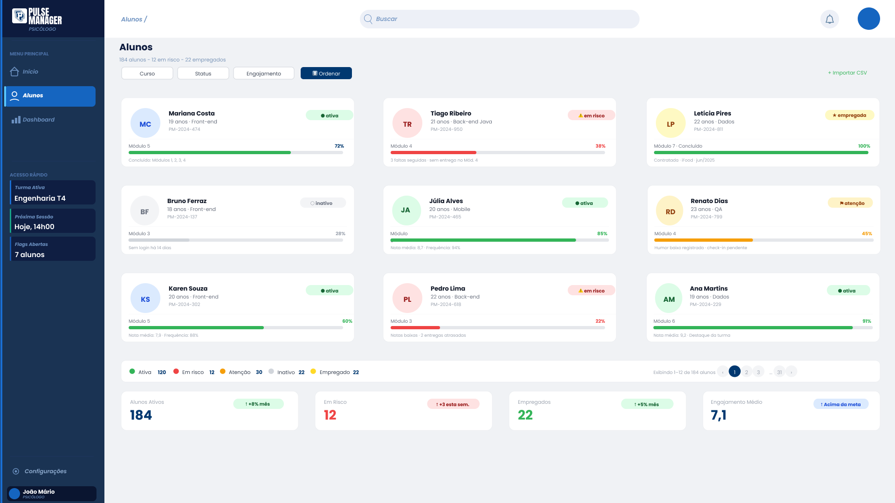<br>
<sub>Fonte: Autoria própria (2026).</sub><br>
</div>

<div align="justify">
A tela de lista de alunos do psicólogo segue a mesma estrutura da tela do gestor, com filtros por curso, status e engajamento. Os alunos são exibidos em cards com avatar, nome, curso, badge de status e barra de progresso do módulo atual. A sidebar traz acesso rápido à próxima sessão e às flags abertas, facilitando a priorização dos atendimentos. No rodapé, uma legenda resume os totais por status com paginação, e quatro cards exibem os principais indicadores da turma.

Esta tela está associada às User Stories US06 e US07, de acordo com os critérios de aceite de cada uma. Isso porque a tela permite ao psicólogo visualizar todos os alunos em um único lugar e identificar rapidamente quem precisa de suporte, com base nos badges de status e nas flags abertas exibidas na navegação lateral.
</div>

### Dashboard apresentado ao Psicólogo

<div align="center">
<sup>Figura 48: Dashboard do Psicólogo.</sup><br>
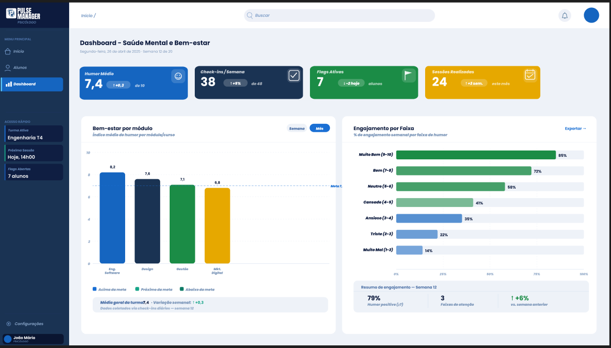<br>
<sub>Fonte: Autoria própria (2026).</sub><br>
</div>

<div align="justify">
Dashboard de saúde mental. Exibe 4 KPIs no topo (humor médio, check-ins semanais, flags ativas e sessões realizadas), dois gráficos centrais — um de barras com bem-estar por módulo/turma e um de barras horizontais com engajamento por faixa de humor, além de um resumo semanal e acesso rápido à turma e próxima sessão na sidebar esquerda.

Para ter uma visão dos flows desenvolvidos para cada um dos segmentos (aluno, gestor e psicólogo), segue em anexo o link para a plataforma de desenvolvimento dos protótipos de alta fidelidade e sua linha de segmentação interativa.

Link: https://www.figma.com/proto/txJwOwELjVHZt3YVdrjuo0/PulseMais---Prot%C3%B3tipos-de-Alta-Fidelidade?node-id=99-2&p=f&viewport=117%2C-854%2C0.36&t=CdCHM4sZQqs1BBos-1&scaling=contain&content-scaling=fixed&starting-point-node-id=212%3A2&show-proto-sidebar=1&page-id=0%3A1
</div>


## 3.6. Modelagem do banco de dados (sprints 2 e 4)

### 3.6.1. Modelo Entidade-Relacionamento (ER) (sprint 2)

<div align="justify">
Um diagrama de Modelo Entidade-Relacionamento (MER) é uma representação visual da estrutura lógica de um banco de dados que descreve como os dados de um sistema estão organizados e se relacionam entre si. Ele é composto por três elementos fundamentais: Entidades, que representam os objetos ou conceitos do mundo real sobre os quais se deseja armazenar informações, como usuários, produtos ou pedidos; Atributos, que são as características ou propriedades que descrevem cada entidade, como nome, data de nascimento ou preço; e Relacionamentos, que expressam as associações existentes entre as entidades, podendo ser do tipo um-para-um, um-para-muitos ou muitos-para-muitos. Esse tipo de diagrama é amplamente utilizado na fase de modelagem de dados de um projeto, pois permite visualizar de forma clara e estruturada como as informações se conectam, facilitando o planejamento do banco de dados, a comunicação entre a equipe de desenvolvimento e a posterior implementação das tabelas e relações em um sistema gerenciador de banco de dados.

A partir destes conceitos e utilizando como base o TAPI e outros materiais disponibilizados pelo parceiro, foram mapeadas as entidades que serão a base para o desenvolvimento de novas funcionalidades do projeto, além de seus atributos, importantes para o funcionamento adequado das funcionalidades. Essas entidades e atributos estão explicitados na seguinte imagem:
</div>

<div align="center">
<sup>Figura 49: Modelo conceitual Entidade-Relacionamento utilizando Chen.</sup><br>
<br>
<sub>Fonte: Autoria própria (2026). </sub><br>
</div>

<div align="justify">
Dentro do modelo conceitual, estão explicitadas as relações entre as entidades, sendo estas:

</div>

##### `membro_equipe`

- Publica zero ou várias `oportunidades` (0, n), onde cada uma é publicada por apenas um membro da equipe (1, 1);
- Visualiza zero ou várias `agendas` (0, n), e usuários com perfil de gestor podem registrar ou modificar itens da agenda institucional;
- Envia zero ou várias `notificações` (0, n), onde cada uma pode ser enviada por apenas um remetente, este que pode ser membro da equipe ou psicólogo (1, 1).


##### `aluno`

- Acessa zero ou várias `agendas` (0, n), limitadas aos eventos ou compromissos relacionados à sua própria jornada;
- Possui zero ou várias `labels` atribuídas (0, n), onde cada label pertence a apenas um aluno (1, 1);
- Recebe zero ou várias `notificações` (0, n), onde cada notificação é direcionada a apenas um aluno (1, 1);
- Possui zero ou várias `participações` (0, n), onde cada uma pertence a apenas um aluno (1, 1) e está vinculada a uma atividade (1, 1);
- Possui zero ou vários `registros` psicológicos (0, n), onde cada um pertence a apenas um aluno (1, 1).


##### `psicologo`

- Registra zero ou vários `registros` psicológicos (0, n), os quais podem ser registrados por apenas um psicólogo (1, 1);
- Gerencia zero ou várias `labels` (0, n), onde cada uma pode ser gerenciada por apenas um psicólogo (1, 1);
- Acessa zero ou várias `agendas` (0, n), limitadas aos compromissos relacionados aos alunos que acompanha;
- Acessa o desempenho acadêmico dos alunos monitorados, preservando a restrição de acesso aos demais alunos da base;
- Envia zero ou várias `notificações` (0, n), onde cada uma pode ser enviada por apenas um remetente, este que pode ser membro da equipe ou psicólogo (1, 1).

<div align="justify">

Além disso, faz-se necessário explicar a importância de decisões específicas utilizadas na modelagem conceitual do modelo entidade-relacionamento. Assim, como pontos importantes têm-se as aplicações das relações com as entidades e cardinalidades e a utilização do símbolo de especialização/generalização.

Na construção do modelo entidade-relacionamento, é utilizada a sinalização de retângulos para exemplificar as entidades utilizadas, futuramente representadas como tabelas no banco de dados; também são utilizadas elipses para explicitar os atributos destas entidades e, além disso, os losangos para visualização das relações existentes entre as entidades do modelo. Já as cardinalidades são utilizadas para identificar visualmente como funcionam as quantificações entre relações, como, por exemplo, quantas entidades participam de uma ação.

Além disso, um novo conceito utilizado é a sinalização de um triângulo para explicitar que há uma superclasse (`remetente`), que se divide em duas subclasses (`membro_equipe` e `psicologo`), onde são utilizadas as letras (t, d) no triângulo que significam (total, disjoint), mostrando que todo elemento da superclasse pertence a pelo menos uma subclasse e que um elemento só pode pertencer a uma única subclasse por vez.

Por fim, as entidades aplicadas foram elaboradas a partir da análise das Regras de Negócio anteriormente desenvolvidas, sendo definidas as seguintes relações:
</div>

| Entidade principal | Relacionamento com | RNs associadas | Justificativa |
|-------------|------------|---------------|-------------|
| Membro da Equipe | Publicação de oportunidades | RN008, RN011 | Pois a interface incentiva o registro de vínculos de trabalho (formal/informal) e a publicação de oportunidades é uma ação exclusiva da equipe interna |
| Membro da Equipe | Visualização de agenda | RN018 | Pois a agenda institucional deve ser visível para os perfis internos, respeitando o contexto de acesso de cada usuário |
| Gestor | Modificação da agenda | RN019 | Pois somente o perfil de gestão pode criar, editar, reagendar ou cancelar itens da agenda institucional |
| Membro da Equipe | Envio de notificações | RN011, RN016 | Pois a equipe interna tem autonomia no quesito de registros no sistema, além de ter que comunicar os alunos sobre atividades de mentores voluntários (não-usuários), já que estes não têm liberdade de alterações no sistema |
| Aluno | Acesso de agenda | RN018 | Pois o aluno pode visualizar eventos ou compromissos relacionados à sua jornada, mas não pode modificar os itens da agenda |
| Aluno | Atribuição de labels | RN015 | Pois as labels são vinculadas ao aluno acompanhado e, no DER atual, possuem psicólogo responsável por meio de `id_psi` |
| Aluno | Recebimento de notificações | RN013, RN014 | Pois o aluno não tem permissão de alterar todos os dados do sistema, apenas dados essenciais, outros dados podem apenas ser acessados para verificação. Além disso, as notificações são um meio de enviar formulários para que os alunos atualizem seus dados |
| Aluno | Participações dos alunos | RN004, RN009, RN007 | Pois o histórico de programas anteriores deve ser preservado para verificações futuras, algo permitido através do registro de participações. Além de este registro servir como base para a criação de alguns indicadores em dashboards e cálculos de variáveis |
| Aluno | Registros psicológicos | RN012, RN010 | Pois registros voltados à saúde mental só podem ser criados e editados por psicólogos, sua ligação com o aluno se relaciona com a existência desta entidade no registro estudantil visto pela equipe especificada. Além disso, estes dados podem ser preservados para análises futuras dos profissionais |
| Psicólogo | Registros psicológicos | RN012, RN010 | Pois os registros relacionados à saúde mental são criados e editados pela equipe de psicólogos, além da necessidade de preservação dos dados para outras análises |
| Psicólogo | Gerenciamento de labels | RN015 | Pois a criação de labels é de autonomia exclusiva da equipe interna de psicólogos  |
| Psicólogo | Envio de notificações | RN011 | Pois a equipe interna tem autonomia no quesito de registros no sistema, assim, precisa utilizar notificações para a coleta de informações |
| Psicólogo | Acesso ao desempenho acadêmico | RN020, RN017 | Pois o psicólogo pode consultar notas, frequência e indicadores acadêmicos apenas dos alunos que monitora, mantendo a restrição de acesso aos dados pessoais |


### 3.6.2. Diagrama Entidade-Relacionamento (DER) (sprint 2)

<div align="justify">

O Diagrama Entidade-Relacionamento (DER) do sistema PulseManager representa a estrutura lógica do banco de dados responsável por armazenar e organizar as informações relacionadas ao acompanhamento acadêmico, profissional e psicossocial dos alunos atendidos pela organização Pulse Mais. O modelo foi desenvolvido com base nos requisitos funcionais levantados ao longo da análise do sistema e está integralmente alinhado ao Diagrama de Classes do Domínio, garantindo consistência entre a modelagem conceitual orientada a objetos e a modelagem relacional.

O DER explicita as entidades do sistema, seus atributos, as respectivas chaves primárias (Primary Keys – PK), chaves estrangeiras (Foreign Keys – FK) e as cardinalidades de todos os relacionamentos, assegurando a integridade referencial e a correta representação das regras de negócio.

</div>

<div align="center">
<sup>Figura 50: Diagrama Entidade-Relacionamento.</sup><br>
<br>
<sub>Fonte: Elaborado pela equipe (2026).</sub><br>
</div>

### Entidade `aluno`

<div align="justify">

A entidade `aluno` constitui o elemento central do modelo, pois representa os jovens acompanhados pela organização e concentra a maior parte dos relacionamentos do sistema.

</div>

Seus atributos são:

- `id_aluno` (PK)
- `nome`
- `email`
- `idade`
- `genero`
- `ocupacao`
- `escolaridade`
- `data_ingresso`
- `status`


<div align="justify">

Cada aluno pode participar de diversas atividades, registrar compromissos na agenda, acumular labels de acompanhamento e possuir diversos registros em seu histórico psicológico.

</div>

### Entidade `membro_equipe`

<div align="justify">

A entidade `membro_equipe` representa os colaboradores da organização responsáveis pela gestão administrativa e pedagógica do sistema, incluindo gestores e outros profissionais autorizados.

</div>

Seus atributos são:

- `id_membro` (PK)
- `nome`
- `cargo`
- `email`

<div align="justify">

Cada membro da equipe pode publicar oportunidades, registrar compromissos institucionais na agenda e enviar notificações.

</div>

### Entidade `psicologo`

<div align="justify">

A entidade `psicologo` representa os profissionais responsáveis pelo acompanhamento psicossocial dos alunos.

</div>

Seus atributos são:

- `id_psi` (PK)
- `nome_psi`
- `cargo_psi`

<div align="justify">

Cada psicólogo pode registrar históricos psicológicos, criar labels, enviar notificações e acompanhar a evolução comportamental e emocional dos alunos.

</div>

### Entidade `atividade`

<div align="justify">

A entidade `atividade` foi concebida como uma abstração genérica para representar cursos, eventos, mentorias e aulas em uma única estrutura. Essa decisão de modelagem reduz redundâncias e simplifica o tratamento das informações acadêmicas.

</div>

Seus atributos são:

- `id_atividade` (PK)
- `titulo`
- `tipo`
- `descricao`
- `data`

<div align="justify">

O atributo `tipo` permite identificar a natureza da atividade, diferenciando cursos, eventos, mentorias e aulas dentro de uma estrutura unificada.

</div>

### Entidade `participacao`

<div align="justify">

A entidade `participacao` materializa o relacionamento entre `aluno` e `atividade`, registrando o envolvimento efetivo do aluno em cada atividade. O atributo `nota` registra o desempenho individual do aluno naquela atividade específica, refletindo que a avaliação é um atributo do vínculo entre aluno e atividade, e não da atividade em si.

</div>

Seus atributos são:

- `id_part` (PK)
- `data_part`
- `status_part`
- `id_aluno` (FK)
- `id_atividade` (FK)
- `nota`

Cardinalidades:

- Um `aluno` pode possuir zero ou muitas participações.
- Cada `participacao` pertence a exatamente um aluno.
- Uma `atividade` pode possuir zero ou muitas participações.
- Cada `participacao` refere-se a exatamente uma atividade.

### Entidade `label`

<div align="justify">

A entidade `label` representa marcadores de acompanhamento atribuídos aos alunos, cadastrados por psicólogos para apoiar a leitura da situação de cada jovem.

</div>

Seus atributos são:

- `id_lbl` (PK)
- `descricao`
- `tipo_label`
- `id_aluno` (FK)
- `id_psi` (FK)

Cardinalidades:

- Um `aluno` pode possuir zero ou muitas labels.
- Cada `label` está associada a exatamente um aluno.
- Um `psicologo` pode criar zero ou muitas labels.
- Cada `label` é associada a exatamente um psicólogo responsável.

### Entidade `historico_psicologico`

<div align="justify">

A entidade `historico_psicologico` armazena observações qualitativas registradas pelos psicólogos durante o acompanhamento individual dos alunos.

</div>

Seus atributos são:

- `id_historico` (PK)
- `observacao`
- `titulo`
- `id_aluno` (FK)
- `id_psi` (FK)

Cardinalidades:

- Um `aluno` pode possuir zero ou muitos registros psicológicos.
- Cada `historico_psicologico` pertence a exatamente um aluno.
- Um `psicologo` pode registrar zero ou muitos históricos.
- Cada `historico_psicologico` é elaborado por exatamente um psicólogo.


### Entidade `agenda`

<div align="justify">

A entidade `agenda` armazena registros de compromissos, eventos e acompanhamentos vinculados a alunos e membros da equipe. A agenda deve poder ser visualizada por todos os perfis, respeitando o contexto de cada usuário, enquanto a modificação de seus itens fica restrita ao perfil de gestor.

</div>

Seus atributos são:

- `id_agenda` (PK)
- `tipo_user`
- `registro`
- `data`
- `status`
- `id_membro` (FK)
- `id_aluno` (FK)
- `id_psi` (FK, opcional)

Cardinalidades:

- Um `aluno` pode possuir zero ou muitos registros na agenda.
- Um `membro_equipe` pode criar zero ou muitos compromissos.
- Um `psicologo` pode estar associado a zero ou muitos compromissos de acompanhamento.


### Entidade `oportunidade`

<div align="justify">

A entidade `oportunidade` representa conteúdos disponibilizados pela equipe, como vagas de emprego, bolsas de estudo, cursos e eventos externos.

</div>

Seus atributos são:

- `id_oportunidade` (PK)
- `titulo`
- `descricao`
- `tipo`
- `data_publicacao`
- `id_membro` (FK)

Cardinalidades:

- Um `membro_equipe` pode publicar zero ou muitas oportunidades.
- Cada `oportunidade` é publicada por exatamente um membro da equipe.


### Entidade `notificacao`

<div align="justify">

A entidade `notificacao` registra as comunicações enviadas pelos membros da equipe e psicólogos no sistema.

</div>

Seus atributos são:

- `id_notificacao` (PK)
- `titulo`
- `mensagem`
- `data_envio`
- `tipo`
- `id_aluno` (FK)
- `id_remetente`
- `tipo_remetente`
- `nome_remetente`

Cardinalidades:

- Um `aluno` pode receber zero ou muitas notificações.
- Cada `notificacao` está associada a exatamente um aluno.
- Cada `notificacao` é enviada por exatamente um remetente, identificado pelos campos `id_remetente` e `tipo_remetente`, que indicam respectivamente o identificador e o tipo do emissor (membro da equipe ou psicólogo).


### Principais Relacionamentos e Cardinalidades

<div align="justify">

Os principais relacionamentos definidos no DER são:

</div>

- `aluno` 1:N `participacao`
- `atividade` 1:N `participacao`
- `aluno` 1:N `label`
- `psicologo` 1:N `label`
- `aluno` 1:N `agenda`
- `aluno` 1:N `historico_psicologico`
- `membro_equipe` 1:N `oportunidade`
- `membro_equipe` 1:N `agenda`
- `psicologo` 0:N `agenda`
- `aluno` 1:N `notificacao`
- `remetente` (polimórfico) 1:N `notificacao`
- `psicologo` 1:N `historico_psicologico`


### Decisões de Modelagem

<div align="justify">

A principal decisão arquitetural foi a criação da entidade `atividade`, responsável por unificar cursos, eventos, mentorias e aulas em uma estrutura única. O atributo `nota` foi posicionado na entidade `participacao`, pois representa o desempenho individual de cada aluno em uma atividade específica, e não uma característica da atividade em si. Essa abordagem reduz a redundância de dados e facilita a manutenção do sistema, uma vez que a entidade `participacao` passa a referenciar um único tipo de objeto para registrar o vínculo entre alunos e atividades.

Outra decisão importante foi a adoção da entidade associativa `participacao`, responsável por implementar o relacionamento muitos-para-muitos entre alunos e atividades, além de possibilitar o armazenamento de informações específicas da relação, como data, status e nota da participação.

O modelo foi construído respeitando a Terceira Forma Normal (3FN). Não há dependências transitivas entre atributos não-chave, e todos os atributos dependem exclusivamente de suas respectivas chaves primárias, contribuindo para a redução de redundâncias e para a integridade estrutural do banco de dados.

</div>

### Limitações Conhecidas do Modelo

<div align="justify">

A unificação de cursos, eventos, mentorias e aulas no atributo "tipo" da entidade Atividade simplifica o modelo e reduz redundâncias, porém implica perda de especificidade estrutural entre os tipos. Caso futuramente seja necessário armazenar atributos exclusivos de cada tipo, como carga horária para cursos ou palestrante para eventos, o modelo exigirá refatoração. Essa é uma limitação conhecida e aceita, justificada pelo escopo atual do sistema.

A entidade `notificacao` adota associação polimórfica para identificar o remetente por meio dos campos `id_remetente` e `tipo_remetente`, em vez de uma tabela física `remetente`. Essa abordagem simplifica a implementação, mas delega a validação do remetente à camada de aplicação.

O campo `nome_remetente` em `notificacao` representa uma desnormalização intencional, adotada para simplificar consultas decorrentes da associação polimórfica. Essa decisão implica redundância controlada e exige sincronização pelo código da aplicação em caso de atualização.

</div>

### Conclusão

<div align="justify">

O Diagrama Entidade-Relacionamento do PulseManager representa de forma estruturada, consistente e normalizada os dados necessários para o funcionamento do sistema. A identificação explícita de chaves primárias, chaves estrangeiras e cardinalidades garante integridade referencial e aderência às regras de negócio, estabelecendo uma base sólida para a construção do Modelo Relacional e do Modelo Físico do banco de dados.

</div>


### 3.6.3. Modelo Relacional e Modelo Físico (sprints 2 e 4)

<div align="justify">

Esta seção traduz o DER apresentado na seção 3.6.2 para o modelo relacional e para sua implementação física em PostgreSQL.

O modelo relacional organiza os dados em tabelas com seus respectivos campos (Normando, 2024). As chaves primárias identificam de forma única cada registro, enquanto as chaves estrangeiras conectam uma tabela a outra e preservam os vínculos definidos na modelagem. Dessa forma, as entidades e relacionamentos do DER são convertidos em uma estrutura pronta para implementação no banco de dados.

</div>

#### Modelo Relacional - Pulse Manager

<div align="justify">

Com base na modelagem de dados do projeto, o modelo relacional foi definido para refletir as entidades atuais do sistema conforme o DER. A tabela `participacao` representa o relacionamento entre `aluno` e `atividade` e concentra os dados específicos desse vínculo, incluindo `nota`; `oportunidade` fica vinculada a `membro_equipe`; e os registros de agenda, notificações, labels e histórico psicológico mantêm vínculo com os usuários definidos na modelagem.

</div>

##### Representação Relacional

| Tabela | Chave primária | Atributos | Chaves estrangeiras |
|---|---|---|---|
| `aluno` | `id_aluno` | `nome`, `email`, `idade`, `genero`, `ocupacao`, `escolaridade`, `data_ingresso`, `status` | - |
| `membro_equipe` | `id_membro` | `nome`, `cargo`, `email` | - |
| `psicologo` | `id_psi` | `nome_psi`, `cargo_psi` | - |
| `atividade` | `id_atividade` | `titulo`, `tipo`, `descricao`, `data` | - |
| `notificacao` | `id_notificacao` | `titulo`, `mensagem`, `data_envio`, `tipo`, `id_remetente`, `tipo_remetente`, `nome_remetente` | `id_aluno` |
| `oportunidade` | `id_oportunidade` | `titulo`, `descricao`, `tipo`, `data_publicacao` | `id_membro` |
| `agenda` | `id_agenda` | `tipo_user`, `registro`, `data`, `status` | `id_membro`, `id_aluno`, `id_psi` |
| `label` | `id_lbl` | `descricao`, `tipo_label` | `id_aluno`, `id_psi` |
| `historico_psicologico` | `id_historico` | `observacao`, `titulo` | `id_aluno`, `id_psi` |
| `participacao` | `id_part` | `data_part`, `status_part`, `nota` | `id_aluno`, `id_atividade` |

##### Descrição das Tabelas

###### Tabela aluno

<div align="justify">

A tabela `aluno` representa os jovens acompanhados pela Pulse Mais. Ela contém os dados principais do aluno e é a base para registros de agenda, notificações, labels, histórico psicológico e participação em atividades.

</div>

###### Tabela membro_equipe

<div align="justify">

A tabela `membro_equipe` armazena os profissionais da equipe responsáveis por registros administrativos, comunicações, oportunidades e compromissos. Ela se relaciona com `notificacao`, `oportunidade` e `agenda`.

</div>

###### Tabela psicologo

<div align="justify">

A tabela `psicologo` representa os profissionais responsáveis por registros e acompanhamentos psicológicos. Na modelagem, essa entidade se relaciona com `notificacao`, `label` e `historico_psicologico`, sendo que em `notificacao` o vínculo do remetente é polimórfico.

</div>

###### Tabela notificacao

<div align="justify">

A tabela `notificacao` armazena mensagens e avisos emitidos no sistema. O campo `id_aluno` associa a notificação ao aluno destinatário, enquanto `id_remetente`, `tipo_remetente` e `nome_remetente` identificam quem enviou a comunicação, podendo ser um membro da equipe ou um psicólogo.

</div>

###### Tabela oportunidade

<div align="justify">

A tabela `oportunidade` registra oportunidades acadêmicas, profissionais ou institucionais. Cada oportunidade é criada ou mantida por um membro da equipe, e não vinculada diretamente a um aluno.

</div>

###### Tabela agenda

<div align="justify">

A tabela `agenda` registra compromissos, eventos e acompanhamentos. Cada registro pode ser associado ao aluno envolvido, ao membro da equipe responsável e, quando aplicável, ao psicólogo relacionado ao acompanhamento, conforme os campos `id_aluno`, `id_membro` e `id_psi` padronizados no modelo relacional.

</div>

###### Tabela label

<div align="justify">

A tabela `label` armazena classificações ou marcações vinculadas ao aluno. O campo `id_aluno` vincula a label ao aluno correspondente, enquanto `id_psi` identifica o psicólogo responsável pela marcação.

</div>

###### Tabela historico_psicologico

<div align="justify">

A tabela `historico_psicologico` registra informações de acompanhamento psicológico. Cada registro histórico possui uma observação e um título, ficando vinculado ao aluno acompanhado e ao psicólogo responsável.

</div>

###### Tabela atividade

<div align="justify">

A tabela `atividade` armazena cursos, eventos, mentorias e aulas em uma estrutura única. O DER atual não apresenta `nota` como atributo direto de `atividade`.

</div>

###### Tabela participacao

<div align="justify">

A tabela `participacao` é uma tabela lógica associativa entre `aluno` e `atividade`. Essa estrutura permite que um aluno participe de várias atividades e que uma atividade tenha vários alunos participantes. O campo `nota` pertence a essa tabela, pois a avaliação está ligada ao vínculo entre aluno e atividade.

</div>

#### Implementação de Chaves Estrangeiras

<div align="justify">

Com base nas cardinalidades descritas no DER, as chaves estrangeiras foram posicionadas nas tabelas dependentes de cada relacionamento. Esse mapeamento preserva a integridade entre os registros e impede que informações da jornada do aluno fiquem desconectadas no banco.

</div>

##### Mapeamento das Chaves Estrangeiras

| Tabela | Chave estrangeira | Referência | Finalidade |
|---|---|---|---|
| `notificacao` | `id_aluno` | `aluno(id_aluno)` | Identificar o aluno destinatário da notificação. |
| `oportunidade` | `id_membro` | `membro_equipe(id_membro)` | Indicar qual membro da equipe publicou ou administra a oportunidade. |
| `agenda` | `id_membro` | `membro_equipe(id_membro)` | Registrar o responsável interno pelo compromisso ou acompanhamento. |
| `agenda` | `id_aluno` | `aluno(id_aluno)` | Associar o compromisso ao aluno envolvido. |
| `agenda` | `id_psi` | `psicologo(id_psi)` | Associar o compromisso ao psicólogo relacionado, quando houver acompanhamento psicológico. |
| `label` | `id_aluno` | `aluno(id_aluno)` | Vincular marcações e classificações ao aluno correspondente. |
| `label` | `id_psi` | `psicologo(id_psi)` | Identificar o psicólogo responsável pela label. |
| `historico_psicologico` | `id_aluno` | `aluno(id_aluno)` | Associar o registro psicológico ao aluno acompanhado. |
| `historico_psicologico` | `id_psi` | `psicologo(id_psi)` | Associar o registro psicológico ao psicólogo responsável. |
| `participacao` | `id_aluno` | `aluno(id_aluno)` | Indicar qual aluno participou de determinada atividade. |
| `participacao` | `id_atividade` | `atividade(id_atividade)` | Indicar qual atividade recebeu a participação do aluno. |

##### Regras de Negócio do Modelo Relacional

<div align="justify">

O modelo mantém `aluno` como entidade central, referenciada por notificações, agenda, labels, histórico psicológico e participações. Assim, os dados de acompanhamento ficam ligados ao aluno sem duplicação de informações pessoais em outras tabelas.

O relacionamento entre `aluno` e `atividade` é resolvido por `participacao`, o que mantém o modelo normalizado e permite registrar dados próprios do vínculo, como `data_part`, `status_part` e `nota`. Como regra de negócio, um mesmo aluno não deve ser registrado mais de uma vez na mesma atividade.

Como o DER atual não apresenta uma entidade separada para notas, `nota` permanece como atributo de `participacao`, mantendo a avaliação associada ao aluno em uma atividade específica.

Os vínculos com `membro_equipe` e `psicologo` preservam a rastreabilidade dos responsáveis por oportunidades, notificações, labels e registros psicológicos, respeitando as relações representadas no DER.

Como regra de acesso, o psicólogo não possui visão geral de todos os alunos. Sua visualização deve ser limitada aos alunos aos quais ele está relacionado por registros como `label` e `historico_psicologico`, que possuem simultaneamente `id_psi` e `id_aluno`, ou por notificações em que `tipo_remetente` seja `psicologo` e `id_remetente` corresponda ao seu `id_psi`. Para esses alunos monitorados, o psicólogo pode consultar dados de desempenho acadêmico necessários ao acompanhamento, como notas, frequência e participação em atividades. Já `membro_equipe` mantém acesso institucional mais amplo aos registros administrativos e acadêmicos dos alunos, respeitando a restrição de que informações sensíveis de acompanhamento psicológico só devem ser acessadas por usuários com perfil de psicólogo.

</div>

#### Codificação do Modelo Físico em PostgreSQL

<div align="justify">

A codificação a seguir representa o DDL do modelo físico em PostgreSQL. Esse script implementa o modelo relacional apresentado anteriormente, criando os tipos, as tabelas, as chaves primárias, as chaves estrangeiras e as restrições simples do sistema.

Os identificadores principais usam `GENERATED ALWAYS AS IDENTITY`, recurso do PostgreSQL que gera automaticamente valores inteiros sequenciais para as chaves primárias. Os campos de domínio fechado foram representados com `ENUM`, e as restrições simples foram declaradas com `NOT NULL`, `UNIQUE`, `CHECK`, `PRIMARY KEY` e `FOREIGN KEY`.

</div>

```sql
-- PostgreSQL

DO $$
BEGIN
  CREATE TYPE genero_aluno_enum AS ENUM (
    'feminino',
    'masculino',
    'nao_binario',
    'outro',
    'prefiro_nao_informar'
  );
EXCEPTION WHEN duplicate_object THEN NULL;
END $$;

DO $$
BEGIN
  CREATE TYPE status_aluno_enum AS ENUM (
    'ativo',
    'inativo',
    'egresso',
    'desligado',
    'em_acompanhamento'
  );
EXCEPTION WHEN duplicate_object THEN NULL;
END $$;

DO $$
BEGIN
  CREATE TYPE cargo_membro_enum AS ENUM (
    'gestor',
    'coordenador',
    'mentor',
    'voluntario',
    'administrativo',
    'outro'
  );
EXCEPTION WHEN duplicate_object THEN NULL;
END $$;

DO $$
BEGIN
  CREATE TYPE cargo_psicologo_enum AS ENUM (
    'psicologo',
    'coordenador_psicologico',
    'estagiario',
    'outro'
  );
EXCEPTION WHEN duplicate_object THEN NULL;
END $$;

DO $$
BEGIN
  CREATE TYPE tipo_notificacao_enum AS ENUM (
    'alerta',
    'informativo',
    'convite',
    'urgente',
    'outro'
  );
EXCEPTION WHEN duplicate_object THEN NULL;
END $$;

DO $$
BEGIN
  CREATE TYPE tipo_remetente_enum AS ENUM (
    'membro_equipe',
    'psicologo'
  );
EXCEPTION WHEN duplicate_object THEN NULL;
END $$;

DO $$
BEGIN
  CREATE TYPE tipo_oportunidade_enum AS ENUM (
    'emprego',
    'estagio',
    'curso',
    'evento',
    'bolsa',
    'voluntariado',
    'outro'
  );
EXCEPTION WHEN duplicate_object THEN NULL;
END $$;

DO $$
BEGIN
  CREATE TYPE tipo_usuario_agenda_enum AS ENUM (
    'aluno',
    'membro_equipe',
    'psicologo'
  );
EXCEPTION WHEN duplicate_object THEN NULL;
END $$;

DO $$
BEGIN
  CREATE TYPE tipo_label_enum AS ENUM (
    'risco',
    'interesse',
    'perfil',
    'acompanhamento',
    'prioridade',
    'outro'
  );
EXCEPTION WHEN duplicate_object THEN NULL;
END $$;

DO $$
BEGIN
  CREATE TYPE tipo_atividade_enum AS ENUM (
    'aula',
    'mentoria',
    'workshop',
    'evento',
    'avaliacao',
    'outro'
  );
EXCEPTION WHEN duplicate_object THEN NULL;
END $$;

CREATE TABLE IF NOT EXISTS aluno (
  id_aluno INTEGER GENERATED ALWAYS AS IDENTITY PRIMARY KEY,
  nome VARCHAR(150) NOT NULL,
  email VARCHAR(255) NOT NULL UNIQUE,
  idade INTEGER CHECK (idade IS NULL OR (idade >= 0 AND idade <= 120)),
  genero genero_aluno_enum,
  ocupacao VARCHAR(150),
  escolaridade VARCHAR(100),
  data_ingresso DATE DEFAULT CURRENT_DATE,
  status status_aluno_enum NOT NULL DEFAULT 'ativo'
);

CREATE TABLE IF NOT EXISTS membro_equipe (
  id_membro INTEGER GENERATED ALWAYS AS IDENTITY PRIMARY KEY,
  nome VARCHAR(150) NOT NULL,
  cargo cargo_membro_enum NOT NULL,
  email VARCHAR(255) NOT NULL UNIQUE
);

CREATE TABLE IF NOT EXISTS psicologo (
  id_psi INTEGER GENERATED ALWAYS AS IDENTITY PRIMARY KEY,
  nome_psi VARCHAR(150) NOT NULL,
  cargo_psi cargo_psicologo_enum NOT NULL
);

CREATE TABLE IF NOT EXISTS atividade (
  id_atividade INTEGER GENERATED ALWAYS AS IDENTITY PRIMARY KEY,
  titulo VARCHAR(255) NOT NULL,
  tipo tipo_atividade_enum NOT NULL,
  descricao VARCHAR(500),
  data DATE
);

CREATE TABLE IF NOT EXISTS notificacao (
  id_notificacao INTEGER GENERATED ALWAYS AS IDENTITY PRIMARY KEY,
  titulo VARCHAR(255) NOT NULL,
  id_aluno INTEGER NOT NULL,
  mensagem VARCHAR(500) NOT NULL,
  data_envio DATE NOT NULL DEFAULT CURRENT_DATE,
  tipo tipo_notificacao_enum NOT NULL,
  id_remetente INTEGER NOT NULL,
  tipo_remetente tipo_remetente_enum NOT NULL,
  nome_remetente VARCHAR(150) NOT NULL,
  FOREIGN KEY (id_aluno) REFERENCES aluno(id_aluno)
);

CREATE TABLE IF NOT EXISTS oportunidade (
  id_oportunidade INTEGER GENERATED ALWAYS AS IDENTITY PRIMARY KEY,
  titulo VARCHAR(255) NOT NULL,
  descricao VARCHAR(500),
  tipo tipo_oportunidade_enum NOT NULL,
  data_publicacao DATE DEFAULT CURRENT_DATE,
  id_membro INTEGER NOT NULL,
  FOREIGN KEY (id_membro) REFERENCES membro_equipe(id_membro)
);

CREATE TABLE IF NOT EXISTS agenda (
  id_agenda INTEGER GENERATED ALWAYS AS IDENTITY PRIMARY KEY,
  tipo_user tipo_usuario_agenda_enum NOT NULL,
  registro VARCHAR(500) NOT NULL,
  data DATE NOT NULL,
  status INTEGER NOT NULL,
  id_membro INTEGER NOT NULL,
  id_aluno INTEGER NOT NULL,
  id_psi INTEGER,
  FOREIGN KEY (id_membro) REFERENCES membro_equipe(id_membro),
  FOREIGN KEY (id_aluno) REFERENCES aluno(id_aluno),
  FOREIGN KEY (id_psi) REFERENCES psicologo(id_psi)
);

CREATE TABLE IF NOT EXISTS label (
  id_lbl INTEGER GENERATED ALWAYS AS IDENTITY PRIMARY KEY,
  descricao VARCHAR(500) NOT NULL,
  tipo_label tipo_label_enum NOT NULL,
  id_aluno INTEGER NOT NULL,
  id_psi INTEGER NOT NULL,
  FOREIGN KEY (id_aluno) REFERENCES aluno(id_aluno),
  FOREIGN KEY (id_psi) REFERENCES psicologo(id_psi)
);

CREATE TABLE IF NOT EXISTS historico_psicologico (
  id_historico INTEGER GENERATED ALWAYS AS IDENTITY PRIMARY KEY,
  observacao VARCHAR(500) NOT NULL,
  titulo VARCHAR(255) NOT NULL,
  id_aluno INTEGER NOT NULL,
  id_psi INTEGER NOT NULL,
  FOREIGN KEY (id_aluno) REFERENCES aluno(id_aluno),
  FOREIGN KEY (id_psi) REFERENCES psicologo(id_psi)
);

CREATE TABLE IF NOT EXISTS participacao (
  id_part INTEGER GENERATED ALWAYS AS IDENTITY PRIMARY KEY,
  data_part DATE DEFAULT CURRENT_DATE,
  status_part BOOLEAN NOT NULL DEFAULT FALSE,
  id_aluno INTEGER NOT NULL,
  id_atividade INTEGER NOT NULL,
  nota DECIMAL(3,1) CHECK (nota >= 0 AND nota <= 10),
  FOREIGN KEY (id_aluno) REFERENCES aluno(id_aluno),
  FOREIGN KEY (id_atividade) REFERENCES atividade(id_atividade),
  UNIQUE (id_aluno, id_atividade)
);
```

<div align="justify">

As restrições `PRIMARY KEY` garantem identificação única para cada registro, enquanto `GENERATED ALWAYS AS IDENTITY` automatiza a geração dos identificadores. As restrições `NOT NULL` foram aplicadas aos campos obrigatórios para impedir registros incompletos nos dados essenciais. A restrição `UNIQUE` foi usada em campos que não devem se repetir, como `email`, e também em `participacao(id_aluno, id_atividade)`, evitando duplicidade de participação do mesmo aluno na mesma atividade.

As restrições `CHECK` foram usadas em regras numéricas simples, como a validação da idade do aluno e da nota em `participacao`. A coluna `nota` foi definida como `DECIMAL(3,1)` para permitir avaliações de 0 a 10 com uma casa decimal, como `8.5` ou `10.0`, sem permitir valores fora da escala definida. Já os tipos `ENUM` limitam campos categóricos a valores previamente definidos, reduzindo inconsistências de preenchimento em campos como `status`, `cargo`, `tipo`, `tipo_user`, `tipo_label` e `tipo_remetente`.

Na tabela `notificacao`, `id_remetente` foi mantido como identificador do remetente, sem chave estrangeira física, conforme o DER. O campo `tipo_remetente` indica se esse identificador se refere a um `membro_equipe` ou a um `psicologo`, enquanto `nome_remetente` preserva o nome exibido na comunicação.

</div>

#### Mapeamento da Ordem de Dependência

<div align="justify">

O mapeamento da ordem de dependência organiza a sequência correta para criação, manutenção e eventual remoção das estruturas do banco de dados. Como o modelo físico utiliza chaves estrangeiras, as tabelas referenciadas precisam existir antes das tabelas que dependem delas. Essa ordem evita erros de integridade referencial durante a execução do DDL e facilita a leitura do modelo por etapas.

No modelo da solução, não há dependência circular entre as tabelas. As entidades `aluno`, `membro_equipe`, `psicologo` e `atividade` funcionam como bases do domínio, pois não possuem chaves estrangeiras. Já `notificacao`, `oportunidade`, `agenda`, `label`, `historico_psicologico` e `participacao` dependem dessas bases para manter os vínculos definidos no modelo.

</div>

##### Ordem Sugerida de Criação

| Ordem | Estrutura | Depende de | Justificativa |
|---|---|---|---|
| 1 | Tipos `ENUM` | Nenhuma estrutura relacional | Os domínios categóricos precisam existir antes das tabelas que usam esses tipos em suas colunas. |
| 2 | `aluno` | Nenhuma tabela | Entidade central da jornada do jovem, referenciada por notificações, agenda, label, histórico psicológico e participação. |
| 3 | `membro_equipe` | Nenhuma tabela | Entidade base para registros administrativos, oportunidades, agenda e notificações. |
| 4 | `psicologo` | Nenhuma tabela | Entidade base para notificações, labels e registros de acompanhamento psicológico. |
| 5 | `atividade` | Nenhuma tabela | Entidade base das atividades realizadas ou acompanhadas pela plataforma. |
| 6 | `notificacao` | `aluno` | Precisa do aluno destinatário; o remetente é identificado por `id_remetente`, `tipo_remetente` e `nome_remetente`, sem chave estrangeira física. |
| 7 | `oportunidade` | `membro_equipe` | Precisa do membro da equipe responsável pela publicação ou administração da oportunidade. |
| 8 | `agenda` | `membro_equipe`, `aluno`, `psicologo` | Depende do aluno envolvido, do responsável interno pelo compromisso e, quando aplicável, do psicólogo relacionado ao acompanhamento. |
| 9 | `label` | `aluno`, `psicologo` | Depende do aluno e do psicólogo responsável para registrar marcações, classificações ou prioridades. |
| 10 | `historico_psicologico` | `aluno`, `psicologo` | Depende do aluno acompanhado e do psicólogo responsável pelo registro. |
| 11 | `participacao` | `aluno`, `atividade` | Representa a relação associativa entre alunos e atividades, por isso só pode ser criada após as duas tabelas-base. |

<div align="justify">

Essa sequência também orienta a ordem de carga inicial de dados. Primeiro devem ser cadastrados os registros-base, como alunos, membros da equipe, psicólogos e atividades. Em seguida, podem ser inseridos os registros dependentes, como agenda, labels, histórico psicológico, oportunidades, notificações e participações.

Para exclusões estruturais, a ordem deve ser invertida: primeiro removem-se ou ajustam-se as tabelas dependentes e, somente depois, as tabelas-base. Dessa forma, evita-se quebrar vínculos ativos de chave estrangeira durante manutenções no banco.

</div>

### 3.6.4. Consultas SQL e lógica proposicional (sprint 2)

<div align = "justify">
A lógica proposicional se refere a uma área da matemática que estuda proposições, que são afirmações classificadas entre verdadeiras ou falsas, e as relações estabelecidas entre elas a partir de conectivos lógicos. No contexto do desenvolvimento de um projeto, ela é utilizada na tradução de expressões SQL em proposições lógicas, com o objetivo de explicitar as regras de negócio aplicadas e verificar sua sintaxe e funcionamento no banco de dados.

Os conectivos lógicos utilizados nesta seção incluem: a conjunção (“e”), representada pelo símbolo ∧, que exige que, para a proposição molecular (a proposição macro, formada por proposições menores) seja V, logo, as proposições atômicas (proposições menores, que já estão fragmentadas ao máximo) sejam V; a disjunção (“ou”), representada por ∨, que exige que para a proposição molecular ser verdadeira, as atômicas tem que ter no mínimo um valor lógico V; a negação, representada por ¬, que inverte o valor lógico de uma proposição; e a condicional (“se…então”), representada por →, que estabelece uma relação de hipótese e conclusão entre as proposições e tem como única exigência para ser falsa o antecedente ser V e o consequente F. Outro recurso utilizado juntamente com as proposições é a tabela-verdade, que mapeia todas as possíveis combinações entre as proposições envolvidas.

---

\#1 | Enviar notificação de "Alerta: Cuidado com Faltas" para o aluno que possui ID 123 e possuem percentual de falta entre 10% e 15%
--- | ---
**Expressão SQL** | `INSERT INTO notificacoes (tipo, id_aluno) SELECT 'Alerta: Cuidado com Faltas', id_aluno FROM participacao WHERE id_aluno = 123 GROUP BY id_aluno HAVING (SUM(CASE WHEN participacao = FALSE THEN 1 ELSE 0 END) * 1.0 / COUNT(*)) BETWEEN 0.10 AND 0.15;`
**Proposições lógicas** | $A$: A taxa de faltas do aluno é maior ou igual a 10% <br> $B$: A taxa de faltas do aluno é menor ou igual a 15% <br> $C$: O aluno recebe a notificação 'Alerta: Cuidado com Faltas'
**Expressão lógica proposicional** | $(A \land B) \to C$
**Tabela Verdade** | <table><thead><tr><th>$A$</th><th>$B$</th><th>$C$</th><th>$(A \land B)$</th><th>$(A \land B) \to C$</th></tr></thead><tbody><tr><td>V</td><td>V</td><td>V</td><td>V</td><td>V</td></tr><tr><td>V</td><td>V</td><td>F</td><td>V</td><td>F</td></tr><tr><td>V</td><td>F</td><td>V</td><td>F</td><td>V</td></tr><tr><td>V</td><td>F</td><td>F</td><td>F</td><td>V</td></tr><tr><td>F</td><td>V</td><td>V</td><td>F</td><td>V</td></tr><tr><td>F</td><td>V</td><td>F</td><td>F</td><td>V</td></tr><tr><td>F</td><td>F</td><td>V</td><td>F</td><td>V</td></tr><tr><td>F</td><td>F</td><td>F</td><td>F</td><td>V</td></tr></tbody></table>

---

\#2 | Selecionar alunos que possuem idade igual a 17, 18 ou 19
--- | ---
**Expressão SQL** | `SELECT * FROM alunos WHERE idade IN (17, 18, 19);`
**Proposições lógicas** | $A$: A idade do aluno é 17 (idade = 17) <br> $B$: A idade do aluno é 18 (idade = 18) <br> $C$: A idade do aluno é 19 (idade = 19)
**Expressão lógica proposicional** | $(A \lor B) \lor C$
**Tabela Verdade** | <table><thead><tr><th>$A$</th><th>$B$</th><th>$C$</th><th>$(A \lor B)$</th><th>$(A \lor B) \lor C$</th></tr></thead><tbody><tr><td>V</td><td>V</td><td>V</td><td>V</td><td>V</td></tr><tr><td>V</td><td>V</td><td>F</td><td>V</td><td>V</td></tr><tr><td>V</td><td>F</td><td>V</td><td>V</td><td>V</td></tr><tr><td>V</td><td>F</td><td>F</td><td>V</td><td>V</td></tr><tr><td>F</td><td>V</td><td>V</td><td>V</td><td>V</td></tr><tr><td>F</td><td>V</td><td>F</td><td>V</td><td>V</td></tr><tr><td>F</td><td>F</td><td>V</td><td>F</td><td>V</td></tr><tr><td>F</td><td>F</td><td>F</td><td>F</td><td>F</td></tr></tbody></table>

---

\#3 | Selecionar alunos que tem status de participação "Ativo" e curso como "Sistemas de Informação"
--- | ---
**Expressão SQL** | `SELECT * FROM alunos WHERE status = 'Ativo' AND NOT curso = 'Sistemas de Informação';`
**Proposições lógicas** | $A$: O status do aluno é 'Ativo' (status = 'Ativo') <br> $B$: O curso do aluno é 'Sistemas de Informação' (curso = 'Sistemas de Informação')
**Expressão lógica proposicional** | $A \land \lnot B$
**Tabela Verdade** | <table><thead><tr><th>$A$</th><th>$B$</th><th>$\lnot B$</th><th>$A \land \lnot B$</th></tr></thead><tbody><tr><td>V</td><td>V</td><td>F</td><td>F</td></tr><tr><td>V</td><td>F</td><td>V</td><td>V</td></tr><tr><td>F</td><td>V</td><td>F</td><td>F</td></tr><tr><td>F</td><td>F</td><td>V</td><td>F</td></tr></tbody></table>

---

\#4 | Apagar label do aluno que possui ID 123 e label "Inativo"
--- | ---
**Expressão SQL** | `DELETE FROM label_aluno WHERE id_aluno = 123 AND label = 'Inativo';`
**Proposições lógicas** | $A$: O ID do aluno é 123 (id\_aluno = 123) <br> $B$: O label é 'Inativo' (label = 'Inativo')
**Expressão lógica proposicional** | $A \land B$
**Tabela Verdade** | <table><thead><tr><th>$A$</th><th>$B$</th><th>$A \land B$</th></tr></thead><tbody><tr><td>V</td><td>V</td><td>V</td></tr><tr><td>V</td><td>F</td><td>F</td></tr><tr><td>F</td><td>V</td><td>F</td></tr><tr><td>F</td><td>F</td><td>F</td></tr></tbody></table>


\#5 | Inserir informações no histórico psicológico
--- | ---
**Expressão SQL** | `INSERT INTO historico_psicologico (id_aluno, observacao) VALUES (123, 'Aluno demonstra ótima evolução e engajamento.');`
**Proposições lógicas** | $A$: O ID do aluno é 123 (id\_aluno = 123) <br> $B$: A observação é válida e não nula <br> $C$: O registro é inserido no histórico psicológico
**Expressão lógica proposicional** | $(A \land B) \to C$
**Tabela Verdade** | <table><thead><tr><th>$A$</th><th>$B$</th><th>$C$</th><th>$(A \land B)$</th><th>$(A \land B) \to C$</th></tr></thead><tbody><tr><td>V</td><td>V</td><td>V</td><td>V</td><td>V</td></tr><tr><td>V</td><td>V</td><td>F</td><td>V</td><td>F</td></tr><tr><td>V</td><td>F</td><td>V</td><td>F</td><td>V</td></tr><tr><td>V</td><td>F</td><td>F</td><td>F</td><td>V</td></tr><tr><td>F</td><td>V</td><td>V</td><td>F</td><td>V</td></tr><tr><td>F</td><td>V</td><td>F</td><td>F</td><td>V</td></tr><tr><td>F</td><td>F</td><td>V</td><td>F</td><td>V</td></tr><tr><td>F</td><td>F</td><td>F</td><td>F</td><td>V</td></tr></tbody></table>                                           

---

\#6 | Apagar data na agenda que esteja com data ou ID em branco
--- | ---
**Expressão SQL** | `DELETE FROM agenda WHERE data IS NULL OR id_agenda IS NULL;`
**Proposições lógicas** | $A$: A data é nula (data IS NULL) <br> $B$: O ID da agenda é nulo (id\_agenda IS NULL)
**Expressão lógica proposicional** | $A \lor B$
**Tabela Verdade** | <table><thead><tr><th>$A$</th><th>$B$</th><th>$A \lor B$</th></tr></thead><tbody><tr><td>V</td><td>V</td><td>V</td></tr><tr><td>V</td><td>F</td><td>V</td></tr><tr><td>F</td><td>V</td><td>V</td></tr><tr><td>F</td><td>F</td><td>F</td></tr></tbody></table>

---

\#7 | Selecionar todos os alunos que possuem nome "João"
--- | ---
**Expressão SQL** | `SELECT * FROM alunos WHERE nome LIKE 'João%';`
**Proposições lógicas** | $A$: O nome do aluno começa com 'João' (nome LIKE 'João%')
**Expressão lógica proposicional** | $A$
**Tabela Verdade** | <table><thead><tr><th>$A$</th><th>$A$</th></tr></thead><tbody><tr><td>V</td><td>V</td></tr><tr><td>F</td><td>F</td></tr></tbody></table>

---

\#8 | Atualizar ocupação do aluno que possui ID 123 para "Desenvolvedor Júnior"
--- | ---
**Expressão SQL** | `UPDATE ocupacao_aluno SET ocupacao_aluno = 'Desenvolvedor Júnior' WHERE id_aluno = 123;`
**Proposições lógicas** | $A$: O ID do aluno é 123 — condição WHERE (id\_aluno = 123) <br> $B$: A ocupação é atualizada para 'Desenvolvedor Júnior' — efeito do SET
**Expressão lógica proposicional** | $A \to B$
**Tabela Verdade** | <table><thead><tr><th>$A$</th><th>$B$</th><th>$A \to B$</th></tr></thead><tbody><tr><td>V</td><td>V</td><td>V</td></tr><tr><td>V</td><td>F</td><td>F</td></tr><tr><td>F</td><td>V</td><td>V</td></tr><tr><td>F</td><td>F</td><td>V</td></tr></tbody></table>

</div>

## 3.7. WebAPI e endpoints (sprints 3 e 4)


A documentação da WebAPI do Pulse Manager foi desenvolvida em HTML puro, seguindo o backend real implementado no projeto (SSOT). Nela estão descritos os endpoints disponíveis na aplicação, incluindo métodos HTTP, headers, parâmetros, status codes e organização dos módulos da API.

### Acesso à documentação

A documentação pode ser acessada diretamente pelo link abaixo:

[Abrir documentação WebAPI](others/Documentacao-WebAPI.html)

Caso o link não seja suportado pela plataforma de visualização, o arquivo também pode ser encontrado manualmente no seguinte caminho:

docs/others/Documentacao-WebAPI.html


## 3.8. Autenticação, Autorização e Resiliência (sprint 5)

### 3.8.1. Autenticação

_Descreva o fluxo de autenticação implementado: persistência de senha com hash bcrypt/argon2 (parâmetros de custo explícitos e justificados), validação de credenciais e criação de sessão. Senhas em texto plano no banco não são aceitas._

### 3.8.2. Controle de sessão

_Descreva o controle de sessão baseado em `session id` persistido em tabela própria, com expiração. Se optar por JWT, justifique a escolha explicando os trade-offs (stateless, não revogável, payload exposto)._

### 3.8.3. Autorização

_Descreva as regras de autorização por rota e por operação, baseadas no perfil do usuário autenticado. A verificação deve ocorrer no backend — o frontend nunca é fonte de verdade para autorização._

### 3.8.4. Estratégias de Resiliência

_Descreva as estratégias aplicadas no tratamento de falhas de rede: timeout, retry com backoff exponencial, circuit breaker e idempotência em operações críticas (`PUT`, `DELETE`, operações de pagamento etc.)._

## 3.9. Matriz de Rastreabilidade (RTM) 

A Matriz de Rastreabilidade (RTM) foi elaborada para relacionar os principais elementos do projeto, conectando personas, requisitos funcionais, regras de negócio, endpoints, telas, testes e evidências. Sua função é garantir que cada funcionalidade prevista tenha uma justificativa clara, uma implementação correspondente e uma forma de validação.

No contexto do projeto, a RTM é importante porque permite verificar se os requisitos definidos nas etapas anteriores continuam coerentes com o que foi desenvolvido no sistema. Além disso, ela facilita a identificação de lacunas, como endpoints pendentes, testes ausentes ou artefatos sem evidência. Dessa forma, a matriz contribui para manter a documentação alinhada ao código, aos diagramas, à WebAPI e ao protótipo, fortalecendo a rastreabilidade e a qualidade técnica da entrega.

| Persona | RF | RN | Endpoint | Tela | Teste | Evidência |
| ------- | ----- | ---- | ----------- | -------- | ----- | ---------------------------------- |
| Equipe Pulse Mais | RF001 | RN001, RN002, RN003, RN005, RN006, RN010, RN015, RN017 | `POST /api/alunos` | Cadastro | `src/tests/integration/alunos.integration.test.ts` - UC-03 CT01 a CT04; `src/tests/integration/codigo-pm.integration.test.ts` - CT01 a CT04; `src/tests/unit/services/aluno.service.test.ts` | Registro retornado pela API |
| Equipe Pulse Mais | RF002 | RN003, RN005, RN010, RN011, RN015 | `PATCH /api/alunos/:idAluno` | Cadastro / Perfil do aluno | `src/tests/integration/alunos.integration.test.ts` - UC-05 CT01 a CT03; `src/tests/unit/services/aluno.service.test.ts` | Formulário de edição de dados do aluno |
| Equipe Pulse Mais | RF003 | - | `GET /api/alunos`, `GET /api/alunos/:idAluno` | Busca / Perfil do aluno | `src/tests/integration/alunos.integration.test.ts` - UC-04 CT01 a CT05; `src/tests/unit/services/aluno.service.test.ts` | Lista e detalhe retornados pela API |
| Equipe Pulse Mais | RF004 | RN003, RN004, RN005, RN006, RN010, RN016 | `GET /api/alunos/:idAluno`, `GET /api/jornada/resumo`, `GET /api/jornada/alunos/:idAluno` | Perfil do aluno | `src/tests/integration/jornada.integration.test.ts` - UC-07 CT01 a CT04; `src/tests/unit/services/jornada.service.test.ts` | Histórico parcial exibido no perfil |
| Equipe Pulse Mais | RF005 | RN007, RN016 | `POST /api/frequencias` | Registro de frequência | `src/tests/integration/jornada.integration.test.ts` - UC-08 CT01 a CT05; `src/tests/unit/services/jornada.service.test.ts` | Frequência registrada por aula |
| Equipe Pulse Mais | RF006 | RN007, RN016 | `POST /api/participacoes` | Registro de eventos | `src/tests/integration/jornada.integration.test.ts` - UC-09 CT01 a CT05; `src/tests/unit/services/jornada.service.test.ts` | Participação registrada por evento |
| Equipe Pulse Mais | RF007 | RN008 | `PATCH /api/empregabilidade/:idAluno`, `GET /api/impacto/alunos-empregados` | Perfil do aluno | `src/tests/integration/jornada.integration.test.ts` - UC-10 CT01 a CT04; `src/tests/integration/dashboard.integration.test.ts` - UC-16 CT01 a CT05; `src/tests/unit/services/dashboard.service.test.ts` | Dados de empregabilidade exibidos no perfil |
| Equipe Pulse Mais | RF008 | - | `PATCH /api/ensino-superior/:idAluno`, `GET /api/impacto/acesso-ensino-superior` | Perfil do aluno | `src/tests/integration/jornada.integration.test.ts` - UC-11 CT01 a CT04; `src/tests/integration/dashboard.integration.test.ts` - UC-18 CT01 a CT05; `src/tests/unit/services/dashboard.service.test.ts` | Dados de ensino superior exibidos no perfil |
| Psicólogo | RF009 | RN012, RN017 | `GET /api/prontuarios`, `POST /api/prontuarios`, `GET /api/labels`, `POST /api/labels` | Prontuário | `src/tests/integration/saude-mental.integration.test.ts` - UC-20a CT01 a CT06; UC-20b CT01 a CT06; `src/tests/unit/services/saude-mental.service.test.ts` | Listagem restrita de prontuários |
| Todos os usuários | RF010 | RN011, RN012, RN015, RN017, RN018, RN019, RN020 | `GET /api/prontuarios`, `POST /api/prontuarios`, `GET /api/agenda`, `POST /api/agenda`, `PATCH /api/agenda/:idAgenda`, `DELETE /api/agenda/:idAgenda` | Sistema global | `src/tests/integration/saude-mental.integration.test.ts`; `src/tests/integration/agenda.integration.test.ts`; `src/tests/integration/notificacao-psicologo.integration.test.ts` | Acesso restrito conforme perfil do usuário |
| Equipe Pulse Mais | RF011 | RN015 | `GET /api/alunos/segmentacao` | Busca / Filtros | `src/tests/integration/segmentacao.integration.test.ts` - UC-13 CT01 a CT06; `src/tests/unit/services/segmentacao.service.test.ts` | Lista filtrada retornada pela API |
| Gestora | RF012 | RN006, RN009 | `GET /api/impacto/resumo`, `GET /api/jornada/resumo` | Dashboard | `src/tests/integration/dashboard.integration.test.ts` - UC-14 CT01 a CT06; `src/tests/unit/services/dashboard.service.test.ts` | KPIs exibidos no dashboard |
| Gestora | RF013 | RN008, RN009 | `GET /api/impacto/alunos-empregados` | Dashboard | `src/tests/integration/dashboard.integration.test.ts` - UC-16 CT01 a CT05; `src/tests/unit/services/dashboard.service.test.ts` | Indicador de empregabilidade |
| Gestora | RF014 | RN005, RN006, RN009 | `GET /api/impacto/conclusao-programas` | Dashboard | `src/tests/integration/dashboard.integration.test.ts` - UC-15 CT01 a CT05; `src/tests/unit/services/dashboard.service.test.ts` | Indicador de conclusão de programa |
| Gestora | RF015 | RN007, RN009 | `GET /api/jornada/evasao-risco` | Dashboard | `src/tests/integration/dashboard.integration.test.ts` - UC-19 CT01 a CT05; `src/tests/unit/services/dashboard.service.test.ts` | Alertas e sinais de risco |
| Gestora | RF016 | RN009 | `GET /api/impacto/acesso-ensino-superior` | Dashboard | `src/tests/integration/dashboard.integration.test.ts` - UC-18 CT01 a CT05; `src/tests/unit/services/dashboard.service.test.ts` | Indicador de ensino superior |
| Aluno | RF017 | RN013, RN017 | `GET /api/portal/alunos/:idAluno` | Portal do aluno | `src/tests/integration/portal-aluno.integration.test.ts` - UC-01 CT01 a CT03; `src/tests/unit/services/portal-aluno.service.test.ts` | Dados cadastrais exibidos no portal |
| Aluno | RF018 | RN013, RN014, RN017 | `PATCH /api/portal/alunos/:idAluno/contato` | Portal do aluno | `src/tests/integration/portal-aluno.integration.test.ts` - UC-02 CT01 a CT05; `src/tests/unit/services/portal-aluno.service.test.ts` | Atualização de contato realizada pelo aluno |
| Equipe Pulse Mais | RF019 | - | `GET /api/comunicacao`, `POST /api/comunicacao`, `GET /api/comunicacao/oportunidades`, `POST /api/comunicacao/oportunidades`, `GET /api/portal/alunos/:idAluno/notificacoes`, `GET /api/portal/oportunidades` | Comunicação | `src/tests/integration/notificacoes.integration.test.ts` - RF019a CT01 a CT08 e RF019b CT01 a CT05; `src/tests/integration/notificacao-psicologo.integration.test.ts` - CT01 a CT04; `src/tests/integration/portal-aluno-notificacoes.integration.test.ts` - CT01 a CT05; `src/tests/unit/services/notificacao.service.test.ts` | Comunicação cadastrada e listada |
| Todos os usuários | RF020 | RN018 | `GET /api/agenda` | Agenda | `src/tests/integration/agenda.integration.test.ts` - RF020 CT01 a CT05; `src/tests/unit/services/agenda.service.test.ts` | Visualização de agenda por perfil |
| Gestora | RF021 | RN019 | `POST /api/agenda`, `PATCH /api/agenda/:idAgenda`, `DELETE /api/agenda/:idAgenda` | Agenda | `src/tests/integration/agenda.integration.test.ts` - RF021 CT01 a CT07; `src/tests/unit/services/agenda.service.test.ts` | Item de agenda criado, editado ou cancelado |
| Psicólogo | RF022 | RN020, RN017 | `GET /api/psicologo/alunos/:idAluno/desempenho` | Perfil do aluno monitorado | `src/tests/integration/desempenho-psicologo.integration.test.ts` - UC-23 CT01 a CT05 | Desempenho acadêmico exibido apenas para alunos monitorados |

# <a name="c4"></a>4. Desenvolvimento da Aplicação Web

## 4.1. Primeira versão da aplicação web (sprint 3)

### Novas implementações

**Back-end**

O back-end foi estruturado em camadas (routes → controllers → services → repositories → models), com os seguintes módulos ativos e registrados na aplicação:

| Módulo | Endpoints |
|--------|-----------|
| Alunos | `GET /alunos`, `POST /alunos`, `GET /alunos/:id`, `PATCH /alunos/:id`, `DELETE /alunos/:id` |
| Segmentação | `GET /alunos/segmentacao` |
| Dashboard | `GET /impacto/resumo`, `GET /jornada/resumo`, `GET /impacto/alunos-empregados`, `GET /impacto/conclusao-programas`, `GET /impacto/acesso-ensino-superior`, `GET /jornada/evasao-risco` |
| Jornada | `GET /jornada/alunos/:id`, `POST /frequencias`, `POST /participacoes`, `PATCH /empregabilidade/:id`, `PATCH /ensino-superior/:id`, `POST /anotacoes-qualitativas` |
| Saúde mental | `GET /prontuarios`, `POST /prontuarios`, `GET /labels`, `POST /labels` |
| Agenda | `GET /agenda`, `POST /agenda`, `PATCH /agenda/:id`, `DELETE /agenda/:id` |
| Comunicação | `GET /comunicacao`, `POST /comunicacao`, `GET /comunicacao/oportunidades`, `POST /comunicacao/oportunidades` |
| Portal do aluno | `GET /portal/alunos/:id`, `PATCH /portal/alunos/:id/contato`, `GET /portal/alunos/:id/notificacoes`, `GET /portal/oportunidades` |
| Psicólogo | `GET /psicologo/alunos/:id/desempenho` (com controle de permissão por perfil) |

Os endpoints de jornada, saúde mental, portal e psicólogo aplicam o `authMiddleware`, que lê os headers `x-user-id`, `x-user-role` e `x-user-name` e os anexa ao objeto de requisição - não há validação de token nesta versão. Foram implementados testes de integração para 10 módulos: alunos, código PM, dashboard, jornada, agenda, notificações, portal do aluno, saúde mental e segmentação.

**Protótipos de Alta Fidelidade**

Foram desenvolvidas 12 protótipos de alta fidelidade no Figma, cobrindo os fluxos principais dos três perfis (gestora, psicóloga e aluno):

Protótipo desenvolvido para os três perfis:

<div align="center">
<sup>Figura 51: Tela de login — perfil gestora.</sup><br>
<br>
<sub>Fonte: Autoria própria (2026).</sub>
</div>

<br>

<div align="center">
<sup>Figura 52: Dashboard — visão da gestora.</sup><br>
<br>
<sub>Fonte: Autoria própria (2026).</sub>
</div>

<br>

<div align="center">
<sup>Figura 53: Listagem de alunos — perfil gestora.</sup><br>
<br>
<sub>Fonte: Autoria própria (2026).</sub>
</div>

<br>

<div align="center">
<sup>Figura 54: Listagem de alunos — perfil psicóloga.</sup><br>
<br>
<sub>Fonte: Autoria própria (2026).</sub>
</div>

<br>

<div align="center">
<sup>Figura 55: Perfil do aluno — visão do aluno.</sup><br>
<br>
<sub>Fonte: Autoria própria (2026).</sub>
</div>

**Modelagem de dados**

O MER, o DER e o modelo físico foram atualizados para refletir as necessidades identificadas no desenvolvimento. Foram adicionados campos como `nivel_jornada`, `perfil_socioeconomico`, `curso` e `origem_participacao` em alunos; `modalidade` e `carga_horaria` em atividades; `certificado` em participação; `prazo_inscricao` em oportunidades; e `hora_inicio`/`hora_fim` em agenda.

---

### Pendentes de conclusão


- **Importação de dados:** `importacaoRoutes.ts` é placeholder; a funcionalidade de importação em lote não foi desenvolvida.
- **Rotas de participação e anotação qualitativa independentes:** `participacaoRoutes.ts` e `anotacaoQualitativaRoutes.ts` são placeholders (os endpoints equivalentes foram incorporados em `jornadaRoutes`).
- **Integração front-end <-> back-end:** as 12 telas ainda não consomem dados reais da API; a camada de serviços do front-end (`api.ts`) precisa ser conectada a cada página.
- **Psicólogo fora do roteador principal:** `psicologoRoutes` não está registrado em `index.ts`, tornando o endpoint de desempenho inacessível em runtime.

---

### Dificuldades técnicas enfrentadas

- **Coerência entre artefatos simultâneos:** qualquer alteração no banco exigia atualização em cascata no MER, DER, migrations, services, documentação da WebAPI e WAD, o que gerou retrabalho frequente ao longo da sprint.
- **Modelagem da entidade `participacao`:** foi necessário compreender que atributos como nota, certificado e status de participação pertencem ao relacionamento aluno–atividade, e não às entidades isoladas, o que exigiu revisão do modelo físico e das migrations já criadas.
- **Reestruturação do Diagrama de Classes:** o diagrama inicial refletia a arquitetura técnica em camadas (controller/service/repository); após feedback docente, foi necessário reescrevê-lo em notação UML com estereótipos `<<boundary>>`, `<<control>>` e `<<entity>>`.
- **Conflitos de merge:** com múltiplos membros atuando em branches paralelas sobre os mesmos arquivos (`wad.md`, `migration.sql`, `index.ts`), os conflitos de merge demandaram tempo considerável de resolução manual.

---

### Próximos passos

- Implementar autenticação (login e validação de credenciais) e registrar `authRoutes` e `psicologoRoutes` no roteador principal.
- Conectar as telas do front-end aos endpoints da API, eliminando dados estáticos e validando os fluxos de ponta a ponta para os três perfis.
- Desenvolver as rotas de importação de dados e validar os módulos de frequência, participação e anotação qualitativa com testes de integração.
- Ampliar a cobertura de testes para garantir que os fluxos principais (login, cadastro de aluno, dashboard, agenda, saúde mental) funcionem end-to-end.
- Revisar a Matriz de Rastreabilidade (RTM) para eliminar os campos "A definir" na coluna de testes, associando cada RF a evidência concreta de teste.

## 4.2. Segunda versão da aplicação web (sprint 4)

_Descreva e ilustre aqui o desenvolvimento da segunda versão do sistema web, com foco no que foi consolidado entre a primeira versão funcional e o sistema operacional integrado. Utilize prints de tela para ilustrar. Indique obrigatoriamente: (a) o que foi implementado, (b) o que não foi concluído, (c) dificuldades técnicas enfrentadas e próximos passos._

## 4.3. Versão final da aplicação web (sprint 5)

_Descreva e ilustre aqui o desenvolvimento da versão final do sistema web, com foco em refatorações, correções finais e na camada de autenticação/autorização entregue. Utilize prints de tela para ilustrar. Indique obrigatoriamente: (a) o que foi refinado ou adicionado desde a sprint 4, (b) pendências remanescentes, (c) dificuldades técnicas enfrentadas._

# <a name="c5"></a>5. Testes

## 5.1. Relatório de testes automatizados do backend (sprint 4)

Os testes automatizados do backend foram implementados com **Jest**, contemplando duas abordagens complementares:

- **_White-box_** — testes unitários de Service que exercitam ramos internos, exceções e regras de negócio com conhecimento da implementação.
- **_Black-box_** — testes de integração dos endpoints via Jest + Supertest, verificando o contrato HTTP, status code, body e efeitos observáveis sem depender da implementação interna.

O relatório abaixo consolida a estrutura real existente em `src/tests`, corrige a organização das evidências e explicita o escopo validado pela suíte automatizada.

| Indicador | Resultado validado |
|---|---:|
| Arquivos de testes unitários de Service | 8 |
| Casos de testes unitários de Service | 110 |
| Arquivos de testes de integração de endpoints | 12 |
| Casos de testes de integração de endpoints | 156 |
| Total de arquivos automatizados | 20 |
| Total de casos automatizados aprovados | 266 |
| Comando principal de validação | `npm test` |

Essa tabela apresenta uma visão geral da suíte automatizada, indicando o volume de arquivos, a quantidade de testes e o comando usado para validar o backend. Ela serve para mostrar rapidamente o tamanho da cobertura automatizada entregue.

### 5.1.1 Estratégia de Testes
<div align="justify">

A suíte de testes automatizados da aplicação combina testes de integração via Supertest e testes unitários de Service. Os testes de integração cobrem de forma unificada as camadas de Controller, Service e Repository em cada requisição, enquanto os testes unitários de Service validam regras de negócio de forma isolada, com repositories e integrações externas mockadas. Essa combinação permite verificar tanto o contrato HTTP dos endpoints quanto os ramos internos mais relevantes da camada de negócio.

| Campo | Definição adotada |
|---|---|
| Framework de testes | Jest com `ts-jest` e ambiente `node`. |
| Biblioteca de requisições HTTP | Supertest, usada nos arquivos com sufixo `.integration.test.ts`. |
| Local dos testes unitários | `src/tests/unit/services`. |
| Local dos testes de integração | `src/tests/integration`. |
| Setup global | `src/tests/setup.js`, responsável por definir `NODE_ENV=test`. |
| Banco usado na integração | `sqljs` em memória, configurado automaticamente para o ambiente de teste. |
| Critério de aprovação | Todas as suítes executadas sem falhas, com status HTTP, body, exceções e efeitos observáveis validados. |

Essa tabela explica a base técnica usada nos testes. Ela serve para deixar claro quais ferramentas, diretórios e critérios sustentam a execução automatizada.

**Tipos de teste implementados**

A suíte é organizada em três tipos, diferenciados pelo nível de isolamento e pelo uso de mocks:

- **Tipo 1 - Testes unitários de Service:** validação isolada da camada de `src/backend/services`, sem acesso a banco de dados real, Supabase, PostgreSQL, rotas ou controllers. As dependências externas, como repositories e integrações de auditoria, são simuladas por mocks com `jest.fn()`.
- **Tipo 2 - Integração pura:** banco em memória, requisição HTTP real e nenhum mock. O arquivo `src/tests/integration/jornada.integration.test.ts` é um exemplo representativo desse tipo. Todos os efeitos observáveis - status HTTP, corpo da resposta e estado do banco - são verificados sem substituição de dependência interna.
- **Tipo 3 - Integração com mock de dependência externa:** mesmo setup do Tipo 2, com a diferença de que `jest.mock()` é aplicado exclusivamente sobre integrações externas, como serviços que fariam chamadas reais de rede em produção. O arquivo `src/tests/integration/segmentacao.integration.test.ts` representa esse tipo: banco, HTTP, Controller, Service e Repository permanecem reais; apenas `registrarConsultaSegmentacao` é substituído por um `jest.fn()`.

**Padrão de escrita - AAA**

Todos os casos de teste seguem o padrão Arrange, Act, Assert:

- **Arrange:** preparação dos dados necessários, seja por mocks nos testes unitários de Service, seja por inserção no banco in-memory nos testes de integração.
- **Act:** chamada direta do método de Service nos testes unitários ou disparo da requisição HTTP via `request(app)` nos testes de integração.
- **Assert:** verificação do retorno, das exceções esperadas, do status code, do corpo da resposta e, quando aplicável, dos parâmetros recebidos pelas dependências mockadas.

**Determinismo e isolamento**

O determinismo da suíte de integração é garantido pelo mecanismo configurado em `src/backend/database/connection.ts`, ativado automaticamente quando `NODE_ENV=test` - valor definido por `src/tests/setup.js` antes de qualquer teste, referenciado em `jest.config.ts` via `setupFiles`. Nesse modo, a aplicação instancia um DataSource com `type: 'sqljs'` - banco SQLite compilado em WebAssembly que existe exclusivamente em memória durante a execução do Jest, sem dependência de servidor externo. A flag `dropSchema: true` garante que o schema seja descartado na inicialização; o `beforeEach` de cada arquivo de teste executa `AppDataSource.synchronize(true)`, que dropa e recria todas as tabelas do zero antes de cada caso de teste individual.

Esse mecanismo impõe quatro regras de isolamento observadas em toda a suíte:

- **Independência de ordem:** nenhum teste depende de estado deixado por outro; a ordem de execução não afeta os resultados.
- **Sem rede externa:** toda dependência que faria chamada real de rede é substituída por `jest.fn()`, impedindo falhas causadas por indisponibilidade de serviços externos.
- **Sem dependência de relógio:** valores de data e hora são sempre definidos explicitamente no Arrange, nunca inferidos de `new Date()` em tempo de execução.
- **Sem dados residuais:** cada teste é responsável por inserir ou mockar os próprios dados; nenhum assume a existência de registros criados por outros testes ou por execuções anteriores.

</div>

### 5.1.2 Testes Unitários de Service
<div align="justify">

Os testes unitários de Service foram organizados em `src/tests/unit/services`, seguindo o padrão de nomenclatura com sufixo `.service.test.ts`. O objetivo foi validar os principais comportamentos dos services ligados aos endpoints ativos do backend, contemplando cenários de sucesso, erros de validação, regras de negócio, conflitos, registros inexistentes e chamadas corretas aos repositories mockados.

| Service testado | Arquivo de teste | Quantidade de testes | Principais responsabilidades validadas |
| --- | --- | ---: | --- |
| `AlunoService` | `src/tests/unit/services/aluno.service.test.ts` | 13 | Cadastro, listagem, busca, atualização, inativação, validação de email, idade, data, duplicidade e risco de evasão. |
| `SegmentacaoService` | `src/tests/unit/services/segmentacao.service.test.ts` | 9 | Segmentação de alunos, validação de filtros, limite máximo, status, risco de evasão, busca e auditoria. |
| `DashboardService` | `src/tests/unit/services/dashboard.service.test.ts` | 14 | Cálculo de indicadores de impacto, jornada, evasão, risco, empregabilidade, conclusão, ensino superior, agrupamento por programa e auditoria. |
| `JornadaService` | `src/tests/unit/services/jornada.service.test.ts` | 23 | Consolidação da jornada, frequência, participação em eventos, empregabilidade, ensino superior e anotações qualitativas. |
| `AgendaService` | `src/tests/unit/services/agenda.service.test.ts` | 12 | Listagem, criação, atualização e cancelamento de agenda, validação de datas, perfil gestor, tipo de usuário e registros inexistentes. |
| `NotificacaoService` | `src/tests/unit/services/notificacao.service.test.ts` | 15 | Listagem e criação de notificações, oportunidades, validação de aluno destinatário, tipos, remetente, perfil, datas e campos obrigatórios. |
| `PortalAlunoService` | `src/tests/unit/services/portal-aluno.service.test.ts` | 13 | Visualização de perfil, atualização de contato, normalização de email/telefone, permissões de notificações e oportunidades do portal. |
| `SaudeMentalService` | `src/tests/unit/services/saude-mental.service.test.ts` | 11 | Prontuários, labels, restrição ao perfil psicólogo, validação de aluno, tipo de label, título, observação e descrição. |
| **Total** | **8 arquivos** | **110 testes** | **Cobertura unitária das principais regras de negócio da camada de Service.** |

Essa tabela organiza os testes unitários por Service. Ela serve para mostrar quais regras de negócio foram validadas de forma isolada e quantos testes existem para cada service.

**AlunoService**

Os testes do `AlunoService` validam listagem com filtros, cadastro com payload válido, normalização de email, rejeição de nome, email, idade e data de ingresso inválidos, bloqueio de email duplicado, busca de perfil existente, tratamento de aluno inexistente, atualização de aluno, rejeição de atualização inválida e inativação de aluno.

**SegmentacaoService**

Os testes do `SegmentacaoService` validam segmentação com critério válido, retorno de total e filtros aplicados, rejeição de segmentação sem critérios, validação de limite, status e risco de evasão, validação de busca com menos de três caracteres e registro de auditoria da consulta.

**DashboardService**

Os testes do `DashboardService` verificam cálculo de resumo de impacto, percentuais com duas casas decimais, retorno de percentual zero quando não há alunos, agrupamento por programa, resumo de jornada, identificação de alunos evadidos, indicadores de empregabilidade, conclusão de programas, acesso ao ensino superior, resumo de evasão e risco, validação de filtros e registro de auditoria.

**JornadaService**

Os testes do `JornadaService` cobrem validação de ID de aluno, tratamento de aluno inexistente, consolidação dos dados da jornada, frequências de aula, participações em eventos, anotações qualitativas, criação e atualização de frequência, rejeição de frequência para atividade que não seja aula, validação de nota e data, bloqueio de duplicidade em eventos, atualização de empregabilidade e ensino superior.

**AgendaService**

Os testes do `AgendaService` validam listagem com filtros, validação de datas, rejeição de intervalo inválido, criação de item apenas para perfil gestor, rejeição de criação para perfil não autorizado, validação de tipo de usuário e registro, aplicação de status padrão, atualização, cancelamento e tratamento de item inexistente.

**NotificacaoService**

Os testes do `NotificacaoService` validam listagem geral, listagem por aluno, criação de notificação, rejeição para aluno inexistente, validação de tipo de notificação, tipo de remetente, restrição de remetente psicólogo, validação de data de envio, título, mensagem, nome do remetente, listagem e criação de oportunidades.

**PortalAlunoService**

Os testes do `PortalAlunoService` validam visualização do perfil do aluno, tratamento de aluno inexistente, atualização de contato, normalização de email, tratamento de telefone, rejeição de email inválido, rejeição de atualização sem dados, listagem de notificações do próprio aluno, bloqueio de acesso cruzado e listagem de oportunidades.

**SaudeMentalService**

Os testes do `SaudeMentalService` validam listagem de prontuários apenas para perfil psicólogo, bloqueio de perfil não autorizado, criação de prontuário, rejeição de prontuário para aluno inexistente, validação de título e observação, listagem de labels, criação de label, validação de tipo de label, rejeição de label para aluno inexistente e validação da descrição.

</div>

### 5.1.3 Testes de Integração de Endpoints
<div align="justify">

Os testes de integração cobrem os endpoints principais da aplicação por meio de requisições HTTP reais via Supertest, com banco em memória. Para cada endpoint, a cobertura segue quatro cenários-chave: sucesso (`200`/`201`), falha de validação (`400`/`422`), regra de negócio violada (`409`/`422`/`403`) e recurso não encontrado (`404`). Quando um cenário é marcado como N/A, significa que aquela categoria de erro não se aplica à lógica do endpoint - não é um gap de cobertura.

A suíte de integração totaliza **156 testes distribuídos em 12 arquivos**, todos executados via `npm test` sem falhas.

| Arquivo de integração                                                 | Módulo/Requisito coberto                    | Quantidade de testes | Escopo principal                                                                                                 |
| --------------------------------------------------------------------- | ------------------------------------------- | -------------------: | ---------------------------------------------------------------------------------------------------------------- |
| `src/tests/integration/alunos.integration.test.ts`                    | UC-03 a UC-06 / gestão de alunos            | 17                   | Cadastro, listagem, consulta, atualização, inativação, código PM, validações, duplicidade e RNF de qualidade.    |
| `src/tests/integration/codigo-pm.integration.test.ts`                 | RN001 / geração de identificador interno    | 4                    | Sequencial anual `PM-AAAA-NNN`, reinício por ano e formato do código gerado.                                     |
| `src/tests/integration/jornada.integration.test.ts`                   | UC-07 a UC-12 / jornada do aluno            | 28                   | Histórico consolidado, frequência, participação, empregabilidade, ensino superior, anotações qualitativas e RNF. |
| `src/tests/integration/segmentacao.integration.test.ts`               | UC-13 / segmentação                         | 8                    | Filtros, busca, limite, risco de evasão, consulta persistida e auditoria mockada.                                |
| `src/tests/integration/dashboard.integration.test.ts`                 | UC-14 a UC-19 / dashboards                  | 28                   | Impacto, jornada, conclusão, empregabilidade, ensino superior, evasão, filtros e RNF.                            |
| `src/tests/integration/saude-mental.integration.test.ts`              | UC-20 / saúde mental                        | 14                   | Prontuários, labels, restrição de perfil psicólogo, validações e RNF.                                            |
| `src/tests/integration/agenda.integration.test.ts`                    | RF020/RF021 / agenda                        | 18                   | Listagem, criação, atualização, cancelamento, permissão de gestor, validações e RNF.                             |
| `src/tests/integration/notificacoes.integration.test.ts`              | RF019 / comunicação e oportunidades         | 15                   | Notificações, oportunidades, filtros, validações e RNF.                                                          |
| `src/tests/integration/notificacao-psicologo.integration.test.ts`     | UC-24 / remetente psicólogo                 | 4                    | Permissão para envio como psicólogo e bloqueio de perfis indevidos.                                              |
| `src/tests/integration/portal-aluno.integration.test.ts`              | UC-01/UC-02 / portal do aluno               | 10                   | Perfil do aluno, atualização de contato, validações, inexistência e RNF.                                         |
| `src/tests/integration/portal-aluno-notificacoes.integration.test.ts` | UC-03 / portal do aluno                     | 5                    | Notificações próprias, bloqueio de acesso cruzado, oportunidades e validações.                                   |
| `src/tests/integration/desempenho-psicologo.integration.test.ts`      | UC-23 / desempenho acadêmico para psicólogo | 5                    | Acesso por vínculo, bloqueio por perfil/vínculo, id inválido e aluno inexistente.                                |
| **Total**                                                             | **12 arquivos de integração**               | **156 testes**       | **Cobertura automatizada dos endpoints principais do backend.**                                                  |

Essa tabela serve para identificar quais arquivos compõem a suíte de integração, quais módulos ou requisitos cada arquivo valida e quantos testes automatizados existem em cada parte do backend.

**Matriz consolidada de cenários por módulo**

| Módulo / Escopo | Endpoint ou regra validada | 200/201 | 400/422 validação | 409/422/403 regra | 404 |
| --------------- | -------------------------- | ------- | ----------------- | ----------------- | --- |
| **Módulo: Alunos** | Cadastro, listagem, consulta, atualização, inativação e segmentação de alunos. | - | - | - | - |
| Alunos | `POST /api/alunos` | ✅ | ✅ email inválido, idade > 120 | ✅ 409 email duplicado | N/A |
| Alunos | `GET /api/alunos` | ✅ | N/A | N/A | N/A |
| Alunos | `GET /api/alunos/:id` | ✅ | ✅ id não numérico | N/A | ✅ |
| Alunos | `PATCH /api/alunos/:id` | ✅ | ✅ riscoEvasao inválido | N/A | ✅ |
| Alunos | `DELETE /api/alunos/:id` | ✅ | N/A | N/A | ✅ |
| Alunos | `GET /api/alunos/segmentacao` | ✅ | ✅ limite, risco, busca | ✅ 422 sem critério | N/A |
| **Módulo: Código PM** | Regra de negócio de geração do identificador interno único do aluno. | - | - | - | - |
| Código PM | `POST /api/alunos` com geração `PM-AAAA-NNN` | ✅ | N/A | ✅ sequencial anual e reinício por ano | N/A |
| **Módulo: Jornada** | Histórico do aluno, frequência, participação, empregabilidade, ensino superior e anotações qualitativas. | - | - | - | - |
| Jornada | `GET /api/jornada/alunos/:id` | ✅ | ✅ id não numérico | N/A | ✅ |
| Jornada | `POST /api/frequencias` | ✅ | ✅ nota > 10 | ✅ 422 atividade não é aula | ✅ |
| Jornada | `POST /api/participacoes` | ✅ | ✅ idAtividade inválido | ✅ 409 duplicado, 422 tipo | ✅ |
| Jornada | `PATCH /api/empregabilidade/:id` | ✅ | ✅ ocupacao, rendaMensal | N/A | ✅ |
| Jornada | `PATCH /api/ensino-superior/:id` | ✅ | ✅ escolaridade, dataIngresso | N/A | ✅ |
| Jornada | `POST /api/anotacoes-qualitativas` | ✅ | ✅ descricao, dataRegistro | N/A | ✅ |
| **Módulo: Agenda** | Listagem, criação, atualização e cancelamento de compromissos da agenda. | - | - | - | - |
| Agenda | `GET /api/agenda` | ✅ | ✅ formato dataInicio | ✅ 422 intervalo inválido | N/A |
| Agenda | `POST /api/agenda` | ✅ | ✅ tipoUser, formato data | ✅ 422 sem perfil gestor | N/A |
| Agenda | `PATCH /api/agenda/:id` | ✅ | ✅ id não numérico | ✅ 422 sem permissão | ✅ |
| Agenda | `DELETE /api/agenda/:id` | ✅ | N/A | ✅ 422 sem perfil gestor | ✅ |
| **Módulo: Dashboard** | Indicadores consolidados de impacto, jornada, conclusão, empregabilidade, ensino superior, evasão e risco. | - | - | - | - |
| Dashboard | `GET /api/impacto/resumo` | ✅ | ✅ formato dataInicio | ✅ 422 intervalo inválido | N/A |
| Dashboard | `GET /api/jornada/resumo` | ✅ | ✅ formato dataInicio | ✅ 422 intervalo inválido | N/A |
| Dashboard | `GET /api/impacto/conclusao-programas` | ✅ | ✅ categoria < 3 chars | ✅ 422 intervalo inválido | N/A |
| Dashboard | `GET /api/impacto/alunos-empregados` | ✅ | ✅ formato dataFim | ✅ 422 intervalo inválido | N/A |
| Dashboard | `GET /api/impacto/acesso-ensino-superior` | ✅ | ✅ programa < 3 chars | ✅ 422 intervalo inválido | N/A |
| Dashboard | `GET /api/jornada/evasao-risco` | ✅ | ✅ formato dataInicio | ✅ 422 intervalo inválido | N/A |
| **Módulo: Comunicação** | Notificações enviadas pela equipe e oportunidades exibidas aos alunos. | - | - | - | - |
| Comunicação | `GET /api/comunicacao` | ✅ | N/A | N/A | N/A |
| Comunicação | `POST /api/comunicacao` | ✅ | ✅ tipo, tipoRemetente, dataEnvio | ✅ 403 psicólogo | ✅ |
| Comunicação | `GET /api/comunicacao/oportunidades` | ✅ | N/A | N/A | N/A |
| Comunicação | `POST /api/comunicacao/oportunidades` | ✅ | ✅ tipo, prazoInscricao | N/A | N/A |
| **Módulo: Portal do Aluno** | Perfil, contato, notificações próprias e oportunidades acessadas pelo aluno. | - | - | - | - |
| Portal do Aluno | `GET /api/portal/alunos/:id` | ✅ | ✅ id não numérico | N/A | ✅ |
| Portal do Aluno | `PATCH /api/portal/alunos/:id/contato` | ✅ | ✅ email inválido, nenhum campo informado | N/A | ✅ |
| Portal do Aluno | `GET /api/portal/alunos/:id/notificacoes` | ✅ | ✅ id não numérico | ✅ 403 aluno cruzado | ✅ |
| Portal do Aluno | `GET /api/portal/oportunidades` | ✅ | N/A | N/A | N/A |
| **Módulo: Saúde Mental** | Prontuários, labels psicológicas e desempenho acadêmico acessado por psicólogo autorizado. | - | - | - | - |
| Saúde Mental | `GET /api/prontuarios` | ✅ | N/A | ✅ 422 sem perfil | N/A |
| Saúde Mental | `POST /api/prontuarios` | ✅ | ✅ titulo, observacao ausentes | ✅ 422 sem perfil | ✅ |
| Saúde Mental | `GET /api/labels` | ✅ | N/A | ✅ 422 sem perfil | N/A |
| Saúde Mental | `POST /api/labels` | ✅ | ✅ tipoLabel inválido | ✅ 422 sem perfil | ✅ |
| Saúde Mental | `GET /api/psicologo/alunos/:id/desempenho` | ✅ | ✅ id não numérico | ✅ 403 sem vínculo | ✅ |

Essa tabela serve para mostrar, por módulo, quais endpoints foram testados e quais tipos de cenário foram cobertos: sucesso, erro de validação, violação de regra de negócio/permissão e recurso inexistente. Ela ajuda a verificar se cada fluxo principal possui cobertura mínima de contrato HTTP e comportamento esperado.

</div>

### 5.1.4 Evidências de Execução dos Testes
<div align="justify">

As evidências de execução dos testes foram registradas a partir da execução local da suíte automatizada com Jest.

| Evidência | Comando executado | Escopo validado | Resultado |
|---|---|---|---|
| Testes unitários de Service | `npm run test -- src/tests/unit/services --runInBand` | Validação isolada das regras de negócio dos services, com repositories e integrações mockadas. | 8 suítes executadas, 110 testes aprovados. |
| Suíte completa do backend | `npm run test` | Validação conjunta dos testes unitários de Service e dos testes de integração de endpoints. | 20 suítes executadas, 266 testes aprovados. |

Essa tabela resume as evidências de execução. Ela serve para registrar quais comandos foram rodados, qual escopo cada comando validou e qual foi o resultado obtido.

**Evidência 1 - Testes unitários de Service**

```bash
npm run test -- src/tests/unit/services --runInBand
```

Resultado obtido:

```text
PASS src/tests/unit/services/segmentacao.service.test.ts (8.62 s)
PASS src/tests/unit/services/dashboard.service.test.ts
PASS src/tests/unit/services/notificacao.service.test.ts
PASS src/tests/unit/services/agenda.service.test.ts
PASS src/tests/unit/services/jornada.service.test.ts
PASS src/tests/unit/services/saude-mental.service.test.ts
PASS src/tests/unit/services/aluno.service.test.ts
PASS src/tests/unit/services/portal-aluno.service.test.ts

Test Suites: 8 passed, 8 total
Tests:       110 passed, 110 total
Snapshots:   0 total
Time:        13.223 s
Ran all test suites matching /src\\tests\\unit\\services/i.
```

Essa execução comprova que os oito arquivos de testes unitários de Service foram executados com sucesso, validando regras de negócio de `AlunoService`, `SegmentacaoService`, `DashboardService`, `JornadaService`, `AgendaService`, `NotificacaoService`, `PortalAlunoService` e `SaudeMentalService` sem acesso a banco real ou infraestrutura externa.

**Evidência 2 - Suíte completa do backend**

```bash
npm run test
```

Resultado obtido:

```text
PASS src/tests/integration/saude-mental.integration.test.ts (12.831 s)
PASS src/tests/integration/jornada.integration.test.ts
PASS src/tests/integration/dashboard.integration.test.ts
PASS src/tests/integration/notificacoes.integration.test.ts
PASS src/tests/integration/agenda.integration.test.ts
PASS src/tests/integration/segmentacao.integration.test.ts
PASS src/tests/integration/portal-aluno.integration.test.ts
PASS src/tests/integration/alunos.integration.test.ts
PASS src/tests/integration/notificacao-psicologo.integration.test.ts
PASS src/tests/integration/desempenho-psicologo.integration.test.ts
PASS src/tests/integration/portal-aluno-notificacoes.integration.test.ts
PASS src/tests/integration/codigo-pm.integration.test.ts
PASS src/tests/unit/services/segmentacao.service.test.ts
PASS src/tests/unit/services/dashboard.service.test.ts
PASS src/tests/unit/services/aluno.service.test.ts
PASS src/tests/unit/services/agenda.service.test.ts
PASS src/tests/unit/services/jornada.service.test.ts
PASS src/tests/unit/services/portal-aluno.service.test.ts
PASS src/tests/unit/services/notificacao.service.test.ts
PASS src/tests/unit/services/saude-mental.service.test.ts

Test Suites: 20 passed, 20 total
Tests:       266 passed, 266 total
Snapshots:   0 total
Time:        63.275 s
Ran all test suites.
```

A execução completa demonstra que os testes necessários para o backend estão passando. A suíte final validada contém 20 arquivos de teste e 266 cenários aprovados, cobrindo testes unitários de Service e testes de integração dos endpoints ativos.

**Observações e lacunas registradas**

| Item | Situação atual | Encaminhamento |
|---|---|---|
| Testes end-to-end de interface | Não fazem parte da suíte automatizada atual; a seção 5.1 cobre backend. | Manter como evolução futura junto aos testes de usabilidade da sprint 5. |
| Módulos sem integração própria | Rotas de importação, frequência isolada, participação isolada e anotação qualitativa aparecem validadas dentro da jornada, mas ainda não possuem arquivo dedicado de integração. | Criar arquivos específicos caso esses módulos passem a ter regras próprias mais complexas. |
| Dependências externas | Auditoria/integrações externas são mockadas em testes que poderiam disparar chamadas fora do processo. | Manter mocks para preservar determinismo e adicionar testes contratuais apenas se houver ambiente externo controlado. |
| Helpers de teste | `src/tests/helpers/databaseTestHelper.ts` ainda está como placeholder e não é usado pela suíte atual. | Implementar apenas se houver duplicação relevante de setup; hoje o isolamento é feito diretamente nos `beforeEach` dos arquivos. |

Essa tabela registra limitações e próximos cuidados da suíte. Ela serve para separar o que já está validado do que ainda pode evoluir em testes futuros.

</div>

## 5.2. Testes de usabilidade (sprint 5)

### 5.2.1. Relatório de testes de guerrilha

_Posicione aqui as tabelas com enunciados de tarefas, etapas e resultados de testes de usabilidade. Ou utilize um link para seu relatório de testes (mantenha o link sempre público para visualização)._

### 5.2.2. Relatório de testes SUS (System Usability Scale)

_Posicione aqui o relatório dos testes SUS realizados._

# <a name="c6"></a>6. Estudo de Mercado e Plano de Marketing (sprint 4)

## 6.1 Resumo Executivo

O projeto Pulse Manager foi desenvolvido a partir de uma solicitação de serviço da ONG Pulse Mais, inserida no setor de organizações sociais voltadas à capacitação profissional de jovens em tecnologia. Observou-se que instituições desse segmento precisam comprovar impacto, acompanhar a jornada dos beneficiários e organizar informações institucionais de forma cada vez mais estruturada, especialmente em um contexto de crescimento do terceiro setor, da digitalização da educação e da maior exigência por governança de dados.

O problema central atendido pela aplicação consiste na descentralização dos dados da Pulse Mais, atualmente distribuídos em planilhas, relatórios e registros dispersos. Essa fragmentação dificulta a visualização completa da trajetória dos jovens, reduz a eficiência da tomada de decisão, prejudica o acompanhamento individualizado e limita a capacidade da organização de comunicar seu impacto para parceiros, doadores e demais stakeholders.

Diante desse cenário, foi proposta uma aplicação web voltada à centralização, organização e análise dos dados institucionais e dos alunos. O Pulse Manager atua como uma fonte única de verdade, reunindo cadastro, histórico de jornada, empregabilidade, ensino superior, participação em atividades, indicadores de impacto e registros de acompanhamento em um ambiente estruturado.

Como diferenciais competitivos, destacam-se a adaptação ao fluxo real da Pulse Mais, a existência de dashboards gerenciais, a segmentação de alunos por critérios estratégicos, o portal do aluno, o controle de acesso por perfil e a criação de uma agenda integrada à plataforma. Dessa forma, a aplicação não se limita a armazenar dados, mas transforma registros operacionais em inteligência institucional.

Os objetivos estratégicos pretendidos são: reduzir retrabalho operacional, melhorar a qualidade do acompanhamento dos jovens, apoiar decisões baseadas em dados, fortalecer a prestação de contas da organização e criar uma base escalável para futuras evoluções da plataforma.

## 6.2 Análise de Mercado

### 6.2.1 Visão Geral do Setor

A aplicação está inserida na interseção entre terceiro setor, educação tecnológica, gestão de impacto social e soluções digitais de gestão. A Pulse Mais atua como organização sem fins lucrativos voltada à capacitação profissional de jovens para o setor de tecnologia, segmento que tem ganhado relevância diante da demanda por qualificação digital, da busca por inclusão produtiva e da necessidade de acompanhamento mais estruturado de trajetórias educacionais e profissionais.
No Brasil, o terceiro setor apresenta grande capilaridade e relevância econômica. Segundo o Mapa das Organizações da Sociedade Civil, elaborado pelo Ipea, o país registrou 897.054 organizações da sociedade civil ativas em 2024, com crescimento de 2% em relação ao ano anterior e expansão acumulada de 16,83% na última década. Além disso, estudo divulgado pelo Mapa das OSCs aponta que as atividades do terceiro setor contribuem com 4,27% do valor adicionado ao PIB brasileiro, o que evidencia seu peso econômico para além de sua função social.
Esse cenário indica um ambiente amplo e competitivo, no qual organizações sociais disputam recursos, visibilidade, voluntários, parceiros institucionais e capacidade de demonstrar impacto. Do ponto de vista tecnológico, observa-se a expansão de plataformas digitais, sistemas de gestão, dashboards e ferramentas de análise de dados aplicadas à educação e ao impacto social. A digitalização permite maior rastreabilidade, padronização de processos e comunicação de resultados.
No campo regulatório, destaca-se a Lei Geral de Proteção de Dados, que estabelece princípios como finalidade, adequação, necessidade, segurança, prevenção e responsabilização. Como o Pulse Manager lida com dados de jovens, histórico acadêmico, empregabilidade e registros sensíveis de acompanhamento, torna-se necessário adotar controles de acesso, minimização de dados e proteção das informações armazenadas.

### 6.2.2 Tamanho e crescimento do mercado

O mercado potencial da solução pode ser observado por três dimensões complementares: o crescimento do terceiro setor, a expansão das edtechs e o avanço do mercado brasileiro de tecnologia. No terceiro setor, o Brasil possuía 897.054 organizações da sociedade civil ativas em 2024, segundo o Ipea. Esse volume demonstra a existência de um ecossistema amplo de organizações que, em diferentes níveis de maturidade, podem demandar ferramentas de gestão, monitoramento de impacto e organização de dados.
No segmento educacional, o EdTech Report 2025, da Distrito, aponta a análise de mais de 1.300 startups de educação na América Latina, com destaque para inovação, inteligência artificial e novas tendências pedagógicas. Esse dado evidencia o crescimento do mercado de soluções digitais voltadas à educação, capacitação e gestão da aprendizagem. Ainda que o Pulse Manager não seja uma edtech tradicional voltada à venda direta de cursos, a aplicação se relaciona com esse mercado ao apoiar a gestão de jornadas formativas e indicadores educacionais.
Além disso, o mercado brasileiro de tecnologia da informação segue em expansão. Segundo estudo da ABES/IDC, o mercado brasileiro de TI alcançou US$ 67,8 bilhões em receitas em 2025, com crescimento de 18,5% em relação a 2024. Esse avanço reforça a adoção crescente de soluções digitais, sistemas em nuvem, automação e ferramentas de dados por organizações de diferentes portes.
Por fim, a demanda social também sustenta a relevância do projeto. O IBGE indicou que, em 2024, 18,5% dos jovens brasileiros de 15 a 29 anos não trabalhavam, não estudavam e nem se qualificavam. Esse cenário reforça a importância de organizações que promovem capacitação e empregabilidade juvenil, bem como de ferramentas que aumentem sua eficiência operacional e capacidade de acompanhamento.


### 6.2.3 Tendências do mercado

Identificaram-se três grupos de tendências com impacto direto sobre a adoção do Pulse Manager: tendências tecnológicas, comportamentais e mercadológicas.
No campo tecnológico, destaca-se a valorização de plataformas baseadas em dados, dashboards gerenciais e sistemas de acompanhamento longitudinal. Organizações sociais e educacionais tendem a buscar ferramentas que permitam monitorar indicadores, acompanhar a evolução dos participantes e transformar registros operacionais em evidências de impacto. Também se observa a expansão do uso de inteligência artificial e automação no setor educacional, conforme apontado pelo EdTech Report 2025, o que amplia a expectativa por soluções digitais mais inteligentes, integradas e orientadas por dados.
No âmbito comportamental, foi observado que gestores, parceiros e financiadores demandam maior transparência sobre resultados. Assim, a simples execução de programas sociais tende a ser insuficiente sem mecanismos de mensuração, visualização e comunicação de impacto. Para os alunos, há também maior expectativa de autonomia digital, acesso ao próprio histórico, consulta a oportunidades e acompanhamento do progresso individual.
Já na ótica metodológica, a competição entre organizações de impacto social tende a aumentar a importância da diferenciação institucional. ONGs, institutos e negócios de impacto competem por editais, doações, empresas parceiras, mentores e reconhecimento público. Nesse contexto, soluções capazes de organizar dados e demonstrar resultados podem se tornar vantagem estratégica.
Também se destaca a crescente atenção à privacidade e à governança de dados. A LGPD exige que organizações tratem dados pessoais com finalidade clara, segurança e limitação de acesso. Dessa forma, plataformas que incorporam controle de permissões, organização da informação e proteção de dados tendem a ser mais adequadas ao cenário regulatório atual.


## 6.3 Análise da Concorrência

_a) Principais Concorrentes (até 250 palavras)_
_Liste os concorrentes diretos e indiretos, destacando suas principais características e posicionamento no mercado


_b) Vantagens Competitivas da Aplicação Web (até 250 palavras)_
_Descreva os diferenciais da sua aplicação em relação aos concorrentes, sem necessidade de citação de fontes._

## 6.4 Público-Alvo

### a) Segmentação de Mercado

A aplicação desenvolvida para a Pulse Mais está inserida no segmento de soluções digitais para organizações de impacto social, educação, empregabilidade e acompanhamento de jovens em situação de vulnerabilidade socioeconômica. Identificou-se como mercado prioritário o conjunto de organizações do terceiro setor, programas educacionais, iniciativas de formação profissional, redes de mentoria e instituições que atuam com inclusão produtiva de jovens.

Esse segmento foi definido a partir da necessidade de centralizar informações, acompanhar trajetórias individuais, registrar participação em atividades, monitorar indicadores e gerar evidências de impacto. No contexto brasileiro, essa demanda é relevante porque ainda existe um número expressivo de jovens com dificuldades de permanência educacional e inserção produtiva. Dados do IBGE indicam que, em 2023, 19,8% da população brasileira de 15 a 29 anos não estudava nem estava ocupada. Além disso, em 2024, 8,7 milhões de jovens de 14 a 29 anos não haviam concluído o ensino médio.

Assim, concluiu-se que a aplicação atende um segmento formado por organizações que precisam profissionalizar a gestão de dados sociais, educacionais e de empregabilidade, especialmente em iniciativas voltadas à juventude, tecnologia e redução de desigualdades.

### b) Perfil do Público-Alvo

O público-alvo direto da aplicação é composto pela equipe interna da Pulse Mais, incluindo gestores, coordenadores de programas, profissionais de operação, mentores e responsáveis pelo acompanhamento dos alunos. Esses usuários possuem necessidade de consultar, cadastrar, atualizar e analisar dados sobre jornada, frequência, participação, agenda, saúde mental, oportunidades, empregabilidade e ensino superior.

Também foi identificado como público usuário o profissional de acompanhamento psicossocial, especialmente psicólogos responsáveis por registros sensíveis. Esse perfil demanda acesso controlado, organização de histórico, labels, anotações qualitativas e informações que apoiem decisões de cuidado e encaminhamento.

O público indireto é formado por alunos e ex-alunos atendidos pela Pulse Mais. Demograficamente, trata-se de jovens em processo de formação educacional e profissional, com interesse em tecnologia, empregabilidade, mentoria e acesso a oportunidades. Psicograficamente, esse público tende a buscar desenvolvimento, pertencimento, orientação e maior previsibilidade sobre sua trajetória. Comportamentalmente, espera-se que utilize canais digitais para consultar agenda, notificações, eventos e informações pessoais.

Foi observado que as principais dores envolvem dispersão de dados, dificuldade de acompanhamento individualizado, baixa visibilidade sobre evolução e ausência de indicadores consolidados. Portanto, a aplicação busca atender usuários que necessitam de uma solução clara, segura e orientada à gestão da jornada dos jovens.


## 6.5 Business Model Canvas

<div align="justify">

O Business Model Canvas é uma ferramenta visual que descreve, de forma estruturada, como a Pulse Manager cria, entrega e captura valor, conectando os principais elementos do modelo de negócio em uma única representação.

</div>

<div align="center">
<sup>Figura 10: Business Model Canvas da Pulse Manager.</sup><br>
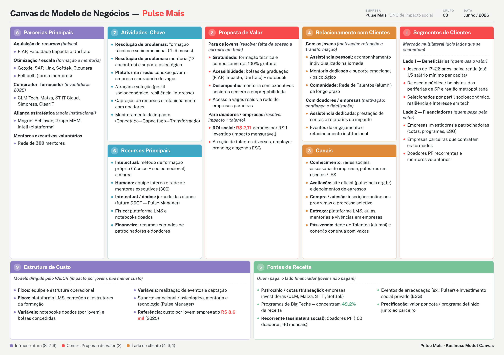<br>
<sub>Fonte: Elaborado pela equipe (2026), com base no Business Model Canvas de Strategyzer.</sub><br>
</div>

## 6.6 Posicionamento

### 6.5.1 Proposta de valor

A proposta de valor do Pulse Manager consiste em centralizar, organizar e transformar os dados da jornada dos jovens atendidos pela Pulse Mais em informações acessíveis, seguras e acionáveis. A aplicação entrega valor ao reduzir a fragmentação de registros, facilitar o acompanhamento individualizado dos alunos e permitir que a equipe gestora tome decisões com base em dados consolidados.
Para os gestores, o principal valor está na possibilidade de acessar uma visão única da trajetória de cada aluno, consultar indicadores institucionais, identificar padrões de engajamento, acompanhar empregabilidade, visualizar riscos de evasão e segmentar perfis para oportunidades específicas. Dessa forma, a plataforma reduz o tempo gasto em buscas manuais e aumenta a qualidade da gestão.
Para os psicólogos, o valor está na organização dos registros de acompanhamento, respeitando restrições de acesso e permitindo uma leitura mais estruturada dos alunos acompanhados. Para os alunos, o valor está no acesso ao próprio histórico, à atualização de dados cadastrais e à visualização de oportunidades relacionadas à sua jornada.
Assim, a aplicação se diferencia por atuar como uma infraestrutura de gestão de impacto social. O Pulse Manager não apenas armazena dados, mas qualifica o acompanhamento dos jovens, fortalece a governança institucional e amplia a capacidade da Pulse Mais de demonstrar resultados para parceiros e apoiadores.


### 6.5.2 Posicionamento e Diferenciação

O Pulse Manager pretende ser percebido como uma plataforma de gestão social inteligente, confiável e acolhedora, voltada à centralização da jornada de jovens em programas de capacitação tecnológica. Seu posicionamento combina seriedade técnica, impacto social e proximidade com os usuários, mantendo coerência com a identidade institucional da Pulse Mais.

Entre os concorrentes diretos e indiretos, podem ser considerados sistemas genéricos de CRM, planilhas compartilhadas, plataformas de gestão educacional, ferramentas de BI e soluções internas desenvolvidas por outras organizações sociais. Embora essas alternativas possam atender partes do problema, muitas não são desenhadas especificamente para acompanhar a jornada completa de jovens em iniciativas de impacto social. Planilhas, por exemplo, oferecem flexibilidade, mas tendem a gerar retrabalho, inconsistências e baixa rastreabilidade. CRMs e sistemas educacionais genéricos podem ser robustos, porém menos aderentes ao contexto de organizações sem fins lucrativos e aos indicadores específicos de impacto, empregabilidade e acompanhamento socioemocional.

A diferenciação do Pulse Manager está na combinação entre centralização de dados, leitura longitudinal da jornada do aluno, dashboards de impacto, segmentação estratégica, portal do aluno e controle de acesso por perfil. A aplicação foi pensada a partir das dores reais da Pulse Mais, o que permite maior aderência ao fluxo operacional da instituição.

A marca deve ser percebida como confiável, clara, humana e orientada a impacto. A identidade pretendida é a de uma solução que aproxima tecnologia e transformação social, oferecendo à equipe mais controle sobre os dados e aos jovens maior visibilidade sobre sua trajetória. A percepção de valor desejada é a de uma plataforma essencial para transformar dados dispersos em acompanhamento qualificado, governança institucional e evidências concretas de impacto.

## 6.7 Estratégia de Marketing

Os 4Ps são um modelo de estratégia que organiza as principais decisões de marketing em 4 elementos diferentes, sendo eles: Produto, Preço, Praça e Promoção. O produto seria o que a pessoa está oferecendo, dentre um serviço/produto; o preço seria quanto a pessoa está cobrando por esse serviço/produto; a praça seria a localidade de onde o produto/serviço está sendo oferecido, sendo ela online ou física; e, por fim, a promoção seria como o dono do produto/serviço faz o contato com o cliente, seja por redes sociais, publicidade ou outros meios.
Produto: Nosso grupo teve como solução a plataforma web Pulse Manager, que centraliza os dados institucionais e acadêmicos da Pulse Mais, atuando como uma Single Source of Truth. Entre as principais funcionalidades estão o cadastro, a edição de dados e a consulta de alunos e ex-alunos (RF001-RF003); a consolidação do histórico completo da jornada, formação, frequência, eventos, empregabilidade e ensino superior (RF004-RF008); o dashboard de indicadores de impacto, com métricas de empregabilidade, conclusão, evasão e acesso ao ensino superior (RF012-RF016); o portal do aluno para consulta e atualização do próprio perfil (RF017-RF018); e o módulo de saúde mental com acesso exclusivo ao psicólogo (RF009-RF022). O principal benefício é eliminar a fragmentação de informações dispersas em grandes planilhas, reduzindo o retrabalho e acelerando a tomada de decisão baseada em dados. Já os nossos diferenciais são: uma agenda institucional para os gestores (RF020-RF021), na qual eles podem se organizar melhor em seu dia a dia e, ao mesmo tempo, enviar as notificações de eventos, aulas obrigatórias e não obrigatórias para os alunos. Com isso, nosso outro diferencial é a aba de notificações aos alunos, na qual cada aluno consegue ter uma noção de quando será sua próxima aula ou evento e se deve participar ou não.
Preço: A Pulse Manager não é monetizada junto aos seus usuários, pois opera em uma lógica de terceiro setor na qual quem usa não é quem paga. Há duas camadas de entregas gratuitas: primeiro, nós (alunos do Inteli), que entregamos a aplicação web à Pulse Mais sem custo, como projeto acadêmico; e a Pulse Mais, por sua vez, oferece o serviço gratuitamente aos jovens, coerentemente com a sua missão social. Portanto, nem o aluno nem a ONG pagam pelo uso do serviço. Quem sustenta a operação são terceiros, ou seja, doadores, empresas parceiras e até mesmo patrocinadores da ONG Pulse Mais.
Praça: A Pulse Manager será distribuída como uma aplicação web acessível diretamente pelo navegador, sendo eles: Google Chrome, Edge, Firefox… E a interface é otimizada para o uso em desktop, ambiente predominante da equipe de trabalho da Pulse Mais. O acesso é segmentado por perfil: a equipe interna e os psicólogos utilizam as funcionalidades de gestão, enquanto alunos e ex-alunos acessam o portal restrito por meio de um link próprio. A distribuição ocorre de forma direta ao parceiro, ou seja, sem marketplace e lojas, aproveitando, assim, os próprios canais já existentes da ONG.
Promoção: A divulgação dos produtos da ONG para os alunos é feita pelo onboarding e pelo treinamento da equipe Pulse Mais. A segunda estratégia é a divulgação do portal do aluno pela própria instituição, ou seja, por e-mail e redes sociais; e a terceira estratégia é uma estratégia de marketing e relacionamento, com conteúdo voltado a doadores e parceiros.

# <a name="c7"></a>7. Conclusões e trabalhos futuros (sprint 5)

_Escreva de que formas a solução da aplicação web atingiu os objetivos descritos na seção 2 deste documento. Indique pontos fortes e pontos a melhorar de maneira geral._

_Relacione os pontos de melhorias evidenciados nos testes com planos de ações para serem implementadas. O grupo não precisa implementá-las, pode deixar registrado aqui o plano para ações futuras_

_Relacione também quaisquer outras ideias que o grupo tenha para melhorias futuras_

# <a name="c8"></a>8. Referências 

IBGE- INSTITUTO BRASILEIRO DE GEOGRAFIA E ESTATÍSTICA. **Uma em cada quatro mulheres de 15 a 29 anos não estudava e nem estava ocupada em 2023**. Agência IBGE Notícias, 2024. Disponível em: [https://agenciadenoticias.ibge.gov.br/agencia-noticias/2012-agencia-de-noticias/noticias/39531-uma-em-cada-quatro-mulheres-de-15-a-29-anos-nao-estudava-e-nem-estava-ocupada-em-2023](https://agenciadenoticias.ibge.gov.br/agencia-noticias/2012-agencia-de-noticias/noticias/39531-uma-em-cada-quatro-mulheres-de-15-a-29-anos-nao-estudava-e-nem-estava-ocupada-em-2023). Acesso em: 3 jun. 2026.

IBGE- INSTITUTO BRASILEIRO DE GEOGRAFIA E ESTATÍSTICA. **Indicadores educacionais avançam em 2024, mas atraso escolar aumenta**. Agência IBGE Notícias, 2025. Disponível em: [https://agenciadenoticias.ibge.gov.br/agencia-noticias/2012-agencia-de-noticias/noticias/43699-indicadores-educacionais-avancam-em-2024-mas-atraso-escolar-aumenta](https://agenciadenoticias.ibge.gov.br/agencia-noticias/2012-agencia-de-noticias/noticias/43699-indicadores-educacionais-avancam-em-2024-mas-atraso-escolar-aumenta). Acesso em: 8 jun. 2026.

CETIC.BR- CENTRO REGIONAL DE ESTUDOS PARA O DESENVOLVIMENTO DA SOCIEDADE DA INFORMAÇÃO. **TIC Educação**. São Paulo: Cetic.br, [s.d.]. Disponível em: [https://cetic.br/pesquisa/educacao/](https://cetic.br/pesquisa/educacao/). Acesso em: 8 jun. 2026.


ABES; IDC. Mercado de TI no Brasil cresce 18,5% em 2025, e País segue líder na América Latina. São Paulo: ABES, 2026. Disponível em: https://abes.org.br/mercado-de-ti-no-brasil-cresce-185-em-2025-e-pais-segue-lider-na-america-latina/. Acesso em: 8 jun. 2026.

BRASIL. Lei nº 13.709, de 14 de agosto de 2018. Lei Geral de Proteção de Dados Pessoais (LGPD). Brasília, DF: Presidência da República, 2018. Disponível em: https://www.planalto.gov.br/ccivil_03/_ato2015-2018/2018/lei/l13709.htm. Acesso em: 8 jun. 2026.

DISTRITO. EdTech Report 2024. São Paulo: Distrito, 2024. Disponível em: https://materiais.distrito.me/report/edtech-report-2024. Acesso em: 8 jun. 2026.

DISTRITO. EdTech Report 2025. São Paulo: Distrito, 2025. Disponível em: https://materiais.distrito.me/report/edtech-report. Acesso em: 8 jun. 2026.

EXPRESS. Express: Node.js web application framework. 2026. Disponível em: https://expressjs.com/en/. Acesso em: 8 jun. 2026.

GOOGLE FONTS. Anton. 2026. Disponível em: https://fonts.google.com/specimen/Anton. Acesso em: 8 jun. 2026.

GOOGLE FONTS. Poppins. 2026. Disponível em: https://fonts.google.com/specimen/Poppins. Acesso em: 8 jun. 2026.

IBGE. Indicadores educacionais avançam em 2024, mas atraso escolar aumenta. Agência IBGE Notícias, Rio de Janeiro, 13 jun. 2025. Disponível em: https://agenciadenoticias.ibge.gov.br/agencia-noticias/2012-agencia-de-noticias/noticias/43699-indicadores-educacionais-avancam-em-2024-mas-atraso-escolar-aumenta. Acesso em: 8 jun. 2026.

IPEA. Brasil possui mais de 897 mil organizações da sociedade civil ativas. Brasília, DF: Instituto de Pesquisa Econômica Aplicada, 5 fev. 2025. Disponível em: https://www.ipea.gov.br/portal/categorias/45-todas-as-noticias/noticias/15591-brasil-possui-mais-de-897-mil-organizacoes-da-sociedade-civil-ativas. Acesso em: 8 jun. 2026.

IPEA. Estudo analisa a importância do terceiro setor para o PIB. Mapa das Organizações da Sociedade Civil, Brasília, DF: Instituto de Pesquisa Econômica Aplicada, 2023. Disponível em: https://mapaosc.ipea.gov.br/post/164/estudo-analisa-a-importancia-do-terceiro-setor-para-o-pib. Acesso em: 8 jun. 2026.

ISO. ISO/IEC 25010:2011: Systems and software engineering — Systems and software Quality Requirements and Evaluation (SQuaRE) — System and software quality models. Genebra: International Organization for Standardization, 2011. Disponível em: https://www.iso.org/standard/35733.html. Acesso em: 8 jun. 2026.

JEST. Jest: delightful JavaScript testing. 2026. Disponível em: https://jestjs.io/. Acesso em: 8 jun. 2026.

LUCIDE. Lucide Icons. 2026. Disponível em: https://lucide.dev/. Acesso em: 8 jun. 2026.

NODE.JS. Node.js. 2026. Disponível em: https://nodejs.org/en. Acesso em: 8 jun. 2026.

POSTGRESQL GLOBAL DEVELOPMENT GROUP. PostgreSQL Documentation. 2026. Disponível em: https://www.postgresql.org/docs/. Acesso em: 8 jun. 2026.

STRATEGYZER. Value Proposition Canvas: download the official template. 2026. Disponível em: https://www.strategyzer.com/library/the-value-proposition-canvas. Acesso em: 8 jun. 2026.

SUPERTEST. Supertest. npm, 2026. Disponível em: https://www.npmjs.com/package/supertest. Acesso em: 8 jun. 2026.

TYPESCRIPT. TypeScript Documentation. 2026. Disponível em: https://www.typescriptlang.org/docs/. Acesso em: 8 jun. 2026.

WEBAIM. Contrast Checker. 2026. Disponível em: https://webaim.org/resources/contrastchecker/. Acesso em: 8 jun. 2026.

WORLD WIDE WEB CONSORTIUM. Web Content Accessibility Guidelines (WCAG) 2.1. W3C Recommendation, 2018. Disponível em: https://www.w3.org/TR/WCAG21/. Acesso em: 8 jun. 2026.


# <a name="c9"></a>Anexos

_Inclua aqui quaisquer complementos para seu projeto, como diagramas, imagens, tabelas etc. Organize em sub-tópicos utilizando headings menores (use ## ou ### para isso)_
