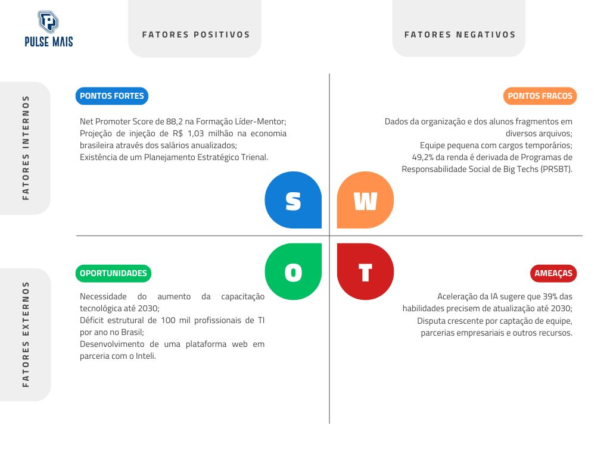

# WAD - Web Application Document - Módulo 2 - Inteli

**_Os trechos em itálico servem apenas como guia para o preenchimento da seção. Por esse motivo, não devem fazer parte da documentação final_**

## Nome do Grupo

#### Nomes dos integrantes do grupo

## Sumário

[1. Introdução](#c1)

[2. Visão Geral da Aplicação Web](#c2)

[3. Projeto Técnico da Aplicação Web](#c3)

[4. Desenvolvimento da Aplicação Web](#c4)

[5. Testes da Aplicação Web](#c5)

[6. Estudo de Mercado e Plano de Marketing](#c6)

[7. Conclusões e trabalhos futuros](#c7)

[8. Referências](#c8)

[Anexos](#c9)

 

# 1. Introdução (sprints 1 a 5)

A Pulse Mais é uma organização sem fins lucrativos voltada à capacitação profissional de jovens que desejam seguir na área de tecnologia. Ao analisar mais profundamente o contexto da organização é identificada uma problemática central em relação à organização operacional: a descentralização dos dados institucionais, divididos em múltiplos arquivos em diferentes formatos, de planilhas à relatórios, e sistemas externos. Essa fragmentação de informações compromete diretamente a eficiência na tomada de decisões da equipe, dificulta o acompanhamento individual dos jovens atingidos e reduz a oportunidade da instituição de explicitar o impacto de forma estruturada em apresentações ao público e parceiros.

A partir desta problemática, o grupo propõe o desenvolvimento de uma plataforma web voltada à organização e gestão dos dados institucionais e dos alunos que possibilita a centralização das informações em um ambiente e o monitoramento dos indicadores empresariais, contribuindo para maior eficiência nos processos desenvolvidos pela equipe.

# 2. Visão Geral da Aplicação Web (sprint 1)

## 2.1. Escopo do Projeto (sprints 1 e 4)

### 2.1.1. Modelo de 5 Forças de Porter (sprint 1)

**Ameaça de novos entrantes - Ameaça Baixa**

A entrada no segmento de ONGs voltadas à capacitação no mercado tecnológico se torna de difícil execução devido aos desafios burocráticos, além da captação de mentores e entidades doadoras. Para além disso, há uma expansão de instituições voltadas ao aprendizado e tecnologia no Brasil, de acordo com a Edtech Report 2024 da Distrito, indo de 197 para 619 entre 2013 e 2024. Apesar disso, a popularização da IA Generativa facilitou a construção de novas ferramentas voltadas ao ensino e capacitação tecnológica de jovens, permitindo a construção rápida de novas ferramentas e menos infraestrutura física; explicitando que, apesar das barreiras, há pontos que tornam a ameaça moderada.

**Ameaça de produtos substitutos - Ameaça Alta**

É identificada uma alta ameaça de produtos substitutos devido ao crescimento da disponibilidade de conteúdos onlines, como cursos gratuitos e vídeos em plataformas como Youtube, além da existência de programas governamentais, como o Pronatec. Para além disso, há também a substituição através de outras organizações que oferecem serviços semelhantes, classificando a ameaça como alta.

**Poder de barganha dos fornecedores - Poder Alto**

Os fornecedores deste segmento são definidos como os mentores e equipe voluntários e empresas parceiras doadoras, que podem exercer grande poder sobre as operações. Para além da existência de dificuldades relacionadas à captação e mantenimento de colaboradores, a equipe também influencia na credibilidade institucional e sua substituição é de alto custo de tempo, ocasionando um alto poder de barganha da parte dos fornecedores.

**Poder de barganha dos clientes - Poder Baixo-Médio**

Os clientes são classificados como os jovens atingidos, que possuem, em muitos casos, acesso limitado a alternativas de capacitação acadêmica em tecnologia. Além disso, há a classificação de 88,2 no NPS (Net Promoter Score) da Formação Líder-Mentor, que indica alta satisfação e baixo poder de negociação individual.

**Rivalidade entre concorrentes - Rivalidade Alta**

No segmento de aprendizado voltado à tecnologia, há uma maior disputa por visibilidade entre outras, financiamento de empresas e captação de talentos. Como exemplo estão instituições como o Códigos do Amanhã, que oferece serviços em nichos semelhantes, além de competir por doadores e ter perfis semelhantes de beneficiários, ocasionando a classificação de alta rivalidade.

### 2.1.2. Análise SWOT da Instituição Parceira (sprint 1)

Figura 2: Análise SWOT. 
 
Fonte: Autoria própria (2026).  

**Ponto Fortes** 

Um dos principais pontos forte da instituição é evidenciado pelo NPS de 88,2 na Formação Líder-Mentor que explicita uma fidelidade e alto nível de satisfação dos participantes envolvidos com a instituição, sendo eles os clientes e doadores; Além disso, também há o retorno financeiro de R$1,03 milhão na economia brasileira reforça o impacto social real e mensurável da organização e a documentação voltada ao Planejamento Estratégico Anual, que é reconhecida como um diferencial de mercado que confere à instituição maior previsibilidade e coerência na execução de suas iniciativas. 

**Pontos Fracos**

Entre os pontos fracos da instituição, um dos principais é a fragmentação dos dados organizacionais em diversos arquivos que compromete diretamente a escalabilidade operacional das operações e a eficiência na tomada de decisões devido à dificuldade de realizar análises a partir de dados agrupados. Para além disso, a equipe composta em sua maioria por cargos temporários também apresenta fraqueza relacionada à instabilidade na continuidade de processos devido à alta rotatividade; e a principal fonte de receita representa uma dependência e vulnerabilidade financeira causada por decisões fora do controle direto da organização.

**Oportunidades**

São identificadas oportunidades a partir de diversos pontos de importância, sendo eles a necessidade do aumento da capacitação tecnológica até 2030 e o déficit estrutural de 100 mil profissionais de TI no Brasil, que confira uma alta demanda de mercado que auxilia a empresa à se estabelecer em um cenário externo propício ao seu crescimento. Adicionalmente, o desenvolvimento de uma plataforma web com o Inteli pode ser reconhecido como ponto de diferenciação que possibilita crescimento na eficiência na tomada de decisão.

**Ameaças**

São identificadas ameaças a partir de fatores externos à organização, sendo a principal ameaça a necessidade de atualização das habilidades profissionais até 2030 devido ao crescimento da Inteligência Artificial que impõe à instituição a necessidade de constante revisão curricular para evitar desatualização e manter a relevância competitiva. Paralelamente, a disputa crescente por captação de equipe qualificada, parcerias empresariais e demais recursos representa risco ao crescimento sustentável, pois o ambiente de alta competitividade exige que a instituição fortaleça sua proposta de valor e consolide alianças estratégicas para preservar seu posicionamento no mercado. 

### 2.1.3. Solução (sprints 1 a 5)

*Explique detalhadamente os seguintes aspectos (até 60 palavras por item):*
1. Problema a ser resolvido
2. Dados disponíveis (mencionar fonte e conteúdo; se não houver, indicar “não se aplica”)
3. Solução proposta
4. Forma de utilização da solução
5. Benefícios esperados
6. Critério de sucesso e como será avaliado

### 2.1.4. Value Proposition Canvas (sprint 1): 
*Sem limite de palavras — usar template do curso*

*Elaborar o Value Proposition Canvas com base na proposta de solução definida.*

### 2.1.5. Matriz de Riscos do Projeto (sprint 1)

*Sem limite de palavras — usar template do curso*

*Registre na matriz os riscos identificados no projeto.*

## 2.2. Personas (sprint 1)

*Posicione aqui suas Personas em forma de texto markdown com imagens, ou como imagem de template preenchido. Atualize esta seção ao longo do módulo se necessário.*

## 2.3. User Stories (sprints 1 a 5)

*Posicione aqui a lista de User Stories levantadas para o projeto. Siga o template de User Stories e utilize a mesma referência USXX no roadmap de seu quadro Kanban. Indique todas as User Stories mapeadas, mesmo aquelas que não forem implementadas ao longo do projeto. Não se esqueça de explicar o INVEST das 5 User Stories prioritárias*

*ATUALIZE ESTA SEÇÃO SEMPRE QUE ALGUMA DEMANDA MUDAR EM SEU PROJETO*

*Template de User Story*
Identificação | USXX (troque XX por numeração ordenada das User Stories)
--- | ---
Persona | nome da Persona
User Story | "como (papel/perfil), posso (ação/meta), para (benefício/razão)"
Critério de aceite 1 | CR1: descrever cenário + testes de aceite
Critério de aceite 2 | CR2: descrever cenário + testes de aceite
Critério de aceite ... | CR...
Critérios INVEST | *(Por que é Independente? Por que é Negociável? Por que é Valorosa? Por que é Estimável? Por que é Pequena? Por que é Testável?)*

# 3. Projeto da Aplicação Web (sprints 1 a 5)

## 3.1. Requisitos do Sistema (sprints 1 a 5)

*Esta seção formaliza o que o sistema deve fazer, sob quais regras e com quais qualidades. Atualize a cada sprint conforme os requisitos evoluem.*

### 3.1.1. Requisitos Funcionais (sprint 1, refinar até sprint 5)

Os requisitos funcionais a seguir foram extraídos do Termo de Abertura do Projeto Inteli (TAPI) da Pulse Mais e refinados a partir das conversas iniciais com os pontos focais do parceiro. A priorização (Alta, Média, Baixa) reflete o entendimento de que o núcleo da solução é a gestão centralizada da jornada do aluno pela equipe interna da Pulse Mais, sendo que funcionalidades voltadas ao aluno final ou a integrações e automações periféricas aparecem como prioridade secundária.

| ID | Descrição | Prioridade | Status |
|----|-----------|------------|--------|
| RF001 | O sistema deve permitir o cadastro de alunos e ex-alunos com dados pessoais, acadêmicos, de jornada na Pulse Mais, empregabilidade e engajamento. | Alta | Planejado |
| RF002 | O sistema deve permitir a edição e atualização dos dados cadastrais de um aluno pela equipe Pulse Mais. | Alta | Planejado |
| RF003 | O sistema deve permitir a consulta e listagem dos alunos cadastrados. | Alta | Planejado |
| RF004 | O sistema deve consolidar e apresentar o histórico completo de cada aluno (dados gerais, programas, eventos, empregabilidade e renda) de forma integrada. | Alta | Planejado |
| RF005 | O sistema deve permitir o registro de frequência dos alunos em aulas. | Alta | Planejado |
| RF006 | O sistema deve permitir o registro de participação dos alunos em eventos promovidos pela Pulse Mais. | Alta | Planejado |
| RF007 | O sistema deve permitir o registro de indicadores de empregabilidade do aluno (conquista e retenção de emprego). | Alta | Planejado |
| RF008 | O sistema deve permitir o registro de informações sobre o acesso e permanência do aluno no ensino superior. | Alta | Planejado |
| RF009 | O sistema deve permitir o registro de anotações qualitativas e quantitativas sobre a evolução de cada jovem (mentorias, atendimentos e observações gerais). | Alta | Planejado |
| RF010 | O sistema deve permitir o registro de observações sobre saúde mental e bem-estar do aluno, com acesso restrito ao psicólogo da instituição. | Alta | Planejado |
| RF011 | O sistema deve restringir o acesso às funcionalidades de acordo com o perfil do usuário (ex.: equipe Pulse, psicólogo, aluno). | Alta | Planejado |
| RF012 | O sistema deve permitir a localização e segmentação de alunos com base em múltiplos critérios combinados (ex.: identificação de perfis para oportunidades específicas ou de multiplicadores na rede). | Alta | Planejado |
| RF013 | O sistema deve permitir que a equipe Pulse Mais crie novos campos personalizados no cadastro do aluno, com autonomia. | Alta | Planejado |
| RF014 | O sistema deve apresentar um dashboard consolidando os principais indicadores de impacto da Pulse Mais. | Alta | Planejado |
| RF015 | O sistema deve calcular e apresentar o total de alunos empregados em um período selecionado. | Alta | Planejado |
| RF016 | O sistema deve calcular e apresentar o total de alunos que concluíram um programa em um período selecionado. | Alta | Planejado |
| RF017 | O sistema deve calcular e apresentar indicadores de evasão e risco de evasão por programa ou turma. | Alta | Planejado |
| RF018 | O sistema deve calcular e apresentar indicadores de acesso ao ensino superior dentro da rede de alunos. | Alta | Planejado |
| RF019 | O sistema deve disponibilizar um portal restrito no qual o próprio aluno possa visualizar seus dados cadastrais. | Média | Planejado |
| RF020 | O sistema deve permitir que o aluno atualize informações do seu perfil pelo portal do aluno. | Média | Planejado |
| RF021 | O sistema deve permitir o envio de e-mails informativos e convites para eventos. | Média | Planejado |
| RF022 | O sistema deve permitir o envio de formulários cujas respostas atualizem ou adicionem automaticamente as informações dos alunos. | Baixa | Planejado |

### 3.1.2. Regras de Negócio (sprint 1, refinar até sprint 5)

*Numere e redija as RN de forma implementável e testável. Toda RN deve ter pelo menos um teste automatizado associado a partir da sprint 3.*

| ID   | Descrição | RF associado |
|------|-----------|--------------|
| RN01 | ...       | RF001        |
| RN02 | ...       | RF001        |

### 3.1.3. Requisitos Não Funcionais — 8 Eixos ISO/IEC 25010 (sprints 1 a 5)

*Preencha os 8 eixos. Cada eixo deve ter ao menos um RNF verificável (com métrica, limite ou critério concreto) ou justificativa explícita de ausência. Evolua do conceitual (sprint 1) ao técnico mensurável (sprint 5).*

| Eixo                     | Requisito | Métrica / Critério | Como atendido |
|--------------------------|-----------|--------------------|---------------|
| USAB — Usabilidade       | ...       | ...                | ...           |
| CONF — Confiabilidade    | ...       | ...                | ...           |
| DES — Desempenho         | ...       | p95 < X ms         | ...           |
| SUP — Suportabilidade    | ...       | ...                | ...           |
| SEG — Segurança          | ...       | ...                | ...           |
| CAP — Capacidade         | ...       | ...                | ...           |
| REST — Restrições Design | ...       | ...                | ...           |
| ORG — Organizacionais    | ...       | ...                | ...           |

### 3.1.4. Matriz RF → RN → Endpoint (sprints 3 a 5)

*Matriz de cobertura mostrando quais RN e endpoints implementam cada RF.*

| RF    | RN associadas | Endpoint    | Método |
|-------|---------------|-------------|--------|
| RF001 | RN01, RN02    | `/usuarios` | POST   |

## 3.2. Arquitetura (sprints 1 a 5)

### 3.2.1. Diagrama de Arquitetura (sprints 3 e 4)

*Posicione aqui o diagrama de arquitetura da solução, indicando as camadas principais (Controller, Service, Repository, Model) e suas responsabilidades. Atualize sempre que necessário.*

### 3.2.2. Diagrama de Casos de Uso (sprint 1)

*Apresente o diagrama de casos de uso com atores (boneco), casos (elipse) e as relações `<<include>>` / `<<extend>>` com semântica correta. Consulte a notação de referência em `in02/suporte/use-case_3.0_v1.0.pdf`.*

### 3.2.3. Diagrama de Classes do Domínio (sprint 2)

*Diagrama UML de classes com entidades, atributos, relacionamentos e responsabilidades. Diferencie **associação**, **agregação** (losango vazio), **composição** (losango cheio) e **herança** (triângulo vazio). Multiplicidade explícita em toda associação.*

### 3.2.4. Diagrama de Sequência UML (sprint 3)

*Ao menos um fluxo prioritário, mostrando a interação entre as camadas Controller → Service → Repository → Banco. Linhas de vida verticais, ativação correta, mensagens síncronas e assíncronas diferenciadas, retornos tracejados.*

### 3.2.5. Diagrama de Atividades ou Estados (sprint 3)

*Ao menos um fluxo relevante em UML ou BPMN. Use a notação da ferramenta escolhida de forma consistente (sem misturar convenções).*

### 3.2.6. Diagrama de Implantação (sprints 4 e 5)

*Diagrama UML de deployment mostrando nós físicos, artefatos e canais de comunicação. Representa a visão Engineering + Technology do RM-ODP.*

### 3.2.7. Padrões de Projeto Aplicados (sprints 3 a 5)

*Documente os design patterns utilizados (Repository, Strategy, Factory, DTO etc.) e quais princípios SOLID se aplicam. Justifique a adoção de cada padrão com base em uma necessidade real do projeto.*

## 3.3. Wireframes (sprint 2)

*Posicione aqui as imagens do wireframe construído para sua solução e, opcionalmente, o link para acesso (mantenha o link sempre público para visualização)*

## 3.4. Guia de estilos (sprint 3)

*Descreva aqui orientações gerais para o leitor sobre como utilizar os componentes do guia de estilos de sua solução*

### 3.4.1 Cores

*Apresente aqui a paleta de cores, com seus códigos de aplicação e suas respectivas funções*

### 3.4.2 Tipografia

*Apresente aqui a tipografia da solução, com famílias de fontes e suas respectivas funções*

### 3.4.3 Iconografia e imagens 

*(esta subseção é opcional, caso não existam ícones e imagens, apague esta subseção)*

*posicione aqui imagens e textos contendo exemplos padronizados de ícones e imagens, com seus respectivos atributos de aplicação, utilizadas na solução*

## 3.5 Protótipo de alta fidelidade (sprint 3)

*posicione aqui algumas imagens demonstrativas de seu protótipo de alta fidelidade e o link para acesso ao protótipo completo (mantenha o link sempre público para visualização)*

## 3.6. Modelagem do banco de dados (sprints 2 e 4)

### 3.6.1. Modelo Entidade-Relacionamento (ER) (sprint 2)

*Apresente o modelo ER conceitual com entidades, atributos e relacionamentos. Use notação consistente (Chen ou Crow's Foot — não misture).*

### 3.6.2. Diagrama Entidade-Relacionamento (DER) (sprint 2)

*Posicione aqui o DER com cardinalidades explícitas em ambos os lados de cada relação e identificação de PK/FK. O DER deve ser coerente com o diagrama de classes (3.2.3).*

### 3.6.3. Modelo Relacional e Modelo Físico (sprints 2 e 4)

*Posicione aqui os diagramas de modelos relacionais do banco de dados, apresentando todos os esquemas de tabelas e suas relações. Inclua as migrations DDL numeradas e reproduzíveis (`CREATE TABLE`, `CREATE INDEX`, constraints `NOT NULL`, `UNIQUE`, `FOREIGN KEY`, `CHECK`). Utilize texto para complementar suas explicações quando necessário.*

### 3.6.4. Consultas SQL e lógica proposicional (sprint 2)

*posicione aqui uma lista de consultas SQL compostas, realizadas pelo back-end da aplicação web, com sua respectiva lógica proposicional, descrita conforme template abaixo. Lembre-se que para usar LaTeX em markdown, basta você colocar as expressões entre $ ou $$*

*Template de SQL + lógica proposicional*
#1 | ---
--- | ---
**Expressão SQL** | SELECT * FROM suppliers WHERE (state = 'California' AND supplier_id <> 900) OR (supplier_id = 100); 
**Proposições lógicas** | $A$: O estado é 'California' (state = 'California')   $B$: O ID do fornecedor não é 900 (supplier_id ≠ 900)   $C$: O ID do fornecedor é 100 (supplier_id = 100)
**Expressão lógica proposicional** | $(A \land B) \lor C$
**Tabela Verdade** | <table> <thead> <tr> <th>$A$</th> <th>$B$</th> <th>$C$</th> <th>$(A \land B)$</th> <th>$(A \land B) \lor C$</th> </tr> </thead> <tbody> <tr> <td>F</td> <td>F</td> <td>F</td> <td>F</td> <td>F</td> </tr> <tr> <td>F</td> <td>F</td> <td>V</td> <td>F</td> <td>V</td> </tr> <tr> <td>F</td> <td>V</td> <td>F</td> <td>F</td> <td>F</td> </tr> <tr> <td>F</td> <td>V</td> <td>V</td> <td>F</td> <td>V</td> </tr> <tr> <td>V</td> <td>F</td> <td>F</td> <td>F</td> <td>F</td> </tr> <tr> <td>V</td> <td>F</td> <td>V</td> <td>F</td> <td>V</td> </tr> <tr> <td>V</td> <td>V</td> <td>F</td> <td>V</td> <td>V</td> </tr> <tr> <td>V</td> <td>V</td> <td>V</td> <td>V</td> <td>V</td> </tr> </tbody> </table>

*Dica: edite a tabela verdade fora do markdown, para ter melhor controle*

## 3.7. WebAPI e endpoints (sprints 3 e 4)

*Utilize um link para outra página de documentação contendo a descrição completa de cada endpoint. Ou descreva aqui cada endpoint criado para seu sistema.* 

*Cada endpoint deve conter endereço, método (GET, POST, PUT, PATCH, DELETE), header, body, formatos de response e os status codes possíveis (200, 201, 204, 400, 401, 403, 404, 409, 422, 500).*

## 3.8. Autenticação, Autorização e Resiliência (sprint 5)

### 3.8.1. Autenticação

*Descreva o fluxo de autenticação implementado: persistência de senha com hash bcrypt/argon2 (parâmetros de custo explícitos e justificados), validação de credenciais e criação de sessão. Senhas em texto plano no banco não são aceitas.*

### 3.8.2. Controle de sessão

*Descreva o controle de sessão baseado em `session id` persistido em tabela própria, com expiração. Se optar por JWT, justifique a escolha explicando os trade-offs (stateless, não revogável, payload exposto).*

### 3.8.3. Autorização

*Descreva as regras de autorização por rota e por operação, baseadas no perfil do usuário autenticado. A verificação deve ocorrer no backend — o frontend nunca é fonte de verdade para autorização.*

### 3.8.4. Estratégias de Resiliência

*Descreva as estratégias aplicadas no tratamento de falhas de rede: timeout, retry com backoff exponencial, circuit breaker e idempotência em operações críticas (`PUT`, `DELETE`, operações de pagamento etc.).*

## 3.9. Matriz de Rastreabilidade (RTM) (sprints 3 a 5)

*A RTM consolida a rastreabilidade completa do sistema. Um elo quebrado invalida toda a cadeia — mantenha-a atualizada a cada sprint. A partir da sprint 3 não deve haver lacunas nos fluxos centrais.*

| Persona | RF    | RN   | Endpoint    | Tela     | Teste | Evidência        |
|---------|-------|------|-------------|----------|-------|------------------|
| ...     | RF001 | RN01 | `/usuarios` | Cadastro | CT02  | print, log, relatório de cobertura |

# 4. Desenvolvimento da Aplicação Web

## 4.1. Primeira versão da aplicação web (sprint 3)

*Descreva e ilustre aqui o desenvolvimento da primeira versão do sistema web. Utilize prints de tela para ilustrar. Indique obrigatoriamente: (a) o que foi implementado, (b) o que não foi concluído, (c) dificuldades técnicas enfrentadas e próximos passos.*

## 4.2. Segunda versão da aplicação web (sprint 4)

*Descreva e ilustre aqui o desenvolvimento da segunda versão do sistema web, com foco no que foi consolidado entre a primeira versão funcional e o sistema operacional integrado. Utilize prints de tela para ilustrar. Indique obrigatoriamente: (a) o que foi implementado, (b) o que não foi concluído, (c) dificuldades técnicas enfrentadas e próximos passos.*

## 4.3. Versão final da aplicação web (sprint 5)

*Descreva e ilustre aqui o desenvolvimento da versão final do sistema web, com foco em refatorações, correções finais e na camada de autenticação/autorização entregue. Utilize prints de tela para ilustrar. Indique obrigatoriamente: (a) o que foi refinado ou adicionado desde a sprint 4, (b) pendências remanescentes, (c) dificuldades técnicas enfrentadas.*

# 5. Testes

## 5.1. Relatório de testes de integração de endpoints automatizados (sprint 4)

*Liste e descreva os testes automatizados dos endpoints criados e planejados para sua solução, implementados com **Jest**. Cubra as duas abordagens:*

- ***White-box*** *— testes unitários de Service que exercitam ramos internos, exceções e regras de negócio (conhecimento da implementação).*
- ***Black-box*** *— testes de integração dos endpoints via Jest + Supertest, verificando apenas o contrato HTTP (status, body, efeito observável), sem depender da implementação interna.*

*Posicione aqui também o relatório de cobertura de testes Jest se houver (através de link ou transcrito para estrutura markdown).*

## 5.2. Testes de usabilidade (sprint 5)

### 5.2.1. Relatório de testes de guerrilha

*Posicione aqui as tabelas com enunciados de tarefas, etapas e resultados de testes de usabilidade. Ou utilize um link para seu relatório de testes (mantenha o link sempre público para visualização).*

### 5.2.2. Relatório de testes SUS (System Usability Scale)

*Posicione aqui o relatório dos testes SUS realizados.*

# 6. Estudo de Mercado e Plano de Marketing (sprint 4)

## 6.1 Resumo Executivo

*Preencher com até 300 palavras, sem necessidade de fonte*

*Apresente de forma clara e objetiva os principais destaques do projeto: oportunidades de mercado, diferenciais competitivos da aplicação web e os objetivos estratégicos pretendidos.*

## 6.2 Análise de Mercado

*a) Visão Geral do Setor (até 250 palavras)*
*Contextualize o setor no qual a aplicação está inserida, considerando aspectos econômicos, tecnológicos e regulatórios. Utilize fontes confiáveis.*

*b) Tamanho e Crescimento do Mercado (até 250 palavras)*
*Apresente dados quantitativos sobre o tamanho atual e projeções de crescimento do mercado. Utilize fontes confiáveis.*

*c) Tendências de Mercado (até 300 palavras)*
*Identifique e analise tendências relevantes (tecnológicas, comportamentais e mercadológicas) que influenciam o setor. Utilize fontes confiáveis.*

## 6.3 Análise da Concorrência

*a) Principais Concorrentes (até 250 palavras)*
*Liste os concorrentes diretos e indiretos, destacando suas principais características e posicionamento no mercado.*

*b) Vantagens Competitivas da Aplicação Web (até 250 palavras)*
*Descreva os diferenciais da sua aplicação em relação aos concorrentes, sem necessidade de citação de fontes.*

## 6.4 Público-Alvo

*a) Segmentação de Mercado (até 250 palavras)*
*Descreva os principais segmentos de mercado a serem atendidos pela aplicação. Utilize bases de dados e fontes confiáveis.*

*b) Perfil do Público-Alvo (até 250 palavras)*
*Caracterize o público-alvo com dados demográficos, psicográficos e comportamentais, incluindo necessidades específicas. Utilize fontes obrigatórias.*

## 6.5 Posicionamento

*a) Proposta de Valor Única (até 250 palavras)*
*Defina de maneira clara o que torna a sua aplicação única e valiosa para o mercado.*

*b) Estratégia de Diferenciação (até 250 palavras)*
*Explique como sua aplicação se destacará da concorrência, evidenciando a lógica por trás do posicionamento.*

## 6.6 Estratégia de Marketing 

*a) Produto/Serviço (até 200 palavras)*
*Descreva as funcionalidades, benefícios e diferenciais da aplicação*

*b) Preço (até 200 palavras)*
*Explique o modelo de precificação adotado e justifique com base nas análises anteriores.*

*c) Praça (Distribuição) (até 200 palavras)*
*Apresente os canais digitais utilizados para distribuir e entregar a aplicação ao público.*

*d) Promoção (até 200 palavras)*
*Descreva as estratégias digitais planejadas, como SEO, redes sociais, marketing de conteúdo e campanhas pagas.*

# 7. Conclusões e trabalhos futuros (sprint 5)

*Escreva de que formas a solução da aplicação web atingiu os objetivos descritos na seção 2 deste documento. Indique pontos fortes e pontos a melhorar de maneira geral.*

*Relacione os pontos de melhorias evidenciados nos testes com planos de ações para serem implementadas. O grupo não precisa implementá-las, pode deixar registrado aqui o plano para ações futuras*

*Relacione também quaisquer outras ideias que o grupo tenha para melhorias futuras*

# 8. Referências (sprints 1 a 5)

_Incluir as principais referências de seu projeto, para que seu parceiro possa consultar caso ele se interessar em aprofundar. Um exemplo de referência de livro e de site:_ 

LUCK, Heloisa. Liderança em gestão escolar. 4. ed. Petrópolis: Vozes, 2010.  
SOBRENOME, Nome. Título do livro: subtítulo do livro. Edição. Cidade de publicação: Nome da editora, Ano de publicação.  

INTELI. Adalove. Disponível em: https://adalove.inteli.edu.br/feed. Acesso em: 1 out. 2023  
SOBRENOME, Nome. Título do site. Disponível em: link do site. Acesso em: Dia Mês Ano

# Anexos

*Inclua aqui quaisquer complementos para seu projeto, como diagramas, imagens, tabelas etc. Organize em sub-tópicos utilizando headings menores (use ## ou ### para isso)*

